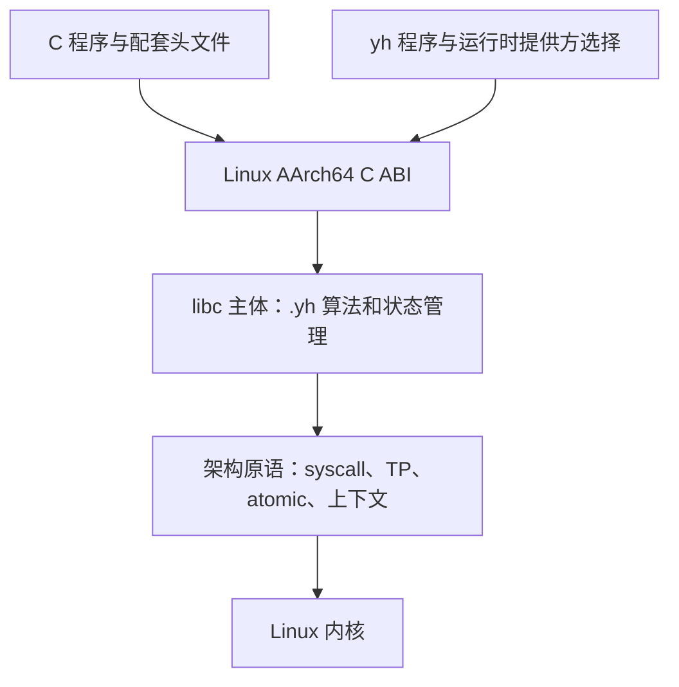

# yh 实现 libc：可行性与阻塞点分析

状态：分析完成；十个混合实参调用缺陷已于 2026-10-02 修复，见
[完成记录](yh-混合参数调用修复-2026-10-02.md)。2026-10-03 已补齐
[自动 C ABI](../03-design/yh-extern自动C-ABI设计.md) 的固定参数聚合/HFA、
浮点栈溢出与函数指针返回；libc 主体尚未实施。目标已由用户确认：
**Linux/AArch64 上可独立链接、兼容 C ABI 的 libc**。

原始分析基线为仓库 `dcfcac1` 和分析时工作区；参考 musl **1.2.6**，源码提交
`9fa28ece75d8a2191de7c5bb53bed224c5947417`。源码镜像与全部临时探针在
`tmp/libc-analysis/`；原分析轮未修改编译器实现、语法或入库种子。

## 结论与目标边界

这条路线可行。yh 已能编写整数、指针、字节循环、普通结构体和 f32/f64
算法，并能导出固定参数 C 函数、直接发射 Linux 系统调用。小型静态子集
已经有运行证据；完整 libc 仍被 C 调用边界、机器原语和交付链路阻塞。

当前不能用现有纯 `.yh` 能力完整重写 musl。建议 libc 主体使用 `.yh`，
为架构相关操作提供受约束的编译器 intrinsic 或少量独立汇编对象。musl
自身也有启动、clone、setjmp、信号恢复、浮点环境等架构层。

“独立”首先按最终 Linux ELF 的运行依赖验收：使用自有启动对象和 libc，
静态程序没有 `PT_INTERP`、`DT_NEEDED` 和未解决符号。开发阶段可以使用
外部汇编器、链接器和 C 编译器；编译器自身在 macOS 使用 libSystem，
与目标程序是否依赖宿主 libc 是两个不同问题。自有汇编器/链接器继续
按现有 R4 路线推进，不作为开始编写 libc 算法的前置条件。

C ABI 兼容需要同时提供正确的函数调用约定、数据符号和配套 C 头文件。
本分析以使用目标 sysroot 重新编译的 C 程序为验收对象；已有 glibc
二进制的符号版本与运行时兼容，需要另立范围。动态 libc 单独分期。

## 已具备的基础

| 能力 | 代码依据 | 可支撑的工作 |
| --- | --- | --- |
| LP64、小端，int 32 位、指针/i64/u64 64 位 | `compiler/gen/target.yh:27` | size_t/ssize_t、文件描述符、指针和常见结构布局 |
| 固定参数 C 标量与指针导出 | `compiler/gen/symbols.yh:499`、`compiler/parse/parse_decl.yh:581` | 字符串/内存函数、常见固定参数 POSIX 接口 |
| Linux 原始 syscall，七个 u64 实参、i64 返回 | `compiler/gen/symbols.yh:1025`、`compiler/gen/emit_arm64.yh:798` | read/write/openat/close、mmap/munmap、futex 等内核入口 |
| 自有 memcpy/strlen 与 mmap 分配入口 | `compiler/gen/emit_runtime_memory.yh:115` | 最小字节运行时和简单分配器参照 |
| 无 main 的库项目模块发射 | `compiler/cmd/module_build.yh:1114`、`compiler/cmd/module_worker.yh:9` | 库模块源码与接口生成 |
| 项目 C 源、预编译对象混编 | `compiler/cmd/link_cache.yh:140` | 迁移期接入架构对象、C 调用方测试 |

`libs/` 当前是 yh 标准库基础层。`memory` 包装自有运行时；`os` 多数接口
仍引用宿主函数，`math` 转发宿主数学符号，`time` 使用 Darwin 常量。
这些模块尚未构成独立 Linux libc。

## 阻塞矩阵

| 优先级 | 阻塞点 | 对 libc 的影响 | 最小补齐方向 |
| --- | --- | --- | --- |
| 已解除 | extern 固定参数标量栈溢出 | 混合参数、浮点溢出、Linux/Darwin 窄栈参数已双向通过 | 持续回归；普通 yh 浮点溢出限制保持现状 |
| P0 | 产物与链接配置不足 | 库 build 只产 `.s/.s.i`；默认可执行链接仍使用宿主 CRT/libc | 独立对象/归档出口、crt 输入、静态链接配置与头文件/sysroot |
| P1 | 用户 C 裸变参被拒绝 | printf/scanf/open/fcntl/ioctl 等变参接口无法完整定义 | C 变参调用及被调方支持、默认提升、va_list 与 va_arg |
| 已解除 | 现有类型的 C 聚合/HFA 与函数指针返回 | 自动分类、双向聚合返回、回调与字段调用已通过；div_t 形状已验收 | libc 接口主体另行实现；binary128、向量等未表达类型仍不支持 |
| P1 | C 数据符号缺少声明/导出能力 | stdin/stdout/stderr、environ 等符号无法直接用现有模块变量交付 | 专用 C 数据链接设计，或先用小型架构对象定义数据符号 |
| P1 | 缺 TP 读写、原子操作及屏障契约 | 每线程 errno、pthread、stdio/分配器锁无法完整实现 | get/set TP、原子 load/store/CAS、内存序与 IR 副作用契约 |
| P1 | 缺入口/换栈/上下文恢复原语 | 完整 CRT、clone 子线程入口、setjmp/longjmp、信号恢复受阻 | 独立架构入口或专用 intrinsic；为非局部控制流建立后端契约 |
| P2 | 仅 f32/f64，无 binary128 边界和浮点环境入口 | long double 数学、%Lf/strtold 与 fenv 不能按 AArch64 ABI 实现 | binary128 表示/运算与 ABI，FPCR/FPSR 访问；复数可用聚合表示 |
| P3 | Linux PIC、TLS 重定位与动态装载未形成支持链 | libc.so、动态 TLS 与 dlopen 不能作为当前交付目标 | PIC/可见性/共享链接验收，再单独实现 ELF 装载器 |

P0 是开始正式交付的优先项；P1/P2 是扩大到完整 libc 的能力门，
不阻止先实现不涉及这些边界的字节算法。P3 属于动态版本分期。

### 原分析发现的固定参数 ABI 缺陷（已修复）

临时探针 `mixed-over8.yh` / `consumer-mixed.c` 使用十个交错形参：
五个 `double`、五个 `int`。AAPCS64 分别分配整数与浮点参数寄存器，
这一签名不需要栈实参。原分析轮 C → yh 的结果是预期的 55；yh → C 结果错误，
探针返回 **41**，编译和静态链接均成功。

原调用点在 `compiler/gen/sem_call_literal.yh:194` 按实参总数计算
`nstack = na2 - 8`，随后 `regn` 仍保留总实参数。这会错误弹出尾部
实参并再次进行寄存器装载。参数入口按寄存器类别登记，因而反向调用
通过。原分析轮只定位和记录；随后已按独立寄存器分类修复，原探针
与正式双向回归均通过，详见[完成记录](yh-混合参数调用修复-2026-10-02.md)。

原分析与混合参数修复阶段的入口/调用点仍拒绝第九个浮点参数。2026-10-03
自动 C ABI 已解除 extern 固定参数的这一限制，九个 f32 后接 f64、HFA 整体
溢出与混合寄存器耗尽均在 Darwin 和 Linux 双向通过。普通 yh 调用路径仍保留
既有浮点溢出限制，不能把该扩展理解为 C 变参已经实现。

### 变参需要完整 ABI，类型化切片不能替代

`compiler/parse/parse_decl.yh:509` 拒绝用户裸 `...`；`:583` 也拒绝
extern 函数的 yh 类型化变参。`name ... T` 在 yh 中打包成切片，
不等于 C 的异质变参。

Linux AArch64 的 va_list 需要管理整数/指针寄存器保存区、浮点寄存器
保存区和栈区。仅放开语法，或者只保存 x1–x7，无法处理浮点、溢出参数
和完整 vprintf/vscanf 系列。musl 的 `include/stdarg.h` 使用编译器
va_* builtins，`src/fcntl/open.c` 也实际读取可选 mode。

当前 yh printf 是编译器发射的有限汇编入口，支持整数、字符串、字符，
没有完整宽度、精度、浮点和 locale 支持。它可以作为现有运行时参照，
不能据此宣称标准 C printf 已经实现。

### 结构布局与 C 按值调用是两个能力

原分析阶段 extern struct 字段布局可共享，但 `ty_cabi_scalar` 只接受标量、
指针和外部枚举。自动 C ABI 现改用 `ty_cabi_param` 检查 C 标量、聚合与
函数指针，并用专门分类器处理小结构体/HFA/大聚合，独立于普通 yh 聚合的
副本指针、隐藏返回缓冲规则。

例如 `div()` 必须返回 div_t；把 C 函数签名改成输出指针会改变接口。
`autoabi` 项目现有正负整数 div_t 形状返回、返回函数指针及调用它的正例。
`fail/21-cabi-function-pointer-return.yh` 已改为拒绝含切片的 C 函数指针，
不再拒绝合法的固定参数 C 函数指针返回。

### errno、线程和特殊控制流

`linux_syscall6` 返回内核原始负错误码。musl 的
`src/internal/syscall_ret.c` 将错误区间转换为 -1 并设置 errno；
`src/errno/__errno_location.c` 通过线程对象取得 errno 地址。
单线程子集可以使用专用全局存储，但 pthread 版本必须保证每线程独立。

musl AArch64 架构层使用 `mrs/msr tpidr_el0`、`ldaxr/stlxr`、`dmb ish`。
yh 目前没有相应 intrinsic、atomic/volatile 语义与线程指针入口。
应给原子操作定义内存序和 IR 副作用，保证后续优化保持其语义。

clone 的子线程改变 SP，不能把普通 yh 函数内的 raw syscall 当作完整
线程入口：现有函数帧和返回流程还需要处理。musl 使用专门 clone 汇编。
setjmp/longjmp 保存恢复寄存器和 SP，信号恢复使用特殊 rt_sigreturn
入口，fenv 访问 FPCR/FPSR；这些操作也需要架构层。setjmp 同时要求
优化器理解“可能再次返回”的控制流，不能只增加普通 extern 声明。

完整 CRT 还需读取入口栈上的 argc/argv/envp/auxv，初始化 TLS 与页大小，
处理 C 构造器、atexit、stdio 收尾等；_exit 的 syscall 不能替代 exit
的这些行为。

### 交付链路与运行时提供方

无 main 的项目 `yh build` 已经成功，实际产物是 `.build/asm/*.s` 和
`.build/iface/*.s.i`；当前库模式没有生成 `.o` 或 libc.a。
单文件 `--emit-asm` 仍要求 main。应利用现有模块发射能力增加对象/
归档出口，而不是把“缺少 main”误判为 yh 完全不能编写库。

可执行链接器固定调用宿主 gcc/clang，Linux 加 `-no-pie`，当前没有
选择自有 CRT、`-nostdlib`/静态 libc 的公开项目配置。`[c].objects`
只接收 .o，系统库项转换成 -l 名称，不能直接当成完整 sysroot 配置。

现有 malloc/free/memcpy/strlen/printf 是按模块实际使用后发射的
intrinsic，运行时符号参与模块后缀。新的 libc 需要定义调用方选用哪个
提供方。尤其跨 C/yh 传递分配结果时，malloc/free/realloc 必须来自
同一分配器；现有 mmap 头部格式不能与新的分配器布局混用。

C 头文件也属于交付：size_t、off_t、time_t、va_list、公开结构布局、
errno/flags、宏接口与数据符号必须和实现一致。语法层不必为了重写
musl 同时加入 C 预处理器：平台文件、常量和普通函数即可承担许多宏
的职责。一般 yh pub let 仍沿用现有设计；C 数据链接应单独设计。

## 实测证据

以下为原分析轮证据。`make` 返回 0，验证了入库种子哈希；该轮源码没有变动，目标产物已是
最新状态，make 未执行新一轮冷编。没有重跑全量自举门。

| 探针 | 结果 |
| --- | --- |
| 无 main 的库函数 `yh check` | 成功 |
| 同一文件单文件 `--emit-asm` | 拒绝：缺少 main |
| 无 main 的 project.toml 库项目 `yh build` | 成功，产 `.s/.s.i`，无 `.o/.a` |
| 用户 extern 裸变参 | 拒绝：用户源码不允许裸变参 |
| extern div_t 结构体返回 | 拒绝：C ABI 不支持该返回类型 |
| pub let 数据导出 | 拒绝：let 变量不支持导出 |
| f128 参数/返回 | 拒绝：未知类型 |
| C → yh：字符串长度、九整数参数、混合 f32/f64 | Linux/AArch64 原生容器运行通过 |
| raw write、close(-1) | 输出准确；close 保留预期原始 -EBADF |
| 十个交错参数 | 原分析轮 C → yh 通过，yh → C 失败并返回 41；修复后双向通过并返回 0 |

通过探针的汇编由 `yh -target linux --emit-asm` 生成，用本机 Zig cc
交叉汇编/链接；libc 测试函数由 yh 编写，C 文件只做调用方检查。
入口为本轮临时编写的最小汇编，链接使用 `-nostdlib -static`。
它证明了有限基础能力，不覆盖真实 CRT、TLS、线程或全部 C ABI。

在本机已有 `ubuntu:24.04` 的 **linux/arm64** 镜像中运行，禁用网络，
目录只读挂载，stdout 为 `libc-probe\n`，退出码 0。LLVM 审计结果：
`EM_AARCH64`、无 PT_INTERP、无 PT_DYNAMIC、无动态依赖、无未定义符号。
该探针运行时不调用宿主 libc。

入库 `bin/yh` 仍是 Mach-O arm64。目前有可运行 Linux ELF 的环境和
手工交叉探针，尚缺受支持 Linux 编译器种子、完整原生构建与固定点门；
已有 Linux 汇编检查不能代替这些验收。

详细临时证据：`probes.json`、`link.json`、`scalar-native.json`、
`mixed-build.json`、`mixed-native.json`、`elf-audit.txt`。

修复轮的正式 yh 与 C 混编回归，以及原 Linux/AArch64 探针均已通过；
`make test` 为 92/92，`make selfhost-native` 全绿。修复前后 JSON、
全量门日志与静态 ELF 审计在 `tmp/mixed-args-fix/`，详见
[混合参数调用完成记录](yh-混合参数调用修复-2026-10-02.md)。

## 推荐顺序

按[分阶段候选方案](../02-plan/yh-libc分阶段候选方案.md)推进：
在混合调用缺陷已修复的基础上，完善栈参数、建立静态库交付出口和 Linux 验收；随后实现
memory/string 与固定参数 syscall 子集，再补 C 变参/聚合/数据符号、
TLS/原子/线程和完整标准接口。动态装载最后单独验收。

字符串、内存、整数转换、固定参数 OS 包装可以直接推进。
高质量 allocator、stdio、DNS、locale、时区、正则与数学函数是实质性
实现和标准一致性工作，但与“当前编译器无法表达”的硬阻塞应分开记录。
所有对外接口逐项用 C 调用方验收，不能只用 yh → yh 测试。

## 参考

- [musl 1.2.6 官方发布公告](https://www.openwall.com/lists/musl/2026/03/20/1)。
- [musl 构建要求](https://git.musl-libc.org/cgit/musl/tree/INSTALL?h=v1.2.6)：freestanding 工具链、架构汇编与链接属性。
- [musl AArch64 架构层](https://git.musl-libc.org/cgit/musl/tree/arch/aarch64?h=v1.2.6)。
- [musl AArch64 clone](https://git.musl-libc.org/cgit/musl/tree/src/thread/aarch64/clone.s?h=v1.2.6)、[线程 errno](https://git.musl-libc.org/cgit/musl/tree/src/errno/__errno_location.c?h=v1.2.6)。
- [Arm AAPCS64](https://github.com/ARM-software/abi-aa/blob/main/aapcs64/aapcs64.rst)：参数分类、va_list、long double 与复数表示。
- [现有 C 互操作设计](../03-design/yh-属性系统与C互操作.md)、[现有标准库设计](../03-design/yh-标准库设计.md)。
