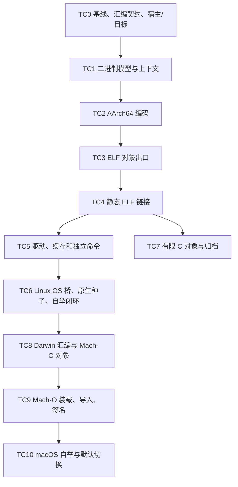

# yh-asm 与 yh-link 分期实施方案

日期：2026-10-02。状态：**实施中**——2026-10-03 起独立立项。TC0 盘点脚本、
浮点标量编码、GOT 重定位、TC4 及以后未实施。

**2026-10-07 起工具链按职责分成两个独立项目**（[归位记录](../01-finished/yh汇编器与链接器项目归位-2026-10-07.md)）：

- **`asm/`（yh_asm，汇编器）**：TC1–TC3 + TC8 的实现都在这里
  （[asm/README](../../asm/README.md)），上一代 asm 实现已归档；
- **`link/`（yh_link，链接器）**：TC4 起实施，当前只有入口骨架
  （[link/README](../../link/README.md)）。

两者互不依赖、互不 import，只通过标准对象文件（ELF64 `ET_REL` /
Mach-O `MH_OBJECT`）交接。本文下文提到的文件布局对应 `asm/src/{obj,asm,main}`
（模块原本规划放在 `compiler/` 下，现为独立项目，模块名不变）。

**Goal：** 用 yh 实现自有汇编/链接能力，先完成 Linux/AArch64 静态 ELF 工具链与
连续自编，再完成 macOS/arm64 自有 Mach-O 工具链。

**Architecture：** 保留稳定目标汇编与标准对象阶段。asm/link 共用必要的 obj 模型，
通过任务私有上下文在编译器进程内调用，独立命令使用同一实现。

**Tech Stack：** `.yh`、AArch64、ELF64/RELA、Mach-O；Python/LLVM/系统工具仅用于开发验证。

**执行方式：** 按 TC0–TC10 的入口条件和验收门逐项实施；每个行为切片先加 `.yh`
复现/验收再实现、构建、验证。此文不执行实现、提交或滚种子。
总体设计与取舍见[设计文档](../03-design/yh-asm与yh-link设计.md)。

## 1. 总体顺序



TC6 所需 OS 导入审计与桥接探针从 TC0 开始准备，实际接入在对应能力就绪后进行。
TC7 是 libc 静态库交付分支，不阻挡显式普通对象的 TC4/TC6。
R1/R2/NP/libc 各自继续推进，不要求它们全部完成才开始 TC0。
TC6 闭环不代表 R2b 真正线程池、完整 SSA 或完整 libc 已完成。

| 阶段 | 可见交付 | 验收门 |
| --- | --- | --- |
| TC0–TC1 | 支持清单、TargetSpec、任务私有基础模型 | 契约可重复、跨宿主目标不污染 I/O |
| TC2–TC3 | yh 汇编可生成 ELF 对象 | 全部冻结汇编通过编码/结构/交叉链接 |
| TC4 | 多对象生成静态 ELF | 原生运行，符号与重定位边界/负例通过 |
| TC5 | 项目与单文件可显式选 self 工具链 | 增量/冷编、命令行为与失败提交正确 |
| TC6 | Linux 编译器不依赖外部编译工具连续自编 | 原生全门、固定点、导入/进程审计 |
| TC7 | 有限 C 对象、libc.a 普通归档交付 | C 调用方及归档顺序/提取规则通过 |
| TC8–TC9 | Mach-O 对象与本机可运行映像 | 编码、绑定、装载、签名与导入审计 |
| TC10 | macOS 自有工具链连续自编 | 本机全门、跨平台回归、独立环境运行 |

## 2. 通用实施规则

文件名是拟定实施位置；不存在的文件/命令/测试不能在完成报告中写成已通过。
新增三个普通源码模块 `compiler/obj`、`compiler/asm`、`compiler/link`，
目录随 `compiler/project.toml` 的 source 根发现；只有实际 schema 变化才改 project.toml。
首期保持模块对象粒度，避免顺手重构 gen/SSA 或迁移文件对象。

每项按下列顺序完成：

1. 写一个可失败的 `.yh` 用例，证明缺失能力/旧缺陷；记录旧版本行为。
2. 实现该用例所需的最小能力，补具体边界与拒绝路径。
3. 运行 `make` 与对应测试，不在失败时发布有效 manifest。
4. 该阶段所有切片通过后跑 `make test`、`make selfhost-native`。
5. 更新支持清单、设计/实施状态、`docs/todo.md`、`docs/finish.md` 及完成报告。
6. 滚种子是验证后的独立交付操作；按宿主路径更新哈希，不能覆盖其他平台资产。

仓库开发临时文件均为 `tmp/yh-toolchain/<stage>/<session>/`。
测试保留 `.yh` 源文件；原始汇编/对象/损坏二进制由测试在 tmp 生成。
结构体与函数使用中文注释；测试语义、所有权和输入边界写入对应注释。
本任务不改 yh 语法；后续若确需新增 intrinsic 语法，先按 AGENTS 更新 yh.g4 与
歧义分析，另列切片，不顺手把 C 裸变参加入本计划。

开发用外部 assembler/linker/readobj/objdump 可以作为 oracle。
最终独立门用进程记录证明没有调用它们；只清空 PATH 不能作为充分证据。
make/Python/测试脚本属于门禁环境；“无 shell”检查对象是 yh 产品及其派生执行路径，
不能把 make 的宿主 shell 与产品内部调用混成一个结论。

## 3. TC0：冻结契约与最低前置

**入口条件：** 当前 Darwin 种子可构建编译器；用户已确认 Linux 优先。

**文件：**

- 新增 `tools/yh-toolchain-inventory.py`，可重复收集编译器/语料/入口的汇编形式。
- 新增 `docs/03-design/yh-汇编子集与重定位契约.md`，记录版本与精确操作数白名单。
- 修改 `compiler/cmd/driver.yh`、`compiler/cmd/module_build.yh`、
  `compiler/cmd/project_index.yh` 中必要的宿主/目标分离接线。
- 新增 `tests/modules/projects/toolchain-target/project.toml`、`main.yh`；
  接入 `tests/modules/build-check.py`。

**切片：**

1. 记录提交/工作区状态、种子/候选哈希，冻结一份语料清单和可重复统计命令。
2. 汇总旧/SSA 后端、自编模块、全部 modules/yh-run 与启动/runtime 的助记符、
   操作数形态、伪指令、符号表达式；记录来源文件和覆盖计数。
3. 将 HostPlatform 与输出 TargetSpec 分开；先修正输出 open flags 与目标校验。
   保持已有 -target 别名；未知目标明确拒绝。
4. 在 Darwin 宿主发射 Linux 项目汇编，验证平台源码选择正确、宿主文件 I/O 正确；
   此阶段用开发交叉工具检查对象，不执行 ELF 原生成功结论。
5. 生成 Linux 候选导入表，枚举 TC6 必须补的 OS 服务，包含活跃 fork worker 路径。
6. 冻结工具子命令参数、受限汇编语法和暂不支持特征；记录 system/self 模式测试矩阵。

**验证：**

```text
make
python3 tools/yh-toolchain-inventory.py --compiler ./yh --output tmp/yh-toolchain/tc0
python3 tests/modules/build-check.py --compiler-path ./yh
make test
make selfhost-native
```

inventory 脚本的参数为拟定接口；实现时保持文档一致。
期望：支持清单可重复，未知目标失败，交叉发射不误用目标 OS 的宿主 open 参数；
现有 Darwin 门不回归。盘点失败的输入应有清楚原因，不能从清单静默删除。

**结束交付：** 子集/重定位契约 v1、实际前置阻塞表、模式矩阵、性能基线。

## 4. TC1：二进制模型与独立上下文

**文件：**

- 新增 `compiler/obj/model.yh`、`bytes.yh`、`target.yh`、`verify.yh`。
- 新增 `tests/modules/projects/objectmodel/project.toml`、`main.yh`。
- 修改 `tests/modules/build-check.py` 接入模型项目。

**切片：**

1. 用 `.yh` 测试构建 TargetSpec/Section/Symbol/Relocation 最小记录；检验公开类型闭包。
2. 实现固定小端 u16/u32/u64 读写、对齐与安全的加法/乘法/范围检查。
3. 实现带容量检查的增长缓冲、名称池、输入视图生命周期；仅抽取 asm/link 真正共用能力。
4. 上下文错误不复用 GenState；测试一次调用失败后另一上下文成功。
5. 验证 BSS 文件尺寸/内存尺寸不同，二进制读写不受宿主 struct padding 影响。

**验证：** `make`，模型项目运行及项目验收，再跑通用阶段门。
期望：期望字节逐项匹配；越界/溢出被拒绝；多上下文无状态串扰。
不为每个 trivial getter 加测试，集中验证字节、边界和生命周期。

## 5. TC2：AArch64 汇编解析与编码

**文件：**

- 新增 `compiler/asm/model.yh`、`scan.yh`、`parse.yh`、`expr.yh`。
- 新增 `compiler/asm/arm64_int.yh`、`arm64_mem.yh`、`arm64_fp.yh`、
  `arm64_branch.yh`、`layout.yh`、`assemble.yh`。
- 新增 `tests/modules/projects/asmencode/project.toml`、`main.yh`；
  `tests/modules/projects/asmreject/project.toml`、`main.yh`。
- 新增 `tests/toolchain/check.py`，从 `.yh` fixture/字符串生成 tmp 中的汇编输入。

**切片与顺序：**

1. scanner/标签/寄存器/整数/注释；unknown token 和非法寄存器有位置诊断。
2. fragment、节切换、数据宽度、BSS、对齐与受限表达式。
3. movz/movk、寄存器 mov、算术/比较/选择；再补逻辑立即数 mov/and/orr 等别名。
4. 整数/浮点 load-store，包括 SP、缩放与非缩放、前索引/后索引及 pair。
5. B/BL/BLR/RET、条件码、CBZ/CBNZ、SVC/BRK；先实现范围拒绝与 fixup。
6. f32/f64 运算、比较、位搬运、转换；补盘点虽未出现但源码可发射的 fneg/fcvtzu 等。
7. 统一别名 beq/b.eq、signed/unsigned 扩展；补入口/运行时实际需要的形式。
8. 实现局部条件远分支单调放宽，验证放宽影响的标签/对齐再次布局。

**验证：**

```text
make
python3 tests/toolchain/check.py --compiler ./yh --stage encode
python3 tests/modules/build-check.py --compiler-path ./yh
```

`tests/toolchain/check.py` 是计划新增脚本，stage 选项由该脚本提供。
期望：每种具体形式都有独立期望机器字/外部编码对照；非法立即数、SP/ZR 混用、
位宽错配、未支持表达式必须拒绝。立即数和位移测试含合法最小/最大与越界一单位。
外部反汇编只是辅助，不能用自己的 encoder/decoder 互相验证代替独立证据。

**结束交付：** 冻结子集所有编码可用，布局/fixup 校验通过，尚不声称 ELF 链接可用。

## 6. TC3：标准 ELF 对象出口

**文件：**

- 新增 `compiler/obj/elf.yh`、`compiler/asm/elf_write.yh`。
- 新增 `compiler/cmd/toolchain.yh` 的对象命令接线；修改 driver 参数分派。
- 新增 `tests/modules/projects/asmelf/project.toml`、`main.yh`；
  `tests/modules/projects/asmsymbols/project.toml`、`main.yh`。
- 扩展 `tests/toolchain/check.py` 的 `object` 阶段。

**切片：**

1. 写 ELF64 header、节表与字符串表，区分 PROGBITS/NOBITS。
2. 写符号表的 local/global/undefined/absolute/section，正确填索引与 sh_info。
3. 写 RELA，首先覆盖 CALL26、JUMP26、页取址和 ABS64；按 TC0 清单补完整实际需求。
4. 同节局部分支 fixup 与跨节/绝对数据引用的重定位分开；实现 mapping symbols。
5. 发布 `yh asm`，先完整生成对象字节后提交文件。
6. 所有冻结汇编生成 ELF；用开发交叉工具完成链接和结构审计。

**验证：**

```text
make
python3 tests/toolchain/check.py --compiler ./yh --stage object
./yh asm -target linux tmp/yh-toolchain/tc3/main.s -o tmp/yh-toolchain/tc3/main.o
```

main.s 由该阶段 `.yh` 用例生成；上面的命令是实施后的验收命令。
期望：外部 ELF reader 正确解释对象，self-asm/system-link 与 system-asm/system-link
使用相同 runtime 后运行一致；对象字节自身可重复。
外部对象的节/符号排序可以不同，不能要求不同 producer 的完整 `.o` 逐字节相同。

**结束交付：** ELF 汇编器门通过，可与系统 linker 交叉使用。

## 7. TC4：Linux 静态 ELF 链接

**文件：**

- 新增 `compiler/link/elf_read.yh`、`symbols.yh`、`layout.yh`、
  `arm64_reloc.yh`、`thunks.yh`、`elf_write.yh`、`link.yh`。
- 新增 `compiler/gen/emit_runtime_start.yh` 的有限入口发射及必要接线。
- 新增 `tests/modules/projects/linkelf/project.toml`、`main.yh`、`helper/helper.yh`；
  `tests/modules/projects/linkreject/project.toml`、`main.yh`。
- 新增 `tests/yh-run/run/53-toolchain-entry.yh`、`54-toolchain-address.yh`；
  实施时若编号已占用，选下一个编号并同步文档。

**切片：**

1. 普通对象 reader 校验 magic/ISA/端序、表长、名称、索引、flags、溢出与文件范围。
2. local 对象作用域和 global 解析；重复/未定义/错误入口负例。
3. 文本/只读数据/数据/BSS 布局；文件偏移和地址分开，LOAD 同余/权限/内存尺寸校验。
4. 页重定位与调用/数据重定位，覆盖跨页 addend、未对齐引用和超出代码模型。
5. 生成 `_start` 对象，argc/argv/envp/auxv → main → 自有 exit。
6. 首个多对象纯 yh 程序链接并在 Linux/AArch64 原生运行；检查无解释器和动态依赖。
7. 函数间长调用跳板与局部条件远分支；一般内部 B 不违反 scratch 契约。
8. 保留有限 `.map` 诊断输出，记录输入到输出节/符号/地址映射。

**验证：**

```text
make
python3 tests/toolchain/check.py --compiler ./yh --stage link-elf
```

开发阶段可在 Darwin 运行工具生成 ELF，再放 Linux/AArch64 原生环境运行目标程序。
必须分别记录宿主与目标运行证据；生成 ELF 成功不等于目标可运行。
四种 assembler/linker 组合均使用同一入口/runtime。
大量虚拟布局边界先用模型验证，再选择实际大距离样例进行端到端运行，
不让每次普通门都无必要地产生巨型文件。

**结束交付：** 静态 ELF 链接器门通过；还没有承诺完整编译器脱库自举。

## 8. TC5：驱动、缓存与独立入口集成

**文件：**

- 修改 `compiler/cmd/toolchain.yh`、`driver.yh`、`link_cache.yh`、`module_build.yh`。
- 修改 `Makefile` 的安装/卸载入口，提供 yh-asm/yh-link 名称。
- 扩展 `tests/selfhost/link-cache.py`；新增 `tests/selfhost/toolchain-cache.py`。
- 新增 `tests/modules/projects/toolchain-build/project.toml`、`main.yh`、`lib/lib.yh`。
- 扩展 `tools/compiler-performance.py` 的模式/工具身份/进程计数。

**切片：**

1. `yh asm/link` 与独立名字共享参数处理；单文件与项目构建使用同一内部 API。
2. 增加显式 `--toolchain=system/self`，self 失败不自动回退；错误参数退出 2，输入错误退出 1。
3. 对象/链接键加入完整 TargetSpec、实现身份、子集/缓存版本、入口/runtime 输入。
4. `.o`、映像和 manifest 按事务发布；旧有效产物保留但不能匹配失败的新键。
5. 同项目并发发布使用会话隔离与互斥；支持短写、失败 rename、损坏缓存的反例。
6. self 对不支持的 C 源/系统库/对象明确拒绝，system 模式继续通过原有 C 混编门。
7. 保持模块级对象、worker 预算与确定的输入顺序；计数区分 self 调用与外部进程。

**验证：**

```text
make
python3 tests/selfhost/toolchain-cache.py --compiler ./yh
python3 tests/toolchain/check.py --compiler ./yh --stage integration
make test
make selfhost-native
```

期望：无改动热构建不汇编不链接；一个模块变化只重新汇编该模块并重链接；
入口、runtime、模式、目标、工具版本或输入对象变化使相关缓存失效。
同样输入的串/并行产物一致；失败不留下可被当作新成功产物的 manifest。

**结束交付：** 可显式选用 self 工具链，Linux 默认尚待 TC6 决定。

## 9. TC6：Linux 原生种子与工具链闭环

这是 Linux 首期的最终门，OS 桥缺失属于明确前置，不能用静态 hello-world 代替。

2026-10-03 用户指定类型化系统调用层统一规划在 `libs/sys/`，见
[sys 设计](../03-design/yh-sys系统调用封装设计.md)与
[SYS0–SYS7 实施方案](yh-sys系统调用封装实施方案.md)。TC6 复用该原语层；
旧 prelude 与发射运行时仍按实际符号补兼容桥，不能把导入 sys 当成已完成替换。

**文件：**

- 新增 `libs/sys/` Linux 原语并以显式项目依赖接入编译器；文件拆分见 SYS 方案。
- 按残余 prelude/运行时引用需要新增 `compiler/gen/emit_runtime_os.linux.yh` 兼容桥，
  补 symbols/运行时接线；不在此另复制一套标准库 OS 原语。
- 修改 `compiler/cmd/process.yh`、`build_scheduler.yh` 与平台 runtime 的必要调用。
- 审核 `tools/seed-build.py`、`tools/selfhost_snapshot_gate.py`、
  `tests/selfhost/native-selfhost.py` 的平台路径/快照行为，已有正确逻辑不重写。
- 新增 `tests/selfhost/toolchain-independent.py`。
- 新增 `tests/modules/projects/toolchain-os/project.toml`、`main.yh`；
  `tests/yh-run/run/55-toolchain-runtime.yh`。
- 验证后归档 `bin/yh-linux-arm64` 与对应 `.sha256`，更新平台交付说明。

**切片：**

1. 以实际 Linux 编译器汇编/对象的引用清单补全部活跃宿主服务；保证 fork worker 可用。
2. I/O/目录/重命名、分配、环境、进程等待/重定向/退出逐项原生运行；
   区分 raw syscall 返回与旧 prelude 约定，避免一个桥返回值错误污染整条构建。
3. 先使用经验证 Darwin 候选发射 Linux 项目汇编；必要时开发交叉工具生成第一份
   临时 Linux 候选。临时产物在 tmp，不提前当作受支持种子入库。
4. Linux 原生通过 system 兼容全门后，建立临时种子/哈希，再切到 self 构建候选。
5. A 用 self 编译 B，B 用 self 编译 C，各代立即保存独立快照；比较 B/C 的
   `.s/.s.i`，再比较自有 `.o` 与最终映像固定点；禁止复用已覆盖缓存比较自己。
6. self 独立环境跑支持矩阵全部成功/拒绝用例与下一代编译器；system 兼容模式
   跑全量现有语料和 C 混编门，报告覆盖差异。
7. 记录 exec 路径和 ELF headers/导入，证明无外部编译工具、shell、libc/CRT 或 loader。
8. 冻结语料做 20 轮性能实测，列出瓶颈；正确性门通过后再切 Linux 默认并归档种子。

**验证：** 在 Linux/AArch64 原生环境执行：

```text
make SEED=<临时Linux种子的绝对路径>
make test
make selfhost-native SEED=<临时Linux种子的绝对路径>
python3 tests/selfhost/toolchain-independent.py --compiler ./yh --platform linux-arm64
```

`SEED` 必须有匹配哈希。现有 Makefile 已把 SEED 作为 `--seed` 传给
native-selfhost，保持这一正确接线；新门也必须使用同一选择，不能另读不同种子。
使用受控原生环境或原生 arm64 容器；如果只使用模拟器，报告模拟证据，不能标成原生。
4/16/64 KiB 页环境的未验证项保留为明确兼容缺口，不能用单机结果覆盖全部。

**结束交付：** Linux 独立工具链闭环、对应原生种子与支持矩阵；Darwin 旧路径仍通过。

## 10. TC7：有限 C 对象和普通静态归档

与 libc L0 的对象/归档交付对接；TC4 后可以开始，不阻挡不含归档的自举。

**文件：**

- 新增 `compiler/link/archive.yh`、`archive_write.yh`；扩展 ELF reader/symbols/reloc。
- 新增 `tests/modules/projects/linkarchive/project.toml`、`main.yh`；
  `tests/modules/projects/linkcobject/project.toml`、`main.yh` 与开发 C 调用方。
- 扩展 `tests/toolchain/check.py` 的 `archive/c-object` 阶段。
- 仅在公开库出口确实需要时扩展 project schema 并同步模块项目管理文档。

**切片：**

1. 使用明确的 freestanding 编译选项生成有限 C 对象，记录 flags、节与重定位清单。
2. 增加实际所需 ABS32/PREL/LDST、weak/common/visibility；初始化/异常/TLS 特征
   未支持时拒绝，不把任意第三方 `.o` 当作已兼容。
3. 普通 ar 读取，长文件名/索引校验，thin archive 拒绝。
4. 按未解决符号惰性提取成员，当前库内迭代；验证命令行顺序与循环依赖诊断。
5. 确定性归档写出、公开库对象出口和 `--archive` 参数互斥。
6. yh 静态库由开发 C 调用方链接运行，C 对象由 self linker 链入同入口/runtime 运行。

**验证：** `make`、toolchain 的 `archive/c-object` 阶段、模块项目验收与通用阶段门。
期望：不提取未使用成员，重复/未定义处理正确，归档可重复；
libc.a 可交付但不因此宣称完整 libc、TLS、动态库已实现。

## 11. TC8：Darwin 汇编与 Mach-O 对象

**文件：**

- 新增 `compiler/obj/macho.yh`、`compiler/asm/macho_write.yh`。
- 扩展 asm expression/section 解析；新增 `compiler/link/macho_read.yh`。
- 新增 `tests/modules/projects/asmmacho/project.toml`、`main.yh`。
- 扩展 `tests/toolchain/check.py` 的 `object-macho` 阶段。

**切片：**

1. 冻结当前 macOS 部署范围，验证最小装载/签名路线所需格式，不先推定通用兼容。
2. Darwin 符号/段名与 PAGE/GOT 表达式，Mach-O header、sections、nlist/string table。
3. BRANCH26、PAGE21/PAGEOFF12、GOT 页、UNSIGNED、实际 ADDEND 配对。
4. self-asm/system-link 运行现有 Darwin 语料；Linux 编码/对象门继续通过。

**结束交付：** Mach-O 对象门通过，尚未替换 macOS linker。

## 12. TC9：Mach-O 链接、系统导入与签名

**文件：**

- 新增 `compiler/link/macho_layout.yh`、`macho_reloc.yh`、`macho_dyld.yh`、
  `macho_write.yh`、`macho_sign.yh`；必要时 `compiler/obj/sha256.yh`。
- 扩展 `compiler/gen/emit_runtime_start.yh` 的 Darwin 入口适配。
- 新增 `tests/modules/projects/linkmacho/project.toml`、`main.yh`；
  `tests/modules/projects/machosign/project.toml`、`main.yh`。

**切片：**

1. 段/节与 __LINKEDIT 布局，入口和最低版本、load commands，明确目标页契约。
2. 本地地址重定位、OS API stub/GOT、选定 dyld rebase/bind 格式。
3. 生成 libSystem 固定导入；只允许经过审计的 OS API，不以库名称替代符号审计。
4. 自有 SHA-256 与 ad-hoc 签名，固定标识与页哈希；签名在最终布局后生成。
5. 原生执行小映像，逐个增加内存/I/O/目录/进程接口；坏签名与绑定越界反例。
6. 删除测试产品对外部 SDK/codesign 的必需依赖，仍允许开发工具进行结构检查。

**验证：** `make`、toolchain 的 `link-macho/sign` 阶段、本机运行和通用阶段门。
期望：原生装载正确、OS 导入符合清单、签名字节可重复；
必须在声明的目标系统实测，不能只通过 Mach-O reader。

## 13. TC10：macOS 自举、交付与默认切换

**文件：**

- 扩展 `tests/selfhost/toolchain-independent.py` 的 Darwin 受控模式。
- 维护平台 seeds/安装入口、`compiler/README.md` 与设计/完成记录。
- 复用已有自举 gate，只新增必要的对象/映像和进程审计断言。

**切片：**

1. self 工具链运行 Darwin 全量支持/拒绝矩阵，并保持 system 兼容语料全绿。
2. 连续自编、模块汇编/接口/对象/最终映像固定点与串并行一致。
3. 无 SDK、外部汇编链接/codesign 的受控产品路径编译普通程序和下一代编译器。
4. Linux 全门继续通过，缓存目标/部署配置切换无污染。
5. 20 轮性能测量与依赖/导入记录；通过后切 Darwin 默认，验证并按宿主独立滚种子。

**结束交付：** Linux/macOS arm64 自有工具链可按各自边界独立运行与连续自编。
此后再按实际需求立项动态 ELF、TLS、调试信息、x64/Windows，不能塞进首期收尾。

## 14. 测试矩阵与明确完成条件

| 维度 | 至少覆盖 |
| --- | --- |
| 数值编码 | 32/64 位、负数、宽立即数、逻辑掩码、所有支持的 s/d 转换 |
| 地址/访存 | 负偏移、缩放边界、前/后索引、SP/ZR、不同数据宽度与对齐 |
| 控制流 | 前后向、条件近/远、长调用、跳板 scratch/LR、非法范围 |
| 多对象 | 私有同名、公开调用、extern、地址/函数指针、重复定义、未定义 |
| 格式错误 | 截断、错误 ISA/端序、越界索引、溢出、未知运行语义节/重定位 |
| 启动/运行时 | main 参数、envp/auxv、stdout/退出、映射分配、目录与 fork worker |
| 缓存/事务 | 无改动、真实函数体变化、对象损坏、目标/工具/runtime 切换、失败发布 |
| 并发/确定性 | 串并行相同、不同完成顺序、同项目并发隔离、各代独立快照 |
| 互操作 | 四种 asm/link 组合、有限 C 对象、ar 顺序；使用相同入口/runtime |
| 独立门 | 原生 self 编译运行和自编；产品进程/动态依赖/OS API 清单证据 |

每个平台的完成报告必须回答：支持哪些输入、拒绝哪些输入、全量现有测试运行在哪个
模式、独立模式覆盖多少成功/拒绝用例、种子在哪里及哈希、性能是否达到目标。
纯 yh 与已支持自有运行时的正常语料必须在 self 模式成功运行，不能通过改标成
“兼容专用”或预期拒绝规避回归；模式差异仅用于明确依赖外部 C/系统库的输入。
只声明已经执行并有证据的门；未验证的平台页大小/部署版本列为开放项。

## 15. 工作量与近期起点

实施前无法可靠给固定日程。按单人、代码/测试/文档一并计的粗估：

| 工作包 | 初步人日范围 | 主要变数 |
| --- | --- | --- |
| TC0–TC1 | 4–7 | 宿主/目标拆分范围、种子可表达的公开类型 |
| TC2–TC3 | 12–20 | 指令具体变体、别名、完整汇编清单 |
| TC4–TC5 | 10–16 | 长分支、重定位、事务和缓存接线 |
| TC6 | 10–18 | Linux OS 桥、第一份原生候选和全门问题 |
| TC7 | 6–10 | 有限 C 对象特征与归档格式范围 |
| TC8–TC10 | 22–38 | dyld 格式、部署版本、签名和原生装载 |

这些是规划估算，不是交付承诺；TC0 完成后按实际缺口重新估算。
近期只推进 **TC0 → TC1 → TC2 的整数/访存编码竖切片 → TC3 对象出口**，
尽早用 self-asm/system-link 运行真实 `.yh` 程序，再扩大到全部浮点和 runtime。
不要先写完所有目标的文件格式，也不要等完整 libc/SSA 优化完成才开始编码验证。
