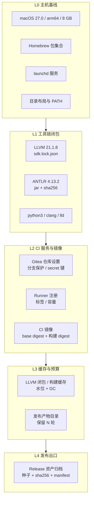

# yh 基础设施即代码（IaC）方案

日期：2026-10-24
性质：**现状分析与方案设计**，不涉及代码改动；文中所有主机数据为当日实测。
基线：工作区 `0.0.9-rc`（HEAD `cc01a61`）。
上游依据：[系统架构与长期演进设计](../03-design/yh-系统架构与长期演进设计-2026-10-24.md)、
`AGENTS.md` 的 CI/发布章节、[分版本 rc 与 release 分支发版流程](yh-分版本rc与release分支发版流程方案-2026-10-21.md)。

---

## 0. 结论

**yh 的"基础设施"目前是一台 Mac 上的手工状态，不是代码。** 编译器本身已经是
自举闭环（种子 → 编译器 → 新种子），但支撑这个闭环的机器、服务、镜像、缓存和
发布出口，全部靠"上一次配好就一直用"。仓库里能重建的是**编译器**，不能重建
**能跑编译器的环境**。

四个可复现性缺口，按修复收益排序：

| 编号 | 缺口 | 具体表现（实测） | 后果 |
| --- | --- | --- | --- |
| **G1** | 主机基线不可重放 | `brew list` 90+ 包、`gitea`/`gitea-runner` 由 `brew services` 拉起、runner `capacity: 4` 手写在 `/opt/homebrew/etc/gitea-runner/config.yaml` | 换机/重装后只能凭记忆重建，容量与路径配置无人审计 |
| **G2** | CI 服务状态在服务端 | 仓库设置、runner 注册（`.runner` token）、`YH_GITHUB_TOKEN`、分支保护全在 Gitea 侧；分支保护**尚未要求 status check**（todo D2） | 无法 code review 的权限变更；仓库被误改无人发现 |
| **G3** | 镜像与工具链非内容寻址 | `yh-ci:ubuntu24` 浮动 tag、`FROM ubuntu:24.04` 无 digest；只有 LLVM 做对了（`vendor/llvm/sdk.lock.json` + sha256） | "昨天绿今天红"无法归因；镜像被本地重建后不可追溯 |
| **G4** | 缓存与磁盘无预算 | 可用空间 **21 GB**，而三端发布需 15–20 GB；容器存储 12 GB、LLVM 闭包 4.9 GB、`tmp/` 5.3 GB、发布产物 252 MB | 磁盘是当前最可能的**硬失败点**，且没有任何水位告警 |

**方案结论：不引入 Terraform / Ansible / Nix，采用"仓库内声明式清单 + 幂等
reconciler + 只读门禁"的最小 IaC。** 理由是这台机器没有云资源可管（Terraform
无用武之地）、Gitea 的 REST API 足以覆盖仓库/密钥/分支保护（不需要 Ansible）、
而 Nix-darwin 会替换 Homebrew 管理的 `gitea`/Apple `container`（8 GB 宿主上
风险大于收益）。真正的收益来自三件事：**清单化（能审阅）**、**plan/apply 语义
（能预演）**、**漂移检测（能报警）**，与工具品牌无关。

设计沿用项目既有风格：Python 标准库、`tools/` 下单文件脚本、退出码 0/2/3、
`--quiet`/`--json`、失败即停并打印"下一步命令"。

---

## 1. 现状分析

### 1.1 先划边界：什么该进 IaC

IaC 的边界容易膨胀成"把所有东西都写进 YAML"。本项目按**生命周期**划线：

| 类别 | 归属 | 理由 |
| --- | --- | --- |
| 主机工具链、服务、目录、PATH、容量 | **IaC（本文）** | 手工配置，换机即失 |
| Gitea 仓库设置、runner 注册、分支保护、密钥**键名** | **IaC（本文）** | 服务端状态，不可 review |
| CI 镜像、基础镜像 digest、LLVM 工具链版本 | **IaC（本文）** | 构建输入，必须可追溯 |
| 缓存根、磁盘预算、GC 水位、发布产物归档 | **IaC（本文）** | 容量策略，需可审计 |
| 编译器源码、`Makefile`、`tools/*.py` | 普通代码 | 已有 git + 门禁 |
| 种子二进制（`bin/`） | **发布资产** | 二进制不入库，走 Release + sha256（已有机制） |
| 测试语料、`tmp/` 产物 | 构建输出 | 可丢弃，只需预算与清理 |

**明确不做**：不接管编译器构建流程（`Makefile` 是构建系统，不是基础设施），
不把种子写进 IaC 清单（种子是产物，靠 `sdk.lock.json` 式的哈希链治理）。

### 1.2 实测清单

| 组件 | 版本/规格 | 位置 | 当前管理方式 | 可复现性 |
| --- | --- | --- | --- | --- |
| 宿主 | macOS 27.0（26A428）、8 GB RAM、8 核 | — | 手工 | 无记录 |
| Gitea | 1.26.1（go1.26.2、sqlite） | `/opt/homebrew/var/gitea`（534 MB） | `brew services` | 无清单 |
| Runner | 5.2.0，host 模式，`yh-local` | `/opt/homebrew/etc/gitea-runner/config.yaml` | 手写 config | 无清单 |
| Runner 容量 | `capacity: 4`、`timeout: 6h`、日志保留 168h | 同上 | 手写 + 注释说明 | 无审计 |
| Runner 标签 | `macos-arm64:host`、`linux-arm64:host` | `.runner`（含注册 token） | 注册时一次性写入 | 需重新注册 |
| 容器运行时 | Apple `container` 1.5.0 | 系统 | `brew install container` | 无清单 |
| 容器镜像 | `ubuntu:24.04`、`yh-ci:ubuntu24`、`yh-ci:ubuntu24-amd64` | 容器存储 **12 GB** | 本地 `container build` | 浮动 tag |
| 工具链锁定 | LLVM 21.1.8（sha256）、本地 ANTLR 4.13.2（不进 CI） | `vendor/llvm/sdk.lock.json`；ANTLR 由 `tests/yh/check.py` 自备 | **已锁定**（正面样板） | 高 |
| 构建缓存 | LLVM 闭包 **4.9 GB** | `tmp/llvm-migration`（symlink 到宿主绝对路径） | 手工 `make llvm-host` | 中（路径会漂） |
| 发布产物 | 3 次 run，**252 MB** | `~/yh-release-dist/ci-<run_id>` | 无保留策略 | 无 |
| 仓库 CI | `ci.yml` 3 job、`release.yml` 5 job | `.gitea/workflows/` | git 管理 | **高** |
| 密钥 | `YH_GITHUB_TOKEN` | Gitea secret 存储 | 网页手工录入 | 无轮换记录 |
| 种子分发 | 三端 tar.gz | **仅 GitHub Release** | `tools/fetch-release-seed.py` | 单点 |
| 可用磁盘 | **21 GB** | `/` | — | **风险** |

### 1.3 六处结构性缺口

**G1 · 主机基线不可重放。** `brew list --formula` 有 **153** 个包，但仓库里没有
Brewfile，也没有记录"CI 必需的是哪 8 个"。runner 的关键参数（`capacity: 4`、
`timeout: 6h`）只存在于 `/opt/homebrew/etc/gitea-runner/config.yaml` 的一行注释里，
注释还写着"8GB 宿主上并发构建有 OOM 风险"——**风险已知，但配置没有跟着改**。

**G2 · CI 服务状态不可审阅。** 分支保护、status check 要求、runner 标签、
secret 键集合都在 Gitea 服务端。`docs/todo.md` 的 D2 已记录"分支保护未要求
status check"，这意味着**红灯的分支仍可合入**。这类状态恰恰是最该 IaC 化的：
它决定了"什么算通过"。

**G3 · 镜像与工具链非内容寻址。** `yh-ci:ubuntu24` 是本地 tag，`FROM ubuntu:24.04`
没有 digest——镜像上游一变动，同一 commit 就会在不同时间得到不同结果。ANTLR 已于
2026-10-26 退出 CI（参考语法门只在本地开发跑，`tools/run-antlr-ci.sh` 一并删除），
这条缺口只剩镜像一项。对照 LLVM 的 `sdk.lock.json`（版本 + sha256 + 字节数 +
来源 URL），差距很清楚——**项目已经有正确的模式，只是没推广**。

**G4 · 缓存与磁盘无预算。** 21 GB 可用 / 三端发布 15–20 GB，余量不到 1.4 倍。
容器存储 12 GB 是最大头，而 `ci.yml` 注释里已经出现"避免每个 job 重复 apt 安装
并累积容器快照"——说明快照累积是**已发生**的问题。目前没有水位、没有 GC、
没有"发布前先腾空间"的动作。

**G5 · 主机绝对路径耦合。** 两个 workflow 的默认缓存路径硬编码为
`$HOME/Documents/x/tmp/llvm-migration`，并用 `perl -pi -e` 就地改写
`selfhost-flags.txt` 里的绝对路径。这在单机单用户下能跑，但它把"构建配方"
绑死在一台机器的目录布局上，与 todo H4 是同一问题的两个面。IaC 化顺带要把它
收敛成 `tools/llvm_cache.py` 已有的解析逻辑。

**G6 · 密钥与发布出口单点。** `YH_GITHUB_TOKEN` 只在 Gitea secret 里，没有
scope 记录、没有轮换流程；更关键的是**三端种子只存在于 GitHub Release**，
`bin/` 被 gitignore。GitHub 侧资产一旦丢失，自举链就断了——仓库有 GitHub +
本地 Gitea 两份，种子只有一份。

### 1.4 风险矩阵

| 风险 | 触发条件 | 影响 | 现有缓解 | 结论 |
| --- | --- | --- | --- | --- |
| 磁盘写满 | 三端发布 + 容器快照累积 | 发布/门禁失败，可能损坏缓存 | 无 | **P0**，G4 |
| 8 GB 内存 OOM | `capacity: 4` 且 4 个容器各 `-m 3G` | job 被杀，结果不可信 | 注释提醒 | **P0**，G1 |
| 换机无法重建 | 重装/换机/迁移 | CI 停摆数天 | AGENTS.md 文字描述 | P1，G1 |
| 红灯合入 | 分支保护未要求 status check | 主分支质量失守 | 人工 review | P1，G2 |
| 镜像/工具链漂移 | 上游 tag 更新、jar 变更 | 同 commit 结果不一致 | 无 | P1，G3 |
| 种子丢失 | GitHub 资产被删/账号异常 | 自举链断，需回滚 git 历史重建 | 无 | P1，G6 |
| 密钥泄漏/过期 | token 未轮换 | 取种/发布 403 | 无 | P2，G6 |

---

## 2. 目标与原则

### 2.1 目标

1. **可重放**：一台空白 macOS（同版本、同架构）执行 `make infra-apply` 后，
   能跑通 `ci.yml` 的等价门禁。
2. **可审阅**：所有影响"什么算通过"的状态（容量、标签、分支保护、镜像、工具链
   版本）都在 git 里，改动走 PR。
3. **可检测**：`make infra-verify` 只读比对"声明 vs 实测"，漂移有明确退出码。
4. **可回滚**：每个收敛动作都有对应的反向动作，且 apply 幂等（连跑两次第二次
   变更数为 0）。
5. **密钥不出仓**：清单只声明**键名与 scope**，值来自系统钥匙串。

### 2.2 非目标

- 不做多云/多集群编排；不做 Kubernetes；不引入常驻 agent/守护进程。
- 不接管编译器构建（`Makefile` 保持现状）、不接管测试语料。
- 不把种子二进制纳入 IaC（它属发布资产，见 §4.9 归档）。
- 不追求"零手工"——一次性的人机交互（Gitea 管理员初始化、Apple 容器授权）
  允许保留为**显式步骤**，但必须被脚本包围并校验结果。

### 2.3 五条设计原则

| 原则 | 落地方式 |
| --- | --- |
| Git 是唯一事实源 | 清单在 `infra/`，服务端状态由 reconciler 收敛 |
| plan 永不改机 | `plan`/`verify` 只读；只有 `apply` 写 |
| 幂等收敛 | 每个资源有稳定幂等键；`apply` 连续两次第二次为 0 变更 |
| 内容寻址 | 版本 + sha256 + 镜像 digest 三者都进 lock 文件 |
| 失败即停并给下一步 | 沿用 `tools/llvm-host.py` 风格：退出码 + 可执行命令 |

---

## 3. 方案选型

| 方案 | 适配度 | 否决/采纳理由 |
| --- | --- | --- |
| **Terraform / OpenTofu** | 低 | 无云资源；macOS 本地资源（brew/launchd/`container`）几乎无 provider；state 文件管理单机会引入额外后端问题。**否决** |
| **Ansible** | 中 | 能管 brew/文件/服务，但 macOS 模块覆盖弱、无 plan/diff 语义、需 Python 环境与 inventory，收益不足以抵消新增依赖。**否决（保留为将来 Linux runner 的候选）** |
| **Nix / nix-darwin** | 中 | 复现性最强，但要替换 Homebrew 管理的 `gitea`/`container`（Apple 容器不在 nixpkgs），8 GB 宿主上迁移风险高，且与"零新运行时依赖"冲突。**否决（记为长期选项）** |
| **仓库内声明式清单 + Python reconciler** | **高** | 零新依赖（python3 标准库）、与 `tools/*.py` 同构、Gitea REST API 覆盖全部服务端资源、可精确实现 plan/apply/verify/gc。**采纳** |

采纳方案不是"自制 Terraform"，而是**借用其语义、不借用其运行时**：

- 借 Terraform 的 `plan → apply → refresh` 生命周期与"声明/实测/差异"三段式；
- 借 Nix 的 lock 文件思想（`infra/lock/*.lock.json` 记录解析结果）；
- 借项目已有的退出码约定（0 一致 / 2 漂移 / 3 环境不可用）。

保留 **provider 接口**：`local-darwin`（当前）与未来的 `linux-runner`/`cloud`
实现同一份资源契约，换宿主只换 provider，不改清单。

---

## 4. 设计

### 4.1 分层模型



每层的**收敛动作**与**幂等键**：

| 层 | 资源 | 声明 | 实测来源 | 收敛动作 | 幂等键 |
| --- | --- | --- | --- | --- | --- |
| L0 | 包集合 | `infra/host/darwin.toml` | `brew list --formula -1` | `brew bundle` / `brew install` | 包名 |
| L0 | 服务 | 同上 `[services]` | `brew services list` | `brew services start/restart` | 服务名 |
| L0 | 目录/PATH | 同上 `[dirs]` | `test -d`、plist 环境 | `mkdir -p`、重写 plist | 路径 |
| L1 | LLVM 闭包 | `vendor/llvm/sdk.lock.json`（已有） | `tools/llvm-host.py status` | `make llvm-host` | host + sdk 版本 |
| L1 | ANTLR | `infra/toolchain/antlr.lock.json` | jar 存在性 + sha256 | 下载并校验 | 版本 |
| L2 | 仓库设置 | `infra/ci/repo.toml` | `GET /repos/{o}/{r}` | `PATCH` | repo 全名 |
| L2 | 分支保护 | 同上 `[protection]` | `GET .../branch_protections` | `POST/PATCH` | 分支名 |
| L2 | Secret 键 | 同上 `[secrets.keys]` | `GET .../actions/secrets` | 校验存在 + scope（值不写） | 键名 |
| L2 | Runner | `infra/ci/runner.toml` | `.runner` + `GET .../actions/runners` | 重新注册/改写 config | runner 名 |
| L2 | 镜像 | `infra/images/ci.toml` | `container image list` + digest | `container build` | Dockerfile sha + base digest |
| L3 | 缓存 | `infra/cache/budget.toml` | `du -sk` 各根 | `make llvm-host` / 清理 | 根路径 |
| L3 | 发布产物 | 同上 `[retention]` | 目录列举 | 删除超出 N 轮的 run | `ci-<run_id>` |
| L4 | 归档 | `infra/release/archive.toml` | 归档目录 + manifest | `tools/archive-release.py` | tag + 平台 |

### 4.2 目录布局

```
infra/
├── README.md                     # 一页：怎么 plan/apply/verify，出问题看哪里
├── host/
│   ├── darwin.toml               # L0：包、服务、目录、PATH、容量约束
│   └── Brewfile                  # 由 darwin.toml 生成（brew bundle 可直接用）
├── toolchain/
│   └── antlr.lock.json           # L1：ANTLR 版本 + jar sha256 + 下载源
├── ci/
│   ├── repo.toml                 # L2：仓库设置、分支保护、secret 键名与 scope
│   └── runner.toml               # L2：runner 名、标签、容量、日志保留
├── images/
│   ├── ci.toml                   # L2：base digest、tag、构建参数
│   └── Dockerfile                # 由 .gitea/ci/Dockerfile 迁入（单一位置）
├── cache/
│   └── budget.toml               # L3：各缓存根、预算、水位、GC 策略
├── release/
│   └── archive.toml              # L4：归档目标、保留策略
└── lock/
    ├── host.lock.json            # apply 后写入：实测解析结果（brew 版本、服务状态）
    ├── ci.lock.json              # 仓库/保护/secret 键/runner 的实测快照
    └── images.lock.json          # 镜像 digest + Dockerfile sha
```

**与现有文件的关系**（不搬家、不重复）：

- `vendor/llvm/sdk.lock.json` **保持原位**（编译器与工具链都依赖它，属构建输入）。
- `.gitea/workflows/*.yml` **保持原位**（Gitea 只认这个路径）；只把镜像定义
  迁到 `infra/images/Dockerfile`，workflow 里改成 `-f infra/images/Dockerfile`。
- `tools/` 下新增 `infra.py`（reconciler）与 `archive-release.py`，与现有脚本同风格。

### 4.3 清单示例

`infra/host/darwin.toml`（节选，字段以实际实现为准）：

```toml
[host]
os = "darwin"
arch = "arm64"
min_macos = "14.0"
# 8 GB 宿主：并发构建的内存预算，作为容量上限的硬约束
memory_gb = 8

[packages]
# 只列 CI/构建必需的包；编辑器等个人工具不进清单
formulae = ["gitea", "gitea-runner", "container", "python@3.13",
            "openjdk", "xz", "git", "lld@21", "llvm@21"]

[services.gitea]
formula = "gitea"
port = 3000
data = "/opt/homebrew/var/gitea"
health = "http://localhost:3000/api/v1/version"

[services.gitea-runner]
formula = "gitea-runner"
config = "infra/ci/runner.toml"     # 由 reconciler 渲染到 brew 的 config.yaml
depends_on = ["gitea"]

[dirs]
llvm_cache = "~/Documents/x/tmp/llvm-migration"
release_dist = "~/yh-release-dist"
release_archive = "~/yh-release-archive"

[constraints]
# 预算：三端发布需 15–20 GB，宿主可用空间下限
min_free_disk_gb = 25
max_runner_capacity = 2
```

`infra/ci/repo.toml`（服务端状态的声明）：

```toml
[repo]
owner = "yh"
name = "yh"
# 现状实测为 llvm；目标流程是"最新 <ver>-release"，切换需一次显式 apply
default_branch = "llvm"
allow_force_push = false

[protection."*-rc"]
required_checks = ["antlr", "darwin-arm64", "linux-arm64"]
require_pr = true
dismiss_stale = true

[secrets.keys.YH_GITHUB_TOKEN]
# 只声明"必须存在"与最小权限；值来自钥匙串，不进 git、不进 lock
scope = "contents:read,releases:write"
source = "keychain:yh-ci/YH_GITHUB_TOKEN"

[env]
SEED_REPO = "lalavender/x"
```

`infra/cache/budget.toml`（把当前的隐式约束显式化）：

```toml
[[root]]
path = "~/Documents/x/tmp/llvm-migration"
budget_gb = 6.0          # 实测 4.9 GB
kind = "keep"            # 只允许 GC 旧 closure，不允许整体删除

[[root]]
path = "~/Library/Application Support/com.apple.container"
budget_gb = 8.0          # 实测 12.0 GB —— 当前超预算
kind = "prune"           # 保留在用镜像，清理未引用快照

[[root]]
path = "~/yh-release-dist"
budget_gb = 0.5          # 实测 0.25 GB（3 轮）
retention_runs = 1       # 只留最近一轮，其余归档后删除

[watermarks]
warn_free_gb = 10
fail_free_gb = 4         # 低于此值 CI 直接拒绝启动（快速失败优于写坏缓存）
```

### 4.4 Reconciler 契约

单入口 `tools/infra.py`，子命令与退出码：

| 命令 | 读/写 | 行为 | 退出码 |
| --- | --- | --- | --- |
| `infra.py plan [--json]` | 只读 | 列出每层"声明 vs 实测"差异，输出人类可读表或 JSON | 0 一致 / 2 有漂移 / 3 环境不可用 |
| `infra.py apply [--only L2]` | 写 | 按层收敛，逐资源打印动作；结束时刷新 lock | 0 成功 / 1 失败（已回滚该资源） |
| `infra.py verify [--quiet]` | 只读 | CI 用；只判断是否一致，不做解释 | 0 / 2 / 3 |
| `infra.py lock` | 写 | 仅刷新 lock（用于"接受现状"的显式动作） | 0 |
| `infra.py gc [--dry-run]` | 写 | 按预算与保留策略清理缓存/产物 | 0 / 2（仍超预算） |

对应的 Make 目标（与现有门禁并列，不改动已有目标语义）：

```make
infra-plan:            # 只读，随时可跑
infra-verify:          # CI 只读门
infra-apply:           # 需要人确认的收敛动作
infra-gc:              # 磁盘水位低时手动/定时执行
```

**为什么是退出码 2 而不是 1 表示漂移**：`1` 保留给"执行出错"，`2` 表示
"环境与声明不一致但可收敛"——CI 可以把二者区分成"需要修基础设施"与
"基础设施坏了"。`3` 与 `tools/llvm-host.py` 的 NOT_READY 语义对齐。

### 4.5 内存与并发：把注释变成约束

当前 `capacity: 4`，而每个 Linux job 起一个 `-m 3G` 容器，宿主只有 8 GB。
最坏情况 4 个 job 同时跑（例如分支门 3 个 Linux 任务 + 1 个 Darwin 构建），
内存需求 9–12 GB，**必然 OOM 或换页到卡死**。

方案：

1. `infra/ci/runner.toml` 声明 `capacity = 2`，并在 `infra/host/darwin.toml`
   的 `[constraints]` 里写 `max_runner_capacity = 2`，`plan` 检测到服务端
   capacity > 2 即报漂移。
2. workflow 级互斥：`release.yml` 与 `ci.yml` 加 `concurrency` 组
   （Gitea 1.26 是否支持 workflow `concurrency` 需实测；不支持则在 reconciler
   里用"release 运行期间临时把 capacity 降到 1"的收敛动作替代，同样由清单驱动）。
3. 容量与镜像内存标注联动：`infra/images/ci.toml` 记录 `memory_limit = "3G"`，
   reconciler 校验 `capacity × memory_limit < memory_gb × 0.75`，不满足直接
   在 `plan` 阶段失败——**让约束在改配置时说话，而不是在 OOM 时**。

### 4.6 磁盘与 GC：当前最紧的约束

实测占用与预算（单位 GB）：

| 项 | 实测 | 建议预算 | 动作 |
| --- | ---: | ---: | --- |
| 容器存储（镜像 + 快照） | 12.0 | 8.0 | 保留 `ubuntu:24.04`、`yh-ci:ubuntu24`、`yh-ci:ubuntu24-amd64`，清理其余快照 |
| LLVM 闭包 | 4.9 | 6.0 | 保留当前 closure + 上一代，其余删 |
| `tmp/` 其他 | 0.4 | 1.0 | 按目录白名单清理 |
| Gitea 数据 | 0.5 | 1.0 | 只备份不清理 |
| 发布产物 | 0.25 | 0.5 | 保留最近 1 轮，其余归档后删 |
| **合计** | **~18** | **~16.5** | 可用 21 GB → 余量 4.5 GB |

**结论：仅靠 GC 不够。** 三端发布需要 15–20 GB 的瞬时空间，而当前可用 21 GB
意味着"发布时几乎没有余量"。三条硬措施，按优先级：

1. **发布前强制预检**：`release.yml` 的 `prepare` job 增加
   `python3 tools/infra.py gc --require-free 25`，不足则失败并打印可清理项。
2. **amd64 镜像只在发布流水线构建**：分支门不建 `yh-ci:ubuntu24-amd64`（当前
   `ci.yml` 的 `linux-x86_64` job 会建），省一份镜像层。
3. **归档而非堆积**：`~/yh-release-dist` 只留最近一轮；种子与 sha256 进
   `~/yh-release-archive/<tag>/`（体积小、可长期留）。

> 若宿主扩容或外接盘可用，`infra/cache/budget.toml` 只需改路径与预算，
> 所有消费者（`tools/llvm_cache.py`、workflow、GC）自动跟随——这正是
> 清单化的收益。

### 4.7 路径去耦（顺带修 G5/H4）

当前 workflow 有两处硬编码：

```yaml
cache="${YH_LLVM_CACHE:-$HOME/Documents/x/tmp/llvm-migration}"
perl -pi -e "s#/Users/[^\s]*?/tmp/llvm-migration/#$cache/#g" "$f"
```

改为：

```yaml
cache="$(python3 tools/llvm_cache.py)"        # 已有解析逻辑：env → 仓库 → 主 worktree
python3 tools/llvm-host.py rebase --from-old-root --to "$cache"
```

`rebase` 是新增子命令（把 `selfhost-flags.txt` 里的路径前缀重写），逻辑从
YAML 里的 `perl` 搬进 Python 并由测试覆盖。这样 workflow 不再知道宿主目录名，
换机/换 worktree 不需要改 CI。

### 4.8 密钥与权限

| 项 | 做法 |
| --- | --- |
| 值存放 | macOS 钥匙串：`security find-generic-password -s yh-ci -a YH_GITHUB_TOKEN -w` |
| 进 git 的 | 只有键名、scope、来源标识（`keychain:yh-ci/...`） |
| `verify` 检查 | `GET /repos/{o}/{r}/actions/secrets` 确认键存在；**值不读取、不打印** |
| 最小权限 | fine-grained token：`contents:read` + `releases:write`，不含 `admin` |
| 轮换 | `make infra-secret-rotate NAME=YH_GITHUB_TOKEN`：从钥匙串读新值 → `PUT` 到 Gitea → 触发一次 `fetch-seed` 冒烟 |
| 泄漏响应 | 清单里记录 `created_at`；`verify` 对超过 180 天的 token 报警（不自动失效） |

原则：**IaC 管"应该存在哪些密钥、权限多大"，不管"值是什么"。**

### 4.9 发布出口与灾备（G6）

种子不在 git 里，GitHub Release 是唯一副本。补一条最小灾备链：

1. `release.yml` 的 `publish` job 成功后，调用
   `tools/archive-release.py --tag <tag> --dist <dir>`，把三端 `tar.gz` +
   `.sha256` 复制到 `~/yh-release-archive/<tag>/` 并写 `manifest.json`
   （含每文件 sha256 与大小）。
2. `tools/fetch-release-seed.py` 增加 `--source github|gitea|dir`：默认 GitHub
   （保持现状），GitHub 不可用时回退本地归档目录。这**不改变**当前取种规则
   （仍取上一版 Release），只是多一条读取路径。
3. `infra/release/archive.toml` 声明归档保留策略（例如保留全部正式版 + 最近
   3 个 rc），`infra.py gc` 负责执行。

这一条与 IaC 是同一件事：**让"从零重建"不依赖任何不可控的外部状态**。

---

## 5. 迁移路线

四个阶段，每阶段独立可回滚；**I1 完全不改机**，因此可以立刻做。

| 阶段 | 目标 | 产出 | 验收 | 回滚 |
| --- | --- | --- | --- | --- |
| **I1 只读核查** | 把现状写成清单 + lock，不动机器 | `infra/` 骨架、`tools/infra.py plan/verify`、首次 `lock` | `make infra-plan` 输出 0 差异；`make infra-verify` 进 CI 只读 job | 删 `infra/`，零影响 |
| **I2 服务可重放** | 主机与 CI 服务由清单收敛 | Brewfile、`runner.toml`、`repo.toml`、`apply --only L0,L2` | 手工改 `capacity` 后 `plan` 报漂移；`apply` 复原；分支保护要求 3 个 check | `apply` 反向动作；Gitea 设置可网页回退 |
| **I3 镜像与工具链** | 内容寻址 | `infra/images/`、ANTLR lock、`images.lock.json`、workflow 引用 digest | 同 commit 重跑两次镜像 digest 相同；ANTLR jar sha256 校验通过 | 改回浮动 tag（一次性 commit） |
| **I4 预算与灾备** | 磁盘可控、种子可恢复 | `budget.toml`、`gc`、`archive-release.py`、取种多源 | `gc --require-free 25` 在发布前通过；断网 GitHub 后从归档取种成功 | 保留策略调宽；归档只增不删 |

### I1 的具体切片（可直接开工）

1. `infra/host/darwin.toml`：从 `brew list`、`brew services list`、`config.yaml`
   反推，**只写 CI 必需项**，个人工具不写。
2. `infra/ci/runner.toml` + `infra/ci/repo.toml`：从 `.runner`、`config.yaml`、
   `.gitea/workflows/` 反推。
3. `tools/infra.py`：先实现 `plan` 的 L0/L2 两层（brew 包集合、服务状态、
   runner 标签/容量、分支保护、secret 键存在性）。
4. `make infra-plan` / `make infra-verify` + `infra/README.md`。
5. `.gitea/workflows/ci.yml` 增加只读 `infra-verify` job（`runs-on: macos-arm64`，
   `continue-on-error` 先行，观察两轮后再转成硬门）。

> I1 结束时的状态：**没有任何机器被改动，但"当前环境长什么样"第一次进了 git。**

### 与现有 todo 的映射

| todo | 本方案中的位置 | 关系 |
| --- | --- | --- |
| D1 本机 ANTLR jar | I3 / `antlr.lock.json` | 直接解决：版本 + sha256 进清单，`plan` 检查本地 jar |
| D2 Gitea Actions 收尾 | I2 / `repo.toml` | 直接解决：分支保护与 status check 声明化 |
| H4 闭包缓存路径迁移 | §4.7 | 直接解决：`llvm-host.py rebase` 取代 workflow 里的 `perl` |
| C1 固定 SDK 预编译分发 | §4.9（同构思路） | 相关：产物归档与分发用同一套 lock + sha256 |
| D3 x86_64 模拟崩溃 | 不在范围 | 属构建/后端问题，IaC 只负责"这台机器能不能跑" |
| R1–R5 分支发布流程 | I2 | 分支保护是流程的机器执行部分 |

---

## 6. 验收标准

一套可执行的验收，全部只读或可回滚：

```sh
# 1. 一致性与幂等
make infra-plan                 # 期望 0 差异
make infra-apply && make infra-apply
                                # 期望第二次 "changed=0"

# 2. 漂移可检测（手工制造一处，再复原）
#    把 runner capacity 改成 4 → 期望
make infra-plan                 # 退出码 2，指出 runner.capacity 4 != 2
make infra-apply                # 收敛回 2

# 3. 服务端状态可审阅
#    网页删掉分支保护的 status check → 期望
make infra-verify               # 退出码 2，列出缺失的 3 个 check

# 4. 密钥缺失可发现（不打印值）
#    Gitea 里删掉 YH_GITHUB_TOKEN → 期望 verify 失败并打印修复命令

# 5. 磁盘水位
python3 tools/infra.py gc --require-free 25 --dry-run   # 列出可回收项
python3 tools/infra.py gc --require-free 25             # 达标退出 0

# 6. 灾备
python3 tools/fetch-release-seed.py --platform darwin-arm64 --source dir \
  --archive ~/yh-release-archive   # 断网 GitHub 也能取种
```

**冷启动演练（I2 结束时做一次）**：新建一个 macOS 用户（或临时 VM），只装
Homebrew，然后 `git clone` + `make infra-apply` + `make fetch-seed` + `make`，
期望 `make test` 与 `make selfhost-native` 全绿。这次演练的**每一步手工操作**
都必须被写回清单，否则 I2 不算完成。

---

## 7. 风险与对策

| 风险 | 对策 |
| --- | --- |
| reconciler 自身成为新的手工脚本 | 每个子命令都有退出码契约 + `--json`；`plan` 进 CI；改动需 PR |
| `apply` 误改服务端导致 CI 停摆 | 分层 `--only`；写操作前打印将变更的字段；`--dry-run` 默认在文档示例里 |
| brew 版本漂移 | `brew pin` 关键包，版本进 `host.lock.json`；升级是一次显式 commit |
| Gitea API 版本差异（1.26） | provider 层做能力探测：缺接口时降级为"只检测不改"，并在报告里标 `manual` |
| 单机仍是 SPOF | 本方案不解决硬件单点，只保证**可重建**；重建时间是验收项，不是承诺 |
| 清单与实际脱节（写了不跑） | `infra-verify` 进 CI；漂移红灯按 todo 立项修复（遵循现有 CI 红灯处理约定） |

---

## 8. 待决策

| 编号 | 问题 | 建议 | 影响面 |
| --- | --- | --- | --- |
| **Q1** | runner `capacity` 定 2 还是保留 4？ | **2**（8 GB 宿主 + 每容器 3 G），并用 `concurrency` 串行化发布 | 门禁时长上升，OOM 风险下降 |
| **Q2** | 是否把 `.gitea/ci/Dockerfile` 迁到 `infra/images/`？ | **迁**，workflow 改 `-f` 路径 | 一次性改动，消除镜像定义的双位置 |
| **Q3** | 分支保护是否立刻转硬门？ | 先 `continue-on-error` 观察两轮，再转硬门 | 立即转硬门可能因历史分支不合规而阻塞 |
| **Q4** | 归档放本地还是再加一处远端？ | 先本地归档（零成本），远端作为 I4 可选 | 本地归档只解决"误删 GitHub 资产"，不解决整机丢失 |
| **Q5** | 是否为 IaC 立 ADR？ | **立 ADR-0018**：声明式清单 + 自有 reconciler，否决 Terraform/Ansible/Nix | 决策留痕，避免半年后重议 |

---

## 附录 A · 为什么不用现成工具（一句话版）

- **Terraform**：没有云资源；本地 macOS 资源无 provider；state 反而多一个要管的东西。
- **Ansible**：能做但没 plan 语义，macOS 覆盖弱，为 20 条配置引入一整套运行时。
- **Nix-darwin**：复现性最强，但要换掉 `gitea`/Apple `container`，8 GB 宿主上迁移风险不划算。
- **自建**：20 条左右资源、单机、已有 Python 工具链与退出码约定——成本最低、可控性最高。

## 附录 B · 与既有文档的关系

- 本方案只管"机器与环境"；编译器的结构性问题（S1/S2/S3）见
  [系统架构与长期演进设计](../03-design/yh-系统架构与长期演进设计-2026-10-24.md)。
- 分支与发布流程的**规则**见
  [分版本 rc 与 release 分支发版流程](yh-分版本rc与release分支发版流程方案-2026-10-21.md)；
  本方案负责把这些规则**变成可检测的状态**。
- LLVM 闭包锁定的既有模式（`vendor/llvm/sdk.lock.json`）是本方案 I3 的样板，
  不重复定义。
