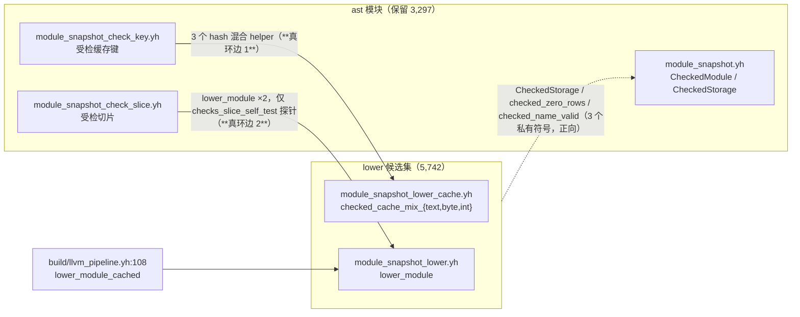
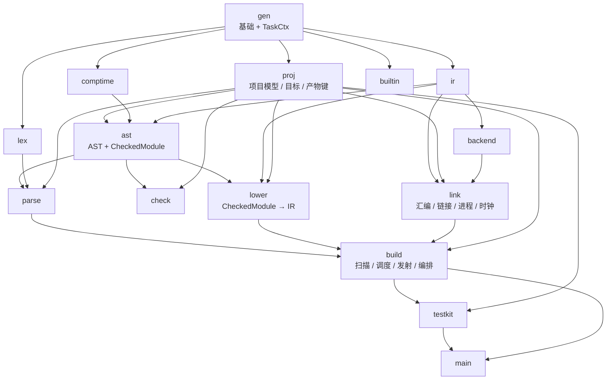
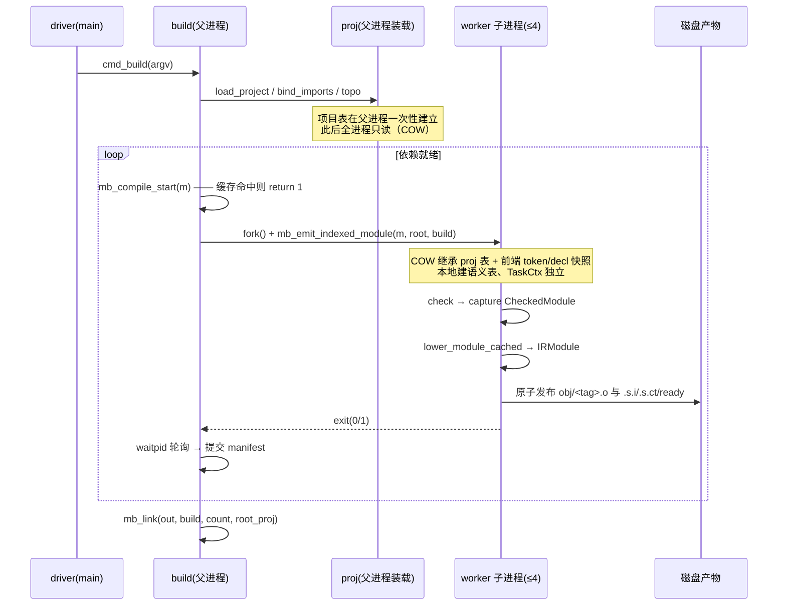
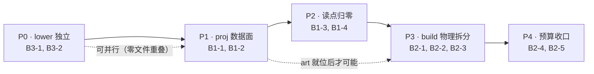

# yh 构建态对象化与 build 拆分 · 重新规划（2026-10-25）

> **2026-11-06 口径更新**：`arch-check` 已取消代码行数预算（`max_file_lines`、`max_function_lines`、`max_*_lines`、`max_cmd_share_pct`）；本文中的行数目标保留为历史设计指标，不再作为门禁。代码规模只由 `just code-stats` 报告。

> 输入：`docs/todo.md`「2026-10-24 架构优化」B1/B2/B3、`docs/finish.md` 的 A4/A6/A7 评审记录。
> 方法：**先读代码再下结论**。本文所有数字来自 `python3 tools/arch-check.py` 与对 `compiler/` 的逐文件实测，
> 凡与既有文档冲突处都在 §1.5 列明并给出实测值。
> 范围：只做设计与任务分解，不含实现代码。

---

> **实施回填 · B2（2026-10-26）**：P3（B2-1/B2-2/B2-4）与 P4（B2-3/B2-5）
> 已全部落地并双门全绿，见 [finish.md](../../finish.md)。落地时对本文的修正：
> 1. **B2-1 只搬“纯计算”**：产物路径/键进 `proj_40_art.yh`，但 `mb_mkdir`、
>    `mb_iface_write_ready`/`mb_iface_ct_same`/`mb_iface_copy_file`、
>    `mb_manifest_commit` 留在 build（要建目录/写文件，`link` 又在 `proj` 之上，
>    不能反向依赖）。会话接口后缀改成显式 `suffix` 参数，`default_binary_path`
>    不再借 build 的 `append_bytes_np`（后者升为 `gen.append_np`）。
> 2. **`link` 的落点**：`pl_target_code_current` → `proj.target_code_current()`、
>    `append_bytes_np` → `gen.append_np()`、对象/链接计时进 `link/context.yh`；
>    `project_link.yh` 留在 build（读 `toml_*` globals），`link → build` 不存在。
> 3. **`mb_link` 阶段化用 `LinkPlan` 而非 `LinkArgs`**：一次链接的全部可变量
>    （含 argv、三类路径行缓冲、`library_search_*`）都在栈上结构里，阶段只返回
>    0/-1，`mb_link_release` 统一释放；实测 676 → 编排 41 行 + 六阶段
>    （60/167/161/148/96/52）。
> 4. **实测 vs 目标**：`build` 6,308（目标 ≈6,000）、`link` 3,657（目标 ≈3,476）、
>    `proj` 1,353（目标 ≈1,300）；`max_function_lines` 目标 ≤260 实际 360
>    （最大函数已是 `lower/module_snapshot_lower_expr`，`mb_link` 侧最大
>    274 属 `mb_link_query_identity`，不在本轮范围）；`max_file_lines` 目标 ≤900
>    未达，最大文件是 `parse/parse_expr` 2,042（本文 §6 明确不做 parse 拆分）。

> **实施回填（2026-10-26）**：P1（B1-1）与 P2（B1-2..B1-4）已全部落地并双门禁
> 全绿，见 [finish.md](../../finish.md)。落地时对本文的三处修正：
> 1. **B1-2 的归属**：目标/配置的**存储**归 `proj.ProjectCtx.cfg`，但**类型**
>    `gen.TargetCfg` 与读写口必须留在 `gen`（`gen/target.yh`、`gen/symbols.yh`
>    自己也在读 `dialect`/`module_mode`），因此改成「`proj` 持实体 + `gen` 持
>    `c_cfg` 指针」，而不是把字段直接搬进 `proj`。
> 2. **统计的归属**：25 个统计数据写入方主要在前端（lex/parse/ast），搬进 `build`
>    会造成 build↔gen 双向耦合；落地为 `gen.CompileStats` + `gen.stats()` 窄口。
>    `BuildCtx` 只收 build 自己的会话身份/计时/调度/依赖表（21 个 `let`）。
> 3. **`gen.G()` 目标达成**：165 → 0，`G()` 与 `GenState` 一并降为 `gen` 私有；
>    `arch-check` 的 `max_g_call_sites` 预算已改为 0。
> 规模：`proj` 775 行（预估 ≈1,300）、`build` 10,289（预估 ≈6,000 属 B2 目标）。

## 0. 结论速览

| # | 结论 | 依据 |
|---|---|---|
| C1 | **顺序应改为 `B3 → B1 → B2`**，且 B3 可与 B1 并行（两者零文件重叠） | §7 |
| C2 | todo 说「三项是同一件事，不同批要改三遍」——**B1+B2 成立，B3 不成立** | B3 侧 `gen.G()`/`gen.task()`/`c_target`/`p_*` 读点 **实测全为 0**；§7 |
| C3 | 「A7 被环阻塞」的前提**已失效**：`module_snapshot.yh` 调 `lower_module` 实测 **0 处**（文档说 4 处）；真正的环边只有 **2 处** | §1.4 |
| C4 | B3 的真实规模是 **15 文件 / 5,742 行**（文档说 10 文件 / 4,739 行，漏了 ctx/forin/global/static/template 共 1,003 行） | §1.4 |
| C5 | todo 说 BuildCtx 要「随 worker/线程模型一起传递」——**实测没有线程模型**：`fork()` + `waitpid` 的有界进程池（并发 4），COW 隔离，**无锁需求** | §2.4 |
| C6 | `gen.G()` 的真实病灶不是「165 个调用点」，而是 **1,550 次字段读**（项目表 678 / 任务态 642 / 统计 88 / 目标 82 / 其它 60）；每调用点平均带 9.4 次读，所以加窄口必然本末倒置 | §1.2 |
| C7 | 目标形态：模块 **12 → 15**（新增 `proj` / `lower` / `link`），`gen.G()` **165 → 0**，build **10,717 → ≈6,000**，最大文件 **2,242 → ≤900** | §2、§3 |
| C8 | 交付为 **5 个可独立提交的阶段 / 11 个任务**，每期结束三门全绿 | §3、§4 |

---

## 1. 问题诊断（实测）

### 1.1 基线与口径

`make arch-check` 实测（2026-10-25，与 todo 一致，可信）：

| 指标 | 实测 |
|---|---|
| 模块 / 文件 / 代码行 | 12 / 114 / 51,493 |
| 行数分布 | ast 9,039 · backend 3,340 · build 10,717 · builtin 172 · check 958 · comptime 5,521 · gen 5,599 · ir 4,230 · lex 741 · main 381 · parse 9,280 · testkit 1,515 |
| 依赖边 / 最大文件 / 最大函数 | 33 / `module_build.yh` 2,242 / `mb_link` 674 |
| `gen.G()` 调用点 | 165（build 101 · testkit 27 · parse 21 · main 5 · 其余 11） |
| 模块级可变 `let` / 容量安全追加点 | 183 / 45 |
| `GenState` 字段 / `TaskCtx` 字段 | 64 / 188（合计 252） |

> **口径说明**：`arch-check` 的正则统计含注释，得 165；剔除注释后代码内实测 **162**。
> 本文正文用 165（与门禁一致），字段级分析用 162 的样本。

### 1.2 `gen.G()` 读点分类

**(a) 按模块（代码口径 162）**

| 模块 | 读点 | 备注 |
|---|---|---|
| build | **101** | 本次主体 |
| testkit | 27 | 只读项目表 + 测试配置 |
| parse | 20 | 已降到窄口边缘 |
| cmd | 5 | driver 3 + api 2 |
| check | 3 / comptime 3 | `c_target` 为主 |
| ast | 2 / lex 1 | 单点 |
| gen | 2 | `state.yh` 内部 |

**(b) 按字段（经 `let gs *gen.GenState = gen.G()` 后的字段读，1,550 次）**

| 类目 | 次数 | 占比 | 代表字段 |
|---|---|---|---|
| 项目模型 | **678** | 43.7% | `p_projs` 214 · `p_mods` 146 · `p_files` 96 · `p_proj_n` 39 · `p_imp_*` 125 · `p_mod_n`/`p_file_n` 40 · `p_stdlib`/`p_state` 15 |
| 任务态 `task.*` | **642** | 41.4% | `np_data` 127 · `c_src` 51 · `c_pos` 42 · `c_toks` 35 · `c_decl_attrs` 27 |
| 统计 `c_stats_*` | **88** | 5.7% | `c_stats_enabled` 22 + 18 个阶段计数 |
| 目标/配置 | **82** | 5.3% | `c_target` 66 · `c_opt_level` 7 · `c_emit_kind`/`c_dialect`/`c_host_target`/`c_target_explicit` 9 |
| 其它 | 60 | 3.9% | `to_type`、`json` 等误命中的标识符 |

**(c) 按文件（前 10，字段级）**

| 文件 | 项目表 | 目标 | 统计 | 任务态 | 其它 |
|---|---|---|---|---|---|
| build/project_state.yh | 212 | 0 | 0 | 5 | 9 |
| testkit/test_cmd.yh | 55 | 1 | 0 | 33 | 8 |
| parse/parse_decl.yh | 0 | 0 | 4 | 175 | 1 |
| build/project_index.yh | 103 | 4 | 2 | 109 | 7 |
| build/project_resolve.yh | 93 | 0 | 0 | 11 | 1 |
| build/module_build.yh | 85 | 10 | 40 | 71 | 8 |
| build/module_worker.yh | 33 | 1 | 6 | 24 | 10 |
| build/link_cache.yh | 30 | 19 | 8 | 33 | 5 |
| build/project_link.yh | 37 | 7 | 0 | 6 | 0 |
| parse/iface_ct.yh | 0 | 0 | 0 | 58 | 0 |

**诊断结论**：
1. **项目表（678 次）是最大单块**，且它的定义（`GenState` 字段）与使用（build 101 处）**跨模块错位**——build 是唯一写者却必须经 `gen.G()` 读，这才是「加窄口本末倒置」的真实原因。
2. **任务态 642 次不需要动**（`gen.task()` 已经是正确抽象，A4b 已完成）。
3. 统计 88 / 目标 82 是「浅触点、可机械迁移」的一批，适合做 B1 的第一台阶。

### 1.3 build 的 22 个文件分簇

| 簇 | 文件 | 行数 | 关键符号 |
|---|---|---|---|
| **项目模型 / 发现** | project.yh, project_state.yh, project_index.yh, project_resolve.yh, toml.yh, project_dir.{darwin,linux.x64,linux.arm64} | **2,895** | `pj_*`, `toml_*`/`tml_*` |
| **链接** | link_cache.yh, link_inputs.yh, project_link.yh, darwin_link.yh, process.yh, clock.{darwin,linux.x64,linux.arm64} | **3,858** | `mb_link`, `li_*`, `pl_*`, `cmd_process_*`, `cmd_darwin_*` |
| **调度** | build_scheduler.yh | **459** | `mb_sched_*`, `mb_schedule_modules` |
| **模块发射** | module_build.yh, module_worker.yh, function_ir_cache.yh, llvm_emit.yh, llvm_pipeline.yh | **3,505** | `mb_compile_start`, `mb_emit_indexed_module`, `firc_*`, `llvm_*` |
| 合计 | 22 | **10,717** | |

**簇间真实耦合（实测，不是推测）**

| 从 | 到 | 依赖内容 | 后果 |
|---|---|---|---|
| 链接簇 | 发射簇 | **6 个符号**：`mb_fnv` `mb_hash_file` `mb_hash_init` `mb_mod_tag` `mb_module_obj_row` `mb_open_out` | 「产物路径与键」工具被两簇共用 → 不先抽出，link 无法独立成模块 |
| 链接簇（project_link） | 项目模型簇（toml.yh） | **模块级 globals**：`toml_secs` `toml_sec_n` `toml_sec_str` | project_link 不能进 `link`（否则 `link → build` 成环） |
| 发射簇 + 链接簇 + testkit | host 原语 | `cmd_mkdirs` 8 处、`cmd_process_run/capture/status` 12 处、`cmd_clock_ns` 14 处 | 三方共用 → 原语必须落在两簇**之下** |
| 全簇 | 项目表 | `pj_state()` 142 处、`pj_pool_str` 107 处、`pj_canon` 21 处、`mb_dep_*` 132 处 | `pj_canon` 把结果写进 `pj_state().canon_off/len`，是**隐式出参**，任何拆分都会踩 |

### 1.4 `ast ↔ lower` 环的实际边

**规模（实测，与 todo/finish 不一致）**

| 项 | 文档说法 | 实测 |
|---|---|---|
| 待迁文件 | 10 个（`module_snapshot_lower*` + `ast_ir*`） | **15 个**：另含 `module_snapshot_ctx`(115) `module_snapshot_forin`(263) `module_snapshot_global`(271) `module_snapshot_static`(227) `module_snapshot_template`(127) |
| 行数 | 4,739 | **5,742**（+1,003） |
| 迁出后 ast | — | **3,297**（ast_decl 257 / ast_expr 326 / ast_function 187 / ast_stmt 455 / ast_view 51 / module_snapshot 554 / check_key 166 / check_slice 1,214 / module_snapshot_view 87） |
| lower 侧 `pub` 面 | — | **4 / 152**（`lower_module` `lower_module_cached` `CheckedLowerStats` + 1） |

**环的边（符号级，实测全部）**



**关键事实修正**

| 文档说法 | 实测 |
|---|---|
| `ast/module_snapshot.yh` 有 4 处调用 `lower_module` | **0 处**（该文件只在注释里提到 lowering） |
| `lower_module` 调用点在 check 流水线内部，属流程耦合，须先重构 check 流程 | 生产驱动点**已经在 build**（`build/llvm_pipeline.yh:108`）；`ast` 内仅剩 **2 处**，全部在 `checked_slice_self_test`（一个**只被 `tests/modules/projects/llvmlower/main/main.yh` 调用**的离线等价性探针） |
| lower 侧依赖 ast 的 57 个符号 | 符号级实测 **28 个**（9 pub + 19 private），其中 **15 个 private 随 5 个「漏算文件」一起搬走**，真正需要在 ast 侧补 `pub` 的只有 **3 个**：`CheckedStorage`、`checked_zero_rows`、`checked_name_valid`（探针随迁还需 `checked_slice_release`，+1） |

**结论**：B3 不是「流程重构」，而是**一次纯搬迁 + 3 个 helper 下沉 + 1 个探针随迁**。原判断「须先接开 check 产出与 lower 消费」**不成立**。

### 1.5 三条必须修正的前提（否则工程量会算错 3 倍）

| # | 错误前提 | 实测事实 | 影响 |
|---|---|---|---|
| P1 | 「BuildCtx 随 worker/线程模型一起传递」（todo B1） | **没有线程模型**。`build_scheduler.yh:59` 是 `fork()`，`:347` 是 `waitpid(...,1)` 轮询，并发上限硬编码 4，`:238` 失败用 `kill(pid,15)`；子进程从 `:63` 起跑 `mb_emit_indexed_module`。COW 隔离，**无需锁** | 若按「线程安全」设计会白做互斥与同步；正确动机是 **字段偏移膨胀 + 读点归属**（§2.3） |
| P2 | 「A7 环阻塞，待 build CLI 重构一并处理」（finish.md ×2 处） | 环只剩 2 条边，其中 1 条在**测试探针**里；`module_snapshot.yh` 实测 0 处调用 | B3 可立即开工，不必等 build 重构 |
| P3 | 「lower = 10 文件 4,739 行」 | **15 文件 5,742 行**（`module_snapshot_ctx/forin/global/static/template` 是 lowering 实现，只是文件名没有 `lower` 前缀） | 按 10 文件搬会把 5 个文件留在 ast，形成「ast 仍含 lowering 实现」的半吊子状态 |

---

## 2. 目标架构

### 2.1 模块清单（12 → 15）

| 模块 | 现状 | 目标 | 动作 | 职责 |
|---|---|---|---|---|
| gen | 5,599 | ≈5,480 | **瘦身** | `TaskCtx`（188 字段，前端每任务态）· 名字池/缓冲/诊断/哈希 · 符号与类型表 · 目标描述符**定义** · ABI |
| ir | 4,230 | 4,230 | 保留 | SSA IR 模型与序列化 |
| lex | 741 | 741 | 保留 | |
| comptime | 5,521 | 5,521 | 保留 | |
| builtin | 172 | 172 | 保留 | |
| **proj** | — | **≈1,300** | **新增** | `ProjectCtx`（项目/模块/文件/导入四张表 + 目标 + 构建配置）· **唯一写者 API** · 窄口读口 · 产物路径与键（art） |
| ast | 9,039 | **3,297** | 收缩 | AST arena + `CheckedModule` 受检快照 + 切片 |
| **lower** | — | **5,742** | **新增** | `CheckedModule → IRModule`（15 文件） |
| check | 958 | 958 | 保留 | 快照校验 |
| parse | 9,280 | 9,280 | 保留（改读口） | |
| backend | 3,340 | 3,340 | 保留 | |
| **link** | — | **≈3,476** | **新增** | 工具链调用层：汇编、链接驱动、`lld` 自举闭包、进程、时钟 |
| build | 10,717 | **≈6,000** | 收缩 | 扫描/索引/导入绑定/topo/调度/模块发射/编排 |
| testkit | 1,515 | 1,515 | 保留（改读口） | |
| main | 381 | 381 | 保留 | |

**proj 内容清单（它拿走什么）**

| 来源 | 行数 | 内容 |
|---|---|---|
| `build/project_state.yh` | 574 | `PjState` + `pj_proj_push`/`pj_mod_push`/`pj_file_push`/`pj_imp_push`（唯一写者）+ `pj_canon`（**改显式出参**）+ `pj_pool_str`/`pj_env_fetch`/`pj_file_exists`/`pj_proj_diag` |
| `build/module_build.yh` 摘取 | ≈500 | `mb_build_dir` `mb_sub_dir` `mb_mod_tag` `mb_asm_stem_base` `mb_asm_stems` `mb_module_obj_row` `mb_module_iface_*` `mb_module_ctiface_*` `mb_module_ready_path` `mb_iface_*` `mb_mkdir` `mb_open_out` `mb_default_binary_path` |
| `build/module_build.yh` + `link_cache.yh` 摘取 | ≈210 | `mb_hash_init` `mb_fnv` `mb_hash_file` `mb_hash_hex` `mb_hash_tool_identity` `mb_mix_compiler_fingerprint` `mb_write_manifest` |
| `gen/state.yh` 字段 + `gen` 窄口 | ≈150 | 22 个项目字段、9 个目标字段、5 个测试/扫描字段；`G().p_file`→`proj.file`、`module_mode`、`test_file_selected` |
| — | — | **表类型**：`PFile` `PMod` `PProj` `PDep` `PInput` `PJDirEntry` `PLinkGroup` `PLinkItem` 从 `gen/model.yh` 迁入（涉及 **69 处 / 17 文件**前缀改写） |

**link 内容清单**：`link_cache.yh` 1,448 + `link_inputs.yh` 966 + `darwin_link.yh` 838 + `process.yh` 164 + `clock.*` 60 = **3,476**。
**project_link.yh（382）不进 link** —— 它读 `toml_secs`/`toml_sec_n`/`toml_sec_str`（toml.yh 的模块级 globals），进 link 会造成 `link → build` 环。

### 2.2 依赖方向（目标，无环）



**`arch-check` 的 `ALLOWED` 目标值**

```python
ALLOWED = {
    "gen": set(),
    "ir": set(),
    "lex": {"gen"},
    "comptime": {"gen"},
    "builtin": {"gen"},
    "proj": {"gen"},                                         # 新
    "ast": {"gen", "comptime", "ir", "proj"},
    "check": {"gen", "ast", "proj"},
    "parse": {"gen", "lex", "comptime", "ast", "ir", "proj"},
    "lower": {"gen", "ir", "ast", "proj"},                   # 新
    "backend": {"gen", "ir"},
    "link": {"gen", "proj", "backend"},                      # 新
    "build": {"gen", "lex", "parse", "comptime", "ast", "check",
              "ir", "backend", "builtin", "proj", "lower", "link"},
    "testkit": {"gen", "parse", "build", "proj"},
    "main": {"gen", "lex", "comptime", "ast", "check", "parse", "ir",
             "backend", "builtin", "build", "testkit", "proj", "lower", "link"},
}
```

**新增硬规则**（写进 `ALLOWED` 旁的注释与评审清单）

| 规则 | 理由 |
|---|---|
| `proj` 不得 import 任何前端模块（只允许 `gen`） | 它是前端与构建层共用的数据层，一旦反向依赖就成环 |
| `lower` 不得 import `parse` / `check` / `build` | 只吃受检快照（与设计文档 §2.4 一致） |
| `ast` 不得 import `lower` | 这是 B3 的全部意义；由 `ALLOWED` 强制 |
| `build` 不得 import `main` / `testkit` | 沿用 A2c/A6 结论 |
| 任何模块不得直接读写 `proj` 的表字段，只能走 `proj.*()` | 保证「唯一写者」 |

### 2.3 三个上下文：字段划分与唯一写者

| 上下文 | 归属 | 字段数 | 唯一写者 | 读者 | 生命周期 |
|---|---|---|---|---|---|
| `TaskCtx` | gen（**不动**） | 188 | 当前 worker 进程内的前端（lex/parse/comptime/check） | 同左 | 每编译单元；fork 后子进程私有 |
| `ProjectCtx` | **proj（新）** | ≈40 | `proj` 自己的 `add_*`/`canon`（仅由 build 的 scanner 调用） | parse·ast·check·lower·build·link·testkit | 父进程装载一次；fork 后**所有进程只读** |
| `BuildCtx` | **build（新，模块私有）** | ≈12 | build 的编排函数 | build（+ `main` 只经 `build.*` 访问） | 一次构建；父进程持有 |

**`ProjectCtx` 字段划分**

| 组 | 字段 | 原位置 | 写者 |
|---|---|---|---|
| 项目表 | `projs *PProj` `proj_n` `proj_cap` | `GenState` | `proj.add_proj/add_mod/add_file/add_import` |
| 模块表 | `mods *PMod` `mod_n` `mod_cap` | `GenState` | 同上 |
| 文件表 | `files *PFile` `file_n` `file_cap` | `GenState` | 同上 |
| 导入表 | `imp_*` 11 个平行数组 + `imp_n/cap` | `GenState` | 同上 |
| 路径游标 | `canon_off/canon_len` `root_off/root_len` `envp` `order/mark` | `GenState` + `PjState` | `proj.canon(...)`（**改显式出参，取消隐式写全局**） |
| 目标 | `target` `host_target` `target_explicit` `dialect` `opt_level` `emit_kind` `emit_text_path` | `GenState` | `proj.set_target()` （仅 driver/scanner） |
| 构建配置 | `module_mode` `is_entry_mod` `test_project` `test_key` `test_mod_filter` `test_file_filter` `scan_file_off/len` `stdlib` `state` | `GenState` | 同上 |

**`BuildCtx` 字段划分（build 私有单例，替代现有 50 个 build 模块级 `let`）**

| 组 | 字段 | 现形态 |
|---|---|---|
| 会话 | `argv0 *char`、`iface_suffix *char`、`compiler_fingerprint u64`、`fingerprint_ready int` | 5 个模块级 `let` |
| 统计 | `stats_enabled`、`stats_lex/syntax/index/pass1/globals/functions`、`stats_ir_*`、`stats_check_*`、`stats_workers/asm/link`、5 个 `mb_stats_*_ns`、`sched_peak`、`sched_iface_early` | 24 个 `let`（含 `gen` 里的 18 个 `c_stats_*`） |
| 模块依赖表 | `dep_bind/dep_bindlen/dep_ifoff/dep_ctoff/dep_mod/dep_mi/dep_n/dep_cap/dep_base` | `mb_dep_*` 9 个 `let`，**132 处引用** |
| 扫描产物 | `order/paths`… | 由 `proj` 持有，`BuildCtx` 只存 `build_off/build_len/root_off/root_len` 游标 |

> **为什么 BuildCtx 仍是单例**：yh 没有闭包/方法，把 `*BuildCtx` 逐层传参会让 101 个读点变成 101 条参数链。
> 目标不是「消灭单例」，而是**把 252 字段的单例降到三处各自 ≤200 字段的专用结构**，
> 并让 `gen.G()` 在 build 里的 101 处读点归零（`gen.G()` 全仓 165 → 0）。
> 这一条要在文档与注释里写死，否则下一轮评审会把它当「换个名字的全局」再否一次。

### 2.4 fork 模型与跨进程契约（实测）



| 契约 | 内容 |
|---|---|
| 并发单位 | **进程**（`fork`），不是线程。**不存在共享可写内存，不需要锁** |
| 传递方式 | 项目表/目标/配置靠 **fork 时的 COW 继承**（天然只读）；每任务只显式传 5 个标量：`m`、`root_off/len`、`build_off/len`（已如此） |
| 子进程可写 | 只有自己的 `TaskCtx`、本地产物文件、`BuildCtx` 的 `stats` 副本（进程退出即丢弃） |
| 禁止事项 | 子进程**不得**写 `ProjectCtx` 的 `canon_off` 之类「隐式出参」字段——父进程看不到，且会污染后续诊断路径。`pj_canon` 改显式出参后此风险消除 |
| 不需要 | 互斥锁、原子计数、共享内存、线程局部存储 |

### 2.5 `gen` 在目标架构里还剩什么

| 保留 | 迁出 |
|---|---|
| `TaskCtx`（188 字段，前端每任务态：token/符号/类型/作用域/字面量/循环栈…） | 22 个项目表字段 → `proj` |
| 名字池 `np_data/np_len/np_cap`、`name_intern`、`tml_intern_str` | 9 个目标/配置字段 → `proj` |
| 缓冲/追加 `append_str/int/byte`、`arr_cstr`、`write_all`、`fail*` | 5 个测试/扫描字段 → `proj` |
| 哈希、`hexval`、`DATA_STR`/`em_*` 登记表 | 18 个 `c_stats_*` → `build.BuildCtx` |
| `TargetInfo` **类型与 `target_host_info()`**（描述符定义） | `c_module_mode`/`c_is_entry_mod` → `proj` |
| `sem_*` 语义表操作（符号/类型/签名） | — |
| `G()`（**降级为 gen 私有或删除**，目标：全仓 0 调用） | — |

### 2.6 三个必须遵守的构造约束（实测得来）

| # | 约束 | 证据 | 违反后果 |
|---|---|---|---|
| K1 | **模块内文件按文件名顺序编译**（类型先声明后使用） | `module_snapshot.yh:58` 注释明写「按模块『类型先声明后使用 + 文件名序编译』的约束放在 module_snapshot_ctx.yh」；`ir/` 用 `ssa_module_00_model` `_10_build` `_20_verify` 编号 | lower 15 文件搬入新模块后，`ast_ir*.yh` 字母序在 `module_snapshot_ctx.yh` 之前；若 `AstIRBuilder` 引用 ctx 类型则编译失败。**对策**：搬完立即 `make`，报「未声明」就加数字前缀（`lower_00_model`/`lower_10_ctx`/…） |
| K2 | **`pub` 同时决定 `.s.i` 接口与 `.globl`**，模块私有类型不得出现在 pub 签名/pub 字段/pub 别名 | `AGENTS.md` | 补 pub 会同时改接口文件与符号可见性，**触发下游对象键全变**（正确，但会让增量缓存清空一轮） |
| K3 | **模块私有 `let` 跨模块不可见**，跨模块可变状态只能经 `pub fn` | `gen/state.yh` 头注释（原 208 个 pub let 被废除） | 新模块 `proj`/`link` 不得导出全局表，必须 `pub fn` 访问器 |
| K4 | `arch-check` 的 `ALLOWED` / `BUDGETS` 是**刻意摩擦**：上调必须改文件并在 `finish.md` 说明 | `tools/arch-check.py` 头注释 | 新模块不加 `ALLOWED` 直接失败；预算上调无记录会在评审被退回 |

---

## 3. 迁移分期

### 3.1 五个阶段（每阶段结束三门全绿、可独立提交）

| 阶段 | 名称 | 内容 | 结束指标 | `make arch-check` 预算改动 |
|---|---|---|---|---|
| **P0** | `lower` 独立（B3） | 3 个 hash helper 下沉 → 探针随迁 → 15 文件 `git mv` 到 `compiler/lower/` | 模块 12→13；ast 9,039→3,297；lower 5,742；行数总量不变；`lower_module` 唯一驱动源仍在 build | `ALLOWED["lower"]={"gen","ir","ast"}`（P1 后再加 `"proj"`）；新增 `max_lower_lines: 5742`、`max_ast_lines: 3297` |
| **P1** | `proj` 数据面（B1 上半） | 建 `proj`：表类型 + `ProjectCtx` + 唯一写者 + 窄口 + art 路径/键 + `pj_canon` 显式出参 | 模块 13→14；build ≈9,400；`p_projs/p_mods/p_files` 读点上移到 `proj.*()`；`gen` 字段 64→≈24 | `ALLOWED["proj"]={"gen"}`；`max_proj_lines: 1600`；`max_build_lines` 10,720→9,600；`max_globals` 190→180 |
| **P2** | 读点归零（B1 下半） | 目标/配置迁 `proj.Cfg`；build 建 `BuildCtx` 收 50 个 `let`；testkit/cmd 改读口；`G()` 降级 | **`gen.G()` 165 → 0**；build 全局 50→1 结构；`gen.G()` 在 build/testkit/parse/main 全消失 | `max_g_call_sites` 165→**0**；`max_globals` 180→≈130；`max_module_lines`(main) 381 不变 |
| **P3** | build 物理拆分（B2 上半） | art 已就位 → 建 `link`（5 文件 3,476）→ `mb_link` 拆 5 阶段 → `module_build` 拆 3 文件 | 模块 14→15；build 10,717→≈6,000；`max_file_lines` 2,242→≤900；`max_function_lines` 674→≤260 | `ALLOWED["link"]={"gen","proj","backend"}`；`max_link_lines: 3600`；`max_build_lines` 9,600→6,300；`max_file_lines` 2,242→900；`max_function_lines` 700→260 |
| **P4** | 预算收口（B2 下半） | 把 P0–P3 实测值写回 `BUDGETS` 并补 `finish.md` 记录；`tests/tools/arch-check` 自测复跑 | 全部预算等于实测值（无余量），后续任何增长立刻红 | 全量对齐；`min_cap_appends` 保持只增 |

### 3.2 阶段依赖



拓扑序（严格偏序）：`B3-1 → B3-2 → B1-1 → B1-2 → B1-3 → B1-4 → B2-1 → B2-2 → B2-3 → B2-4 → B2-5`。
唯一可并行对：`B3-*` 与 `B1-*`（B3 只用 `ast/` 与 `compiler/lower/`，B1 只用 `gen/`+`build/`+`proj/`，文件集不交）。

---

## 4. 任务分解表

> 粒度：一人一天内可提交并全绿。每行「验收门」都是可执行命令 + 期望输出。

### 4.1 细表

| ID | 目标（一句话） | 涉及文件 | 预估规模 | 前置 | 验收门 | 风险 |
|---|---|---|---|---|---|---|
| **B3-1** | 解掉两条环边：3 个 hash helper 下沉到 ast、等价性探针搬到 lower 侧文件（仍在 ast 模块内） | `ast/module_snapshot_lower_cache.yh`（删 3 fn）· `ast/module_snapshot_check_key.yh`（接收 3 fn）· 新 `ast/module_snapshot_lower_selftest.yh`（接收 `checked_slice_self_test`，从 check_slice 移出）· `ast/module_snapshot_check_slice.yh`（删 160 行） | ≈160 行移动，0 符号增删 | 无 | `make && make test && make selfhost-native` 全绿；`arch-check` 行数/读点**不变**（165）；`lower` 侧不再被 ast 侧引用（`grep -c lower_module compiler/ast/module_snapshot_check_slice.yh` → 0） | **低**（零语义改动） |
| **B3-2** | `lower` 成模块：15 文件 `git mv`，改 `module lower` + import 头，补 4 个 `pub` | `compiler/lower/`（15 新文件）· `ast/module_snapshot.yh`（3 处补 pub）· `ast/module_snapshot_check_slice.yh`（`checked_slice_release` 补 pub）· `build/llvm_pipeline.yh`·`build/module_worker.yh`（`ast.`→`lower.`）· `tests/modules/projects/llvmlower/main/main.yh`（前缀）· `tools/arch-check.py`（`ALLOWED`） | 5,742 行迁移 · 4 pub · 5 处前缀 · 2 处 import | B3-1 | 三门全绿；`arch-check`：模块 13、`ast=3297`、`lower=5742`、总行数 51,493±0、无环；**固定点 A==B** 逐字节 | **中**：K1 文件名序（见 §2.6），首次 `make` 若报「未声明」→ 加数字前缀重排 |
| **B1-1** | `proj` 模块骨架成立：表类型 + `ProjectCtx` + 4 个 `add_*` 唯一写者 + 窄口读口（表仍由 build 的 scanner 调用） | 新 `compiler/proj/{proj_00_model,proj_10_table,proj_20_path}.yh` · `gen/model.yh`（移出 8 个表类型）· `gen/state.yh`（删 22 字段 + 改 4 个窄口转调）· `build/project_state.yh`（清空/删除）· 17 文件 `gen.P*`→`proj.P*`（69 处） | ≈1,100 行迁入 · 69 处前缀 · 22 字段 | B3-2（顺序无关，可并行） | 三门全绿；`arch-check`：模块 14、`proj≈1100`、`build≈9600`、无环；`grep -c 'gen\.p_file(' compiler` → 0 | **中高**：69 处类型前缀 + 22 字段删除必须一次到位（不留影子字段，见 R3） |
| **B1-2** | 目标/配置迁 `proj.Cfg`，`pj_canon` 改显式出参 | `gen/state.yh`（删 14 字段）· `proj/proj_30_cfg.yh` · `proj/proj_20_path.yh`（`pj_canon(base,len,rel,&off,&len)`）· `build/*`（21 处 `pj_canon` 调用）· `parse/parse_type|parse_decl|parse_expr|parse_global_init` · `comptime/ct_target|ct_layout|ct_ir_place` · `ast/module_snapshot*` · `build/link_cache|function_ir_cache|llvm_pipeline` · `cmd/driver` | ≈180 行 · 96 个读点（82 目标 + 14 配置）· 21 处 canon | B1-1 | 三门全绿；`arch-check`：`gen.G()` 165→≈64（build 侧仅剩统计相关 40）；`pj_canon` 无调用点读 `pj_state().canon_off` | **中**：`pj_canon` 是隐式出参，改签名时 21 处必须同时改，漏一处会读到上一次的游标（**症状：路径串位，不崩**） |
| **B1-3** | build 建 `BuildCtx`：收 50 个模块级 `let`（会话 5 + 统计 24 + `mb_dep_*` 9 + 调度 3），101 个 `gen.G()` 读点清零 | `build/build_00_ctx.yh`（新，`BuildCtx` + `bc()`）· `build/module_build|module_worker|build_scheduler|link_cache|link_inputs|project_index|project_resolve|project_link|darwin_link|llvm_*|function_ir_cache`（改读点）· `toplevel` `build/*` 的 `gen.G().p_mods` → `proj.mods(...)` | 50 `let` → 1 结构 · 101 读点 · ≈450 行编辑 | B1-2 | 三门全绿；`arch-check`：build 侧 `gen.G()` = **0**；`max_globals` 183→≈130 | **中**：`mb_dep_*` 132 处引用且被父/子进程共用，必须**进程内唯一实例**（不能按 worker 复制），否则接口路径错乱 |
| **B1-4** | 收尾三处残余读点（testkit 27 / cmd 5 / 其它 11）并**关闭 `G()`** | `testkit/test_cmd.yh` · `cmd/driver.yh`·`cmd/api.yh` · `lex/lexer.yh` · `check/verify.yh` · `ast/module_snapshot*` · `gen/state.yh`（`G()` 去 `pub` 或删除）· `tools/arch-check.py` | 43 读点 · `G()` 降级 | B1-3 | 三门全绿；`arch-check`：**`gen.G()` = 0**，`max_g_call_sites` 预算改 0 | **低**：`G()` 去 pub 后任何漏改都会编译失败（**这是好事**，比运行时错位好定位） |
| **B2-1** | 把「产物路径与键」从发射簇抽进 `proj`（`art` 子簇），为 link 独立清障 | `build/module_build.yh`（移出 ≈500 行）· `build/link_cache.yh`（移出 `mb_hash_*`/`mb_write_manifest` ≈210）· `proj/proj_40_art.yh`（新）· `build/*` 改前缀 | ≈710 行迁移 · 6 个跨簇符号变 `proj.*` | B1-4 | 三门全绿；`grep -c 'mb_module_obj_row\|mb_mod_tag\|mb_fnv' compiler/build/link*.yh` → 0（已全部 `proj.` 前缀） | **低**：纯搬迁，但 `mb_module_obj_row` 是 100 行多分支，搬时勿改逻辑 |
| **B2-2** | `link` 成模块：5 文件迁出（`link_cache`+`link_inputs`+`darwin_link`+`process`+`clock.*`） | `compiler/link/`（5+3 新文件）· `build/module_build.yh`·`build/llvm_emit.yh`·`build/function_ir_cache.yh`·`build/module_worker.yh`·`testkit/test_cmd.yh`（`cmd_mkdirs`/`cmd_clock_ns` 改 `link.`）· `tools/arch-check.py` | 3,476 行迁移 · ≈40 处前缀 · ≈12 个 pub 补 | B2-1 | 三门全绿；`arch-check`：模块 15、`link=3476`、`build≈6000`、无环（尤其 `link → build` 必须不存在） | **中**：`project_link.yh`（382 行）**必须留在 build**，误迁会立刻造成 `link → build → link` 环 |
| **B2-3** | `mb_link` 拆 5 阶段 + 引入 `LinkPlan`/`LinkArgs` + 统一释放 | `link/link_cache.yh`（674 → 5 个 ≤160 行 fn + 2 个结构） | 674 → ≈700 行分散 · **消除 20+ 处 4 连 `free` 错误分支** | B2-2 | 三门全绿；`arch-check`：`max_function_lines` 674→≤260；`link` 产物逐字节不变（同一输入对比 `obj/`/二进制） | **中**：阶段间共享 30+ 局部量，必须全部进 `LinkArgs`；漏一个会静默用默认值 |
| **B2-4** | `module_build` 拆 3 文件（发射 / 缓存键 / CLI） | `build/module_emit.yh`·`build/module_cache.yh`·`build/module_cmd.yh`（新）· `build/module_build.yh`（删除或瘦成 ≤120 的公共头） | 1,740 → 3 × ≈600 | B2-3 | 三门全绿；`arch-check`：`max_file_lines` ≤900 | **低**：同模块内文件搬家，无 import 变化 |
| **B2-5** | 预算收口：把实测值写回 `BUDGETS`，补 `finish.md` | `tools/arch-check.py`·`docs/finish.md`·`docs/todo.md`（勾掉 B1/B2/B3） | 12 个预算项 · 3 节记录 | B2-4 | `make arch-check` 通过且**无余量**；`make test-arch-check` 通过（自测注入仍能抓到 `max_file_lines`） | **低**：唯一风险是把预算写成「刚好不红」，留一点余量更稳（+2%） |

### 4.2 粗粒度 5 任务映射（给任务系统用）

| 粗任务 | 含细任务 | 一句话 |
|---|---|---|
| T1 | B3-1, B3-2 | `lower` 独立成模块，拆掉 ast↔lower 的两条环边 |
| T2 | B1-1, B1-2 | 建 `proj`：项目表 + 目标/配置 + `canon` 显式出参 |
| T3 | B1-3, B1-4 | build 建 `BuildCtx`，`gen.G()` 归零 |
| T4 | B2-1, B2-2, B2-3 | 抽 art → 建 `link` → `mb_link` 阶段化 |
| T5 | B2-4, B2-5 | `module_build` 拆分 + 预算收口 |

---

## 5. 风险与回退

| ID | 风险 | 触发症状 | 定位方法 | 回退 |
|---|---|---|---|---|
| **R1** | **固定点被破坏**（A≠B） | `make selfhost-native` 在「候选两代固定点」处报字节差异 | ① 回退点是**非确定性**还是**语义漂移**：连续跑 2 次同一代，若两次结果自身不同 → 非确定（多为哈希/遍历顺序/`getpid` 掺入）；② 若自洽但 A≠B，按 `<proj>__<mod>` 的 `.s` 逐文件 diff，二分到模块再二分到函数；③ 用 `--emit-llvm` 出 `.ll` 做函数级 diff，比汇编可读 | 逐任务独立提交，破坏点即最后一个提交；`git revert` 单个任务即可回到全绿。**不要**跨阶段排障（P0 与 P2 的差异面不重叠，混在一起无法二分） |
| **R2** | **`pub` 面扩张导致 `.s.i` 抖动** | 全量重编一轮（预期）；若**持续**抖动 → 某模块接口每条构建都变（多为主键里掺了不稳定量） | 构建两次，对比 `build/iface/yh-<mod>.s.i` 的 `sha`：稳定则只是键变更；不稳定则查接口生成里是否带行号/时间/指针值 | 本次只计划补 **4 个 pub**（B3-2）+ **≈12 个**（B2-2）。任一任务若需要补 >15 个 pub，说明切面选错，回退重挑边界 |
| **R3** | **`gen.G()` 迁移期双写不一致**（表同时存在于 `GenState` 与 `ProjectCtx`） | 不崩，但出现「改了 A 看不到 B」：诊断路径串位、模块计数错 1、缓存键算错 | 强制规则：**一个字段只允许一处存储**，迁移任务的验收门加一条 `grep` 断言（例：`grep -c 'p_projs' compiler/gen` → 0） | 绝不留兼容层/转发壳。B1-1 允许「删除 gen 字段」与「新增 proj 字段」在**同一个提交**里（哪怕 diff 大），不允许分两次提交 |
| **R4** | **`arch-check` 预算误伤** | 拆完反而红：`max_file_lines` 仍是 2,242（值没跟着改）、或 `max_build_lines` 因为没减到 6,000 而红 | 预算有**上界**与**下界**两种，方向搞反必红：`max_*` 只能调**小**，`min_cap_appends` 只能调**大** | 每个阶段的预算改动写进该阶段任务的验收门（§3.1 已列目标值），不允许「先红后调」。另注意 `make test` 会跑 `tests/tools/arch-check/check.py` 自测（注入 4,000 行到当前最大文件），拆完后最大文件变小仍能触发 |
| **R5** | **B3 若仍解不开环**（探针无法迁走） | `B3-1` 完成后 `ast` 仍引用 `lower` 符号 | — | 三级降级：**A（首选）** 探针整体随迁至 `lower`，测试项目改调 `lower.checked_slice_self_test`（本文方案）；**B** 探针逻辑复制进 `tests/modules/projects/llvmlower/main/main.yh`，由测试侧用 `ast.checked_module_capture` + `lower.lower_module` 自行驱动（compiler 侧删探针，零 pub 扩张）；**C（不接受）** 在 ast 留转发壳——会把模块环变成跨模块环，比现状更差 |
| **R6** | **K1 文件名序**：新模块编译顺序错 | `make` 报「未声明标识符 `CheckedLower`」之类 | 看报错文件在字母序中的位置与定义文件位置 | 加数字前缀重排（`lower_00_model` `lower_10_ctx` `lower_20_ir` …），与 `ir/`/`comptime/` 既有约定一致 |
| **R7** | **fork COW 语义被破坏**：子进程写 `ProjectCtx` | 父进程汇总统计/路径时缺项；或子进程诊断指向错误文件 | 在 `mb_emit_indexed_module` 入口加一次性断言（`proj` 表 `n` 与父进程一致） | `pj_canon` 显式出参（B1-2 已含）后该类写入消失；若仍发现，改为在 `mb_spawn_indexed_module` 前把游标快照成局部量传参 |

---

## 6. 明确不做（Out of scope）

| 项 | 为什么不做 |
|---|---|
| **`parse`（9,280 行）拆分** | 它是目标架构里第二大的模块，但 `parse_expr`(2,039)/`parse_decl`(1,299) 是语法实现，拆它不改善任何依赖方向，只会和本轮改动抢同一批文件 |
| **`gen` → `base` + `sem` 拆分** | 设计文档 §8 D3 已决策「暂不拆」：334 个 pub 里 157 个是常量、外部零引用仅 4%。本轮只做**状态移出**，不动类型与函数边界 |
| **把语义分析从 `parse`+`gen` 迁到 `check`** | 设计文档 D4 明确「不在 M1 做」，属独立 ADR |
| **引入 `api` 模块 / `Session` 门面** | 设计文档把它列为下一步；本轮 `BuildCtx` 是它的**真子集**（只是 build 私有）。同时做两件会有两套上下文并存期，违反 R3 |
| **线程池 / 线程化 worker** | 实测当前是 fork 进程池，COW 天然隔离。线程化的收益（省 fork 成本）未被测量，成本（锁、共享状态、`TaskCtx` 传递）极大。**留作独立决策**，需先有 PF 性能数据 |
| **`mb_dep_*` 改成按模块动态分配** | 132 处引用、父子进程共用，本轮只做「收进 `BuildCtx`」不改变语义。改成按 `m` 索引的表会让 `.s.i` 与接口路径计算全变，风险与收益不成比例 |
| **`testkit`（1,515 行）拆分** | A6 刚完成搬迁，短期内无第二次拆分的证据支撑 |
| **`ir` / `comptime` 内部重构** | 与依赖方向无关 |
| **删除 `checked_slice_self_test` 探针** | 它是 check↔lower 等价性的唯一自动验证，B3 之后反而是「lower 独立」的健康证明（放在 `lower` 里更合理）。只迁不删 |
| **`.s.i` / manifest 加 schema 版本号** | 设计文档 §2.3 的契约版本化，属独立工作项；本轮只搬边界不加格式 |

---

## 7. 对 B1 / B2 / B3 顺序的重新判断（核心输出）

### 7.1 判断

| 项 | todo 原判断 | 本文判断 | 置信度 |
|---|---|---|---|
| 总体顺序 | `B1 → B2 → B3` | **`B3 → B1 → B2`** | 高 |
| 「三项是同一件事，不同批要改三遍」 | 成立 | **B1+B2 成立；B3 不成立** | 高 |
| B3 是否依赖 B1 | 隐含依赖（同批） | **零依赖，零文件重叠，可并行** | 高 |
| B1 是否必须先于 B2 | 是 | **是，且顺序正确** | 高 |
| B1 能否一次做完 | 视为一项 | **应拆两个台阶**（数据面 / 读点面），各可独立提交 | 中高 |

### 7.2 理由（逐条带数据）

**R-a｜B3 与 B1/B2 完全正交，不存在「改三遍」**

| 检查项 | lower 候选 15 文件内实测 |
|---|---|
| `gen.G()` | **0** |
| `gen.task()` | **0** |
| `gen.p_file()` | **0** |
| `c_target` | **0** |
| `p_projs` / `p_mods` / `p_files` | **0** |
| 代码里出现的模块前缀 | 仅 `gen.` 与 `ir.` |

→ B3 的改动集是 `compiler/ast/` + `compiler/lower/` + 2 处 build 前缀；
B1 的改动集是 `compiler/gen/` + `compiler/proj/` + `build/` + parse/comptime/ast 的**读口**。
两者只在 `ast/module_snapshot*.yh` 的 `import` 头与 `gen.PFile` 类型前缀上相遇（B1-1 的 69 处里约 15 处在 lower 侧）——**顺序无关，谁先谁后都只改一次**。

**R-b｜B3 的前提已被实测推翻，它是三项里最便宜、最先能兑现的**

| 项 | 数量 |
|---|---|
| 环边 | **2**（3 个 hash helper + 1 个探针） |
| 需补 `pub` | **4** |
| 需改前缀/import | 5 处 + 2 行 import |
| 需改测试 | 1 个文件（`tests/modules/projects/llvmlower/main/main.yh`） |
| 风险等级 | 中（唯一硬约束是 K1 文件名序） |
| 收益 | ast 9,039 → 3,297（**−63%**），此后所有涉及 ast 的改动都在 1/3 规模上进行 |

对比 B1：96 个读点 + 22 字段 + 69 处类型前缀 + 442 个项目表读点；B2：3,476 行迁移 + 674 行函数拆分。
→ **先把最便宜、收益最立竿见影的做掉**，同时把「ast 里混着 lowering」这个长期噪声源清掉。

**R-c｜B1 先于 B2 的判断正确，且 B2 的前置比 todo 说的更硬**

todo 只提到「B2 在 B1 之后做，否则拆完还要按新上下文再改一遍」。实测还多两条硬前置：

1. **`link` 无法在 art 抽出去之前独立**：链接簇依赖发射簇的 6 个符号（`mb_fnv`/`mb_hash_file`/`mb_hash_init`/`mb_mod_tag`/`mb_module_obj_row`/`mb_open_out`），这 6 个必须先进 `proj`（B2-1）。
2. **`project_link` 必须留在 build**：它读 `toml_secs`/`toml_sec_n`/`toml_sec_str`（build 内 toml.yh 的模块级 globals），迁进 `link` 会立刻 `link → build` 成环。
3. `process`/`clock` 被 link / emit / testkit **三方共用**，必须落在 `link`（工具链调用层）而不能留 build。

→ B2 不是「搬文件夹」，而是**先抽公共底层（art）→ 再定切面（谁留谁走）→ 才搬**。这个顺序只有在 B1 完成（proj 已存在）后才可能。

**R-d｜B1 应拆成两个台阶，不要一次做完**

| 台阶 | 内容 | 触点 | 独立提交的价值 |
|---|---|---|---|
| 数据面（B1-1/B1-2） | 表 + 目标 + `canon` 显式出参 | 69 前缀 + 22 字段 + 96 读点 + 21 canon | 完成后 `proj` 已是唯一写者，B2 的两个硬前置里有一个（art 需要 proj 的表访问）就绪 |
| 读点面（B1-3/B1-4） | `BuildCtx` + `G()` 归零 | 50 `let` + 101 读点 + 43 读点 | `gen.G()` 归零是可度量、可庆祝的里程碑，且**只有在这一步之后**才能把 `G()` 从 pub 撤掉，让后续漏改变成编译错误 |

若合成一项，diff 会到 3,000+ 行、跨 20+ 文件，R1（固定点破坏）定位成本从「二分一个提交」变成「二分一个巨提交」。

### 7.3 若必须保留原顺序（B1 → B2 → B3）

可行性：**可以**，但代价明确：

| 代价 | 说明 |
|---|---|
| ast 一直是 9,039 行 | B1-1 的 69 处类型前缀里有约 15 处在 lower 侧（`module_snapshot_lower*` 用 `gen.PFile`），B1 时改一次、B3 搬家时这些前缀又跟着文件动一次（虽不改内容，但 diff 重叠 → 冲突/误改风险） |
| 固定点排障面变大 | B1 的改动面最大，一旦破坏固定点，此时 ast 仍与 lowering 混在一起，`--emit-llvm` 的 `.ll` diff 会同时含 3 类改动 |
| 无收益损失 | B3 的收益（−63% ast）会推迟 4 个任务才拿到 |

→ 结论：**推荐 `B3 → B1 → B2`；若出于批次管理必须保持原序，把 B3 插到 B1-1 之前**（成本 1 分钟的重排，收益是避免 15 处前缀二次改动）。

---

## 附录 A · 一次性核对清单（每个任务提交前）

```
[ ] 1. 该任务是否只改一个模块的 import 头？新增 import 是否已在 ALLOWED 登记？
[ ] 2. 是否留下"影子字段"（同一语义在两处存储）？grep 断言是否加进验收门？
[ ] 3. 新增 pub 的清单与消费者是否写在提交信息里？总数是否 ≤ 计划值？
[ ] 4. 新模块目录内的文件名，按字母序是否满足"类型先声明后使用"？
[ ] 5. 预算改动方向：max_* 调小、min_* 调大？目标值是否取自 §3.1？
[ ] 6. 三门：make → make test → make selfhost-native，且 project 123/123 全过？
[ ] 7. 固定点 A==B 逐字节？
```

## 附录 B · 与本仓库既有文档的关系

| 文档 | 关系 |
|---|---|
| `docs/03-design/yh-架构设计.md` §6.2/§6.3 | 本文的 `lower` / `proj` / `link` 与该文档的目标分层一致（该文档的 `Session` ≈ 本文的 `ProjectCtx` + `BuildCtx`；本文**不引入 `api` 模块**，缩小范围） |
| 同上 §3.1 依赖矩阵 | 本文 §2.2 直接给出该矩阵的下一版 `ALLOWED` |
| `docs/finish.md` A7 两段评审（约 64–73 行 / 194–203 行） | **前提已失效**（§1.4）：`module_snapshot.yh` 实测 0 处调用、lower 侧真实 15 文件 5,742 行。A7 可从「暂缓」改为「可开工」 |
| `docs/finish.md` A4a–A4d 评审（约 180–192 行） | 「`gs` 整体传给下游而卡住」的两类位置（①同函数用 `p_files`+`c_module_mode`+`c_target` ②传 `gs` 给下游）正是 B1-2/B1-3 要解的两个具体形态：①由 `proj.Cfg` 一次性替换三处读口；②由 `BuildCtx` 替换「传 `gs`」 |
| `docs/todo.md`「2026-10-24 架构优化」B1/B2/B3 | 本文是其**重新分析版**：顺序改为 `B3→B1→B2`，规模修正 3 处（§1.5），拆分为 11 个任务 |
