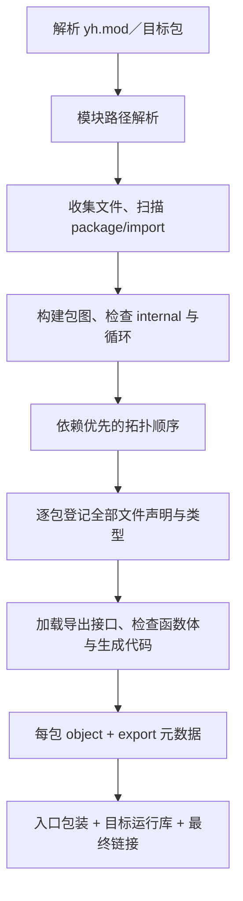

# yh 的 Go 风格模块与包设计

> 已被 [project.toml 模块与项目管理设计](yh-模块与项目管理设计.md) 替代。
> 本文保留为历史方案；package、yh.mod、路径导入和 internal 不再作为当前规则。

日期：2026-09-29。状态：建议方案，尚未修改 grammar 或编译器。

本方案处理 **yh 用户程序的模块、包、导入、多文件、可见性与依赖管理**。
上一份“编译器内部拆文件”的方案不对应本次需求，已停止作为执行清单。
实施任务见 [模块化实施方案](../02-plan/yh-Go风格模块化实施方案.md)，
主要决策见 [ADR-0004](../adr/0004-yh-Go风格模块与包.md)。

本文所有 `package`、`import`、`yh.mod` 和新命令示例均为拟议功能，
当前 0.0.1 编译器不能直接执行。清单里的 `yh 0.0.2` 是建议的版本门槛，
实际发布版本在实施时确定。

## 1. 推荐模型

Go 将 module 用于依赖和版本管理，将 package 用于源码组织；同包文件
共同实现一个包，import 的本地名称属于文件作用域。yh 借鉴这一分层，
保留自身的 `fn`、显式类型、分号和 `pub`。
参考：[Go 包与导入规范](https://go.dev/ref/spec#Packages)、
[Go 模块说明](https://go.dev/ref/mod#introduction)。

| 概念 | yh 规则 | 示例 |
| --- | --- | --- |
| 模块 module | 一个 `yh.mod` 管理的一组包；依赖版本边界 | `example.com/demo` |
| 包 package | 同一目录的普通 `.yh` 文件；编译与可见性边界 | `example.com/demo/math` |
| 包名 | 每个文件开头声明；默认导入别名 | `package math;` |
| 导入路径 | 模块路径 + 包相对目录；不是文件路径 | `import "example.com/demo/math";` |
| 导出 | `pub` 的语言可见性；可跨包访问 | `pub fn add(...) int` |
| 入口包 | `package main;`，生成可执行程序 | `cmd/demo/` |

关系是 **一个模块包含多个包，一个包包含多个文件**。两个目录即使都写
`package util;`，仍是不同包；两个模块也可以都拥有名为 util 的包。
包身份由完整导入路径决定，不能只用包名或目录 basename。

方案选择：

- 采用 Go 的目录包、文件级导入、限定名、禁止包循环依赖和模块路径模型。
- 保留 yh 的 `pub`；不另用首字母大小写判定导出。
- 第一里程碑实现当前模块、本地替换依赖和正确的包产物；随后完善缓存、
  远程版本和工作区。语言模块化不要求先全面重构 TCC 或引入完整 AST。

## 2. 用户如何组织和使用代码

```text
demo/
  yh.mod
  math/
    add.yh
    helpers.yh
  geometry/
    point.yh
  internal/
    trace/
      trace.yh
  cmd/
    demo/
      main.yh
```

`yh.mod`：

```text
module example.com/demo
yh 0.0.2
```

`math/add.yh`：

```yh
package math;

pub fn add(a int, b int) int {
    return add_impl(a, b);
}
```

`math/helpers.yh`：

```yh
package math;

// 包内私有函数，add.yh 可以直接调用。
fn add_impl(a int, b int) int {
    return a + b;
}
```

`cmd/demo/main.yh`：

```yh
package main;

import "example.com/demo/math";

fn main() int {
    let result int = math.add(20, 22);
    if (result != 42) {
        return 1;
    }
    return 0;
}
```

拟议命令：

```bash
yh mod init example.com/demo
yh build -o tmp/demo ./cmd/demo
yh run ./cmd/demo
yh list ./...
```

开发者无需列出同包全部文件；构建器发现目录里的普通 `.yh` 文件。
编译依赖包时不要求 main，也不会把依赖包的函数名暴露为无前缀全局名。

## 3. 源文件语法

### 3.1 文件头

包模式的顺序固定为：可选注释／空白 → package → imports → 顶层声明。
package 和 import 都用 yh 已有的分号终结。
下例假设 math 包导出 add、vector 包导出 count；两个导入均实际使用。

```yh
package app;

import "example.com/lib/math";
import vec "example.com/lib/vector";

pub fn calculate() int {
    return math.add(vec.count(), 2);
}
```

默认别名取被导入包声明的名字，不取路径末段。例如模块路径以 `/v2`
结尾，其根包可以仍然声明 `package vector;`。

可提供 Go 风格的分组书写，同样保持显式分号：

```yh
package app;

import (
    "example.com/lib/math";
    vec "example.com/lib/vector";
);
```

分组右括号后的 `;` 结束整个 import 声明，组内每项也以 `;` 结束。
首批只做单行 import 也能完成模块语义；分组语法可在语法阶段一起补齐。

### 3.2 参考 grammar 增量

以下为设计片段，尚未写入 `docs/yh.g4`：

```antlr
// 保留历史单文件入口；目录构建要求 packageSource。
sourceFile
    : packageSource EOF
    | legacySource EOF
    ;

packageSource
    : packageClause importDecl* topLevelDecl*
    ;

legacySource
    : topLevelDecl*
    ;

packageClause
    : 'package' IDENT ';'
    ;

importDecl
    : 'import' importSpec ';'
    | 'import' '(' (importSpec ';')* ')' ';'
    ;

importSpec
    : IDENT? STRING
    ;

// 用于类型位置；表达式限定名复用现有后缀链。
qualifiedTypeName
    : IDENT '.' IDENT
    ;

// 为包外字段访问提供可见性；其他字段规则沿用原语法。
fieldDecl
    : 'pub'? memberName typeRef ';'
    ;
```

需要同步 C lexer、自举 lexer、成员名规则和前瞻逻辑，不能只改 ANTLR。
`package/import` 在普通标识符位置成为保留字；成员位置继续遵循 yh 的
保留字成员名规则。`pub` 原本可作成员名，新增字段修饰符时要用完整字段
形态消歧并保留对应回归，不能无意破坏旧单文件语料。

### 3.3 明确不接受的写法

- `import "../math";`、`import "./math";`：依赖用逻辑导入路径，移动项目不改源代码。
- `import "math.yh";`：导入单位是包。
- `import . "...";`、通配符导入、`pub import`：首版不支持。
- package/import 出现在函数内，或 import 出现在顶层业务声明之后。
- 同一文件重复导入同一个规范包路径，或两个导入使用同一个别名。

空白导入 `import _ "...";` 在支持包初始化时再加入；第一里程碑没有
初始化副作用，直接报“不支持空白导入”，不默默接受无意义依赖。

声明位置／导入形态属于语法；路径内容、别名冲突、包存在性等由包模式
验证。纯 syntax-check 不访问目录或下载依赖，不把缺包当作语法错误。

## 4. 同包多文件与作用域

### 4.1 一个目录一个包

普通包文件必须声明相同 package；混用 `package math` 和 `package util`
时报出两个文件的位置。目录内缺少 package 的历史源文件也不能混入新包。
子目录是独立包，不递归并入父包。嵌套 `yh.mod` 是新模块边界。
package 名必须是合法标识符且不能是 `_`；本包内部直接用声明名字访问，
package 声明本身不会创建一个可写 `包名.成员` 的导入别名。

文件集合按相对文件名排序，以便输出确定；**语义不能依赖文件发现顺序**。
全部文件先登记顶层名字和签名，再解析依赖与函数体，支持跨文件前向调用、
同包递归和跨文件类型引用。无限大小的值递归类型、别名循环和常量依赖
循环应正常拒绝；指针递归类型可按当前类型能力实现。

函数、类型、变量和常量的顶层名字共同构成包声明命名空间；同包跨文件
重复声明是错误。局部变量、字段和函数标签保留各自作用域。
函数内部类型声明不能进入包导出表或被其他文件当作顶层类型使用。

### 4.2 import 只属于声明它的文件

```yh
// a.yh
package app;
import m "example.com/lib/math";
fn first() int { return m.add(1, 2); }
```

```yh
// b.yh
package app;
// 这里没有导入 m；不能因为 a.yh 导入过就使用 m.add。
fn second() int { return m.add(3, 4); }
```

b.yh 必须自己导入。不同文件可以使用不同别名指向同一个包；依赖图只
保留一次包节点。导入别名不能与包内顶层声明冲突；函数局部名称可以按
现有遮蔽规则遮蔽别名，遮蔽后 `m.x` 按局部值成员访问解析。

首版将未使用导入报为错误，使用判断按当前文件计算，类型位置中的
`m.Point` 也算使用。包别名不是运行时值，不能把 `m` 赋给变量或传参。

## 5. pub、字段、类型身份与限定名

### 5.1 pub 成为语言访问控制

| 声明 | 同包其他文件 | 其他包 |
| --- | --- | --- |
| `fn helper`、`let counter`、`const limit` | 可访问 | 不可访问 |
| `pub fn add`、`pub let counter`、`pub const limit` | 可访问 | 导入后可访问 |
| `struct/type/union/enum` | 可使用 | 名字不可使用 |
| `pub struct/type/union/enum` | 可使用 | 导入后可使用其公开名字 |
| struct/union 字段无 pub | 可访问 | 不可访问 |
| struct/union 字段有 pub | 可访问 | 类型与值可获得时可访问 |

`pub let` 是可变的公开存储，可按现有赋值语义从其他包写入；常量不可写。
大写私有名字仍然私有，小写 pub 名字仍然公开。Go 用大写首字母导出，
yh 选择保留显式修饰符，这一点是有意差异。
参考：[Go 导出标识符规则](https://go.dev/ref/spec#Exported_identifiers)。

公开字段示例：

```yh
package geometry;

pub struct Point {
    pub x int;
    pub y int;
    tag int;           // 仅 geometry 包可直接访问。
}

pub fn make_point(x int, y int) Point {
    return Point { x: x, y: y, tag: 0 };
}
```

外部使用 `let p geometry.Point = geometry.make_point(1, 2);` 与 `p.x`；
访问 `p.tag`、在字面量里写 tag 均拒绝。含私有字段的外部位置式字面量
拒绝，避免靠字段顺序绕过访问控制。

第一版允许外部命名式字面量只填写 pub 字段，并将遗漏字段零初始化；
这要求两套实现保证完整清零，不能把当前未显式写入的临时槽视作已初始化。
现有 `T {}` 空字面量仍按原语法拒绝，零值使用 `let p geometry.Point;`。

enum 当前把枚举项登记为普通常量名字。建议延续这一规则：`pub enum`
导出类型及其全部枚举项，外部通过 `pkg.red` 使用；私有 enum 的项
只在本包可见。暂不同时添加 `pkg.Color.red` 这样的新枚举命名空间。

### 5.2 限定名参与语义解析

必须支持：`math.add(...)`、`math.limit`、`geometry.Point`、
`*geometry.Point`、`[]geometry.Point`、`geometry.Point { x: 1, y: 2 }`、
`sizeof(geometry.Point)` 和 `.to_type(geometry.Handle)`。

表达式里的 `x.y` 先按词法作用域确定 x：它是包别名时查导出表，是值时
查字段。类型位置要求解析为一个类型声明，不允许把函数／变量当类型。
新增限定类型后要复验 structInit 与块、sizeof(type/expr) 的消歧。

两包即使都声明布局相同的 `Point`，也不是同一个具名类型；类型身份为
“包身份 + 声明身份”。别名保留原类型身份，不能因重新导出而创建新类型。
同一包在整个构建图中只出现一次，不能按导入别名各复制一份类型。

### 5.3 导出信息必须包含类型依赖闭包

公开函数签名、公开结构体的隐藏字段可能引用私有类型，不能只复制 pub
声明。元数据应包含编译所需的类型布局、身份和依赖闭包，但不把这些
私有名字放入对外可查询的导出名字表。

因此可以支持 `consumer.accept(producer.make())` 这类使用私有返回类型
的表达式；不能因此获得 `producer.Hidden` 的访问权限。yh 要求局部变量
显式写类型，如果需要让用户保存这类值，库应提供 pub 类型名或公开别名。

本轮不增加方法接收器；后续若增加方法，其定义必须与接收器类型属于
同一包，不能用导入模块为外部类型任意增加方法。

## 6. 模块清单、路径解析和本地依赖

### 6.1 yh.mod

采用简洁、按行解析的清单，和 yh 源文件是不同语法；清单不用分号。
从当前工作目录向上寻找最近的 yh.mod 作为主模块根；进入工作区阶段后
先识别适用的 yh.work。命令中的 `./cmd/app` 相对于当前目录，而源码
import 始终按逻辑模块路径解析。缺少模块清单时报出查找起点与初始化提示。

```text
module example.com/app
yh 0.0.2

require example.com/math v0.1.0
require example.com/vector v1.2.0

replace example.com/math => ../math
```

| 指令 | 含义 |
| --- | --- |
| module | 模块唯一逻辑路径，恰好一条 |
| yh | 最低语言能力版本；不自动安装／切换工具链 |
| require | 依赖模块的最低版本；不能在 import 中写 `@版本` |
| replace | 主模块把依赖映射到本地目录，仍保留依赖原逻辑身份 |

先支持单行 require/replace；分组清单、远程 replace、exclude 可后续加入。
replace 本身不添加依赖，仍须 require。被替换目录必须有 yh.mod，且
module 路径匹配。相对替换路径相对于声明它的 yh.mod 所在目录。
依赖模块自己的 replace 不影响主项目，避免依赖作者修改消费者的源路径。

第一里程碑所有外部 require 必须有可用本地 replace；未具备下载能力时
给出明确诊断，不能把写了版本号当作已经能够联网获取。

### 6.2 导入路径解析

```text
导入 example.com/app/math
  → 匹配模块 example.com/app
  → 包相对目录 math
  → app 根目录/math 的普通 .yh 文件

导入 example.com/math/vector
  → 匹配依赖模块 example.com/math
  → replace 指向 ../math
  → ../math/vector，逻辑身份仍为 example.com/math/vector
```

在已选定模块集合中，按完整路径段做最长模块前缀匹配；出现更具体但
未列入依赖的嵌套模块时明确报错，不能误归属到父模块。模块根包的路径
就是 module 路径，不附加目录名。解析结果是模块根、包目录和规范导入路径。

源代码中的路径拒绝空串、`.yh` 后缀、绝对路径、反斜杠、`.`／`..`
路径段、空路径段及结尾斜杠。replace 可以引用外部本地目录，但普通包
路径不能靠目录穿越逃出其模块。不同拼写落到同一个实际目录时不能创建
两个逻辑包副本；大小写／符号链接问题在包加载时诊断。

### 6.3 internal 与标准库

`example.com/app/internal/log` 只允许逻辑包路径位于 `example.com/app`
范围内的调用者导入；边界按路径段判断。更深的 `internal` 同样取它的
父路径作为许可范围。检查发生在包图加载时，早于代码生成。

建议标准库使用保留前缀 `std/`，例如 `import "std/io";`，由当前工具链
的标准库目录解析。普通第三方 module 不能占用 std。第一里程碑保留
现有隐式 prelude；迁移 printf/open 等到标准库是后续独立兼容任务。

## 7. 远程版本、校验和与工作区

### 7.1 版本选择

远程依赖阶段采用 SemVer 与 Go 风格 MVS。require 表达下界，同一个
模块路径在一次构建里只选择一个版本。例如 A 要求 util v1.2.0，B 要求
util v1.4.0，选择 v1.4.0，而不是联网查询最新 v1.x。
参考：[Go MVS](https://go.dev/ref/mod#minimal-version-selection)。

初版实现完整、未裁剪的模块需求图：从主模块要求出发读取所有可达的
“模块路径、版本”节点，包含图中出现的较低版本的 yh.mod，随后对每个
模块路径取最高被要求版本。不要把 MVS 错写成任选最新版或通用 SAT 求解。
模块图可以有环；**源码包的 import 图必须无环**，两者不混为一谈。

v0/v1 使用原模块路径；v2 及以上把 `/v2` 等主版本后缀放入 module 和
import 路径，让不兼容主版本可以共存。第一版远程来源可限定为已明确
仓库根的 Git 托管模块及不可变版本内容；任意域名发现、代理协议和伪版本
不应夹带在本地包实现阶段，另定来源协议后接入。

### 7.2 yh.sum 与下载边界

`yh.sum` 保存所使用模块源码和 yh.mod 的内容摘要，提交到版本控制；
它是内容校验记录，不是另一套版本选择锁文件。建议不同时引入 yh.lock。
第一次获取记录摘要；同一版本内容变化或摘要不匹配时拒绝使用，不能静默
覆盖旧记录。归档路径和符号链接须在解包／加载边界验证。

`yh mod download` 显式填充依赖源码缓存；`yh build` 默认读取本地／缓存
依赖，缺失时提示下载，避免一次编译隐式访问网络。`yh mod tidy` 根据
主模块包和测试所需的依赖闭包整理 require/sum；新增依赖由 `yh get
example.com/lib@v1.2.3` 或明确编辑 yh.mod 完成，不自动猜测来源和版本。

本地 replace 不作为可发布远程源码摘要锁定，但源码内容纳入构建缓存键。
远程源码缓存可放工具链用户缓存；仓库内的构建／验证临时文件仍统一放 tmp/。

### 7.3 yh.work

有多模块协作需要时提供：

```text
yh 0.0.2
use (
    ./app
    ./math
)
```

工作区里的模块作为当前本地开发根参与解析，源码 import 不改为相对路径。
同一 module 路径不能对应两个 use 目录。多个根共同求版本，矛盾的本地
映射报错。第一版只需要 use；工作区 replace 和同步指令可后续增加。
工作区是开发配置，不是库发布必需文件。

## 8. main 与初始化

只有 `package main` 的构建目标生成可执行程序；一个入口包中恰好一个
符合现有 yh 入口形态的 main：`fn main() int`，或已支持的 argc/argv 形态。
库包可以没有 main；其他包不能导入 package main。

入口的机器符号与普通函数不同：建议内部用户 main 也使用包限定符号，
由构建器生成唯一平台入口包装，再按当前 ABI 调用它。只在最终入口包
检查入口约束，不在每个库包执行现有 `sem_check_main()`。

第一里程碑延续静态全局初始化：常量、零值、数据和允许的地址重定位；
不新增函数调用型全局初始化或读取可变全局值来计算另一个全局初值。
同包常量依赖通过声明图求值，不能用文件名排序决定能否引用。

后续若增加 `fn init() void` 与空白导入，应另加初始化阶段：先依赖包、
后导入者，每个包一次；同包按明确的文件／声明顺序处理，保证重复导入
不重复初始化。动态全局初值还需依赖分析和入口 thunk，不能靠简单追加
函数调用实现。init、测试发现与平台文件筛选均不阻塞第一里程碑。

## 9. 编译器如何实现

### 9.1 构建流水线



包图通过 DFS 状态检查，报告完整路径链 `a → b → c → a`，包括每条
import 的原文件位置。拓扑排序对无依赖关系的包按规范导入路径固定排序。

关键数据模型：

| 对象 | 最少需要的信息 |
| --- | --- |
| Module | 逻辑路径、选定版本、源根、替换来源、语言版本 |
| Package | 完整导入路径、package 名、文件集合、依赖、导出表、编译状态 |
| SourceFile | 原路径、字节、token、package 名、自己的 import 别名表 |
| DeclarationRef | 文件编号、token 范围、声明种类、名称与包归属 |
| ImportBinding | 当前文件中的别名、目标 PackageID、导入位置、使用标志 |
| ExportInterface | 类型图、pub 名字、常量、函数签名、全局存储与 ABI 信息 |

这是为语言模块引入的必需信息；不是重新设计所有编译器模块。
FileID 必须进入 token／诊断位置，不能把多个文件连接后只报告拼接行号。

### 9.2 同包多文件不能直接裸拼接

裸拼接会让文件级 import 别名泄漏、抹去文件位置，并让声明顺序决定
可见性。建议保留每个文件的 token 和上下文，通过 DeclarationRef
登记所有顶层声明，再切回各文件处理函数体。现有多遍解析可继续使用，
不必以完整 AST 为前置。

登记顺序要支持具名类型占位、跨文件签名和常量依赖；完成布局后再生成。
每个包有自己的符号／类型归属，不能把被导入包的私有声明合入消费者
顶层作用域。依赖接口进入只读注册表，类型／符号查询先区分包身份。

### 9.3 两套实现的接入点

| 功能 | C stage0 | yh 自举版 |
| --- | --- | --- |
| package/import token | `tcctok.h`、`tccpp.c` | `model.yh`、`lexer.yh` |
| 文件头与声明扫描 | `yh_decl.c` | `parse_decl.yh` |
| 限定类型与 pub 字段 | `yh_type.c` | `parse_type.yh`、字段模型与 types |
| 限定表达式／字面量 | `yh_expr.c` | `parse_expr.yh`、`sem.yh` |
| 包符号／类型／常量 | yh 前端的包注册与 CType/Sym 适配 | `symbols.yh`、模型与包接口表 |
| 入口检查／目录构建 | `tcc.c`、`libtcc.c`、`yh_compile` | `driver.yh`、`sem_compile`、`sem_check_main` |
| 包产物与链接 | TCC 的对象输出／加载接口 | 逐包汇编，经目标 cc/as 生成 .o，再统一链接 |

现有 `.yh` 语言没有目录枚举能力的公开 prelude。自举目录构建必须明确
解决文件发现：第一步可由宿主构建驱动提供已排序的包文件／依赖清单，
后续增加最小宿主 I/O 适配让自举 CLI 自己加载项目。没有这一步，不能
把“自举能编译给定文件集”宣称成“自举已支持完整 yh build”。

宿主阶段驱动与语言语义要分开：首轮可用 C 驱动或 Python 测试辅助，
但最终用户不应手动拼接文件，也不应被要求用 Python 理解包边界。

## 10. 导出元数据、机器符号与 ABI

### 10.1 每包产物

推荐一包生成一个 `.o` 和一个编译器内部 `.yhi` 接口文件。最早阶段可
用内存 ExportInterface 验证语义，再实现落盘和复用。

`.yhi` 包含：

- 格式／编译器接口版本、包身份、源码指纹、依赖接口指纹。
- target、数据模型、ABI 版本及生成器家族。
- pub 声明的种类、名字、签名、常量值及链接符号。
- 类型身份、别名、大小、对齐、字段偏移和可见性，以及所需私有类型闭包。

不得序列化进程指针、当前 type_id 下标或 Sym 地址；导入时用稳定身份
重建本次编译的表项。接口损坏、版本或目标不一致时重新编译或给出诊断。
`.yhi` 是编译产物，不是用户源文件；用户程序依旧只写 `.yh`。

### 10.2 包限定机器符号

不同包都可以定义 add。链接名必须包含完整包身份，而不是 import 别名。
可采用可逆且无碰撞的十六进制编码：

```text
__yh_p<完整导入路径字节的 hex>_n<声明名字节的 hex>
```

同包文件共用一个对象，因此包私有函数可以保持对象 LOCAL 绑定；pub
函数／变量需要可链接的限定符号。语言可见性仍由导出表检查，不能因为
机器符号可被链接就绕过 pub。目标平台的符号前缀由原输出层统一处理。

公共类型／常量即使没有机器存储，也必须进入接口；这正是现有
“pub 仅改变 ELF 绑定”无法提供真正模块化的原因。

### 10.3 跨包调用必须使用一致的 yh ABI

当前 stage0 的 TCC 聚合包装与自举生成器的聚合传递并不当然兼容。
同一构建内各包使用同一生成器、目标与 ABI 版本，缓存也按它们隔离。
在明确统一 ABI 前拒绝混用两套生成器的预编译包，不能只检查都是 ARM64。

数组按值、切片、结构体、浮点、类型化变参、函数指针的跨包调用都要
有真实运行测试。pub 不额外承诺与 C 的 ABI 互操作；prelude 外部调用
沿用既有规则。已有调用缺陷须先可靠修复，否则模块化会放大错误。

## 11. 缓存与构建命令

包构建缓存键至少包含：编译器内容／版本、接口格式、生成器与 ABI、
target、影响生成的选项、规范包路径、全部源码内容、直接依赖接口摘要。
第一版可保守使用依赖完整产物摘要，等正确性稳定后再减少无关重建。
文件 mtime 不是有效内容身份，local replace 修改也必须使缓存失效。

构建产物写入 `tmp/build/<target>/<key>/`，并只在成功后发布有效缓存。
失败不留下可复用的 `.yhi`／`.o` 配对；删除目录即可完整重建。

| 拟议命令 | 语义与交付阶段 |
| --- | --- |
| `yh build ./cmd/app` | 构建 main 包为可执行；当前模块包阶段 |
| `yh build ./math` | 编译库包与其依赖，不要求 main；当前模块包阶段 |
| `yh build -o tmp/app ./cmd/app` | 指定单个入口输出；多个目标不能共用一个 -o |
| `yh run ./cmd/app -- arg1` | 构建到 tmp 后传递参数运行；本地包阶段 |
| `yh list ./...` | 列出当前模块包；不跨嵌套模块，不自动下载 |
| `yh build --emit-asm -o tmp/math.s ./math` | 输出指定包的汇编；不是把整依赖图拼成一个包 |
| `yh mod init/graph` | 清单创建与依赖解释；本地模块阶段 |
| `yh mod download/tidy`、`yh get path@version` | 远程依赖阶段 |
| `yh work init/use` | 多模块工作区阶段 |
| `yh test ./...` | 后续测试发现阶段；前期先用仓库 fixture runner 验证 |

未写目标时 build 默认构建 `.`；run 要求单个 main 包，程序参数放在
`--` 之后。单个 main 的 build 默认输出当前目录下的包目录名，模块根
入口用模块路径末段；需要其他名字时显式 -o。多目标构建（如后续支持的
`build ./...`）只构建／缓存目标集合，不隐式发布多个可执行文件。

自动构建普通 `.yh` 文件时排除 `_test.yh`，目录枚举跳过构建临时目录。
平台文件后缀筛选、build tags、vendor、包发布命令不是首个里程碑必需项。
源文件条件选择一旦加入，必须进入文件集合与缓存键。

## 12. 兼容策略和可验证的完成边界

### 12.1 双入口迁移

- `yh file.yh -o out` 和 `--syntax-check file.yh` 保留旧无 package 单文件模式。
- `yh build ./dir` 使用新包模式，要求 yh.mod 与每个文件的 package。
- 单文件如果含 package，可作纯语法检查；执行／编译时引导用户构建整个包，
  不静默遗漏同目录文件。
- 旧无 package 文件不能使用 import。包模式的字段访问和跨文件规则不
  静默改变旧单文件程序的既有范围。
- 原 `docs/yh.g4` 与语义边界文档保留旧模式说明，新增包模式规则；最终
  是否废弃旧模式是单独版本决策。

自举编译器先保持现有拼接清单，不为实现用户包机制强迫马上把 compiler/
源码全部拆成包。新功能通过后，再把编译器自身迁移为真实包来验收规模。

### 12.2 第一里程碑的明确出口

完整成功案例至少包括：一个 yh.mod、一个 main 包、一个同包多文件库、
一个本地 replace 模块，跨包函数／常量／具名类型／公开字段可用。
别名文件隔离、私有访问、包循环、重复声明、内部目录访问能正确拒绝；
诊断指向原文件；库包无需 main；生成程序真实链接运行。

首轮依赖解析与构建可由 stage0 驱动实现，自举前端按同一语义接受包
输入；完整自举 CLI 的项目发现、缓存和链接单独验收。远程 MVS、校验和、
工作区与运行时初始化分别有自己的后续验证门，不以本地示例代替。

建议验收以 **包语义可用 → 本地模块依赖可用 → 独立产物和缓存可用 →
自举项目构建可用 → 远程版本可用 → 工作区可用** 的顺序推进。

## 13. 当前仓库基线和本次交付

当前 grammar 明确没有 package/import；pub 主要影响链接绑定，类型导出
没有跨包语义。C 版逐文件编译入口和自举版单源状态需要增加上述包／文件
身份，而不是只修改目录名。这些结论来自 `docs/yh.g4`、
`docs/03-design/00-语义边界-0.0.1.md` 和两套前端源码。

本次只交付设计、实施清单和提议 ADR，未修改编译器、grammar、构建脚本
或测试源文件；示例尚未编译。本机旧回归的通过不能算模块功能通过。
工作区正在进行的 ABI 相关改动保持原样，本方案不将它们视作已经验收。
