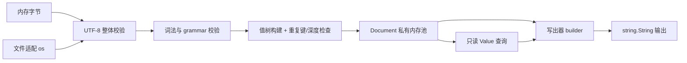

# yh JSON 标准库设计（提案）

日期：2026-10-24。状态：**J0–J3 与 J6 已实现**（reader、writer、查询、文件
读写；一致性语料与注入门待做，见 §9）。取舍见
[ADR-0019](../adr/0019-yh-JSON标准库独立文档模型与词素保真数字.md)，
分期与验收见[实施方案](../02-plan/yh-JSON标准库实施方案-2026-10-24.md)。

## 1. 目标与范围

提供 `import json` 的通用 JSON 读写库：把内存字节或文件解析成只读值树，
按真实类型取值并定位错误；把值树或增量 builder 写成符合 RFC 8259 的文本。

不要求反射、泛型、异常、新字符串类型或新的 yh 语法；不修改
`docs/yh.g4`——JSON 是数据格式，不是 yh 语法。核心只用现有分配/复制运行时，
文件适配调用 `os`，输出缓冲复用 `string.String`。

与 `toml` 的分工：TOML 面向人写的配置，JSON 面向机器交换。两者都是
「私有池 + 只读句柄」的值树，但**各自持有独立文档模型**（§7），只有
十进制 ↔ binary64 转换抽到 `libs/num` 共用。

首期终点是完整 reader + writer（紧凑与缩进两种输出）。JCS 规范模式、流式
SAX、JSON Pointer、schema 校验、结构体映射全部后置（§9）。

### 1.1 为什么现在做

现有 JSON 生产点全是手写，且没有读入口：

- `tests/modules/projects/tomltestdecoder/fmt/fmt.yh` 手写数值并直接
  `io.print`，tagged JSON 的结构拼接散在 `main.yh`；它是 toml-test 协议桥，
  不能当库复用。
- `tools/` 下输出 JSON 的工具（`yh-code-stats.py`、性能报告、IaC `--json`、
  `publish-release` 的 `manifest.json`）都是 Python；工具链迁回 yh 时 JSON
  是硬前置。
- 编译器未来若提供 `--json`（诊断、测试结果），需要库先存在再谈显式依赖与
  种子冷编；那一步才引入自举风险（§8）。

首个真实消费者定为 toml-test 桥：对象、数组、字符串转义、浮点往返四类都用到，
覆盖面刚好，且与 toml 库互不依赖，可以互相验证。

## 2. 规范基线与严格性 profile

以 [RFC 8259](https://www.rfc-editor.org/rfc/rfc8259)（STD 90）为唯一语法与
语义依据，参考 [RFC 7493 I-JSON](https://www.rfc-editor.org/rfc/rfc7493) 的
互操作约束。不提供版本开关，不引入 JSON5/JSONC（注释、尾逗号、单引号、
`NaN`/`Infinity` 字面量）。

| 项 | 选择 | 依据与代价 |
| --- | --- | --- |
| 语法 | 完整 RFC 8259 grammar，无子集 | 唯一权威；解析器比 TOML 小一个量级 |
| 编码 | 输入必须是合法 UTF-8 | RFC 8259 §8.1 要求交换用 UTF-8 |
| BOM | **拒绝**（`error_bom`） | §8.1 禁止产生 BOM，允许解析器忽略；我们选择报错，行为可测且无歧义 |
| 顶层 | 任意值（对象/数组/标量） | §2 允许；不套用 I-JSON 的「顶层必须是对象/数组」限制 |
| 重复键 | **拒绝**（`error_duplicate_key`） | 与 `toml` 一致；I-JSON/JCS 要求键唯一；静默覆盖会丢数据 |
| 孤立代理 | **拒绝**（`error_surrogate`） | `\uD800` 单独不构成字符；I-JSON 禁止；配对写入时不得截断 |
| 字符串内控制字符 | 拒绝未转义的 `< 0x20` | grammar 要求转义 |
| 数字 | 只校验 grammar，保存原始词素（§4.3） | JSON 只有一个 number 类型，规范不区分整数/浮点 |
| 尾随内容 | 拒绝 | 必须完整消费输入 |
| 深度/规模 | 有预算，超限报资源错误（§6） | 递归下降必须显式设限 |

宽松模式（容忍重复键 last-wins、容忍孤立代理、容忍注释）**不做**：当前没有
真实消费者，且会立刻分裂出一套需要长期维护的兼容矩阵。若将来必须读第三方
脏数据，以独立 `Options` 入口立项，不改默认语义。

## 3. 数据流与模块边界



全部源码属于一个普通 `json` 模块，按编译顺序加数字前缀（类型必须先定义）：

```text
libs/json/
  00_types.yh          公开类型/枚举、预算常量、私有节点状态
  10_storage.yh        私有池、稳定节点、对象条目与数组容器
  20_utf8.yh           UTF-8 校验与标量编码（\uXXXX 输出用）
  30_numbers.yh        数字词素校验、i64 范围、调用 num 的精确转换
  40_lex.yh            空白、字面量、字符串转义、数字 grammar 扫描
  50_parse.yh          递归下降：值/数组/对象、重复键、深度、位置
  60_query.yh          查找、遍历、类型化取值、词素读取
  70_write.yh          builder 状态机、转义、数字输出、缩进、排序
  75_files.linux.yh    文件读取适配（结果接口）
  75_files.darwin.yh   文件读取适配（OS8 前的旧接口）
  80_encode.yh         一次性写出入口、encode_owned、write_file
  90_api.yh            parse/parse_text/root/release 与诊断构造
  99_tests.yh          语言内 test 块（yh test json）
  README.md            例子、限制、生命周期与验收入口
```

只导出应用实际消费的声明；池、节点、哈希索引、状态机内部字段全部私有
（ADR-0013）。不依赖 `compiler/gen` 或 `cli` 的私有辅助；依赖 `string`
（输出缓冲）与 `memory`（排序索引临时数组），不新建通用 map/arena 框架。

## 4. 公共模型

### 4.1 文本与句柄

```yh
// Text 是 UTF-8 字节视图；长度不含额外终止字节，可以包含解码所得 NUL。
pub struct Text {
    data *u8
    count u64
}

// Span 是来源位置：offset/length 为零基字节半开区间，line/column 一基。
pub struct Span {
    offset u64
    length u64
    line u64
    column u64
}

// Document 独占一次成功解析的存储；handle 由模块管理，调用者不可改写。
pub struct Document {
    handle *void
}

// Value 是所属 Document 内节点的只读视图，不单独分配或释放。
pub struct Value {
    handle *void
}
```

`ValueKind` 为 `kind_invalid`、`kind_null`、`kind_boolean`、`kind_number`、
`kind_string`、`kind_array`、`kind_object`。`kind_invalid` 只表示空视图。
枚举项模块内唯一，跨模块写 `json.kind_number`，遵守两段式访问规则。

`Text` 不能退化为 `*char`：`"\u0000"` 解码后是内容 NUL，`strlen` 会截断；
键同理，`{"a\u0000b":1}` 是合法 JSON。`*char` 只用于便捷入口、路径和固定
诊断消息。

### 4.2 解析与生命周期

| API | 契约 |
| --- | --- |
| `parse(data *u8, count u64) ParseResult` | 读取显式长度字节；空输入是语法错误（JSON 必须是一个值），非零长度要求有效地址 |
| `parse_text(text *char) ParseResult` | NUL 结尾输入的便捷入口；空指针为参数错误 |
| `read_file(path *char) ParseResult` | 读完整文件并关闭，返回同一种解析结果 |
| `root(doc *Document) Value` | 成功文档的根值；空句柄返回无效视图 |
| `release(doc *Document) void` | 释放全部文档存储并清零；已清零句柄可再次释放 |

`ParseResult` 含 `status`、`document`、`error`。状态为 `parse_ok`、
`parse_syntax_error`、`parse_resource_error`、`parse_io_error`、
`parse_argument_error`。成功结果的 `document` 由调用者最终 `release`；
失败时没有可查询的半成品文档。

解析只借用输入；成功后文档独立持有键、字符串与数字词素，输入可立即释放或
改写。节点地址在文档生存期内稳定，多个文档互不覆盖。分配失败或语法失败
立即整池释放；诊断使用静态消息与数值位置，内存不足时也能返回错误。

`Document` 单一所有者，复制结构体不产生新所有者；释放后所有 `Value`/`Text`
失效。不引入引用计数或隐式析构，无可变全局解析状态。同一存活文档可只读
共享，释放须由调用方同步；线程安全仍需具体运行时证据。

### 4.3 数字语义（与 TOML 的关键差异）

JSON 只有一个 `number` 类型，`1`、`1.0`、`1e0` 语义相同但文本不同。设计选择
**只校验 grammar、原样保存词素**，把「是整数还是浮点」交给取值时显式询问：

| API | 契约 |
| --- | --- |
| `number_text(value Value, out *Text) QueryStatus` | 返回原始词素（不含前后空白），用于保真写出与精确比较 |
| `as_i64(value Value, out *i64) QueryStatus` | 词素必须是整数形式（无 `.`、无 `e/E`）且在 i64 范围内；否则 `query_type_error` / `query_range_error` |
| `as_f64(value Value, out *f64) QueryStatus` | 精确十进制 → binary64；上溢或有效位超过 `JSON_MAX_SIG_DIGITS` 报 `query_range_error`，**不返回 ±inf** |
| `is_integer(value Value) int` | 词素为整数形式且可表示时返回 1；这是谓词，不是类型 |

三条理由：

1. **不丢精度**。`{"id":9007199254740993}` 超过 2^53，强转 f64 会静默改值；
   工具链里 ID、纳秒时间戳都在这条线上。
2. **往返保真**。词素原样保存，`parse` 后 `encode` 输出同一文本（`1.0` 仍是
   `1.0`，`1e400` 仍是 `1e400`），可做字节级 diff 与内容哈希。
3. **不伪装**。把「词素里有小数点」当成类型，会让 `1e2` 被当成浮点而用户想要
   的其实是 100；需要区分时用 `is_integer` 显式问。

`1e400` 这类超出 binary64 的合法 JSON 数字**解析成功**（词素可存），
`as_f64` 报范围错误。这与 `toml`「浮点越界即解析失败」不同，原因是 TOML
规范把浮点定义为 binary64，而 JSON 规范的数字是无界十进制；按规范各自的
语义实现，不强行统一。下溢到 0 或次正规是正确舍入结果，允许（与 `toml` 一致）。

### 4.4 查询与遍历

| API | 返回与语义 |
| --- | --- |
| `kind(value Value) ValueKind` | 类型标签；空视图返回 `kind_invalid` |
| `object_get(object Value, key Text) LookupResult` | 按解码字节查键，支持空键与内嵌 NUL |
| `get(object Value, key *char) LookupResult` | NUL 结尾键的便捷入口；点号就是键内容 |
| `array_get(array Value, index u64) LookupResult` | 零基下标 |
| `count(container Value, out *u64) QueryStatus` | 数组元素数或对象条目数；标量报类型不符 |
| `object_entry(object Value, index u64) EntryResult` | 按首次出现顺序返回键、值、键位置 |
| `as_text(value Value, out *Text) QueryStatus` | 只接受字符串 |
| `as_bool(value Value, out *bool) QueryStatus` | 只接受布尔 |
| `value_span(value Value) Span` | 值的位置；空视图返回零位置 |

`QueryStatus` 区分 `query_ok`、`query_missing`、`query_type_error`、
`query_range_error`、`query_bounds_error`、`query_argument_error`。失败不修改
out 参数；查询不分配、不打印、不退出，不用零值或 false 吞错误。

对象保持插入顺序（本库的确定性契约，不宣称规范要求有序）。首期查找与重复键
检测都是按字节线性比较，大对象 O(n²) 级；`JSON_HASH_THRESHOLD` 以上的哈希
索引列为 J8 后置项，先记录基线实测再决定（§6）。

### 4.5 写出

写出口径：**紧凑默认，缩进可选，失败可回滚**。

```yh
pub struct WriteOptions {
    indent int           // 0 紧凑；1..16 每层空格数
    escape_non_ascii int // 1 = 所有非 ASCII 输出 \uXXXX
    sort_keys int        // 1 = 对象键按无符号字节序升序
}
```

| API | 契约 |
| --- | --- |
| `builder_make(out *string.String, options WriteOptions) Builder` | builder 不持有堆；`out` 由调用者拥有，可预先 `reserve` |
| `begin_object` / `end_object` / `begin_array` / `end_array` | 容器进出；类型不匹配报 `write_state_error` |
| `key(b *Builder, text Text) WriteStatus` | 只在对象内、且当前期待键时合法 |
| `write_string` / `write_i64` / `write_f64` / `write_bool` / `write_null` / `write_number_text` | 写入标量；`write_f64` 拒绝 NaN/±Inf |
| `write_value(b *Builder, value Value) WriteStatus` | 递归写入文档子树（含深度检查） |
| `encode(value Value, out *string.String, options WriteOptions) WriteStatus` | 一次性写出 |
| `encode_owned(value Value, options WriteOptions) EncodeResult` | 返回独占 `string.String`，调用者 `release` |
| `write_file(path *char, value Value, options WriteOptions) WriteStatus` | 建/截断文件后写出（J6） |

`Builder` 用固定 `[256]u8` 容器栈与首元素标志位，不分配；`write_state_error`
之后所有调用变为无操作（错误粘滞），不会写出半截结构。

失败原子性：builder 记录起始长度，首次失败时 `string.truncate` 回滚到起始
长度，`out` 内容保持调用前状态。调用者只看 `WriteStatus` 即可，无需处理
半成品文本。

数字输出：

- 整数词素原样输出；`write_i64` 输出十进制。
- `write_f64` 输出**最短往返**十进制（§5.4），且总带小数点或指数（`1.0`
  不写成 `1`），让读端能区分浮点意图；`-0.0` 输出 `-0.0`。
- NaN/±Inf 在 JSON 无表示，一律 `write_number_range`，绝不降级为 `null` 或
  `Infinity`。

字符串输出：只转义必需字符（`"`、`\`、`< 0x20`，其中 `\b \f \n \r \t` 用
短形式，其余 `\u00XX`）；`/`、`0x7f`、U+2028/2029 默认不转义（合法 JSON）；
`escape_non_ascii=1` 时逐标量转 `\uXXXX`，BMP 以上写代理对。写端必须校验
内容 UTF-8（yh 字符串可装任意字节），非法则 `write_invalid_utf8`。

`sort_keys=1` 只影响输出顺序，不改变文档；排序用条目索引数组做插入排序
（临时 `malloc`，O(n²)，仅在该选项打开时付出）。

## 5. 语义实现要点

### 5.1 词法与 grammar

| 区域 | 必须覆盖的行为 |
| --- | --- |
| 空白 | 只有 `0x20`、`0x09`、`0x0A`、`0x0D`；其他空白（`0x0B`、`0x0C`、NBSP）一律非法 |
| 字面量 | `true`/`false`/`null` 必须完整匹配，且后继只能是空白、`,`、`]`、`}` 或 EOF（`truex` 非法） |
| 数字 | `-?(0|[1-9][0-9]*)(\.[0-9]+)?([eE][+-]?[0-9]+)?`；拒绝 `+1`、`01`、`1.`、`.1`、`1e`、单独的 `-` |
| 字符串 | 拒绝裸控制字符；转义只接受 `\" \\ \/ \b \f \n \r \t \uXXXX`；`\u` 必须四hex；代理对必须成对 |
| 容器 | `[`/`{` 后允许空白；空容器合法；**拒绝尾逗号**；键必须是字符串 |
| 顶层 | 任意单值；值之后只允许空白到 EOF |

字符串解码走两遍：先算解码后字节数，一次分配，再写入。这样避免扩容，也让
「解码后含 NUL」的键和值能直接落池。

### 5.2 重复键

解析期在对象内线性扫描已插入键，命中即报 `error_duplicate_key`，`Diagnostic`
的 `related` 指向第一次出现位置。比较用解码后字节，不做 Unicode 规范化
（`"é"` 与 `"e\u0301"` 是两个键）。这是本库的明确契约，README 必须披露，
因为 ECMAScript 的 `JSON.parse` 是 last-wins。

### 5.3 位置与诊断

`Span` 用零基字节半开区间 + 一基行/字节列；CRLF 计一行，tab 计一字节列。
`Diagnostic` 含稳定 `ErrorCode`、静态中文 `message`、主 `Span`、可选
`related`、`native_code`（I/O 用）。错误码：`error_none`、`error_utf8`、
`error_bom`、`error_syntax`、`error_duplicate_key`、`error_surrogate`、
`error_number_range`、`error_resource_limit`、`error_out_of_memory`、
`error_io`、`error_argument`。消息文字不是程序判断接口。

首期只报首个错误，不做多错误恢复。核心不读全局 errno、不写 stdout/stderr、
不退出进程。

### 5.4 f64 → 最短往返十进制

不引入 Ryu/Grisu 的查表实现，先用可验证的搜索法：

1. 取 IEEE754 位模式，得到整数尾数 `m` 与二进制指数 `e`；
2. `p` 从 1 到 17：用大整数把 `m × 2^e` 正确舍入到 `p` 位有效数字，得到
   十进制 digits 与指数 `k`；
3. 用 `as_f64` 的同一条精确转换把该十进制还原，比较 64 位模式；
4. 首个相等即最短表示；`p` 到 17 仍不等说明实现有 bug，返回错误而不输出
   近似值。

代价是最多 17 次精确转换，每次 O(位数²) 大整数运算。J2 先测真实语料
（性能报告里的 JSON 量级）再决定是否换 Ryu；触发条件是「每 1000 个浮点
写出超过 1 ms」，届时以独立切片替换，不改公共 API。

与 Python `repr` 的差异：Python 指数补两位零（`1e-07`），我们规定指数不补零
且总带符号（`1e-7`）。验收比较**解析回来的位模式**，不比字符串相等，避免
把格式差异记成失败。

## 6. 失败、资源与文件

建议初始预算（J0 实测后冻结，README 披露）：

| 常量 | 值 | 含义 |
| --- | --- | --- |
| `JSON_MAX_INPUT` | 16 MiB | 输入字节上限 |
| `JSON_MAX_DEPTH` | 256 | 容器嵌套上限（JSON 常由机器生成，比 TOML 配置更深） |
| `JSON_MAX_BYTES` | 128 MiB | 单文档累计分配上限 |
| `JSON_MAX_SIG_DIGITS` | 4096 | `as_f64` 允许的有效位数，超出报范围错误而不是截断 |
| `JSON_MAX_INDENT` | 16 | 缩进空格上限，超出报参数错误 |
| `JSON_HASH_THRESHOLD` | 32 | J8 起：对象条目超过该值时建哈希索引 |

所有长度加法、乘法、扩容先做溢出检查；超限报资源错误，不能截断或伪装成
语法错误。这些是实现限制，「完整 reader」指预算与数值表示范围内的 RFC 8259。

`read_file` 按平台分文件：Linux 用 `os.open_path/read_some/close_file` 循环
处理短读与 interrupted；Darwin 在 OS8 新文件 API 落地前用旧
`os.open_file/read_fd/close_fd`，`native_code` 为 0、不区分 interrupted。
所有成功打开的 fd 在全部路径关闭，关闭只尝试一次；已有读取错误优先保留。
文件增长同样受字节预算约束，不只依赖一次文件大小检查。

## 7. 与 toml 的关系

| 维度 | 决策 | 理由 |
| --- | --- | --- |
| 文档模型 | **各自独立**，不抽公共 DOM | 抽取要改已验收的 toml（681/681 语料、124 个注入点），收益是省一份存储代码；第二个格式才刚出现，按「无消费者不建框架」暂缓 |
| 十进制 ↔ binary64 | **抽 `libs/num` 共用** | 同一算法有两处真实消费者（toml 解析、json 的 `as_f64` 与浮点写出）；复制两份必然发散，且 toml 已有 1437+400 组位模式差分可当回归网 |
| UTF-8 校验/编码 | 首期各自实现，`libs/num` 稳定后再评估合入 `libs/text` | 校验逻辑短（约 100 行），先避免一次跨模块重构 |
| 公共 API 形状 | 对齐 toml（`Document`/`Value`/`Text`/`Span`/`Diagnostic`、同名 `parse`/`release`/`kind`） | 用户在两套格式间切换时不必学第二套心智模型 |

`libs/num` 的导出面只保留两个函数加结果类型：
`parse_f64(data *u8, count u64) NumResult`（精确十进制 → binary64）与
`format_f64(value f64, out *u8, capacity u64) NumResult`（最短往返，含
`-0.0`、`inf`/`nan` 显式分类）。`toml` 改为调用它，toml-test 与上溢样本
保持全绿是这次抽取的阻断门；若改动面失控，回退为「json 内先复制一份，
`num` 推迟到第三个消费者」。

## 8. 验收与来源

| 门 | 内容 |
| --- | --- |
| API 组 | `tests/modules/projects/json{model,strings,numbers,containers,errors,files,writer,roundtrip}`，每组一个程序，退出码 0 为通过 |
| 一致性 | 固定 [JSONTestSuite](https://github.com/nst/JSONTestSuite) 提交：`y_` 必须接受，`n_` 必须拒绝，`i_` 逐条登记本库预期结果（不允许静默 SKIP） |
| 差分 | Python `json` 作参考：随机生成（固定种子）合法文档，比较值树；写出后用 Python 解析回来比较；浮点只比位模式 |
| 注入 | 池分配失败点逐点注入，要求资源错误、无半成品文档、重复解析仍干净失败 |
| 预算 | 降低 `JSON_MAX_BYTES` 的副本，强制累计预算返回 `error_resource_limit` |
| 安装 | `make install` 后仓库外、无 `YH_STDLIB` 时能 `import json` |
| 自举 | 首期不改编译器，`make test` + `make selfhost-native` 保持绿即可；若将来编译器依赖本库，按 TOML T6 同样流程（显式依赖、缓存身份、两代固定点）另立切片 |

在当前宿主完成 `make test` 与 `make selfhost-native`；其他平台交 Gitea
Actions，Linux 为主验收平台。JSON 不等待 `yh test` 之外的任何提案。

## 9. 实现落点（2026-10-24）

公共 API 与 §4 草案一致，未新增写入之外的能力。落地文件按编译顺序：

```text
libs/json/00_types.yh      类型/枚举/预算常量
libs/json/10_storage.yh    池、节点、对象条目、数组容器、文本比较
libs/json/20_utf8.yh       UTF-8 校验、标量编解码、十六进制
libs/json/30_numbers.yh    数字 grammar、i64 范围、调用 libs/num 的精确转换
libs/json/40_lex.yh        游标、空白、字面量、字符串转义、数字扫描
libs/json/50_parse.yh      递归下降（值/数组/对象、重复键、深度、位置）
libs/json/60_query.yh      查找、遍历、类型化取值
libs/json/70_write.yh      builder 状态机、转义、数字输出、缩进、排序
libs/json/75_files.linux.yh / .darwin.yh   读文件、写文件适配
libs/json/80_encode.yh     值树递归写出、encode/encode_owned
libs/json/90_api.yh        parse/parse_text/root/release、诊断
```

- **数字**：`as_f64` 与 `write_f64` 走 `libs/num`（`parse_f64`/`format_f64`）；
  `libs/num` 的十进制 → binary64 与 toml 同一算法，差分 260 组解析位模式与
  142 组最短往返格式化全部一致（唯一的"失败"是设计内的上溢报错）。
  **`toml` 尚未改为调用 `num`**：为不触碰已验收的 681/681 语料，迁移另立切片。
- **重复键**：解析期线性查重，`Diagnostic.related` 指向第一次出现；第二处
  列号由 `p_fail_at` 按字节差回退计算。
- **写出**：`Builder` 固定 `[256]u8` 容器栈；失败粘滞并 `string.truncate`
  回滚到起始长度；转义统一走 `w_pair` 字节写入，避免在单个函数里堆字符串
  字面量（也绕开当前后端对超长函数体的限制）。
- **文件**：Linux 用 `os.open_path/read_some/write_fd/close_file`；Darwin 在
  OS8 前用旧 `open_file/read_fd/write_fd/close_fd`，打开标志 1537、权限 420。
- **验收**：六组 API/文件断言已迁入 `libs/json/99_tests.yh`（12 test / 127
  断言，`yh test json`），`jsonmodel` 保留为 `build-check.py` 的公开面 smoke；
  原 `tests/json/run.py` 与 `make test-json` 已删除。迁移记录见
  [YT4-P1](../01-finished/yh-YT4-P1-json迁移-2026-10-25.md)。
- **未完成**：JSONTestSuite 一致性语料（J5）、Python 差分、分配失败注入与低
  预算门（J4）、`test-json-install`（J7）。
- **实现约束记录**：当前后端（种子与 HEAD 均有）对超长函数体、部分调用语句
  形态与"函数调用结果直接赋给字段"存在限制；本库据此把解析、写出与验收夹具
  拆成小函数，并统一用局部变量中转调用结果。后续修编译器时可放宽，不影响 API。

## 10. 非目标与后置

| 项 | 状态 | 触发条件 |
| --- | --- | --- |
| JSON5 / JSONC（注释、尾逗号、单引号） | 不做 | 出现必须读脏配置的真实消费者 |
| JCS 规范模式（RFC 8785） | J8 候选 | 需要对 JSON 做内容哈希/签名 |
| 大对象哈希索引 | J8 候选 | 实测解析 10k 键对象成为瓶颈 |
| 流式 SAX 读写 | J8 候选 | 需要处理超预算文档或常量内存管道 |
| JSON Pointer / Path 查询 | J8 候选 | 出现按路径取值的工具 |
| schema 校验、结构体映射 | 不做 | 需要反射/泛型，属语言能力前置 |
| JSON ↔ TOML 互转 | 不做 | 两个库都不该知道对方 |
| 保留注释/排版的编辑 | 不做 | JSON 交换格式通常不保留注释 |

## 11. 待确认

1. **writer 先行还是 reader 先行**：建议 J1 先交付 writer（约 450 行，立刻
   替换 toml-test 桥的手写输出），J3 再做 reader。
2. **`libs/num` 抽取时机**：建议 J2 就抽（两个消费者已成立），以 toml 语料
   作回归门；也可退到 J3 之后。
3. **重复键拒绝**：建议拒绝；若需要读第三方 last-wins 数据，另立
   `Options` 切片，不改默认。
