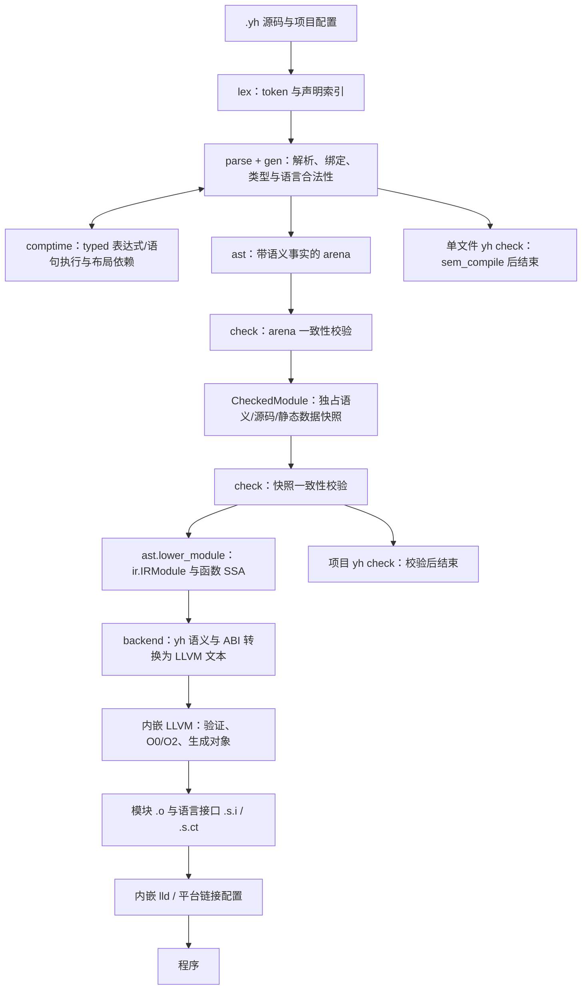

# yh LLVM 分支架构复核

日期：2026-10-22。性质：当前代码的静态架构分析与建议，不是实现验收。
基线：`llvm` 分支，HEAD `895140a`；另外单独核对当前未提交的 builtin 迁移。
> 2026-10-22 后续：LA0–LA2 已完成；LA3 交付 1–2（函数级 IR 复用）已落地，
> 交付 3（函数级 check 复用）未启动。见
> [LA3 完成报告](../01-finished/yh-LLVM架构LA3-2026-10-22.md)。
本次不改编译器、用例、种子和构建闭包，不执行构建、性能测试或多平台门禁。

## 1. 结论

当前 yh 已是“自有语义前端/编译期执行 + 自有语言 IR + 内嵌 LLVM/lld”的编译器。
旧机器发射链已经删除，继续按 10 月 2 日的 Nanopass 计划建设机器 IR、phi 消解和
寄存器分配，会重复 LLVM 的工作，也与已采纳的 ADR-0014 不符。

建议保留 Nanopass 的小变换、阶段契约和独立验证，把它们用于 **受检事实 → 语言 IR →
LLVM 合法语义表达**。后续主要工作是职责收口、函数粒度复用与状态隔离，通用优化继续
使用固定 LLVM 的 O0/O2 管线。暂不增加 Core 表示族、通用 pass 插件或另一套优化中端。

已经形成的正确边界应保留：独占受检快照、独立 IRModule、只读 verifier、完整目标身份、
LLVM 每次调用私有 Context/TargetMachine、原子对象发布，以及隔离 lld 的一次性子进程。

本结论依据源码控制流与声明，不据文件行数推断实际耗时，也不把历史测试结果当成本轮实测。

## 2. 基线与规模

按 `.yh` 文件的 `module`/`import` 声明统计，物理行包含空白和注释，包含各平台变体，
未按单一目标筛选，不包含 C/C++ 桥、清单、SDK 和测试。

| 状态 | 模块 | .yh 文件 | 物理行 |
| --- | ---: | ---: | ---: |
| 已提交 HEAD | 9 | 101 | 46,052 |
| 当前工作区，含 builtin 迁移 | 10 | 102 | 46,078 |

| 工作区模块 | 文件 | 物理行 | 直接 import |
| --- | ---: | ---: | --- |
| gen | 14 | 5,395 | 无 |
| ir | 8 | 3,770 | 无 |
| lex | 2 | 706 | gen |
| comptime | 13 | 5,521 | gen |
| builtin | 1 | 153 | gen |
| ast | 16 | 7,198 | gen、comptime、ir |
| check | 2 | 944 | ast、gen |
| parse | 12 | 8,801 | ast、comptime、gen、lex |
| backend | 12 | 3,268 | gen、ir |
| main（cmd/） | 22 | 10,322 | 其余九个模块 |

HEAD 和工作区的显式模块依赖均无环。`gen`/`ir` 是依赖根，`cmd` 承担协调，
这个方向合理。但无环不代表函数可并发调用；全局可变状态仍须单独审计。

结构热点：`module_snapshot_lower.yh` 3,826 行、`module_build.yh` 2,063 行、
`parse_expr.yh` 2,003 行、`ct_ir.yh` 1,644 行、`link_cache.yh` 1,448 行。
这些是理解、变更和验证的边界问题，不能仅据此认定它们是运行性能瓶颈。

当前工作区 builtin 仅登记内置名字/签名/标志，运行时函数体仍由 backend 发射；
HEAD 尚没有该模块。不能把工作区观察写成已提交版本的事实。

## 3. 实际编译路径

图中箭头表示数据/逻辑阶段，不表示所有操作各自只有一趟遍历。`.s.i/.s.ct`
由前端产生并可在构建会话中提前就绪，图中将其与对象并列汇入项目产物。
实际是 token/声明索引复用加多遍语义处理，尚不是“一次纯解析后独立完成全部类型检查”。

### 3.1 check 的真实含义

`check.verify_module` 和 `check.verify_checked_module` 是只读的结构/引用/快照一致性
验证。语言名字解析、类型兼容、赋值、调用等合法性仍由 parse 调用 gen 语义函数完成。
`yh check` 命令能完成前端检查，不等于 `check` 模块已经拥有全部语义分析。

这是有效分工，但命名和设计图必须区分“完整前端检查”与“快照 verifier”。
不建议为获得表面上的 lex → parse → check 排列，立即搬迁全部 gen/parse 语义函数。

### 3.2 快照与语言 IR 已有价值

`ast.CheckedModule` 拥有深拷贝的 arena、类型/签名、符号、源码、导入和静态数据；
`CheckedModuleView` 是有限生命周期的借用。`IRModule` 独占其符号、布局、全局、函数和来源表，
函数通过 `type_map` 连接私有类型与模块类型。这些边界为独立测试和将来的增量复用提供基础。

本轮直接搜索：快照 lowering 文件没有 `gen.G()` 读取，LLVM backend 文件也没有
`gen.G()` 读取；捕获入口仍需从 G() 取前端状态。使用 gen 的类型常量、纯辅助和诊断不等于
读取全局语义表，但错误输出仍是效果，不能据此声称整个编译过程是纯函数或已经线程安全。

### 3.3 LLVM 已承担的工作

`compiler/llvm/bridge.c` 为每次发射创建私有 Context/TargetMachine，使用 `generic` CPU，
校验 triple/data layout，运行 `default<O0>` 或 `default<O2>`，再生成对象或汇编。
当前还开启 LLVM 的 VerifyEach，并在管线前后验证模块。

LLVM 提供指令选择、phi 消解和寄存器分配，依据
[LLVM 代码生成文档](https://llvm.org/docs/CodeGenerator.html)；默认优化管线的机制见
[New Pass Manager 文档](https://llvm.org/docs/NewPassManager.html)。
本仓库的具体管线以固定版本的桥源码为准，不随在线文档的开发版变化推断新能力。

LLVM 是唯一代码生成后端，CLI 明确拒绝 legacy；O0 默认，O2 显式启用，当前没有 O1。
文本 IR 是清楚、可审阅的交接点，尚无证据需要将其替换为逐节点 C API 构造。

## 4. 需要处理的架构问题

### 4.1 前端与发射入口尚未完全收口

单文件 check 的 `run_file_check` 调用 `sem_compile` 完成语义遍历后结束；
项目 check 则捕获并验证 CheckedModule。单文件编译另走已索引的前端入口，
因此“重用语义函数”不等于三条路径拥有相同阶段产物。
后续统一前端时必须保留库文件 check 不要求 main、check 不调用 LLVM 的边界。

`cmd/llvm_emit.yh::llvm_emit_module_to` 与
`cmd/module_worker.yh::mb_llvm_emit_module` 都执行：
lower_module → LLVM 文本 → 部署元数据 → 桥 → 释放与统计。
后者还负责对象临时文件、架构校验和 rename；前者的桥诊断按模块首个符号回退定位，
项目路径主要报告桥文本。

两条路径共享底层能力，但没有共用完整驱动，文件头“都走这里”不能视为已经统一。
建议保留不同前端/缓存入口，共用一个“已验证快照到产物”的内部 helper，
统一错误、所有权、统计、文本输出与对象发布规则。
不需要新建编译服务、插件或回调框架。

此外 LLVMOutput 已保存 LLVM 行到源位置的 maps，桥错误路径尚未用它做细粒度回映。
先在公共驱动中统一可用映射和找不到映射时的回退，避免两条入口逐渐产生不同诊断行为。

### 4.2 AST 存储与 lowering 仍在同一模块，核心文件过大

`ast` 同时负责捕获、拥有快照、编译期节点交接、SSA builder 和模块 lowering。
`module_snapshot_lower.yh` 包含类型提升、字面量重定型、调用 ABI 事实、控制流/phi、
地址/聚合存储及模块装配；`checked_lower_function` 和 `lower_module` 是最有价值的函数粒度接缝。

第一步应在 ast 模块内部按表达式、调用、控制流、存储、函数/模块装配拆文件，保持语义和
声明顺序，不顺带扩大 pub 面。接着明确模块准备与函数 lowering 的输入/所有权。
只有形成稳定独立接口、且确有独立编译/测试收益时，再考虑单独的 lower 模块。
直接把 3,800 行文件移动到新目录，不会自动获得阶段隔离。

### 4.3 增量粒度仍是模块，旧函数缓存已经退役

`mb_build_dir` 按 triple/LLVM/O0 或 O2 隔离；模块键包含模块源码、依赖 `.s.i/.s.ct`、
目标/布局/ABI、编译器身份、桥版本和 Darwin 配置。manifest 校验对象/接口内容，
链接键还处理对象、工具/运行库及外部输入。这是已有的有效粗粒度缓存。

但 LLVM 主路径每次对整个 CheckedModule 执行 `lower_module`，生成整个模块文本并调用 LLVM。
LL12 删除了旧 `ast_ir_cache`；当前 ir_cache 统计字段存在不代表 LLVM 函数缓存已经实现。
`ir_module_serialize` 的存在也不等于调用方已使用它持久缓存函数。

RS2 应明确两个收益边界：

- 函数 check/IR 复用减少前端检查或 lowering；若仍整模块送 LLVM，不会跳过该模块 LLVM 代码生成。
- 文件/其他对象粒度的复用减少 LLVM 重做范围；需同时解决模块私有符号跨对象引用和稳定布局。

原 RS2 侦察建议先缓存整模块 IR，但无改动模块已有对象缓存会直接跳过 worker；
整模块 IR 缓存的新增收益需单列负载证明，暂不作为默认的第一个实现任务。

函数缓存还需先处理三项契约：

1. `IRModuleFunction` 的符号、`type_map`、locs 及函数中的模块引用需按稳定描述重新绑定，
   不能把上一次模块数组 ID 原样挂入新模块。
2. 函数键只纳入实际读取的签名、常量、布局、全局及 CT 等语义依赖；若把整个模块源码哈希
   无差别加入每个函数键，单函数修改就会使所有函数 miss。模块内容键仍用于整模块 manifest。
3. 函数体键与可变的行号/来源映射分开处理；复用语义体时更新位置，不能返回旧诊断位置。

初期可以保守扩大语义依赖失效范围，不以遗漏依赖换命中率。
跨文件对象不能靠将源级私有声明改为 pub 来完成链接；语言接口隐私与对象可链接性须分别表达。

### 4.4 TaskCtx 的存在不等于线程私有

`GenState` 已有 TaskCtx 字段，但 `gen.G()` 仍返回进程内单个 `g_state`。
AST arena 和 comptime 的函数/节点/执行预算/聚合池也有模块级可变变量，未全部归入显式上下文。
当前 fork/COW worker 可以隔离它们，同进程线程不能直接复用这些入口。

因此应保持已工作的进程调度；函数粒度输入稳定后，再分别收口 FrontendTask、AstStore、CtContext。
不要只把 TaskCtx 指针加到顶层函数，就宣称完成 R2c。
LLVM 桥每调用私有对象是有利条件，不能代替 yh 前端、诊断和发布过程的隔离验收。
lld 继续放一次性进程，避免把其全局/不可重入状态带入编译线程池。

### 4.5 编译期与运行期拥有不同的 typed 表示

`comptime` 使用 CtExpr/CtStmt/CtValue 等受检树快照和解释执行器；
运行期使用 ir.IRFunction/IRModule。前者没有 import ir，不能笼统称为“两条路径执行同一 SSA”。
CtExpr/CtStmt 与 AstExpr/AstStmt 的布局对应也是现有交接契约。

优先统一整数、bool、转换、浮点、按值/切片别名的语义对照与回归，再提取确实重复的纯规则。
不建议仅为减少表示数量，把整个 comptime 改为解释 LLVM IR 或重写为 SSA 解释器；
这会牵动 `$if/$for`、布局依赖、诊断和执行预算，收益尚未证实。

### 4.6 yh 语义到 LLVM 的转换仍由 yh 负责

LLVM 不会替 yh 决定除零、溢出、bool 存储、移位、聚合副本与 C ABI。
当前 backend 已有必要保护：整数提升/截断、移位量处理、安全除数、饱和浮点转换及显式 ABI 分类。
例如 `llvm_division` 在除法之前建立安全操作数，保留 yh 规定的结果。

这些是语言兼容性 lowering，不应作为“优化都交给 LLVM”的理由删掉。
LLVM 对非法操作数有自己的 UB/poison 规则，参见
[LLVM UB 文档](https://llvm.org/docs/UndefinedBehavior.html)。
持续保留 CT/运行期、O0/O2、聚合调用/回调与负例的语义门，比再建通用 DCE 更重要。

### 4.7 自举闭包与普通程序依赖必须分开

编译器静态嵌入 LLVM/lld，另有 C/C++ 桥和固定 SDK；普通 yh AOT 程序不会因此携带 LLVM。
builtin 声明登记、backend 按需运行时定义、libs/os/sys、编译器宿主 I/O 是不同责任。

宿主操作使用 c_host_target，输出/CT/layout 使用 c_target，现有区分应继续保留。
“不依赖系统 LLVM”也不等于编译器没有 C/C++/OS 运行库依赖。
SDK/归档身份、manifest 链接与库搜索属于工具链闭包问题，不能用修改语言 IR 顺带解决。
本轮不验证平台完整性，不把 bridge 接受某 triple 等同于该平台已可发布/原生自举。

## 5. Nanopass 在 LLVM 分支中的重新定位

[原方案](yh-Nanopass风格优化架构.md)是旧自研后端基线，不作为当前路径图。
[ADR-0014](../adr/0014-yh采用LLVM作为正式代码生成后端.md)已经确定通用优化/机器后端的归属；
以下是任务范围调整建议，未将旧 NP 编号批量标为完成，也未改写历史 ADR。

| 原方向 | 当前定位 |
| --- | --- |
| NP0 语义/对照/固定点 | 继续保留为 LLVM 语义和 O0/O2、自举门；已有部分证据，不需要重建一套 O1 |
| NP1 拆现有 ir_simplify | 不再是生产管线入口；当前搜索只有定义和直接测试，未见 LLVM 主路径调用 |
| NP2 默认自研 SSA 优化 | 不重复建立；必要语言规范化或能被测量证明改善编译成本的局部处理单独评估 |
| NP3 Checked/Core 与解耦 | 已有 CheckedModule 和独立 lowering 基础；继续函数粒度契约、规范化事实和驱动收口 |
| NP4 自研机器 IR/分配 | 由 LLVM 取代，符合 ADR-0014；不列作后续 yh 编译器建设项 |
| NP5 自研 SCCP/通用内联等 | 交给 LLVM 默认发布管线；语言/CT 专属变换仍需独立验证 |

保留语言 IR：它已经是模块边界、布局/符号目录、来源/诊断和可序列化的函数容器。
将快照直接发 LLVM IR 虽然少一个表示，却会同时影响 verifier、全局/调用目录和 RS2，
现阶段没有证据证明值得承担这次迁移。

### 建议的小阶段契约

不急于增加新的物理 IR，而是从现有 helper 中识别、封存以下逻辑步骤：

| 步骤 | 输入 → 输出/事实 | 验收 |
| --- | --- | --- |
| 布局与签名准备 | CheckedModule → 稳定类型/符号/全局目录 | 目标/ABI、重定位、私有性一致 |
| 操作规范化 | typed 节点 → 明确计算类型、转换和副本策略 | CT/运行期与 O0/O2 结果一致 |
| 效果与控制流降低 | 短路、条件、循环、goto → 正确 CFG 与边效果 | 求值顺序、break/continue、phi/支配正确 |
| 函数 IR 装配 | 单函数事实 → IRModuleFunction + 依赖/来源映射 | 可独立构造/验证，重绑定后无悬空 ID |
| LLVM 合法化与 ABI | yh IR → LLVM 文本 | yh 语义保护、C/yh 调用边界、LLVM verifier |

这些步骤有依赖，不要求每步复制全部 AST 或单独扫描全模块。
初期保持输出字节和执行顺序，仅在新增规范化事实确有消费者时增加字段。

## 6. 建议实施顺序

| 优先级 | 小交付 | 完成条件 |
| --- | --- | --- |
| 1 | 共用已验证快照的 LLVM 发射 helper | 单文件/项目/文本/汇编走同一核心，失败发布与诊断保持；另列 check 前端入口对齐切片 |
| 2 | 在 ast 内拆 lowering，并分离模块准备/函数构造 | 无语义改动；字节/诊断对照与固定点保持；私有声明不扩大导出 |
| 3 | 按函数保存规范化事实与可重绑定 IR，接 RS2 | 单函数变化只重建相关函数；变目标/布局/CT 依赖正确失效；统计区分各阶段 |
| 4 | 按实际收益接 RS3 对象粒度 | LLVM 重做范围减少；模块私有性、全局/运行时与重定位不变 |
| 5 | 上下文与宿主线程能力成熟后做 R2c | AST/CT/诊断/缓存全隔离；串行/多 worker 确定性；lld 保持隔离 |

1/2 是局部、便于验证的组织改进，3/4 才针对增量粒度，5 不应靠提前引入线程掩盖状态问题。
以上是建议顺序，不是要求重新打开已完成 LLVM 收尾，也不把性能目标作为本次分析的完成条件。
性能测试继续由专门任务承担；本报告不重复运行 20 轮，更不沿用旧外部汇编器的耗时解释。

## 7. 验证范围与资料

本轮完成显式 import 图、规模、调用入口、快照所有权、旧优化可达性和缓存粒度的静态核对。
辅助清单与源码摘要放在 `tmp/llvm-architecture-2026-10-22/`，属于临时分析证据。
未运行 make/test/selfhost，不声称当前未提交工作区已经通过本轮门禁。

未来代码切片仍按仓库规则添加 `.yh` 用例并运行 make；本地执行本平台的
`make test` 与 `make selfhost-native`，多平台由 Gitea Actions 承担。
不为此次文档复核预跑其他平台，也不改种子或清理 LLVM 闭包。

关键源码入口：

- `compiler/cmd/llvm_emit.yh:105`、`compiler/cmd/module_worker.yh:65`：两条实际驱动。
- `compiler/ast/module_snapshot.yh:368`、`module_snapshot_lower.yh:3501/3709`：捕获、函数/模块 lowering。
- `compiler/check/verify.yh:444`、`checked_module.yh:463`：结构校验入口。
- `compiler/backend/llvm_module.yh:403`、`llvm_scalar.yh:201`：模块发射与除法语义保护。
- `compiler/llvm/bridge.c:105`：内嵌 LLVM 生命周期与 O0/O2。
- `compiler/cmd/module_build.yh:128/798`、`link_cache.yh:440`：缓存命名空间、模块键、lld 进程。
- `compiler/gen/state.yh:215/276`、`compiler/comptime/ct_00_model.yh:57/214`：会话/任务入口与 CT 节点/全局状态。

相关设计：[LLVM 替换设计](yh-LLVM后端替换设计.md)、
[语义与 ABI 契约](yh-LLVM语义与ABI契约.md)、
[check 拆分设计](yh-编译器check模块拆分设计.md)、
[RS2 侦察设计](../02-plan/yh-RS2-LLVM函数级IR缓存设计.md)。
