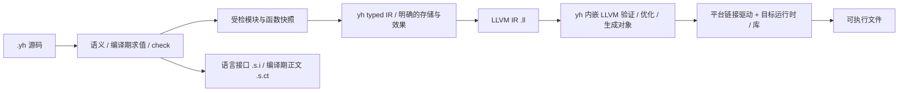

# yh LLVM 后端替换设计

日期：2026-10-14。状态：**用户已授权分阶段实施；尚未切换生产后端**。
实施补充：用户要求 yh 编译器嵌入 LLVM、不依赖系统 LLVM，每阶段验收后提交。
顺序修订：同日用户明确要求 Linux/x86_64 优先，以便在本机 WSL 原生验证；“x86”按前文指 64 位 x86。
目标已明确为最终替换自研代码生成，过渡期保留旧 ARM64 路径用于差分和种子迁移。
问题入口：[问题清单](../02-plan/yh-LLVM后端替换问题清单.md)；执行入口：
[实施方案](../02-plan/yh-LLVM后端替换实施方案.md)；取舍：
[ADR-0014](../adr/0014-yh采用LLVM作为正式代码生成后端.md)。

## 1. 目标、范围与成功标准

首期交付 Linux/x86_64 的完整 LLVM 后端，统一项目与单文件入口，运行期和编译期
语义保持一致，完成当前源码/语料所需的语言覆盖、运行时、缓存和自举验收。
终态默认且唯一的生产代码生成路径为 LLVM；旧 ARM64 后端经退役门后删除。

后续覆盖 Linux/macOS/Windows × AArch64/x86_64 六格。每格分别声明“能出对象、能链接、
能运行标准库程序、编译器可原生运行、可原生自举”，不能用对象探针或 WSL 代替后四层。

以下是所有实施切片共同遵守的约束：

- 用户源码仍只使用 `.yh` 后缀，不新增语言功能作为迁移前提。
- 首期平台为 Linux/x86_64（64 位 x86），目标 triple 为 `x86_64-unknown-linux-gnu`；非 Linux 目标不作为日常改动的回归前置。
- 首期内置 LLVM 固定为 21.1.8，以校验过的静态 SDK 构建；不发现或调用系统 LLVM。clang/llvm-as/opt 21.1.8 仅作开发 oracle；放宽版本另行验收。
- LLVM 模式禁止自动回退旧后端；不支持的形态给出来源诊断并停止发布产物。
- 开发默认 O0、发布显式 O2；初期禁止 fast-math 和未经证明的语义属性，LTO 后置。
- 普通 AOT 程序不依赖 LLVM 运行；编译依赖与 OS/运行时依赖分别披露。
- 维持现行运行时禁止导入 malloc/free/memcpy/strlen/printf 的门，不用放宽断言完成迁移。
- 所有候选、探针和临时日志放 `tmp/llvm-migration/`，未验收候选不覆盖 bin/ 种子。
- 代码变化先加 `.yh` 用例并运行 `make`；阶段关闭执行 `make test` 和 `make selfhost-native`。
- 默认正式切换不得降低 R2b 已确认的任务私有状态、线程池、缓存/并发/确定性硬门。

LLVM 21.1.8 是本机已核对的实施基线，不宣称是产品可支持的最低 LLVM 版本。
首期即包含 Linux/x86_64 的 System V C ABI、syscall、目录/时钟/内存/进程桥、
原生链接、编译器宿主适配和 x64 种子，不再把这些能力放到后续 F1。
macOS 以后使用明确安装的该版本 LLVM 编译 IR；系统 clang 可单独作为链接驱动，
不假设 Apple clang 的版本号与 LLVM 发行号相同。

## 2. 基线与待处理事实

当前模块路径先经 parse/gen 发 ARM64，再由 `ast_ir_lower_module` 处理部分函数，
`arm64_emit_replace` 在汇编缓冲中替换函数区间；单文件入口没有统一走这条 SSA 路径。
当前 IR 模型已有 CFG、phi、直接调用及验证能力，但 AST lowering 主要接受整数/布尔。

`compiler/README.md` 记载 2026-10-13 自编 991 个函数上下文、22 个 SSA 函数。
这是历史观察值，不是本轮新测，也不是“所有程序只有 2.2% 能编译”的普遍结论。
LL0 必须重测实际发射覆盖和原因，尤其区分 SSA 验证成功与后端发射成功。

本会话已验证 LLVM 21.1.8 能将一个整数加法 IR 生成六种目标对象；未验证六格程序的
链接、运行或自举。现有可行性分析保留为背景，本设计的目标和路线替代其中未决策的
oracle/可选第二后端建议，不重写历史分析结果。

## 3. 终态数据流与模块边界

### 3.1 前端与 IR

- parse/gen 负责语言合法性和编译期行为；check 不调用 LLVM、不要求所有合法函数已完成 lowering。
- `ast.CheckedModule` 是语义结束后可由 lowering 消费的受检快照，包含声明、函数与绑定、
  布局、全局初始化、目标身份和来源位置，不依赖旧输出缓冲的字符串范围。
- `ir.IRModule` 统一持有逻辑符号、类型/布局描述、全局数据和函数集合。
  函数保留现有 ID/数组模型；函数私有类型表与模块类型身份通过显式映射交接，
  不把 GenState 中临时 type_id 或指针地址持久化为缓存身份。
- 聚合先按有类型的位置、显式复制和存储处理；可变局部存储采用入口 alloca。
  不要求先完成自研 MemorySSA、机器 IR 或寄存器分配器。
- 现有正确 SSA/phi 直接复用；LLVM 负责通用优化、phi 消解、指令选择、寄存器分配和栈帧。

### 3.2 LLVM 发射与工具驱动

- 在现有 `backend` 模块新增 `llvm_module.yh`、`llvm_scalar.yh`，后续按实际切片新增
  `llvm_memory.yh`、`llvm_call.yh`。只导出 cmd/ast 确实需要的入口和类型。
- `backend.LLVMOutput` 独占文本及来源映射缓冲；复用 `gen.out_grow` 等通用缓冲能力，
  不修改 `gen.G()` 的 ARM64 输出、标签、寄存器或帧状态。
- 首期保留文本 IR 交接，使用薄 C ABI 桥调用静态 LLVM C API 完成解析、模块验证、
  O0/O2 管线和目标对象/汇编输出。`--emit-asm` 也在进程内执行，不创建 clang/llc 子进程。
  llvm-as/opt/clang 仅用于开发差分，不是 yh 正常运行依赖。
- 固定配置采用通用 CPU，不使用 `-march=native`；O0/O2、CPU/features、布局、重定位模式
  都是显式代码生成输入。Linux 首期维持非 PIE 可执行策略。
- 链接子进程使用 argv，不经 shell；链接驱动绝对路径及内容身份被记录。
  LLVM 版本、SDK 包哈希、桥 ABI 和后端实现身份直接纳入对象缓存，不使用 `YH_LLVM_BIN`。
- 薄桥只封装 LLVM 的生命周期和 C API，不承担 yh 语义、AST lowering 或 ABI 设计。
  LLVM 静态库链接进编译器，禁止依赖 `libLLVM.so`、dlopen 或 LLVM 工具旁车。
  SDK 由固定下载地址与 SHA-256 锁定，解包到 `tmp/llvm-migration/sdk/`，不安装到系统。
  首片先交付 Linux/x86_64 的固定 SDK；ARM64 启动 SDK 在 LL3 接入 A 前验收，
  ARM64 LLVM 运行时和原生种子/自举在 F1 验收。
  LLVM 的 Apache-2.0 WITH LLVM-exception 许可和发行包版权随交付保存。
  C/C++ 编译器、平台链接器和 libc 属构建/OS 依赖，不能混称为系统 LLVM 依赖。

缺省目标取编译器自身构建时记录的目标，不能仅用 uname 推断。WSL x86_64 内经 qemu
运行的 AArch64 yh，其进程 ABI 与物理宿主 CPU 不同；宿主 OS 桥按编译器进程的构建目标
实例化，不受用户随后选择的输出 --target 改写。

### 3.3 拟议阶段接口

以下接口在对应任务中实现，本轮没有新增这些 API：

| 接口 | 责任与所有权 |
| --- | --- |
| `gen.target_resolve(triple *char, out *TargetInfo) int` | 解析受支持完整 triple；未知目标失败，不静默回落 Linux |
| `ast.checked_module_capture(out *CheckedModule) int` | 完成语义后生成快照；含逻辑符号/布局/来源；不产生旧汇编 |
| `ast.checked_module_release(unit *CheckedModule) void` | 释放快照自有表，不能释放借用的只读源快照 |
| `ast.lower_module(unit *CheckedModule, out *ir.IRModule) int` | 返回 0 成功、1 不支持、-1 错误；不支持原因必须带函数/位置 |
| `ir.ir_module_verify(unit *IRModule) int` | 检查模块符号、全局/函数签名、布局引用及函数 verifier |
| `ir.ir_module_release(unit *IRModule) void` | 统一释放模块拥有的 IR 表；保留已有函数释放协议的明确归属 |
| `backend.llvm_emit_module(unit *ir.IRModule, target *gen.TargetInfo, out *LLVMOutput) int` | 只接受已验证模块，发完整声明/定义/数据；0 成功、-1 错误 |
| `backend.llvm_output_release(out *LLVMOutput) void` | 释放输出与映射缓冲 |
| 桥 `yh_llvm_emit(text *char, length u64, triple *char, opt_level int, kind int, output *char, diagnostic *char, capacity u64) int` | 0 成功、-1 失败；kind=0 对象、1 汇编；仅支持 O0/O2；诊断缓冲由调用方拥有，每次调用使用私有 LLVMContext/TargetMachine |
| cmd 内部 `llvm_compile_object(input *char, output *char, target *gen.TargetInfo, opt_level int) int` | 调用内嵌桥，0 成功、-1 失败；完成后才发布对象 |

类型字段由 LL2 的数据模型测试锁定；以上名称、返回协议、所有权和必要信息是阶段契约，
后续任务不得自己改名或绕回 GenState 汇编缓冲。

## 4. 先锁定语义，再选择 LLVM 指令

依据已有语言文档、ADR-0001/0002/0012 和回归，逐项填写
“源类型 → 提升/计算位宽 → 结果截断 → 诊断/效果 → LLVM 实现”。
未定义边界先记录和评审，不由 LLVM、C 语义或一条硬件指令代替语言政策。

- 移位当前存在 64 位中间计算和量 `&63`；窄型不能只套用 `and 31`。
- 除零、最小负数/-1、取模分开检查常量与动态路径。需要确定结果/陷阱时，
  用安全操作数或控制流实现，不能先执行 UB 除法再用 select 遮掩。
- 整数截断、符号/零扩展由源语义控制；未证明前不加 nsw/nuw/exact。
- 源 bool 寄存器/存储使用 i8，显式转换保留低字节；条件按非零为真，逻辑/比较结果
  规范为 0/1。LLVM 的 i1 只作临时谓词，不能把字节值直接截一位。见 LL1 语义契约。
- LLVM 指针采用 opaque ptr；元素类型、步长、union/struct 布局仍由 yh 保留。
- LOAD/STORE 的 align 取可证明值；未知对齐保守为 1，不靠指针元素类型推断对齐。
- 不擅自添加 inbounds/noalias/nonnull/noundef、函数 memory/效果摘要或 fast-math。
- 保持短路、实参求值顺序、按值复制和切片共享；保证诊断在优化前完整发生。
- 对必须保留的访问检查或硬陷阱显式建模，不能期待“省略优化属性”保住 LLVM UB 路径。
- 无显式初始化的声明对象已有完整零初始化，LLVM 保留该规则；不把原始分配内存的
  undefined 字节固定为测试期望，不新增拒绝规则。边界探针见 LL1 语义与 ABI 契约。

LL1 未关闭时只允许已锁定语义的 LLVM 子集探针；不能启用其余指令并宣称兼容。

## 5. ABI、全局与运行时

### 5.1 调用边界

保持 yh 源级聚合按值、数组副本和切片 `{u64 长度, T* 数据}` 的可观察规则。
yh LLVM ABI 首版命名为 `yh-llvm-v1`：聚合参数使用显式副本地址，聚合结果使用显式
结果缓冲；标量/浮点使用类型化参数。具体 LLVM 签名由 LL7 锁定，普通内部结果缓冲
不自动附加 C ABI 的 sret/noalias 属性。

不要求 LLVM 产物与旧 ARM64 机器 ABI 二进制兼容；同一次 LLVM 项目构建的所有 yh
模块必须使用同一 ABI 版本并重编，禁止旧对象夹入。迁移期以两份独立可执行产物差分，
不做同函数汇编/IR 混排或 module asm 包裹旧实现。

C ABI 另行按目标降低签名，显式处理小聚合/HFA、间接返回、窄整数扩展、函数指针和
两种变参。不能只把源结构体原样写成 LLVM struct 就声称与 clang ABI 相同。
Clang 针对等价 C 声明产生的 IR/对象作为核对材料，测试同时验证 yh→C、C→yh。
首期以 Linux/x86_64 System V ABI 的整数/浮点寄存器类、聚合 coercion 和栈传参为准；
现有 AAPCS64 分类器仅作为旧平台资料，HFA 等 ARM64 专项在 F1 验收。

### 5.2 数据与符号

LLVM IR 使用逻辑符号名，不预先加 Darwin 汇编 `_`；模块限定和必要的现有名字避让
规则集中保存。pub/extern/私有函数与数据的 linkage 分别核对；私有类型不得泄漏到
公开语言接口。全局常量/可变对象、字符串、零初始化、静态指针和 CT backing 数据
统一归入模块数据目录，不能再靠 ARM64 `.byte/.quad` 输出暂存语义结果。

### 5.3 运行时

语言生成的 memcpy/清零及 LLVM 自动引入的辅助调用必须由明确的目标运行时提供。
先将现有 malloc/free/printf/memcpy/strlen 语义迁成可由 LLVM 编译的 yh/IR 实现，
补齐确实需要的 memset 等入口；保留 Linux OS 接口与现行导入审计。

辅助入口使用符合目标的调用签名；运行时实现本身通过独立低优化策略、O0/O2 和
符号/反汇编检查避免“优化为调用自身”。不认为 freestanding 编译选项能替代 libcall 审计。
普通模块允许声明其他模块符号；只有自包含 runtimebytes fixture 按原门要求无未定义符号。

Linux/x86_64 的 syscall 桥及编译器目录/时钟/内存/进程适配是首期阻塞项。
旧 ARM64 种子不理解新架构文件筛选时，先在现有 `.linux.yh` 内使用它已支持的
`$if arm64` / `$else` 选择实现；不能让旧种子同时编入两个同名架构实现。
迁移后按编译器自身构建目标实例化宿主桥，按输出目标实例化程序运行时。

## 6. CLI、产物、缓存和提交

拟议 CLI（以下新选项实施后才可使用）：

- `--backend arm64|llvm`：迁移期显式选择；正式切换后 LLVM 默认，退役后删除 arm64 选项。
- `--target <完整 triple>`：代码生成目标；旧 `-target linux|darwin` 仅保留为已定义别名。
- `-O0|-O2`：初期只提供两种已验收管线。
- `--emit-llvm f.yh`：输出完整 LLVM 模块；`--emit-asm` 输出当前后端对应汇编。
- build/run、单文件、模块 worker 共用目标和后端解析；check 不依赖 LLVM 工具存在。

中间产物放 `.build/targets/<target-tag>/<backend>/<profile>/`，下分 llvm、iface、obj、
manifest、ir。默认最终项目可执行文件仍按现有 `.build/<project.name>` 定位，
其 manifest 明确记录目标命名空间，不能因为路径相同复用另一个目标的程序。
临时研究产物仍全部放 tmp/。

`.s.i/.s.ct` 后缀在此轮保留，避免额外接口重命名。新增接口版本包含完整目标、布局
和 yh ABI 身份；同目标旧接口只在明确的旧后端迁移路径读取，不跨 ABI 默认为兼容。

缓存层按真实输入划分：

| 层 | 必要身份 |
| --- | --- |
| 解析/check | 源、语义依赖、语言/编译器版本，check 实际读取的目标布局/条件 |
| yh IR | 受检内容、类型/符号闭包、目标语义与 ABI、IR schema/规范化版本 |
| LLVM 文本/对象 | IR 内容、后端/发射版本、内嵌 LLVM 版本/SDK 哈希/桥 ABI、triple/layout、CPU/features、O0/O2、重定位及运行时身份 |
| 链接 | 所有对象/库内容、目标 SDK/sysroot、链接驱动/版本、启动代码和完整参数 |

持久产物以本次会话临时文件生成，完成验证后发布 manifest；共享接口就绪的早推进
仍仅对构建会话有效。失败、取消、工具丢失、并发同项目和损坏缓存不能留下新版本
manifest 与旧内容的组合；补做缓存输入不会解决原有提交事务问题，必须单独验证。

## 7. 覆盖、自举与切换门

新增 checked_functions、lowered_functions、backend_emitted_functions、fallback_functions
及稳定排序的拒绝原因。LLVM 模式的 fallback 永远为 0，未支持形态计入 rejected。
语料和 compiler/、asm/、link/、libs/ 的全量实用覆盖分别记录，不拿一个小 fixture 的
高覆盖率代替编译器自编覆盖。

候选流程：

1. 入库 `bin/yh-linux-arm64` 经 qemu 以旧模式冷编源码得到 A（AArch64 启动编译器），
   源代码仍使用旧种子支持的 yh 子集，旧种子调用不带它不认识的新选项。
2. 从 LL3 起，A 显式选择 `x86_64-unknown-linux-gnu` 生成的测试程序在 WSL 原生运行；
   这时 A 本身仍经 qemu 执行，不能称为原生 x64 编译器。
3. 完整覆盖和 x86_64 OS/运行时桥就绪后，A 以 LLVM O0 冷编 compiler/ 得到 B；
   B 必须是 EM_X86_64=62 的 ELF64，并直接原生编 C；C 同配置原生编 D。
4. C/D 的模块 `.ll/.s.i/.s.ct` 精确固定点，稳定遍历、逻辑来源路径和标签身份，
   不随代号/临时目录/墙钟/地址改变。对象是否字节一致另作诊断，不作为替代语义门。
5. D 自解析、当前全量语法/运行/模块/项目门在本机原生通过；与旧候选及 O2 运行结果对照。
   O2 作为发布配置单独完成候选自举和固定点，不以 O0 的成功代替。
6. 默认正式切换同时关闭 R2b 既有硬门，记录编译速度和运行时导入；再运行原生默认
   `make test` / `make selfhost-native`，最后才允许将验证过的 x64 候选滚为
   `bin/yh-linux-x64` 并生成独立 `.sha256`。ARM64 种子和哈希保留，不用 x64 产物覆盖。

x64 对象由进程内 LLVM 生成，链接使用原生链接驱动绝对路径（本机 `/usr/bin/gcc`），
不能误用 `tmp/boot/crossbin/gcc` 的 AArch64 包装器。
2026-10-15 增补：用户要求把 lld 静态链接进 yh，链接步改为进程内完成。上面的
「原生链接驱动绝对路径」仍是当前实现与回落路径，待
[方案 §LL9L](../02-plan/yh-LLVM后端替换实施方案.md) 验收后切换，并同步 ADR-0014；
可行性证据见 [实测记录](../01-finished/yh-内嵌lld可行性实测-2026-10-15.md)。
额外分发门：在没有 clang/llc/llvm-config/opt/llvm-as 和 libLLVM 动态库的隔离环境运行
交付 yh，实际编译、链接、运行 `.yh`，并完成冷编自举。readelf 的 NEEDED 不含 LLVM。
新 x64 种子未入库前，启动脚本显式选择旧 ARM64 种子；入库后本机日常构建显式/自动选 x64。

失败时保留旧种子和默认旧路径；候选留在 tmp/。退役旧后端另设检查：当前全量消费者
已用 LLVM 验收、语义/ABI/性能/自举门全过、源码不再引用 em_* 机器原语；
保留 gen 的类型与语义能力，不整目录删除 gen。删除源码和默认开关不删除历史种子。
LL12 退役还须等待 F1 的 Linux/AArch64 LLVM 回归，避免删除旧路径导致当前 Linux/ARM64
构建失去可用后端；这不阻挡 x86_64 原生候选、默认验收和独立种子建设。

## 8. 多平台路线与性能

顺序为 Linux/x86_64 → Linux/AArch64 → macOS/ARM64 → Windows/x86_64 →
macOS/x86_64、Windows/ARM64；后两格按获得的原生验证环境排队。
Linux/x86_64 首期顺序已由用户确认，其余按该路线推进；不把未来平台纳入当前 Linux 日常回归。

- Linux/x86_64：上述首期内容，目标是本机 WSL 原生验证与独立 x64 种子。
- F1 Linux/AArch64：复用公共 LLVM 路径，接 AAPCS64、ARM64 syscall/运行时和原生 ARM64 自举，
  对现有 ARM64 行为回归后再执行 LL12 退役。
- macOS：Apple ABI、SDK、目标版本、系统库/链接/签名和原生自举；两架构完成后才考虑 universal binary。
- Windows：MSVC 目标路线、SDK/导入库、LLP64 的 C 类型、Win32 OS 桥、路径/Unicode、
  内存/时间/进程、启动和栈探测辅助函数。Windows/ARM64 与 x64 分别验证 ABI。
- 宿主进程/文件操作按实际运行系统取值；sizeof、条件编译和程序运行时按输出目标取值。
  不把 `.linux.yh` 的 ARM64 syscall 默认复用到 Linux/x86_64，也不把 WSL 当 Windows 宿主。

基准冻结输入、工具版本、目标和 profile，每类至少 20 个样本，报告无改动、单函数修改、
冷编的中位数/p95/RSS/子进程数与生成程序运行性能。qemu 与原生结果分开，
原生 x86_64 摆脱模拟的收益不能冒充 LLVM 优化收益。
可重复超过同机基线 10% 的回退必须归因并关闭或形成经评审接受的取舍；10% 是调查线。
既有 50ms/200ms/1s 目标继续报告，未达到时不暗改数字。

## 9. 文档与事实来源

- [LLVM IR 语义与属性](https://llvm.org/docs/LangRef.html)、[LLVM UB 说明](https://llvm.org/docs/UndefinedBehavior.html)。
- [前端 alloca 与 bool 存储建议](https://llvm.org/docs/Frontend/PerformanceTips.html)。
- [LLVM 对象与机器代码能力](https://llvm.org/docs/CodeGenerator.html)、[Clang 交叉编译](https://clang.llvm.org/docs/CrossCompilation.html)。
- [Windows x64 ABI](https://learn.microsoft.com/en-us/cpp/build/x64-calling-convention?view=msvc-170)、
  [Windows ARM64 ABI](https://learn.microsoft.com/en-us/cpp/build/arm64-windows-abi-conventions?view=msvc-170)、
  [Windows LLP64](https://learn.microsoft.com/en-us/windows/win32/winprog64/abstract-data-models)。

正式实施时按固定 21.1.8 工具链核对使用的 IR 子集，不直接照搬滚动官方文档中的新语法。
方案交付检查不能证明后端已实现，也不替代源码改动后的构建门。
