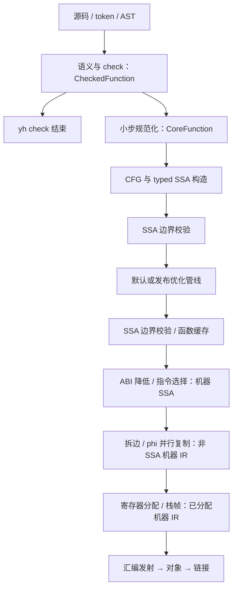

# yh Nanopass 风格优化架构

日期：2026-10-02。状态：**2026-10-26 定位决定后只保留 NP3**（受检契约与 lowering
解耦）；NP0/NP1/NP2/NP4/NP5 关闭，见
[ADR-0011 定位决定](../adr/0011-yh采用Nanopass风格优化阶段契约.md#2026-10-26-定位决定)。
本稿其余内容是设计记录，不是实施承诺。

用户已选择“优化扩展与自举稳定”为首要目标。本方案细化
[ADR-0009](../adr/0009-yh采用check与IR及早期并行.md)的 check → SSA → 后端路线，
继续遵守增量速度第一、默认低成本优化、函数任务私有状态及滚动自举。
实施任务见[分期方案](../02-plan/yh-Nanopass风格优化架构实施方案.md)，
取舍见[ADR-0011 草案](../adr/0011-yh采用Nanopass风格优化阶段契约.md)。

## 1. 建议与边界

推荐“Nanopass 的阶段契约 + 现有 typed SSA + 少量物理表示族”：
一个 pass 只解决一类问题，每个表示边界规定允许的节点、字段和不变量；
复用当前 SSA 的数组与 ID 模型，逐步建立受检表示与机器 IR。

这套架构的首要收益是让优化可独立增加、定位与回归。
生成程序的性能提升来自具体优化和寄存器分配；编译速度改善还依赖前端解耦、
增量缓存、对象粒度与工具链。不能把“拆成更多 pass”本身当作加速证据。

- 保留用户 `.yh` 语法、`project.toml`、模块可见性、现有 ABI 与错误规则。
- 实现继续用上一代种子能够编译的 yh 子集；不引入 Scheme/Racket 运行依赖。
- 不新增源语言宏、泛型、匹配语法或外部 IR 描述文件格式。
- 初期采用静态函数调用的管线；不做动态 pass 插件、自动依赖调度或常驻服务。
- 不把自有汇编/链接器、Linux 原生种子、线程池建设并入本次优化子项目。
  它们继续按既有 R2b–R6 推进，优化上下文提前满足其隔离要求。

## 2. Nanopass 中值得借鉴的部分

Nanopass 官方将其定位为以小 pass 和多个中间表示组织编译器的框架。
[官方介绍](https://nanopass.org/index.html)。
官方手册通过 `define-language` 定义语言、`extends` 增删产生式，
通过 `define-pass` 声明输入/输出；相同形式可自动生成传递与递归代码。
[官方手册](https://docs.racket-lang.org/nanopass/index.html)。

据此作以下 yh 适配，右列是本方案建议，并非官方框架自带的 yh/SSA 能力：

| 借鉴点 | yh 适配 |
| --- | --- |
| 显式中间语言 | 用阶段编号、节点/opcode 集合和 verifier 定义允许的表示 |
| 相邻阶段的小变换 | 拆开规范化、SSA 构造、优化、ABI 降低、寄存器分配 |
| 输入/输出声明 | 每个 pass 写清输入阶段、输出阶段、依赖分析、失效分析与语义前提 |
| 共用形式少写重复代码 | 共用操作数枚举、引用替换、节点复制与表压缩辅助函数 |
| 可观察中间结果 | 输出带阶段名称的稳定 dump，失败定位到函数与 pass |

不照搬 Scheme 的语法 DSL。yh 先用普通结构体、常量和函数实现这些边界；
只有重复样板已经成为可测成本，才另行评估开发期生成工具。

## 3. 当前代码事实

本节依据交付时工作区源码，而不是仅依据 Git HEAD；工作区已有大量未提交的迁移改动。
本方案不覆盖、清理或提交这些改动。

| 现有入口 | 已有能力 | 与本方案相关的限制 |
| --- | --- | --- |
| `compiler/ir/ssa.yh` | typed 值、CFG、phi、调用表、支配校验、`ir_simplify` | 模型/校验/简化同文件约 983 行；值类型与定义位置存在逐次全表查找 |
| `compiler/ir/ssa_serialize.yh` | 格式版本 5、函数/调用 ABI、逻辑字段编码、读回校验 | 暂无独立阶段身份与优化管线身份 |
| `compiler/parse/ast_ir_build.yh` | 标量、直接调用、递归 if、条件循环、break/continue 的构造器 | 约 1263 行；混合支持判断、构造、缓存、简化及后端替换；仍读取 gen 全局 |
| `compiler/parse/ast_ir_cache.yh` | 函数源码/受检事实/编译器/目标隔离的 SSA 缓存 | 存的是简化后的 SSA；生成前仍需旧前端遍历，不等于完整函数级增量 |
| `compiler/backend/arm64.yh` | 整数/布尔 SSA 发射、直接调用、phi 边处理 | 每个值独立 16 字节栈槽；没有机器 IR 与寄存器分配；依赖 gen 输出/标签状态 |
| `compiler/parse/ast_function.yh` | 函数在 AST arena 中的范围与绑定身份 | 是迁移视图，不是完全独立的 CheckedFunction 或线程安全上下文 |

当前 `ast_ir_lower_function` 的主路径是：缓存命中则交给后端；未命中构造 SSA，
调用 `ir_simplify`，通过后由 `arm64_emit_replace` 替换旧汇编，再写缓存。
这意味着受支持函数仍可能先走旧发射，然后重复生成新汇编。

当前构造器包含短路 lowering 代码，但还受类型/形态门限制；嵌套循环、
for-in、switch/goto、浮点、聚合、间接/变参调用等仍有迁移缺口。
存在 opcode/类型定义不等于主路径与后端完整支持。覆盖统计必须分别记录
AST 函数数、SSA 成功数、新后端成功数及回退原因。

## 4. 表示与数据流

目标架构如下；这是迁移终态，初期 NP1/NP2 仅接入已有 SSA 区段。



采用三个内存表示族：受检树/Core、typed SSA、机器 IR；汇编是后续产物。
同一表示族可承载多个逻辑语言，但跨族使用不同结构。
“优化前/后 SSA”共用同一语言，不为每个优化复制一套结构体。

| 逻辑表示 | 允许的形式 | 边界必须验证的条件 |
| --- | --- | --- |
| C：CheckedFunction | 已检查的源级语句、类型和绑定引用 | 无未解析名称；绑定/类型快照稳定；本函数引用不越界 |
| N：CoreFunction | 显式求值临时值、if/loop/label/goto、基础赋值/调用 | 无复合赋值、for-in、短路二元节点；其效果由显式控制流表达；保留源位置 |
| S：SSAFunction | typed 值、块、phi、显式内存/调用/终结符 | 唯一定义、正确支配、phi 前驱吻合、类型与调用契约成立 |
| M：MachineSSA | 目标指令、虚拟寄存器、phi、ABI 参数/结果和 clobber | 不含源级操作；指令合法；调用约束与目标 ABI 明确 |
| E：MachineEdges | 虚拟寄存器、显式边复制、普通指令 | 无 phi；复制只在对应边执行；复制组仍有并行语义 |
| R：MachineAllocated | 物理寄存器、栈槽、具体复制和栈帧 | 无虚拟寄存器/并行复制；冲突、调用保存、栈对齐与偏移合法 |

N 阶段先支持现有标量控制流；for-in 等规范化只在其语义快照和测试齐备后加入。
不把暂不支持的节点伪装成满足 N 契约。C → N 的支持判定可以返回 UNSUPPORTED，
迁移期改走旧函数路径；一旦进入某表示，后续消费者只接收该表示的合法节点。

语法 AST 保持只读。Checked/Core 采用函数范围视图、注解表和必要的新增 arena，
不在每个 pass 完整复制整份模块 AST。Core 降低为 SSA 后可释放其私有暂存。
初期 check/IR 仍按完整目标数据模型与 ABI 隔离；当前 CALL 已保存目标符号名，
不能把现有 SSA 缓存宣称为跨目标通用。

## 5. pass 契约与运行方式

先建立固定管线函数，不引入通用调度框架。每个 pass 的中文函数注释说明：
名称/版本、输入输出、语义前提、读写的表、所需分析、失效范围和错误协议。

建议的概念接口如下，表示职责，不是新增 yh 语法：

```text
PassContext = FunctionArena + TargetSemantics + AnalysisTables + Diagnostics + Stats
PassResult  = status + changed + invalidated_analyses
run_phi_simplify(context, SSAFunction) -> PassResult
run_const_fold(context, SSAFunction)   -> PassResult
run_default_pipeline(context, SSAFunction) -> status
```

函数 arena 和分析表只属于一个任务；目标语义与封存的模块环境只读。
pass 不读取 parser 游标、全局名字分配器、全局标签或 gen 输出缓冲，
不启动进程、不写缓存。协调层负责缓存与产物提交，后端负责目标发射。

第一批共用能力：

1. 指令操作数枚举，统一覆盖 a/b、phi 输入、调用实参和 terminator 值。
2. 值引用替换，在全部表更新完成后再校验，不暴露半更新 IR。
3. 值定义/类型索引、块归属与前驱表；按值上界分配，允许稀疏编号。
4. 表压缩与 ID 重映射，一并处理块、值、phi、调用、实参及符号片段。
5. 保守的 opcode 属性查询，说明是否有结果、读写内存、可陷阱、可不返回等。

初期任何修改都令分析缓存失效，按需重建；测量证明有必要后，再细化为
“改 CFG 失效前驱/可达性/支配/活跃性，改值引用失效 def-use”等规则。
不得复用无法证明仍有效的分析表。支配分析不用为每个小 pass 重算；
需要它的 pass 或完整 verifier 才建立，初期仍可复用既有算法。

阶段编号放在包装视图/缓存记录中，不只给 IR 打一个“优化完成”的标记。
verifier 实际检查该阶段的结构与禁用形式；生成 R 后重新出现虚拟寄存器必须拒绝。
每个简单优化允许 S → S，无须声称增加了新的语法语言。

## 6. 优化管线与优先顺序

以下 `-O0/-O1/-O2` 为拟议选项，当前 CLI 尚未提供；默认拟映射为 O1。
O0 仍做 check、正确 SSA 构造、ABI/phi 降低等必需工作，只跳过可选优化。
旧种子构建不传它尚未支持的新参数。

### O1：默认低成本管线

```text
完整 SSA 校验
→ 平凡 phi 简化 / 拷贝传播
→ 按目标整数语义常量折叠
→ 常量条件分支化简 / 不可达块删除
→ phi 与拷贝清理
→ 保守 DCE / 表压缩
→ 完整 SSA 校验
```

NP1 先拆现有 `ir_simplify`，保持既有执行顺序与结果；NP2 才逐项增加新行为。
默认采用固定顺序和固定轮数，不不断重跑整套管线追求所有优化的共同固定点。
单项算法可用有明确进展度量的工作表，例如 DCE 每个定义最多入队有限次。

| pass | 首版范围 | 明确保留的情况 |
| --- | --- | --- |
| phi 简化 | 非自环输入最终为同一值，完整替换所有引用 | 无外部共同输入的自环 phi；需额外证明的复杂循环 phi |
| 拷贝传播 | 以 SSA 身份与正确支配替换 COPY/别名引用 | 不基于源变量同名判断相等 |
| 常量折叠 | 已定义的定宽整数、布尔/比较，正确截断及符号扩展 | 浮点代数改写；语义未锁定的除法/移位边界 |
| CFG 化简 | 常量分支、不可达块、可证明安全的空跳转块 | goto/不可约图不满足变换条件时保持原图 |
| DCE | 无结果用途且已证明无效果/无陷阱的定义，沿 def-use 工作表删除 | PARAM 签名、CALL、STORE、未知 LOAD、可能陷阱/不返回操作 |
| 表压缩 | 清理删除造成的表片段并重映射 ID | 不改变剩余效果操作的顺序 |

PARAM 即使无人使用，也保留当前 verifier 要求的完整连续参数前导；
签名模型单独调整之前不能按普通死定义删除参数。
删除不可达块必须同步删对应 phi 入边、修复调用 aux 顺序及调用/实参表，
重建分析；只修改 succ/块数组不足以保持当前 IR 契约。

### O2：按测量启用的发布管线

依赖 O1、完整引用工具和分析索引后，逐项加入：

- SCCP：用可执行边与常量格处理跨块常量和 phi，再接 CFG 清理。
- 局部值编号：先仅处理基本块内的纯整数操作，键包含 opcode、类型、位宽和输入。
- 有限内联：先模块内小函数，排除递归 SCC；限制展开的指令总量。
- 循环优化：先测量热点；LICM 等等待别名、效果与陷阱语义成熟后另行设计。

SCCP 等有限格算法可以求解到收敛；内联等用固定 IR 规模预算。
访问顺序和预算由稳定输入决定，不用线程竞速或墙钟超时决定输出。
O2 不作为早期自举稳定门的唯一管线，先建立默认 O1 固定点后再单独验收 O2。

## 7. 语义安全条件

新增优化前建立“类型/opcode → 语义 → 目标实现 → .yh 用例”对照表。
以现有语言规则与回归为依据，不套用 C 的有符号溢出假设或 LLVM 的 poison 规则。

- 窄整数截断、符号/零扩展、unsigned 比较必须与现有后端一致。
- 除零、最小负数除 -1、负移位/超宽移位当前必须逐项核对。
  若旧折叠与动态发射不一致，先单列缺陷与复现用例；方案不悄悄选择新语义。
- 源级编译期常量报错不能因后续优化把代码删掉而消失；完整 check 先完成。
- `&&/||` 规范化为分支，保持短路与源码求值顺序，不能提前调用右侧函数。
- CALL 未有可信摘要时按读写内存、可陷阱、可不返回处理；忽略返回值不代表可删除。
- 未使用的 LOAD 也可能触发访问异常，不能仅按“没写内存”判为可删除。
- 聚合复制、数组/切片视图与逃逸地址遵守现有按值/别名约定；暂不做 load CSE、
  store 删除、内存重排或跨调用提升。不因 `const` 绑定推断所指存储不可写。
- 浮点默认保持现有结果，不引入 fast-math、结合律重排或 x*0 等捷径。

首版用保守属性足以阻止错误 DCE 和值编号，不急于引入 Memory SSA/完整别名系统。
未来需要移动内存或调用操作时，必须补齐其分析和语料，再扩大规则。

## 8. 机器 IR 与寄存器分配

机器 IR 是第二个主要结构变更，放在 NP4；NP1/NP2 保持现有栈槽后端作为基线。
目标 pass 顺序为 ABI 降低 → 指令选择/合法化 → phi 边处理 → 活跃性 → 分配 → 栈帧 → 发射。
ABI 降低与指令选择可以交错实现，但跨边界必须消除规定的伪操作。

phi 消解先产生边上的并行复制组，必要时拆临界边。
寄存器分配后再把复制组排成串行指令，复制环必须用保留临时寄存器或栈槽打破。
当前边发射代码不能自动视为所有复制环正确的证明；新增运行用例先验收现有与新路径。

第一版分配采用确定性线性扫描，先服务整数/布尔子集；区间要包含跨块活跃和
phi 的边使用，不能仅按指令数组物理顺序统计最后引用。调用的参数/结果寄存器、
caller/callee 保存、保留寄存器、spill/reload 与栈对齐均由 Target/ABI 描述提供。
Darwin/Linux 继续各自验收 ABI，不能由一个“arm64”编号掩盖差别。

为了增量和并行，生成函数私有标签、机器 IR 与输出缓冲，再由协调层按稳定顺序合并。
先从 gen 中迁出后端必需的符号/目标/输出视图，不同时搬动整个前端类型系统。

收益验收包含栈帧字节、load/store/spill 数、文本大小和实际运行时间；
不能以“已有 SSA/寄存器分配”代替性能证据。

## 9. 模块和文件安排

按职责拆文件，不按每个 pass 创建一个独立项目。以下是随阶段出现的建议落点：

| 位置 | 责任与依赖 |
| --- | --- |
| `compiler/ir/ssa.yh` | 保留基础模型/类型契约；按规模迁出 verifier 和优化 |
| `compiler/ir/ssa_verify.yh`、`ssa_analysis.yh` | 校验与函数私有分析；只依赖 ir 模型 |
| `compiler/ir/ssa_rewrite.yh` | 完整操作数访问、引用替换、表压缩 |
| `compiler/ir/ssa_fold.yh`、`ssa_phi.yh`、`ssa_cfg.yh`、`ssa_dce.yh` | 可独立验收的小优化；共用 rewrite/analysis |
| `compiler/ir/pass_pipeline.yh` | O0/O1/O2 固定顺序、边界校验、诊断和统计 |
| `compiler/parse/ast_ir*.yh` | 过渡前端适配；NP3 分离 Checked/Core 构造与 lowering |
| `compiler/backend/machine*.yh` | NP4 的机器模型、phi 消解与分配，按实际规模拆分 |
| `compiler/backend/arm64*.yh` | 目标指令/ABI/最终发射 |
| `compiler/cmd/` | 选择配置、函数缓存、调度、文件对象及最终提交 |

ir 为根项目普通模块（2026-10-02 起，原独立子项目），仍保持不 import
gen/parse/backend/cmd。
初期 parse 对 backend 的历史依赖仍可存在；NP3 移出缓存/后端调用后，
协调层分别调用前端/ir/后端，最终避免 parse 与 backend 互相牵制。
文件按实际职责接近仓库 500–1000 行约定，不为凑行数合并无关职责。

## 10. 缓存、确定性与错误处理

首期只保留优化后 SSA 的函数缓存，给现有内容键加入模式与管线身份。
O2 需要复用不同模式输入且收益被测量证明后，再加入未优化 SSA 检查点；
不为每个小 pass 写持久缓存。

```text
函数键 = 编译器身份 + 前端/check 事实 + 函数内容/稳定身份
       + 实际读取的类型/接口事实 + 完整目标/ABI + 兼容/运行时配置
       + IR schema/缓存阶段 + 优化模式/管线版本
后端键 = 函数 IR 内容 + 后端版本/配置 + 完整目标/ABI
对象/链接键 = 输入产物内容 + 工具/运行时/目标/链接配置
```

模式必须进入模块 manifest、对象和链接键，避免热构建提前命中模块缓存，
根本没有机会重新选择函数优化管线。NP0 即验收 O0/O1 切换的整条失效链。
内联或读取被调用者效果摘要时，把其函数体/摘要版本记录为实际依赖；
不能继续只记录公开签名。O1 无内联时，保持当前保守接口失效策略。

新增字段提升序列化/缓存版本，旧缓存自动冷重建；完整校验损坏或错目标记录。
绝不写地址、未初始化填充字节、线程序号或不稳定表 ID。函数标签/序列化输出
依稳定函数身份与确定的块/指令顺序生成，诊断与产物按源码顺序合并。

不支持的前端/后端能力在修改产物之前返回 UNSUPPORTED，并记录原因；
迁移期仅在这个明确边界选择旧路径。构造错误、违反 pass 契约、验证失败
属于编译器错误，停止该任务，保留诊断与稳定 dump，不静默回退掩盖错误。
协调层沿用构建会话的原子提交，必要任务失败时不提交成功 manifest 或最终链接。

## 11. 验证与成功标准

阶段 verifier 只证明结构合法；固定点只证明编译输出稳定。两者均不能代替语义回归。
每个新增优化须覆盖以下证据：

1. `.yh` 正例与反例：语义行为、类型/控制流错误、内部非法 IR。
2. 同一候选编译器、同一后端下 O0/O1，必要时 O2 的退出码、精确 stdout、
   受控文件效果对照；不拿旧 C stage0 作参考。
3. 稳定 IR/dump 的性质断言，确认优化实际发生；统计确认函数进入新后端，
   避免整体回退旧路径的用例被当作优化验收。
4. 小规模确定性生成的有效整数/CFG 程序做模式差分；不生成未定义访问等输入。
5. 缓存冷/热、模式/目标切换、接口/实现变化、损坏记录与并发隔离。
6. `make`、`make test`、`make selfhost-native`；同一模式/目标的候选两代
   全量 `.s/.s.i` 固定点，以及自解析、运行、模块/项目验收。

首次拆分保持既有 verifier 密度。成熟后，开发/门测试可每 pass 完整验证，
普通构建每 pass 做契约局部检查，在 SSA 构造后、优化出口、缓存读回、后端入口
等边界完整验证；不通过省略缓存验证换性能。

性能分别报告三种构建负载的中位数/p95、RSS、优化/验证时间、工具调用数及
生成程序运行时间。沿用冻结 R0 语料，另冻有代表性的 SSA 优化语料，不修改旧语料
后直接推导加速。每类至少 20 个独立样本，固定输入/参数/种子/目标。
NP0 锁定基线；纯组织拆分阶段端到端中位数或 p95 超过同机基线 10% 时重测归因，
可重复的回退必须解决或形成明确取舍后再扩大默认管线。
10% 是建议的回退调查线，不是速度保证；既有 50ms/200ms/1s 目标继续保留。

所有代码切片从上一代入库种子构建并过门后才允许滚种子。
新旧版本产物可以因优化不同；固定点比较的是同一管线的候选相邻自编代。
Linux 交叉汇编/组装证据与原生运行证据分开记录。

## 12. 分期结论

最值得先做的是 NP0/NP1：锁定语义与模式差分，将现有简化抽成小 pass，
建立引用工具和按 ID 的分析索引，保持输出行为并通过两代固定点。
这一步为后续优化提供可靠入口，改动范围仍局限于现有 SSA 切片。

随后 NP2 交付低成本优化；NP3 逐项补齐受检/Core 与自编覆盖；
NP4 解决栈槽后端的代码质量；NP5 才扩展较昂贵优化。
NP0–NP2 通过不代表完整 SSA 编译器、自有工具链或全部 R2b 已完成。
