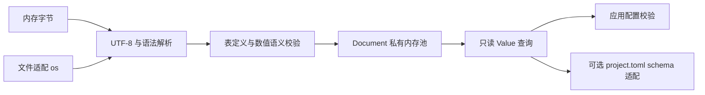

# yh TOML 标准库设计（提案）

日期：2026-10-23。状态：**T0–T5 reader 已实现并收口（2026-10-23）**；
T6 编译器迁移与 T7 writer 仍待办。用户已确认“完整 TOML 1.1 解析优先、生成后置”。
实施分期见[实施方案](../02-plan/yh-TOML标准库实施方案-2026-10-23.md)，
取舍见 [ADR-0017](../adr/0017-yh-TOML标准库独立文档模型.md)，落地状态与
验证证据见文末《实现落点》。

## 1. 目标与实际基线

提供 `import toml` 的通用配置读取库，应用能解析内存或文件、遍历值树、按真实类型
取值并定位错误。不要求反射、泛型、异常、新字符串类型或新的 yh 语法。

实施前基线（2026-10-23；reader 落地后的实际状态见 §9）：

- `libs/` 当时尚无 TOML 实现，`libs/project.toml` 当时尚未注册 `toml`。
- `compiler/cmd/toml.yh` 是面向清单的 TOML 1.0 子集：节、裸键、两类单行字符串、
  整数、字符串数组和特定内联表；未覆盖通用 TOML。
- 旧解析器使用模块全局游标和 `toml_secs`，字符串进入 `gen.G().task` 名字池。
  `project_index.yh` 递归加载依赖前要快照父清单；这不是可直接导出的库模型。
- `libs/cli` 已验证薄句柄、私有分配池、带标签值和显式释放可行。其文本依赖 NUL
  结尾，数值转换也不等于 TOML 转换，不能整套复用为 TOML 公共模型。
- 当前堆裸指针不能直接构造切片，递归类型的声明次序也有限制；采用指针加长度和
  不透明值句柄，避免把语言增强变成库的前置。

首期终点是完整 reader。T0–T5 完成前，阶段子集必须如实标注；编译器消费者迁移
另列 T6，不把它作为应用使用标准库的前置条件。生成器 T7 按需启动；保留注释与
排版的编辑器、结构体自动映射、schema 框架、环境变量展开和 include 均暂不安排。

## 2. 标准版本与备选

官方当前稳定规范是 [TOML 1.1.0](https://toml.io/en/v1.1.0)，发布于
2025-12-18。相对 1.0，1.1 增加内联表换行/尾逗号、`\e` / `\xHH` 转义及
时间省略秒的写法，见[官方变更记录](https://github.com/toml-lang/toml/blob/1.1.0/CHANGELOG.md)。
推荐直接以 1.1 为唯一解析规则；不引入版本开关。读取普通 1.0 文档自然兼容，
但不能声称这是严格 1.0 校验器，因为部分 1.0 反例在 1.1 已合法。

| 方案 | 收益 | 代价与结论 |
| --- | --- | --- |
| **完整语义 reader，随后独立迁移编译器** | 通用能力有明确验收；自举变化单独控制 | 需要完整字符串、数值和表语义；推荐 |
| 只抽取现有清单子集 | 改动较少，可快速服务清单 | 子集无法承担通用标准库；只能作为过渡实现 |
| 一次交付 reader、writer 和保真编辑 | 同时覆盖读取和改写 | 需要语法树、注释归属和布局规则；当前缺少使用需求 |

语法依据为[固定 1.1.0 ABNF](https://github.com/toml-lang/toml/blob/1.1.0/toml.abnf)，
表冲突等语义另行校验。TOML 是数据格式，本方案不修改 `docs/yh.g4`。

## 3. 数据流与模块边界



全部源码属于一个普通 `toml` 模块。实际落地文件不加数字前缀，用语义名让
文件名字节序等于编译顺序（类型必须先定义，模块按文件名顺序编译）：

```text
libs/toml/
  base.yh       公开类型/枚举、预算与私有定义状态常量
  document.yh   私有池、稳定节点、表条目与数组容器
  encoding.yh   UTF-8 校验、标量编码、十六进制
  numbers.yh    整数/浮点扫描、精确 binary64 转换、大整数
  datetime.yh   四种日期时间的验证
  lexer.yh      游标、诊断、空白/注释
  strings.yh    四种字符串、转义与解码
  parse.yh      文档、键、值、表语义
  query.yh      查找、遍历与类型化读取
  file.linux.yh Linux os 结果接口文件读取适配
  file.darwin.yh Darwin 旧 os 文件接口兼容适配
  surface.yh    解析入口、生命周期、诊断构造
  README.md     例子、限制、生命周期与验收入口
```

文件随真实实现调整，接近 1000 行再按职责拆，不填充代码达到行数下限。只导出应用
实际消费的声明；状态、节点、哈希表和分配器均私有。不依赖 `compiler/gen` 或
`cli` 的私有辅助函数，也不先建设通用 map、arena、Unicode 或序列化框架。
核心仅使用现有分配/复制运行时；文件适配调用 `os`，不自行写平台系统调用。

## 4. 公共模型与接口（已按此落地，见 §9）

### 4.1 文本和句柄

```yh
// Text 是 UTF-8 字节视图；长度不含额外终止字节，可以包含解码所得 NUL。
pub struct Text {
    data *u8
    count u64
}

// Document 独占一次成功解析的存储；handle 由模块管理，调用者不可改写。
pub struct Document {
    handle *void
}

// Value 是所属 Document 内节点的只读视图，不单独分配或释放。
pub struct Value {
    handle *void
}
```

`ValueKind` 拟包含 `kind_invalid`、`kind_string`、`kind_integer`、`kind_float`、
`kind_boolean`、`kind_array`、`kind_table`、`kind_offset_datetime`、
`kind_local_datetime`、`kind_local_date`、`kind_local_time`。
`kind_invalid` 只表示空视图；TOML 数据没有 null。所有枚举项在模块内使用唯一名字，
跨模块写 `toml.kind_string`，遵守现有两段式枚举访问规则。

不能把 `Text` 改为只有 `*char`：转义解码后的 NUL 可出现在字符串和带引号键里，
`strlen` 会截断。键按解码后的字节与长度比较，不做 Unicode 规范化。
`*char` 只用于调用方便的入口、文件路径和固定诊断消息。

### 4.2 解析和生命周期

| 拟议 API | 契约 |
| --- | --- |
| `parse(data *u8, count u64) ParseResult` | 读取显式长度字节；`parse(0, 0)` 是合法空文档；非零长度要求有效地址 |
| `parse_text(text *char) ParseResult` | NUL 结尾输入的便捷入口；空指针为参数错误 |
| `read_file(path *char) ParseResult` | 读完整文件并关闭，返回同一种解析结果 |
| `root(doc *Document) Value` | 成功文档的根表；空句柄返回无效视图 |
| `release(doc *Document) void` | 释放全部文档存储并清零；同一个已清零句柄可再次释放 |

`ParseResult` 含 `status`、`document`、`error`。状态为 `parse_ok`、
`parse_syntax_error`、`parse_resource_error`、`parse_io_error`、`parse_argument_error`。
成功结果的 `document` 由调用者最终释放；失败时没有可查询的半成品文档。

解析时输入只借用；成功后文档独立持有键、字符串、时间文本和查询所需数据，输入可
立即释放或改写。节点地址在文档生存期内稳定，多个文档互不覆盖。分配失败或语法失败
立即释放临时存储；诊断使用静态消息与数值位置，内存不足时也能返回错误。

`Document` 按单一所有者使用，复制结构体不产生新所有者。释放原文档后，所有
`Value` / `Text` 视图失效，不允许查询，也不能通过复制句柄二次释放。
不引入引用计数或隐式析构；无可变全局解析状态。同一存活文档可只读共享，释放须由
调用方同步；线程安全仍需具体运行时证据。

### 4.3 查找、遍历和取值

| 拟议 API | 返回和语义 |
| --- | --- |
| `kind(value Value) ValueKind` | 查看类型；空视图返回 `kind_invalid` |
| `table_get(table Value, key Text) LookupResult` | 查询一个完整键名，支持空键和内嵌 NUL |
| `get(table Value, key *char) LookupResult` | NUL 结尾键的便捷入口；点号就是键内容 |
| `array_get(array Value, index u64) LookupResult` | 按零基下标取元素 |
| `count(container Value, out *u64) QueryStatus` | 数组元素数或表条目数；标量报类型不符 |
| `table_entry(table Value, index u64) EntryResult` | 按首次引入顺序返回键、值和键位置 |
| `as_text(value Value, out *Text) QueryStatus` | 只接受字符串 |
| `as_i64(value Value, out *i64) QueryStatus` | 只接受整数，不转换浮点或数字字符串 |
| `as_f64(value Value, out *f64) QueryStatus` | 只接受浮点，不隐式提升整数 |
| `as_bool(value Value, out *bool) QueryStatus` | 只接受布尔 |
| `as_temporal(value Value, out *Text) QueryStatus` | 只接受四种时间类型，返回已验证的原始文本 |
| `value_span(value Value) Span` | 查询值、表头或触发隐式表创建的来源位置 |

`QueryStatus` 区分 `query_ok`、`query_missing`、`query_type_error`、
`query_bounds_error`、`query_argument_error`。失败不修改 out 参数；查找失败返回空
Value，条目失败返回空键和值。查询不分配、不打印、不退出，不用零值或 false 吞掉错误。

`get(root, "a.b")` 查询字面键 `a.b`；嵌套表用两次查询。首期不提供会重新解析
TOML 路径语法的字符串路径 API。遍历顺序是本库的确定性契约，不宣称规范要求有序。

## 5. 语义实现的关键点

以下覆盖项以固定规范为依据；细节与反例在 T0 建立逐项测试矩阵。

| 区域 | 必须覆盖的行为 |
| --- | --- |
| 文档和键 | UTF-8、注释、LF/CRLF；裸键/引号键/点键；空引号键；完整消费输入 |
| 字符串 | 四种字符串、转义和 Unicode 标量；多行首换行裁剪、续行和引号边界 |
| 标量 | 有符号 i64 与进制整数；binary64、科学计数、特殊浮点；布尔 |
| 时间 | 四类独立类型、日期合法性、偏移和小数秒；1.1 的省略秒写法 |
| 容器 | 混合/嵌套数组、内联表、普通表、数组表；定义冲突与所属表绑定 |

解析器区分“行内空白”“允许换行/注释的容器上下文”，不能用旧版 `tml_ws`
在所有位置跳过全部空白。必须拒绝同一行两个未分隔赋值、裸 CR、错误续行和尾随垃圾。

表节点私有保存创建来源与定义状态：隐式父表、显式表头、点键引入、内联表封闭、
数组表元素。状态转移逐项依据规范，不能靠“键存在就覆盖”实现。数组表子项归属最近
创建的对应元素；普通数组与数组表的定义身份在解析期区分，查询时均表现为数组。
条目按顺序保存，查重/查找按解码字节比较，不扩大为通用容器库。首期未建
额外哈希索引，大表是 O(n²) 级；实测/优化另立性能项。

整数无损存为 i64，超范围显式失败。浮点采用 binary64，保留负零和显式 inf/nan；
有限字面量越界不得静默变成 inf。十进制转换须正确处理舍入、长尾数、次正规数和
下溢，禁止直接复制 CLI 的逐位乘十算法。推荐先做纯 yh 精确转换原型（私有大整数
与一次舍入），不急于加入快速路径；T0 实测代价，T2 的独立数值差分是发布阻断门。
不能在算法未验证前把“支持 f64 运算”当作“已正确解析十进制浮点”。

时间节点保留四种类型及完整小数文本，不强制转 Unix 时间，不赋予本地时间隐式时区。
首期不提供日历运算和时间格式化；省略秒、大小写分隔符及偏移的等价比较由测试适配
规范化。`as_temporal` 返回文本不等于降格成字符串，`kind` 仍可区分具体时间类型。

## 6. 失败、资源和文件读取

`Diagnostic` 拟包含稳定 `ErrorCode`、静态中文 `message`、主 `Span`、可选相关
`Span` 和 I/O 来源 `native_code`。错误码至少区分编码/语法/重复键/表冲突/整数范围/
浮点范围/时间值/资源上限/内存不足/I/O/参数错误；消息文字不是程序判断接口。
`Span` 用零基字节半开区间和一基行/字节列；CRLF 计一行，tab 计一字节列。
重复定义报告第二处并关联第一处；根表覆盖输入，隐式表记录首次触发创建的位置。

首期只报首个错误，不做多错误恢复。核心不读取全局 errno、不写 stdout/stderr、不
退出进程；文件路径由调用者附加到诊断，避免成功解析仍保留额外路径副本。

建议初始实现预算：输入最多 16 MiB、嵌套最多 128 层、单文档累计分配最多 128 MiB。
T0 实测后冻结；预算覆盖隐式表路径深度、解析栈、节点、索引、字符串和暂存块。
所有长度加法、乘法和扩容先做溢出检查；超限报资源错误，不能截断或伪装语法错误。
这些是实现限制，README 必须披露；“完整 reader”指支持预算与数值表示范围内的
1.1 语法和语义，不能承诺无限文档或无限精度。

`read_file` 按平台分文件：Linux 用 `os.open_path/read_some/close_file`，
循环处理短读和 interrupted；Darwin 在 OS8 新文件 API 落地前用旧
`os.open_file/read_fd/close_fd`，`native_code` 为 0、不区分 interrupted。
两者都在读到 EOF 后解析并释放读取缓冲。所有成功打开的 fd 在全部路径关闭；
关闭只尝试一次。已有读取错误优先保留；若读取成功而关闭失败，返回 I/O 错误。
文件增长同样受字节预算约束，不只依赖一次文件大小检查。内存解析用例与文件
适配用例分别验收。

## 7. 编译器迁移与自举

T6 才迁移 `compiler/cmd/{toml,project_index,project_link}.yh` 等真实消费者：

1. 在 `compiler/project.toml` 为标准库增加或复用显式依赖，避免依赖本地同名模块
   遮蔽和开发机的 `YH_STDLIB`。先检查 OS7 是否已经添加同一依赖，不重复注册。
2. 通用库负责 TOML；`project_*` 保留允许字段、必填项、模块命名、目标、链接和
   依赖规则。原清单必须继续接受/拒绝；新合法拼写按独立兼容矩阵评审。
3. 原名字池所需内容显式复制；递归加载时每个清单独立持有 Document，验证父子
   同时存活后再移除旧快照，不把旧全局状态藏进新适配器。
4. 审核构建依赖摘要、安装/发布标准库打包和固定点脚本是否覆盖新依赖；避免修改
   `libs/toml` 后编译器仍被视为最新。
5. 旧种子先冷编包含新库的候选，候选再编两代并过本平台全门。只有所有消费者
   切换且无剩余调用后才删除旧解析器；滚种子按仓库单独流程执行。

新库支持更多合法 TOML 不等于放宽 `project.toml` schema；路径、名字等原本要求
NUL 结尾的消费字段还须明确拒绝解码 NUL，不能复制后被宿主接口截断。

## 8. 验收与来源

使用固定 [toml-test v2.2.0](https://github.com/toml-lang/toml-test/tree/v2.2.0)，
明确选择 TOML 1.1。其协议要求 decoder 从 stdin 收 TOML，成功输出带类型标签的
JSON，非法输入返回非零；有效项比较值树，不能只检查“解析成功”。
测试桥放在 `tests/`，无需先建设 JSON 标准库。上游源码/工具带版本和校验信息，
下载及产物进入 `tmp/`；完整门不静默联网，也不把缺少语料记作成功。

原生 `.yh` 用例覆盖本库 API、位置、所有权、多个文档、分配失败和预算边界。
浮点用独立高精度参考比较位模式；NaN 比较分类，负零单独比较符号。
T5 用固定 1.1 decoder 语料无跳过通过作为 reader 的必要门，不能单凭它替代
本库 API 与资源验收。严格 1.0 invalid 集不作为 1.1 实现的通过条件。

在当前宿主完成 `make`、`make test`、`make selfhost-native` 与专项门；其他平台
交 Gitea Actions，Linux 为主验收平台。现有语言内 `yh test` 仍是提案，TOML
不等待它实现，先沿用普通 `.yh` 项目加 Python runner。

## 9. 实现落点（2026-10-23）

公共 API 与 §4 草案一致：`parse`/`parse_text`/`read_file`、`root`/`release`、
`kind`/`value_span`、`table_get`/`get`/`array_get`/`count`/`table_entry`、
`as_text`/`as_i64`/`as_f64`/`as_bool`/`as_temporal`。没有新增写入或格式化 API。

- 存储：`Document.handle` 指向私有 `doc_state`，节点、键、字符串、时间原文和
  容器数组都在同一池；失败整池释放。键按解码字节线性比较，表条目保持插入顺序；
  首期没有额外哈希索引，大表解析/查找是 O(n²) 级，按配置文件规模取舍。
- 浮点：私有 640-limb 大整数做十进制→binary64 正确舍入；1437 个随机/边界值
  与 400 个相邻 double 中点（含次正规数与精确十进制展开）与 Python 位模式一致，
  30 个有限上溢样本全部报错。
- 表语义：节点保存隐式/显式/点键/内联状态；点键在本节结束后冻结，表头可穿过
  已定义表但不可重定义；数组表子表绑定最近元素。固定 toml-test 语料覆盖。
- 资源：输入 16 MiB、容器嵌套 128、键段 128、浮点有效数字 4096、累计分配
  128 MiB；467/467 非法语料与专项边界用例验证拒绝路径。
- 验收：六组 API/文件断言已迁入 `libs/toml/tests.test.yh`（11 test / 154 断言，
  `yh test toml`；记录见 [YT4-P2](../01-finished/yh-YT4-P2-toml迁移-2026-10-25.md)）；
  官方 tagged JSON 桥
  `tests/modules/projects/tomltestdecoder` 对 toml-test v2.2.0 的
  `files-toml-1.1.0` 通过 **681/681**（有效 214、非法 467）；`make test`
  与 `make selfhost-native` 在本机通过。
- 分配失败与预算（T4.1）：测试副本注入运行时失败点，`tomlinject` 覆盖
  **124 个池分配失败点**（资源错误、无半成品文档、重复解析干净失败）；
  测试副本把 `TOML_MAX_BYTES` 降到 2048，`tomlbudget` 验证累计预算返回
  `error_resource_limit`。文件读取缓冲是池外 `malloc`，不在注入范围。
- 文件入口：`file.linux.yh` 使用 os 结果接口；`file.darwin.yh`
  在 OS8 前使用旧 os 文件接口，保证提交树不依赖未完成的 Darwin os 迁移。
- 安装（T5.1）：`make install` 安装树含 12 个 toml `.yh` 源，`tomloutside`
  在仓库外、无 `YH_STDLIB` 时通过默认 `../share/yh/libs` 发现运行。
- 未完成：writer/保真编辑（T7）；编译器清单消费者迁移（T6）。三端 Release
  资产当前只含 `yh`，标准库由 `make install` 分发；是否改变发布策略另行决定
  （todo T5.2）。编译器仍未使用本库，`compiler/cmd/toml.yh` 保持原状。
