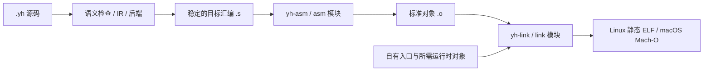

# yh-asm 与 yh-link 设计

日期：2026-10-02。状态：**详细规划，尚未实施**。

用户已确认平台顺序：**Linux/AArch64 优先，随后 macOS/arm64**。
本设计细化 ADR-0009 的 R4/R5，实施任务见
[分期实施方案](../02-plan/yh-asm与yh-link实施方案.md)。
本次交付是设计与计划，不表示汇编器、链接器或 Linux 自举已经可用。

## 1. 目标与成功标准

用 `.yh` 编写自有汇编器与链接器，保留现有编译主线：



首期终点是 Linux/AArch64 编译器在受控环境中编译普通程序、运行结果正确，
并连续生成下一代编译器。产品进程不启动 clang/gcc/as/ld、shell 或外部装配程序；
Linux 独立产物没有 libc/CRT、动态解释器或未解决符号。

分别设置三层能力门，不能用较低层的完成代替较高层：

| 能力门 | 必须证明的结果 |
| --- | --- |
| 汇编器门 | 全部已冻结 yh 后端/运行时汇编可生成标准对象，编码与重定位正确 |
| 链接器门 | 多个普通对象正确解析符号、布局、重定位，生成内核可运行的静态 ELF |
| 工具链闭环门 | 自有入口与宿主运行时齐备，无外部编译工具连续自编，固定点与语料通过 |

性能目标沿用现有重规划：固定负载无改动 ≤50ms、真实单函数修改 ≤200ms、
清空 yh 缓存的冷编 ≤1s；作为待测目标，不预先承诺替换工具链后一定达成。

## 2. 已核实的基线

分析基于 `dcfcac1` 加本轮工作区；工作区已有未提交的 ABI、标准库和文档改动。
基线不是干净提交，实施前必须重新记录源码状态与编译器/种子哈希。

| 现状 | 代码或已有记录 |
| --- | --- |
| 单文件把 `.s` 交给 clang/gcc 一次汇编链接 | `compiler/cmd/driver.yh` 的 `run_emit_asm_to` |
| 项目逐模块 `.s → .o`，最后统一外部链接 | `compiler/cmd/link_cache.yh` 的 `mb_link` |
| 对象与最终产物已有内容缓存 | 同文件；工具身份目前主要是命令名称，版本契约仍不足 |
| 后端为 AArch64；目标选项主要区分 GNU 与 Darwin 方言 | `compiler/gen/target.yh`、`compiler/cmd/driver.yh` |
| 旧发射器和 SSA 发射器同时存在 | `compiler/gen/emit_arm64.yh`、`compiler/backend/arm64*.yh` |
| 零初始化数据用 `.bss/.balign/.skip` | `compiler/gen/emit_arm64.yh`、`compiler/gen/buffer.yh` |
| malloc/free、memcpy/strlen、有限 printf 已有本地入口 | `compiler/gen/emit_runtime_memory.yh` |
| open/read/write、进程控制等仍有外部符号 | `compiler/gen/symbols.yh` 的 prelude 登记 |
| 平台文件可按目标选择 | `compiler/cmd/project_index.yh` 的 `pj_source_target_match` |
| 入库种子与根 yh 都是 Mach-O arm64 | 本轮 `file bin/yh yh`；Linux 原生种子尚未入库 |
| Makefile 已按宿主选择种子路径 | Linux arm64 默认路径为 `bin/yh-linux-arm64`，不能误称已存在 |

本轮盘点了 `tests/yh-run/run/` 与 `pass/` 的 59 个文件：Linux 和 Darwin 各
59/59 成功发射汇编。Linux 观察到 66 个助记符拼写、Darwin 65 个，各 9 个伪指令；
另扫描现有 6 个 Darwin 自编模块汇编缓存，观察到 51 个助记符、8 个伪指令。
拼写包含指令别名和条件码，不等于 66 种独立机器编码。

盘点材料位于 `tmp/yh-toolchain-plan/inventory-corpus.json` 与
`inventory-darwin.json`。它们是本轮临时证据；**没有覆盖全部 modules 项目、
Linux 自编模块、入口与后续 OS 桥，不是最终支持白名单**。
TC0 必须把这些输入纳入可重复盘点，再冻结版本化契约。

### 2.1 必须先解决的宿主/目标混用

`drv_write_asm`、`mb_open_out` 当前用 `tg_darwin()` 选择文件操作标志。
而 `-target linux` 会改变目标方言；在 Darwin 进程中，这不能改变宿主的 open ABI。
新工具链必须分开：

- **HostPlatform**：运行编译器的 OS、文件/进程 API、路径和权限操作。
- **TargetSpec**：输出的 ISA、OS、对象格式、ABI、端序和链接模式。

源码平台文件筛选、符号前缀、指令/对象发射看 TargetSpec；读取文件、创建目录、
计时、进程管理看 HostPlatform。实现工具源码本身时，平台文件由生成该工具的
目标决定；工具运行后的 I/O 不再随它正在输出的目标改变。

现有 `-target` 未识别字符串会落到 GNU 分支。新命令应显式验证支持目标；
既有别名保持兼容，未知目标返回用法错误，不能悄悄生成另一格式。

## 3. 范围与路线选择

### 3.1 推荐路线

采用“yh 所需汇编子集 → 标准对象 → 有限静态链接 → 自举闭环”。
工具命令与编译器内部调用共用实现，先 Linux，再增加 Mach-O 格式适配。

| 路线 | 优点 | 代价/问题 | 决策 |
| --- | --- | --- | --- |
| 有限汇编子集 + 标准 ELF/Mach-O | 范围可验收；可与外部工具交叉测试；保留可观察汇编阶段 | 需要维护明确的支持契约 | **采用** |
| 一开始兼容 GNU as 与 ld 全部能力 | 用户可直接迁移各种第三方输入 | 宏、脚本、TLS、动态链接、调试格式与兼容行为使范围过大 | 延后，按实际输入扩展 |
| 后端直接输出自定义对象/机器码 | 可减少解析汇编的成本 | 绕开已确认汇编阶段；自定义格式增加检查与互操作成本 | 首期不采用 |

### 3.2 各阶段支持边界

| 项目 | Linux 首个闭环 | 后续 |
| --- | --- | --- |
| ISA | AArch64 小端、现有后端/运行时/入口所需指令 | x64 等独立立项 |
| 汇编输入 | 冻结的 GNU 风格子集 | 按需要扩展，不能宣称通用 GNU as 兼容 |
| 对象 | ELF64 `ET_REL`，普通节、符号和明确列出的 RELA | 有限 C 对象、归档、其他格式 |
| 可执行 | 非 PIE 的静态 `ET_EXEC` | PIE、共享对象、动态装载另行设计 |
| 符号 | local/global、undefined、absolute、section | weak/common/visibility 按 C/归档需求补齐 |
| 调试/异常 | 不生成 DWARF，不承诺异常展开 | 后续单独设计；未知有语义节不能静默丢弃 |
| 库输入 | 显式 `.o`，仅接受已支持的特征 | 普通 `.a` 为 TC7，第三方兼容按矩阵扩展 |
| 脚本/LTO | 不支持通用链接脚本、LLVM bitcode、插件 | 无实际需求不增加 |
| OS/运行时 | 自有入口、按需语言运行时、Linux syscall 桥 | 完整 libc、TLS、线程等跟随各自方案 |

第一版有限链接器不承担“兼容任意 GCC/Clang 对象”的承诺。
输入包含未支持的 TLS、COMDAT、IFUNC、动态重定位或特殊节时明确报错。
只允许忽略已经逐项列为无运行语义的元数据节；不能按未知节名直接丢弃。

## 4. 命令与集成方式

以下是**计划新增接口**，不是当前可用命令。
首期沿用 `-target linux/darwin` 别名，内部映射到完整 TargetSpec。

```text
yh asm -target linux input.s -o input.o
yh link -target linux --entry _start start.o main.o runtime.o -o app
yh file.yh --toolchain=self -target linux -o app
yh build --toolchain=self -target linux
```

独立入口名 `yh-asm`、`yh-link` 与对应子命令使用相同参数契约。
先实现 `yh asm` / `yh link`；之后安装时以 yh 的链接/别名入口分派 `argv[0]`
提供两个名称，不维护三份工具实现，不要求项目构建启动两个额外进程。
TC0 验证名称分派和平台安装行为后确定链接方式；首期两个平台不涉及 Windows。

`.s` 是工具链汇编输入，`.o/.a` 是二进制产物；yh 语言源文件仍唯一使用 `.yh`。
汇编器不读取 `.s.i`，链接器不处理 yh 模块接口；模块私有性由编译器负责。

| 接口 | 契约 |
| --- | --- |
| `asm_assemble(context, source, target, result)` | 已在内存的汇编 → 对象字节；不依赖 GenState，不自行启动进程 |
| `link_objects(context, inputs, options, result)` | 有序对象字节/视图 → 最终映像、布局/符号映射；不自行读取项目清单 |
| `cmd` 适配层 | 参数解析、宿主 I/O、缓存、提交输出、诊断展示与运行 |
| `--toolchain=system/self` | 迁移期显式选择；self 不允许失败后自动回退到 system |

`system` 模式继续承接现有 C 混编和系统库兼容行为。
`self` 模式对 `[c].sources`、系统 `-l` 库及未支持对象给出明确诊断；
加入有限 C 对象能力后才接收相应预编译 `.o`，产品不会因此获得 C 编译器。
工具链选择属于构建配置与缓存身份，不靠环境中的 PATH 隐式决定。

首期默认保持现有 system 行为；Linux TC6 独立门完成后再切换 Linux 默认，
Darwin 在其 TC10 门通过后切换。每个平台分别验收，不能一次全平台改默认。

## 5. 源码组织与共享模型

先新增三个普通源码模块，按实际规模拆文件，避免重构现有 gen：

```text
compiler/obj/       二进制读写、目标描述、节/符号/重定位模型与格式校验
compiler/asm/       汇编解析、别名归一化、AArch64 编码、布局与 ELF/Mach-O 写出
compiler/link/      对象读取、符号解析、段布局、重定位与映像写出
compiler/cmd/       新命令及现有构建的调用适配
```

依赖方向：`asm → obj`、`link → obj`、`cmd → asm/link/obj`。
asm/link/obj 不导入 parse、ir、backend、cmd；不把语言 AST 或 GenState 搬进 obj。
TargetSpec 转换由 cmd/后端接线承担，避免 obj 反向依赖 gen。
格式常量、字节整数读写和必要模型可共用；ELF 与 Mach-O 的语义分别实现。

| 记录 | 必要内容 |
| --- | --- |
| TargetSpec | ISA、OS、格式、ABI、端序、地址宽度、平台最低版本/页对齐契约 |
| Section | 名称、类型、flags、alignment、数据视图、文件大小/内存大小 |
| Symbol | 名称、binding、type、visibility、定义状态、section ID、value、size |
| Relocation | 作用节、offset、目标符号 ID、kind、显式有符号 addend、诊断来源 |
| AsmFragment | 指令/数据/对齐/标签种类、大小、当前偏移、源范围、放宽状态 |
| LinkContext | 输入顺序、对象局部索引、全局符号表、布局结果、重定位工作表 |
| Diagnostic | 工具/文件/行列或节偏移、错误种类、相关符号与第二处定义 |

记录先在实际使用处定义；不先建立通用插件系统、虚拟文件系统或跨平台巨型框架。
每次调用拥有独立上下文，禁止复用编译器全局源缓冲存储对象字节。
读取视图的生命周期由调用方持有；输出缓冲归结果所有；失败统一释放上下文。
原始二进制一律按小端字节编码，不能直接把宿主 struct 内存复制到文件。
结构体和函数写中文注释，说明约束、输入/输出、所有权和错误结果。
文件尽量在 500–1000 行内；按职责拆分，不为凑行数合并不相关代码。

## 6. yh-asm 详细契约

### 6.1 子集来源与语法

以旧后端、SSA 后端、全部运行/模块语料、自编模块、Linux 入口和 runtime 的并集为准。
每次后端新增一种形式，必须同轮补汇编器测试及支持清单；清单版本进入缓存键。

首期支持下列受限形式：

- 空白/换行、注释、标签、寄存器、整数立即数、条件码、逗号、括号及写回标记。
- 寄存器 x/w、sp/wsp、xzr/wzr 与 s/d；编码时区分编号 31 的 SP 和 ZR 合法性。
- 表达式限整数、符号、`符号 ± 整数`，以及同节符号差/`.` 用于 `.size`；
  不让任意表达式、多个符号或跨节差偷偷变成错误的单项重定位。
- Linux `:lo12:`，随后 Darwin `@PAGE/@PAGEOFF/@GOTPAGE/@GOTPAGEOFF`。
- 文本默认在 `.text`；支持 `.text/.data/.bss` 及受限 `.section .rodata`。
- `.globl/.global`、`.balign/.p2align`、`.byte/.hword/.word/.xword`、`.zero/.skip`；
  `.quad` 作为 8 字节数据别名，`.type/.size` 支持明确的函数/对象标记。

这里 `.word` 为 4 字节、`.hword` 为 2 字节、`.xword/.quad` 为 8 字节。
`.balign` 表示字节对齐，`.p2align` 表示二的幂指数，不能混为一谈。
首版仅接受本契约明确允许的填充值/参数；代码对齐使用完整 NOP 指令填充，
数据对齐补零；`.bss` 只增长内存尺寸。
同一行标签与指令的处理在 TC0 冻结；不凭当前发射器换行习惯制造隐含歧义。

暂不实现宏、`.include`、条件汇编、任意算术表达式、自动 literal pool 或未知伪指令。
遇到 `ldr reg, =expr` 这类未支持伪指令应拒绝，不能当成普通访存编码。
数字与表达式由自有字节解析实现，不能为解析汇编再引入宿主 strtoul 等通用 C 服务。
这不修改 yh 语言语法，`docs/yh.g4` 保持不变。

### 6.2 指令族

具体操作数变体以 TC0 清单和测试为准，不用“支持 ldr”代表所有 ldr 形式。

| 指令族 | 当前所需示例 | 容易出错的点 |
| --- | --- | --- |
| 整数与标志 | add/sub/adds/subs、cmp、neg、mul/msub、sdiv/udiv | 32/64 位宽、立即数和移位位域 |
| 位操作 | and/orr/eor/bic/mvn、lsl、lslv/lsrv/asrv、sxt*/uxt* | 逻辑立即数的可编码位掩码、扩展别名 |
| 常量/寄存器搬运 | mov/movz/movk | mov 是多种编码的别名，不能只支持 16 位立即数 |
| 访存 | ldr/str、byte/halfword、带符号扩展、ldp/stp | 缩放偏移、非缩放、前/后索引、SP、s/d 访存 |
| 分支与选择 | b/bl/blr/ret、b.cond/beq、cbz/cbnz、csel/cset | 条件码别名、位移范围、LR 与 scratch 寄存器 |
| 地址 | adrp + add 的页内偏移 | 最终地址未知时不能提前固化页差 |
| 浮点标量 | fmov/fadd/fsub/fmul/fdiv/fneg/fcmp、fcvt、scvtf/ucvtf、fcvtzs/fcvtzu | 寄存器宽度、转换方向、立即数合法性 |
| 内核/终止 | svc、brk | 立即数范围与编码 |

TBZ/TBNZ、ADR、独立 BR、NOP 等若由入口、长分支或新 runtime 引入，
在相应任务加入；并非盘点到的 59 个输入都已经覆盖这些形式。
运行时中的 `mov #0x0101010101010101` 等要正确选用逻辑立即数别名，
不能无条件扩成长度不同的指令序列。

### 6.3 汇编算法

1. 扫描一次输入，保留源范围；解析成 fragment，收集标签和符号属性。
2. 归一化指令别名，按操作数形态选择编码；不从字符串助记符直接猜位宽。
3. 计算各节布局与对齐，分配标签偏移；需要时只增长长分支 fragment。
4. 对布局重新计算到稳定，再编码；单调增长保证不会短长反复振荡。
5. 同节且距离已知的局部分支可立即修正；其他地址引用输出重定位。
6. 验证所有 fragment、符号和 fixup，最后一次性生成标准对象字节。

`ADRP` 即使指向同一对象中的本地符号，通常仍依赖链接后的节地址，
保留页重定位。数据中的绝对指针与跨节引用也不能在汇编阶段写成节偏移。
别名归一化原则上不改变长度；长分支放宽属于明确的布局步骤。

### 6.4 距离处理

TC2 初期允许在越界时给出正确诊断，**TC6 前必须完成实际闭环所需的放宽**。
局部条件分支越界，转换成反条件跳过 + B；不改变标志位或任意工作寄存器。
若 B 本身越界，不对任意函数内分支偷偷使用 x16；要么有明确保留寄存器契约，
要么按范围限制拒绝。函数间 CALL/JUMP 可由链接器按 ABI 生成跳板。

分支测试使用有符号位域的最小值、最大值、越界一单位和未对齐位移；
不只测试一个“很远”的地址。放宽后重算受影响符号、重定位和对齐。

## 7. ELF 对象与重定位

首个对象出口为 ELF64、小端、`EM_AARCH64`、`ET_REL`；按实际需要产生
`.text/.rodata/.data/.bss`、`.symtab/.strtab/.shstrtab` 和 `.rela.<section>`。
空节可省略；`.bss` 为 NOBITS，不把零初始化大小写成等量文件字节。
符号表先 local 后 global，正确填写 `sh_info`，重定位的符号索引指向最终符号表。
必要的 AArch64 code/data mapping symbols 由格式层按布局生成并测试。

重定位采用标准 RELA，显式保存 addend；内部抽象不得抹掉格式差异。
核心需求由当前 BL、ADRP+ADD 和绝对数据地址导出，扩展按实际操作数补齐。

| 层级 | 重定位 |
| --- | --- |
| 首个对象/多对象闭环必需 | `R_AARCH64_CALL26`、`JUMP26`、`ADR_PREL_PG_HI21`、`ADD_ABS_LO12_NC`、`ABS64` |
| 局部分支或新增地址形式需要时补 | `CONDBR19`、`TSTBR14`、`ADR_PREL_LO21`、`LD_PREL_LO19` |
| 有限 C 对象阶段按白名单补 | `ABS32`、`PREL32/64`、相应 `LDST*_ABS_LO12_NC`、GOT 静态引用 |
| 独立分期 | TLS、IFUNC、动态符号/PLT、共享对象重定位 |

符号地址为 S，addend 为 A，重定位位置为 P：绝对地址使用 S+A，PC 相对使用
S+A−P；页寻址要分别取页再求差。对齐、符号/零扩展与字段范围按具体类型检查。
`_NC` 不能被理解为“任何越界都可以截断”；仍检查输入指令类别和必要对齐。
定义与计算依据 [Arm AAELF64](https://github.com/ARM-software/abi-aa/blob/main/aaelf64/aaelf64.rst)，
实现交叉核对 [LLVM AArch64 链接实现](https://github.com/llvm/llvm-project/blob/main/lld/ELF/Arch/AArch64.cpp)。

从外部工具读入的对象与自有对象采用同一解析校验；不能因为生产者是 yh 就跳过
长度、索引和范围检查。拒绝错误 ISA/端序/类型、截断数据、非法索引、越界表和
算术溢出；未知有语义 flags/节必须报出具体特征。

## 8. yh-link：Linux 静态链接

### 8.1 链接步骤

1. 校验每个普通对象，建立对象局部 section/symbol 映射。
2. local 按 `(object_id, symbol_id)` 查找；global 按符号名解析。
3. 拒绝重复强定义，诊断同时给出两处对象；未定义符号列出引用对象/位置。
4. 按有序输入合并允许的节，分别计算文件偏移与虚拟地址。
5. 根据最终布局检查重定位距离，需要时插入函数间跳板并迭代布局。
6. 应用重定位，验证入口位于可执行节，验证映像范围和权限。
7. 写出 ELF headers、program headers、节/符号信息和段数据。
8. 校验完成后交给 cmd 原子发布，输出布局映射便于测试和排障。

私有符号不会因为两个对象中同名而冲突；模块名称后缀仍由编译器决定。
汇编器/链接器不能自行重新命名 extern C 符号。weak/common 在后续有限 C
输入阶段明确实现优先级、大小与对齐合并；早期遇到这些特征明确拒绝。

### 8.2 映像布局

推荐固定映像基址、静态 `ET_EXEC`：头部和代码 RX，只读数据 R，可写数据/BSS RW，
不产生 RWX 段；无只读数据时可减少空段。输出非可执行栈标记。
节布局顺序、对象遍历顺序、跳板位置与符号输出顺序都必须确定。

首期最大页对齐建议 64 KiB，实测 Linux/AArch64 的 4/16/64 KiB 页环境；
这是 Linux 映像契约，不能把 64 KiB 常量当作运行时真实页大小。
映射和 allocator 的页信息从运行时环境取得。
每个 LOAD 满足 `p_filesz ≤ p_memsz` 及文件偏移/虚拟地址同余，
BSS 差额由装载器补零。格式依据 [ELF Program Loading](https://gabi.xinuos.com/elf/07-pheader.html)。

结果没有 `PT_INTERP`、`PT_DYNAMIC`、`DT_NEEDED`；没有未解决的强引用。
输出含诊断用符号/节表便于首期验证，strip、压缩和 build-id 不作为闭环前置。

### 8.3 函数间跳板

CALL26/JUMP26 无法到达目标时，按确定顺序生成靠近调用方的跳板岛。
使用 ABI 允许的 x16/x17，保持 BL 的返回地址，尾调用使用 BR，不能额外压坏栈。
绝对地址 literal 或地址构造的形式需要与汇编器、RX 权限和 mapping symbols
共同冻结；初期选择一种可验证形式，不同时实现多种优化策略。

跳板只处理已经满足函数调用 scratch 契约的引用。
不能把任意函数内部 B 当成可随意破坏 x16 的尾调用。
页寻址超出支持代码模型时明确拒绝；不靠掩码截断让链接“成功”。
大型输入允许先按公布限制拒绝，限制与覆盖结果必须写入支持矩阵。

## 9. 自有入口与 Linux 宿主运行时

链接器只选择入口符号，不替 main 猜测参数，也不偷偷拼入系统 CRT。
构建驱动根据 runtime 配置显式加入同目标入口对象：

- `_start` 从初始栈读取 argc、argv、envp、auxv，维护 16 字节栈对齐。
- 初始化最小 runtime，按现有编译器需要把 envp 交给入口函数。
- 调用 main，返回后用自有 exit 路径退出；明确此阶段的收尾契约。
- 函数名与入口 ABI 不能把 Linux 初始栈和 Darwin `LC_MAIN` 参数模型混用。

首个普通程序闭环只需 write/exit 等少量 syscall。
完整编译器闭环则要审计实际导入并补 Linux 宿主服务：

| 用途 | 所需方向 |
| --- | --- |
| 文件/目录 | open 的受限 mode 适配、openat/read/write/close、mkdirat/unlinkat、renameat、getdents64 |
| 内存/字符串/输出 | 保持现有自有实现，避免重复定义与分配器配对不一致 |
| fork worker | 无换栈的 fork 语义桥、wait4、execve、输出重定向、getpid、kill、休眠 |
| 环境/路径 | 初始 envp、绝对工具路径；确需 execvp 时自有 PATH 搜索与正确错误语义 |
| 时间 | 现有 Linux clock syscall 适配与实际返回检查 |

这是一组支撑编译器的受限 OS 桥，不要求先完成 pthread、完整 libc、C 裸变参或
全部标准库。普通程序只带实际使用部分；使用宿主 execvp 的旧外部工具路径
在 self 模式不进入产物，其他仍活跃的引用逐项实现，不能留给“以后 libc 会解决”。

进程 fork 桥与 pthread 的 clone 换栈是两个任务；保留现有 fork worker 可以先完成
工具链闭环，真正线程池继续属于 R2b/R3，不把这次闭环冒充完整 SSA 重规划完成。

现有 extern abs/strtoul 等语料和 `[c]` 项目需要模式矩阵：system 兼容模式仍跑
全部现有门；self 模式只对明确提供了静态实现的外部符号运行成功测试，
否则验证清晰拒绝。TC6 披露每个用例的成功/拒绝/兼容范围，不能默默跳过后声称
“所有原有 C 混编都能独立运行”。有限 libc 静态入口可与 L1 协作，不能隐式改绑。

## 10. 归档与 libc 的衔接

TC3/TC4 的多对象链接以显式 `.o` 列表交付，不把归档作为 hello-world 前置。
TC7 提供普通 ar 的有限读取/确定性写出与惰性成员提取，支持 libc.a 交付。
不另造 yh-ar：先以 `yh link --archive ... -o library.a` 承担有限写出接口。
这也是计划接口，实施前必须明确“打包”与“链接”模式的参数互斥规则。

限定普通归档，拒绝 thin archive；支持实际所需长文件名和成员索引形式。
定义从当前未解决符号提取成员，必要时在当前归档内迭代到稳定；
不同归档的扫描顺序明确保持命令行顺序，不默认全部循环重扫。
循环依赖库可以先报错或要求显式重复输入，`--start-group` 后续按需求增加。
写出时间戳/UID/GID 固定，稳定成员顺序；不把开发机当前时间写进归档。

libc.a 的可链接性不等于完整 libc 实现；C ABI、头文件、errno、TLS、stdio、
构造器/析构器等跟随 libc 方案验收。需要 init/fini arrays 时必须正确接入入口，
未实现阶段拒绝此类运行语义，不能静默忽略初始化函数。

## 11. macOS/arm64 扩展

保留 Linux 回归，复用 AArch64 编码/符号基础，增加两层工作：

1. Mach-O `MH_OBJECT`：节/符号布局、Darwin 伪指令和对象重定位。
2. `MH_EXECUTE`：段、入口、dyld 信息、允许 OS API 导入和自有签名。

对象阶段覆盖 BRANCH26、PAGE21/PAGEOFF12、GOT 页引用、UNSIGNED、
以及实际表达式需要的 ADDEND/配对规则。它们与 ELF RELA 的 addend 组织不同，
不能复用 ELF 写出器改几个 magic bytes。
契约依据 [Apple arm64 relocation 定义](https://github.com/apple-oss-distributions/cctools/blob/main/include/mach-o/arm64/reloc.h)。

映像阶段单列：

- `__PAGEZERO/__TEXT/__DATA`（必要时 `__DATA_CONST`）及 `__LINKEDIT` 布局；
  以实际目标系统确认页对齐，不能套用 Linux 的规则。
- `LC_MAIN` 指向自有入口适配，`LC_LOAD_DYLINKER` 与 libSystem 导入；
  记录部署版本，按需要生成 `LC_BUILD_VERSION` 等命令。
- 对本地指针和外部 OS API 生成相应 rebase/bind 与 GOT/stub。
  首期优先选择覆盖已冻结部署版本的传统 dyld 信息；若目标要求 chained fixups，
  经探针验证后扩展，不假定任一格式天然跨所有 macOS 版本。
- 实现 ad-hoc CodeDirectory/签名及所需 SHA-256；最终字节布局完成后计算签名。
  本地运行不依赖外部 codesign；公证/分发签名不是本期本地自举目标。
- 动态导入按审核过的 libSystem OS API 清单验收，拒绝通用 C 服务越界。
  不依赖 SDK 中的 stub 文件才能每次链接，固定导入清单与部署契约随工具交付。

入口与装载命令以 [Apple loader 定义](https://github.com/apple-oss-distributions/xnu/blob/main/EXTERNAL_HEADERS/mach-o/loader.h)
为依据，签名实现参考 [LLVM Mach-O 签名模块](https://github.com/llvm/llvm-project/blob/main/lld/MachO/SyntheticSections.cpp)。
TC0/TC8 先做当前系统可运行的小映像探针，证实选定装载/签名路线再扩大；
不能把“Mach-O 对象能被系统 ld 链接”当作自有 macOS 链接器已经完成。

## 12. 缓存、并行与产物提交

首期保持**模块级对象**，不把 R2b 文件对象/线程池迁移捆绑进本任务。
接口设计不依赖模块边界，后续可以由驱动换成文件级输入。
asm/link 的任务私有上下文从一开始建立，保持现有 worker 预算；
不未经测量再叠加另一套线程池。

| 缓存层 | 键必须包括 |
| --- | --- |
| 汇编对象 | 汇编字节、完整 TargetSpec、asm 实现身份/契约版本、参数、工具链模式 |
| 链接映像 | 有序对象内容、入口/运行时对象内容、目标/部署配置、link 身份/参数、模式 |
| 归档提取 | 归档内容、提取规则版本及有序输入；不能只按成员名字命中 |
| system 兼容路径 | 实际工具身份/版本、目标参数/SDK 等会改变产物的输入 |

缓存版本变更后旧 manifest 不命中。缓存命中还核对产物内容。
不要把“当前 yh 二进制的身份哈希”写进目标映像造成代际元数据自引用；
工具身份用于缓存，映像中的可选身份只能由稳定输入决定。

asm/link 先返回完整内存结果；驱动写事务临时文件、检查短写与 close、原子 rename，
最后发布 manifest。失败保留旧的有效输出，但旧 manifest 不能匹配失败的新输入。
同项目并发发布使用构建会话目录与发布互斥，不能只在竞态下最后写两个相同文件。

开发临时证据统一放仓库 `tmp/`。产品事务目录也使用 `tmp` 子目录，并必须与
目标输出同文件系统；跨文件系统 `-o` 时选择目标所在文件系统的事务目录，
不能为了固定仓库路径破坏 rename 原子性。正式缓存继续使用 `.build/`。

确定性覆盖符号/节排序、worker 完成顺序、跳板生成、路径无关内容与签名标识。
同配置连续自编比较 `.s/.s.i`；自有工具链再比较标准化 `.o` 与最终映像。
自有产物稳定后要求 `.o`/最终映像字节固定点；外部工具对照允许无语义元数据差异。

## 13. 验证策略与风险

使用四种组合定位故障：system-asm/system-link、self-asm/system-link、
system-asm/self-link、self-asm/self-link。它们使用**同一份目标入口/运行时对象**，
不能拿系统 CRT 版本与自有入口版本的差异当编码错误。
外部工具是开发/测试 oracle，不是最终产品依赖。

| 层次 | 主要检查 |
| --- | --- |
| 编码 | 具体操作数形态与边界；独立期望机器字、外部反汇编和原生结果 |
| 对象 | 节、符号、RELA、mapping symbols；外部 reader 结构审计 |
| 链接 | 多对象调用、数据/函数地址、local 同名、错误与长分支 |
| 运行时 | argc/argv/envp、I/O、映射分配、文件/进程、错误返回 |
| 工程 | 热/冷缓存、目标/工具身份切换、并发、损坏缓存、失败提交 |
| 自举 | Linux 原生种子、连续代快照、全量门、无外部工具进程证据 |

高风险集中在 AArch64 别名/逻辑立即数、ADRP 跨页 addend、SP/ZR、
长分支重新布局、Linux OS 桥和 Mach-O 动态绑定/签名。
每项安排前置探针与负例，不靠“能跑简单程序”推出自举可用。
性能用冻结输入至少 20 次独立进程报告中位数/p95、峰值内存和阶段次数；
新实现增大源码规模时同时报告旧冻结语料与当前真实项目，不混用加速比。

具体任务、文件、测试名、命令与阶段门见[实施方案](../02-plan/yh-asm与yh-link实施方案.md)。
