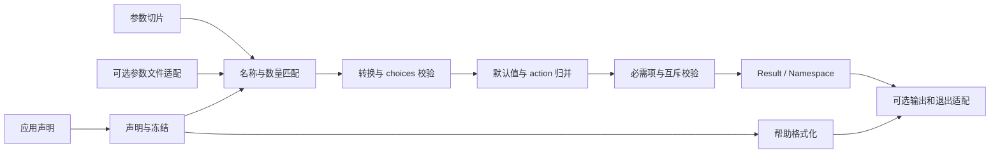

# yh cli 标准库设计

日期：2026-10-18。状态：**设计草案，尚未实现**。

目标模块为 `cli`，拟放在 `libs/cli/`，应用使用 `import cli;`。
本次交付设计和实施分期，不新增语言语法、不修改编译器、不注册空模块。
使用场景包括普通命令行程序，以及未来编译器、汇编器和链接器的参数解析。

用户要求：参考 Python `argparse`，**尽量覆盖其全部能力**。本文据此设计完整目标面，
再拆成可单独验收的实现阶段；阶段完成前不对外宣称该能力已可使用。

## 1. 设计依据与范围

参考基线固定为 [Python 3.14 argparse 官方文档](https://docs.python.org/3.14/library/argparse.html)，
避免随 `/3/` 所指版本变化。借鉴其声明参数、生成帮助和解析结果的工作流。
以下类型、接口、内存规则和解析契约是 **yh 的拟议设计**，不是 Python API 的翻译。

仓库内依据：

- [标准库设计](yh-标准库设计.md)：`libs/` 是普通项目，当前通过 `YH_STDLIB` 加载。
- [语法参考](../yh.g4)：使用函数、结构体、联合体、枚举、切片和函数类型；不依赖反射。
- [模块私有类型设计](yh-模块私有类型设计.md)：私有实现类型不能进入公开签名和字段。
- `compiler/cmd/driver.yh`：入口已有 `argc/argv`，命令行使用错误约定退出码 2。
- `libs/{io,memory,string,os}/`：现有接口以 NUL 字符串和显式所有权为基础。

设计假设：输入已经由 shell 或启动器拆成参数；`cli` 不重新解释引号、不展开通配符、
不执行命令。解析主体以平台无关的字节串运行，系统交互只用于参数文件、终端和输出。
开发和运行验收以 Linux 为先，其他平台适配不阻塞解析核心。

## 2. 关键决策与取舍

### D1：声明对象 + 结果命名空间

状态：建议采用，待设计评审。

| 方案 | 优点 | 代价 | 结论 |
| --- | --- | --- | --- |
| 参数直接绑定调用者变量地址 | 小程序取值直接 | 失败回滚、重复参数、多值和生命周期复杂 | 不作为主接口 |
| 参数声明 + 带标签结果 + 类型化查询 | 能表达不同 action、列表、缺省和子命令；无需新语法 | 取值时检查类型和键名 | **推荐** |
| 反射结构体自动生成接口 | 业务代码短 | 依赖尚未约定的反射、属性和泛型机制 | 不作为前置条件 |

结果使用 `Namespace` 保存 `dest → Value`，支持类型化查询，但不伪装成编译期类型安全。
业务层需要固定结构体时，在解析成功后显式填充，转换范围和业务校验由应用决定。

### D2：核心返回结果，应用入口决定输出和退出

状态：建议采用，待设计评审。

`parse*` 不打印、不退出；帮助和版本也是结果状态。`parse_main_or_exit` 提供常见入口体验。
这样同一个 parser 可以用于测试、嵌入式调用和普通程序，无需异常、继承或全局开关。

### D3：完整目标面，按能力分期实现

状态：建议采用，待设计评审。

先固定公共语义，再实现核心、组合、扩展和体验。高级能力可以晚实现，但不能把已有参数
静默忽略或退回另一套规则。未完成的 API 不先加入公开模块。
不为完全复制 Python 动态对象模型引入语言特性。

### D4：显式分配和独立生命周期

状态：建议采用，待设计评审。

`init/add_argument/parse/format_*` 允许分配，文档逐项声明释放责任；不要求调用者
估算固定数组容量。parser 持有声明副本，结果持有解析数据副本，两者分别释放。
不建立进程全局 parser、错误变量或返回结果缓冲。

## 3. argparse 能力对应表

本表列 Python API 名称作为检索索引；具体行为以本文后续契约为准。

| Python 接口或配置 | yh 目标接口 | 实现阶段 |
| --- | --- | --- |
| `ArgumentParser`、`add_argument` | `ParserConfig`、`init`、`Argument`、`add_argument` | CLI1 |
| `prog/usage/description/epilog` | 同名配置字段 | CLI1 |
| `action/type/nargs/const/default` | 枚举、转换器、`Arity`、`const_value`、`Default` | CLI1–2 |
| `choices/required/help/metavar/dest` | 声明字段及冻结校验 | CLI1–2 |
| `Namespace`、预置 namespace | `Namespace`、`ParseConfig.initial` 的快照 | CLI1–3 |
| `store/store_const/store_true/store_false` | 对应 `Action` | CLI1 |
| `append/append_const/extend/count` | 对应 `Action` | CLI2 |
| `BooleanOptionalAction` | `Action.boolean_optional` | CLI2 |
| `help/version`、`add_help` | 控制状态与自动帮助声明 | CLI1 |
| `parse_args/parse_known_args` | `parse/parse_known` | CLI1、CLI3 |
| `parse_intermixed_args/parse_known_intermixed_args` | `parse_intermixed/parse_known_intermixed` | CLI3 |
| `add_subparsers/add_parser`、aliases | 子命令槽、子 parser、别名 | CLI3 |
| `parents` | `inherit`，注册时深复制 | CLI3 |
| `add_argument_group` | `add_group`，仅影响展示和组内配置 | CLI3 |
| `add_mutually_exclusive_group` | `add_mutex`，按显式出现校验 | CLI3 |
| `set_defaults/get_default/argument_default` | 默认值 API 与配置 | CLI2–3 |
| `SUPPRESS` | 默认值抑制与帮助隐藏分别表达 | CLI2 |
| `prefix_chars/fromfile_prefix_chars` | 前缀配置与显式参数文件展开 | CLI4 |
| `allow_abbrev/conflict_handler` | 缩写开关与冲突策略 | CLI2–3 |
| `Action/register/type` 扩展 | 有上下文的函数回调和 parser 内注册表 | CLI4 |
| `convert_arg_line_to_args` | 参数文件逐行回调 | CLI4 |
| `format_help/format_usage/print_help/print_usage` | 格式化文本与 fd 输出函数 | CLI1、CLI5 |
| 四种 `HelpFormatter` | 基本格式 + 保留换行/空白、显示默认值、类型名选项 | CLI5 |
| `exit/error/exit_on_error` | `Result`、`render`、`exit_code`、入口便捷函数 | CLI1 |
| `deprecated/suggest_on_error/color` | 弃用诊断、建议和颜色配置 | CLI5 |
| `FileType` | 解析路径后由应用打开文件；见第 15 节 | 明确替代 |
| 任意对象字段、继承、任意 callable default | 类型化值、显式回调及应用自己的分派表 | 明确替代 |

“覆盖”指用户可表达相应需求；不承诺异常类型、对象模型、帮助字节或边角行为完全兼容。

## 4. 模块结构与依赖



拟议源码按职责拆分，文件大小根据真实实现调整，不为了达到行数下限填充代码：

```text
libs/cli/
  types.yh          公开类型、常量和接口说明
  schema.yh         注册、冲突、默认值、冻结
  values.yh         值复制、命名空间和类型化查询
  match.yh          token 分类、别名、缩写、短选项组合、数量匹配
  parse.yh          解析协调、action 与约束
  commands.yh       子命令、继承、参数组
  help.yh           usage/help 格式化
  files.yh          参数文件展开
  entry.yh          argc/argv、输出、退出
```

这些文件属于**同一个 `cli` 模块**，只有应用使用的类型和函数导出。
实现状态、索引表、arena、匹配事件和内部辅助函数保持模块私有。
不依赖 `compiler/gen`，不把编译器的 `gen.G()` 状态带进标准库。

核心需要分配、字符串比较和复制；按现有运行时能力提供模块内部封装。
输出适配可消费 `io`，参数文件使用已有可验收的文件接口；不以尚未实现的 `sys`
作为 CLI1 的前置条件。Linux 特有 I/O 问题单独登记，不能在核心硬编码 Darwin 常量。
实施时在 `libs/project.toml` 的 `[lib]` 增加 `cli = { path = "./cli" }`；
模块源码放在 `libs/cli/cli.yh`（同目录多文件即同一模块，按职责拆分）。
标准库项目按 `libs/<模块>/<模块>.yh` 目录扫描装载（`YH_STDLIB`），
`memory`、`string`、`io`、`os`、`math`、`time` 已可导入；`libs/sys`、`libs/toml`
目前只有占位目录（无 `.yh`），不得作为 CLI1 的前置条件。

**跨模块枚举项引用（CLI0 实测，2026-10-19）**：现有语言只支持
`模块名.枚举项`（如 `cli.count`）与模块内 `枚举类型名.成员`（如 `Action.count`）；
`模块名.枚举类型名.成员` 三段式不被接受。枚举项随 `pub enum` 导出，
且枚举项登记在模块的全局名字表里，**同名成员不能共存**：
`ValueKind`、`Action`、`DefaultMode`、`Color`、`ResultStatus` 等所有公开枚举的
成员名必须在 `cli` 模块内全局唯一。设计示例按此规则书写。

## 5. 公共数据模型

### 5.1 文本、值和缺省

文本使用 `*char` 指向 NUL 结尾字节串。命令行参数可以是空串，但不能包含内嵌 NUL。
路径和普通值不强制合法 UTF-8；帮助渲染遇到非法序列使用转义，解析值保留原字节。

以下片段说明拟议数据布局，不代表 `cli` 当前已经存在：

```yh
// ValueKind 标识载荷类型；none 表示显式空值，缺少键由 contains 单独判断。
pub enum ValueKind {
    none;
    text;
    integer;
    natural;
    real;
    boolean;
    sequence;
}

// ValueData 只存放 Value.kind 对应的成员；序列载荷用不透明指针指向内部存储。
// 说明（CLI0 实测，2026-10-19）：union 成员不能引用尚未定义完的 Value 的切片，
// 也不能引用它的类型指针（编译器要求类型先定义），因此 sequence 用 *void；
// 对外可见的 []Value 视图由结果/命名空间的堆内存储切出，见第 16 节。
pub union ValueData {
    text *char;
    integer i64;
    natural u64;
    real f64;
    boolean bool;
    items *void;
}

// Value 是带标签的值视图；字符串和切片的所有权取决于它所属的声明或结果。
pub struct Value {
    kind ValueKind;
    data ValueData;
}
```

构造函数：`value_none()`、`value_text(text)`、`value_i64(number)`、`value_u64(number)`、
`value_f64(number)`、`value_bool(flag)`，均返回 `Value`。这些构造函数**不分配**，
文本暂时借用调用者存储。
**列表值不由公开构造函数创建**（CLI1 定案）：CLI0 实测切片没有可读取的 data 字段，
无法把切片引用存进 union 载荷（见[完成记录](../01-finished/yh-cli0语言能力与ABI基线-2026-10-19.md)）；
序列的内部布局是模块私有实现，应用通过 `get_list` 读取解析产生的列表，
外部构造列表值的入口等到 CLI2 与多值 action 一起定约定。
注册声明、设置默认值和设置 namespace 值时深复制，调用完成后即可释放原存储。
值必须是无环树；`none` 的 union 载荷不读取。

`Default` 由 `mode DefaultMode` 和 `value Value` 组成：

| mode | 含义 |
| --- | --- |
| `inherit` | 采用参数组或 parser 的默认策略；都未指定时使用 action 缺省 |
| `explicit` | 使用给定值，包括 `ValueKind.none` |
| `suppress` | 参数未出现时不创建该键 |

`default_of(value) Default` 构造 explicit 默认值，`suppress_default() Default` 构造抑制策略。
帮助隐藏通过 `Argument.hidden` 表达，与缺省键抑制分开。

`ValueShape` 由 `leaf ValueKind` 和 `list_depth int` 组成：depth=0 为标量，depth=1 为列表，
depth=2 为批次列表；leaf 不能是 sequence，depth 不得为负。none 可作为任意形状的空值，
非空元素必须符合声明的 leaf/depth。独立 Namespace 可保存不同形状的键，同一列表不能混入
不同非空叶子类型。自定义 action 必须声明 output_shape；内置 action 的形状由其行为推导。

### 5.2 Parser、Namespace 和结果

`Parser`、`Namespace`、回调分配上下文使用公开薄句柄和 `*void` 实现指针。
yh 当前没有私有字段，调用者按契约不改写句柄内容；公开字段不引用模块私有类型。
句柄不允许按值复制所有权；没有引用计数和隐式析构。

| 类型 | 拟议字段或职责 |
| --- | --- |
| `Parser` | 可初始化的零值句柄；根 parser 拥有子 parser |
| `Namespace` | 键、值、显式出现次数；支持独立构造后作为解析初始值 |
| `Result` | `status`、`values`、`unparsed`、`command_path`、`error`、`warnings`、`control_text`、内部所有权句柄 |
| `Diagnostic` | `code`、`message`、`dest`、`option`、`token_index`、`file`、`line`、`column` |
| `TextResult` | `status`、`text`、`error`、内部所有权句柄 |

`Result.status` 为 `ok/help_requested/version_requested/usage_error/config_error/resource_error`。
配置错误表示声明无效；使用错误表示输入不满足声明；资源错误包括内存和文件读取失败。
`token_index` 对传给解析器的参数切片从 0 计数；没有对应 token 时为 -1。
文件展开后保留原始 argv 索引以及文件、行列来源，不把展开后下标冒充原始下标。

### 5.3 ParserConfig

使用 `parser_config(prog *char) ParserConfig` 获取推荐默认配置。
直接全零初始化配置不等于推荐默认值，尤其不能据此推断 `add_help`。

| 字段 | 推荐默认值 / 契约 |
| --- | --- |
| `prog` | 调用者显式传入；非空，用于展示，不参与匹配 |
| `usage` | 空指针：自动生成；空串：不显示 usage 正文 |
| `description/epilog` | 空指针或空串均表示没有该段 |
| `add_help` | true；前缀含 `-` 时注册 `-h/--help`，否则用首个前缀生成短/双前缀帮助名 |
| `allow_abbrev` | **false**，可开启唯一长选项前缀匹配 |
| `prefix_chars` | `"-"`；非空 ASCII 字符集合，不允许 `=` 或 NUL |
| `fromfile_prefix_chars` | 空串：不展开；开启后只识别参数首字节 |
| `line_converter/line_user` | 空指针：默认逐行规则；仅根 parser 配置参数文件回调 |
| `argument_default` | inherit |
| `conflict` | `Conflict.error`；可显式选择 `resolve` |
| `suggest_on_error` | false；开启后给出候选但不自动纠错 |
| `color` | `Color.never`；另有 `auto/always` |
| `help_format` | `HelpFormat`：宽度 80、自动换行、默认不显示默认值 |

不提供全局 `exit_on_error`：它的用途由返回结果和入口便捷函数分别覆盖。
`parents` 通过 `inherit` 表达，避免在配置中隐藏可变对象之间的共享。

### 5.4 Argument 与数量模型

`option(name *char, alias *char) Argument` 创建选项声明；无别名时传空串。
`positional(name *char) Argument` 创建位置参数声明。
它们只设置 action、数量等缺省，不分配；`add_argument` 随后复制所有文本和切片。
更多别名可通过 `add_alias` 增加，避免返回指向临时的变参数数组的悬空切片。

| 字段 | 契约 |
| --- | --- |
| `name/alias` | 主名称和可选别名；位置参数无 alias |
| `dest` | 空时从 name/alias 中优先选双前缀名称，去前缀并把 `-` 换成 `_`；否则使用主名称 |
| `action` | 默认 `Action.store` |
| `value_kind` | 默认 text；也可选择 integer/natural/real/boolean |
| `arity` | `Arity`，默认 infer，内置 store 推导为 single；详见下表 |
| `default_value` | `Default`，默认 inherit |
| `const_value` | `Value`，默认 none |
| `choices` | `[]Value`，逐个与转换后的单值比较；默认无约束 |
| `required` | 选项必须显式出现；默认 false；位置必需性由 arity 决定 |
| `help/hidden/deprecated` | 说明文本、隐藏标志和弃用标志 |
| `metavar/metavars` | 单个占位名或定长列表的逐项占位名；不能同时设置 |
| `group/mutex` | 当前 parser 内的组 ID，0 表示未分组 |
| `converter/validator/user` | 可选转换、值校验与用户上下文 |
| `type_name/action_name` | 可选已注册名称；不能与对应直接回调同时提供 |
| `custom_action/version` | 自定义 action 回调，或版本 action 的输出模板 |
| `output_shape` | 可空 `*ValueShape`；直接自定义 action 必须提供，注册时复制；内置 action 自动推导 |

dest 在 add_argument 时确定；后续 add_alias 不改变它。位置参数直接使用声明名称。

`Arity` 使用枚举和数量，不使用 `"?"/"*"/"+"` 字符串驱动内部行为：

| 构造函数 | 数量与结果形状 |
| --- | --- |
| `infer_arity()` | 使用内置 action 或注册 action 的数量；直接 custom 回调必须另选明确数量 |
| `single()` | 恰好一个，标量 |
| `exactly(n)` | n ≥ 1，始终为列表；n = 1 仍是单元素列表 |
| `optional()` | 零或一个，标量；选项出现但无值时使用 const |
| `zero_or_more()` | 零个或多个，列表 |
| `one_or_more()` | 至少一个，列表 |
| `remainder()` | 当前位置后所有 token，列表；包括看起来像选项的 token |
| `no_values()` | 不消费值，仅供 custom action 显式声明零参数行为 |

内置零参数 action 由 action 本身确定数量，调用者不必设置 `exactly(0)`。
store/append/extend 等消费值的 action 拒绝 no_values；不允许用 arity 改写内置零参数行为。
子命令槽是独立声明，不把内部 parser 匹配机制暴露成公共 arity。

**实现状态（CLI1–CLI3，2026-10-19）**：`Argument` 当前含 `name` 到 `metavar`
的字段、`choices`、`group` 与 `mutex`；converter/validator、自定义 action、
版本模板和 `output_shape` 随 CLI4–CLI5 加入。数量模型的判别值是 `ArityKind`，
成员统一加 `arity_` 前缀（`arity_single`、`arity_exactly` 等）：枚举成员登记在
模块全局名字表，不能与 `single()`、`exactly(n)` 这些构造函数同名；
`DefaultMode` 同样使用 `default_` 前缀。CLI2 已实现全部内置 action（除 `custom`）
与数量模型、值形状、等号/附着值、短组合、负数、唯一缩写、choices 与默认值层级；
CLI3 已实现子命令、继承、组与互斥、known/intermixed 与 initial。
`custom` 在 `freeze` 时返回 config_error，参数文件与完整帮助随 CLI4/CLI5 加入。

## 6. API 与生命周期

### 6.1 注册与冻结

下表是签名契约，省略函数体的形式仅供文档使用，不能当成普通 yh 源码编译。

| 签名 | 契约 |
| --- | --- |
| `init(p *Parser, config ParserConfig) int` | 0 成功，-1 失败；失败后仍可读取诊断和 destroy |
| `add_argument(p *Parser, spec Argument) int` | 返回正数参数 ID，失败 -1；复制声明输入 |
| `add_alias(p *Parser, argument int, name *char) int` | 增加名称；0 成功，-1 失败 |
| `freeze(p *Parser) int` | 检查整棵树并建索引；0 成功，-1 失败；重复冻结成功是无操作 |
| `last_error(p *Parser) Diagnostic` | 最近配置错误的借用视图；没有错误时 code 为空错误码 |
| `destroy(p *Parser) void` | 根句柄释放全树并归零；零值可安全调用 |

`init` 要求句柄为零值或已 destroy；失败不会留下半个需要特殊清理的对象。
注册采用**粘滞配置错误**：第一次失败保留诊断，后续注册不再修改声明，直到 destroy。
因此应用可以集中调用 freeze 检查，但不能把失败的参数 ID 当成有效 ID 使用。
每次成功注册都是原子的；不留下部分别名、半个组或未完成的默认值。
freeze 成功后禁止新增、继承或修改声明；parse 和 format 可隐式调用 freeze。
不支持解冻、热更新或回调重入同一 parser；不同 parser 不共享可变全局状态。

### 6.2 解析入口

| 签名 | 契约 |
| --- | --- |
| `parse(p *Parser, args []*char) Result` | 严格普通解析；参数切片不含程序名 |
| `parse_known(p *Parser, args []*char) Result` | 普通解析，保留未知 token |
| `parse_intermixed(p *Parser, args []*char) Result` | 跨选项收集位置参数的严格解析 |
| `parse_known_intermixed(p *Parser, args []*char) Result` | 混合解析并保留未知 token |
| `parse_with(p *Parser, args []*char, config ParseConfig) Result` | 显式 mode、known 和 initial 配置 |
| `parse_main(p *Parser, argc int, argv **char) Result` | 显式检查 argc/argv，跳过 argv[0] 后调用 parse |
| `parse_main_or_exit(p *Parser, argc int, argv **char) Result` | 仅在 ok 时返回；其余状态输出、清理并退出 |
| `release(result *Result) void` | 释放结果所有存储并归零；零值可安全调用 |

`ParseConfig` 由 `parse_config()` 构造，默认 normal、known=false、initial=空指针。
它还包含第 13 节的 file_max_depth、file_max_bytes、file_max_tokens 展开限制。
initial 为只读 `*Namespace`，解析复制它，不原地修改调用者提供的命名空间。
所有入口都要求真实参数是非空指针；空串是有效值。空切片是有效输入。
结果可晚于 parser 销毁，因而其中不能借用 parser 的字符串。
解析失败只交付诊断和必要来源，不向应用暴露可被误用的半成品 values。

### 6.3 命名空间查询

| 签名 | 契约 |
| --- | --- |
| `namespace_init(ns *Namespace) int` | 初始化独立命名空间，0 成功、-1 失败 |
| `namespace_set(ns *Namespace, dest *char, value Value) int` | 深复制并覆盖键；不计入命令行出现次数 |
| `namespace_destroy(ns *Namespace) void` | 仅用于独立构造的 namespace |
| `contains(ns *Namespace, dest *char) bool` | 是否存在键；显式 none 仍返回 true |
| `provided(ns *Namespace, dest *char) bool` | 当前解析中是否显式出现过对应参数 |
| `occurrences(ns *Namespace, dest *char) int` | 当前解析的出现次数；默认值和 initial 不计数 |
| `get_value(ns *Namespace, dest *char, out *Value) int` | 0 成功，-1 键不存在；只返回借用视图 |
| `get_text/get_i64/get_u64/get_f64/get_bool/get_list` | 参数均为 `(ns, dest, out)`；0 成功、-1 缺键、-2 类型不符 |

类型化 getter 不做隐式转换；例如 integer 不会自动窄化成 int，也不会转成 real。
非 0 返回不写 out。`get_list` 的 out 为 `*[]Value`，其他 out 为对应类型的指针。
不得单独 destroy `Result.values`；它由 release 一并释放。
选项名称每被识别一次记一次出现，即使它不消费值；位置参数在实际消费至少一个 token 时
记一次出现，跨段收集不增加该次计数。默认产生的空列表不计入 provided 或 occurrences。

## 7. 完整使用示例

这是**目标 API 示例**，当前仓库不能 `import cli`；实现完成后应转成 tests 项目。
示例在入口处理失败时退出，业务只会在所有命令行校验通过后执行。

```yh
module main;
import cli;
import io;

// main 声明一个支持重复详细等级、输出路径和必需输入文件的命令行程序。
// parse_main_or_exit 在帮助、版本和错误路径清理 parser，成功时由本函数释放。
pub fn main(argc int, argv **char) int {
    let parser cli.Parser;
    let config cli.ParserConfig = cli.parser_config("pack");
    config.description = "打包指定输入文件";
    if (cli.init(&parser, config) != 0) {
        io.println("无法初始化参数解析器");
        cli.destroy(&parser);
        return 1;
    }

    let output cli.Argument = cli.option("--output", "-o");
    output.help = "输出文件路径";
    output.metavar = "PATH";
    output.default_value = cli.default_of(cli.value_text("bundle.bin"));
    cli.add_argument(&parser, output);

    let verbose cli.Argument = cli.option("--verbose", "-v");
    verbose.action = cli.count;
    verbose.default_value = cli.default_of(cli.value_i64(0));
    verbose.help = "增加详细等级，可重复";
    cli.add_argument(&parser, verbose);

    let source cli.Argument = cli.positional("source");
    source.help = "输入文件路径";
    cli.add_argument(&parser, source);

    let result cli.Result = cli.parse_main_or_exit(&parser, argc, argv);
    let path *char;
    let input *char;
    let level i64;
    if (cli.get_text(&result.values, "output", &path) != 0
        || cli.get_text(&result.values, "source", &input) != 0
        || cli.get_i64(&result.values, "verbose", &level) != 0) {
        cli.release(&result);
        cli.destroy(&parser);
        return 1;
    }

    // 业务在此使用 path、input 和 level；这些文本只在 result 存活期间有效。
    io.println(path);
    cli.release(&result);
    cli.destroy(&parser);
    return 0;
}
```

对应行为：`pack input.bin -vv -o output.bin` 得到 output=`output.bin`、verbose=2、
source=`input.bin`；`pack --help` 输出帮助并退出 0；`pack` 报缺少 source 并退出 2。
默认构造函数补齐未设置字段，包括 const、arity、converter、group 和 hidden。

## 8. action、转换和默认值

### 8.1 内置 action

| Action | 结果与重复出现行为 |
| --- | --- |
| `store` | 存储本次值；重复出现最后一次覆盖 |
| `store_const` | 不消费值，存储 const；重复时最后一次覆盖 |
| `store_true/store_false` | 不消费值，分别存 bool；缺省分别为 false/true |
| `append` | 每次追加一个结果；exactly(n) 等多值结果保留为子列表 |
| `append_const` | 不消费值，每次向列表追加 const |
| `extend` | 展平本次多值列表；只允许 exactly/zero_or_more/one_or_more |
| `count` | 不消费值，累计 i64；无显式默认时缺省 none，首次出现视作从 0 开始 |
| `boolean_optional` | 为双前缀长名称生成否定别名，例如 `--cache/--no-cache`；最后出现者胜出 |
| `help/version` | 不消费值，返回控制状态，不返回可用业务 values |
| `custom` | 依声明 arity 消费并转换，随后调用注册的 action handler |

boolean_optional 缺省 none；应用可显式设 true/false。生成名称同样参与冲突检测，
在自定义前缀下按双前缀长名称生成，例如 `++cache/++no-cache`。
count 遇到 i64 溢出返回 usage_error，不回绕。
append/extend 有非空列表默认值时先深复制，再追加；重复 parse 不修改声明中的列表。
required 依据显式出现判断，即使默认值有效也不能满足必需选项。

最终形状的推导：store 使用 value_kind 和 arity；append 在本次值外再包一层列表；
extend 产生一层 value_kind 列表；store_const 使用 const 自身形状，append_const 再加一层。
count 固定 integer 标量，布尔 action 固定 boolean 标量；这些零参数 action 不读取 value_kind。
custom 的输出形状独立于它消费 token 的 value_kind。控制 action 不创建 dest 值。

### 8.2 类型与 choices

内置转换严格消费整个 token：integer 为 i64 十进制，natural 为 u64 十进制，real 为
与 locale 无关的 f64 十进制和科学计数形式，boolean 只接受 `true/false`。
数值允许数字之间的单个下划线；不接受前后空白、空串、整数越界、NaN 或 infinity。
十六进制、日期、枚举名称、复数和更宽数值由自定义 converter 表达。
应用需要 int/i32 时，在解析成功后检查范围再转换，不对超范围值静默截断。

顺序固定为：token → converter/内置转换 → choices → validator → action。
choices 按**转换后的标量类型和值**匹配，多值参数逐项检查；不同 kind 不相等。
choices 不接受列表或 none；无候选用空切片表达，不代表“任何值都不允许”。
默认值和 const 是已经带类型的值，不再次当成命令行字符串转换。
freeze 检查其形状和类型；其 choices/validator 约束也要满足，失败为 config_error。
缺省 none、被 suppress 的键不送入值 validator。

### 8.3 默认值合并

先按选中的命令路径形成完整默认值层，再按原始 token 顺序归并显式 action：

1. action 固有缺省：通常 none；store_true=false、store_false=true；列表数量依声明。
2. parser 和参数组的 argument_default；参数组覆盖 parser。
3. 参数本身的显式 default 或 suppress。
4. 同一 parser 的 `set_default(dest, value)`；覆盖前述声明默认值。
5. 选中子命令的同名默认值；从根到叶依次覆盖，只加入选中路径的键。
6. `ParseConfig.initial`；仅作为初始值，不满足 required 或 mutex。
7. 当前命令行中的显式 action；按 token 顺序生效。

补充规则：`optional()` 选项缺席时采用上述默认值，出现但没有值时采用 const，
出现且有值时采用转换值。位置 optional 缺席使用默认值。
zero_or_more 位置参数无输入时，在没有显式默认/抑制时产生空列表。
one_or_more 和 single 位置参数不能靠 default 绕过数量要求。
append/extend/count 基于初始值累计；类型不符在相应 parser 开始处理输入前报告配置错误。

同 dest 的多个参数必须具有一致的最终值类型和列表形状，freeze 时检查。
兼容的 store_true/store_false 或多个 append_const 可以共用 dest。
父子命令共用 dest 也遵守该规则；默认值不能覆盖早先已经显式提供的根选项。

`set_default(p, dest, value)` 返回 0/-1，可为尚无参数的键设置业务标签。
`get_default(p, dest, out)` 返回 0/-1，查询该 parser 静态有效默认值，不猜测未来子命令。
用户函数不作为 Value 存储，命令处理函数由应用自己的分派表管理。

## 9. token 识别与歧义规则

### 9.1 名称与选项值

名称区分大小写。选项以 prefix_chars 中的字符开头；选项名不得含 `=`、空白或 NUL。
单独一个前缀或仅由前缀组成的名称不能注册为选项；`-` 和 `--` 的角色保持固定。
位置参数声明名只用于 dest 和帮助，不参与 argv 内容匹配。
双前缀名称视为长选项；单前缀多字节名称允许精确匹配，但不支持前缀缩写。
`--` 始终保留为结束当前 parser 选项识别的分隔符，不能注册成参数名。

匹配优先级：精确名称 → 精确名称的 `=value` → 可开启的唯一长名称缩写 → 短选项组合。
多义缩写总是错误，不因注册顺序选择候选；建议候选也不改变匹配结果。
未知名称不会当成已知选项的值；需要前缀开头的值时，使用 `--output=-draft`。

| 输入 | 契约 |
| --- | --- |
| `--output a.bin` / `--output=a.bin` | 接受，值为 a.bin |
| `--output=` | 显式空串；text 接受，数值类型拒绝 |
| `--verbose=yes` | 零参数 action 拒绝附带值 |
| `-vvv` | 依次触发三次 -v |
| `-abc` | 依次处理；遇到需要值的短选项，剩余后缀整体作为它的一个值 |
| `-Ipath` / `-I path` | -I 为单值选项时等价 |
| `-I=path` | -I 的值为 path；紧邻等号作为分隔符移除 |
| `--unknown value` | 严格模式错误；known 模式不猜测它是否消费 value |
| `-` | 单独出现时是普通位置值，可表示标准输入路径 |
| `-- -draft` | 分隔符之后 -draft 是位置值 |

短选项组合只使用“一个 ASCII 前缀 + 一个 ASCII 名称字节”的声明；
精确注册的单前缀长名称优先，因此新增这种名称可能改变已有组合的解释，文档应提示。
对于附着值但声明 exactly(n>1) 的选项，附着部分只提供第一个值，其余按数量规则继续读取。

### 9.2 负数与数值外观

不含数字型短选项的当前 parser，把符合内置负数词法的 token 视为普通值，例如
`-12/-1_000/-0.5/-2e-3`。这种分类只影响它是否像选项，最终仍按声明类型转换。
如果注册了 `-1` 等数字型短选项，该 parser 关闭负数特判：精确名称是选项，其他
以选项前缀开头的负数样 token 也是选项候选；使用 `--limit=-2` 或 `-- -2` 消除歧义。
负数识别不扩展到复数；自定义类型的特殊负号文本可用等号形式传入。
每级 parser 独立分类，不把另一个子命令的选项表带进来。

### 9.3 位置参数与普通/混合解析

数量匹配固定使用“按声明顺序贪心，同时保留后续参数最低需求”的规则。
多个可变长位置参数不按值内容、choices 或转换成功与否回溯，避免输入值改变语法选择。
例如两个 zero_or_more 位置参数遇到 `a b`，前一个得到两项、后一个得到空列表。
variable + required single 遇到 `a b`，为后者保留 b。

普通模式按选项边界分段匹配位置参数；已经完成的可变位置参数不会因为后面的新段重新打开。
混合模式先提取已识别选项，再把剩余位置值整体匹配；仍保留原始 token 来源和 action 次序。
例如声明 `command`、`rest=*` 和 `--level`：

- 输入 `go a --level 2 b`，普通 known 模式得到 rest=[a]，unparsed=[b]。
- 同一输入在 intermixed 模式得到 rest=[a,b]；严格普通模式报多余 b。

remainder 一旦开始消费，`--help` 和 `--` 都是其数据，不再触发控制行为。
freeze 拒绝 remainder 后继续声明位置参数或子命令。
普通 `--` 在进入 remainder 前属于分隔符，不进入结果列表。

## 10. 子命令、继承、参数组和冲突

### 10.1 子命令

| 签名 | 契约 |
| --- | --- |
| `subparsers() Subparsers` | 创建配置，默认不必需，dest/title/description 可设置 |
| `add_subparsers(p *Parser, spec Subparsers) int` | 返回正数槽 ID；每个 parser 最多一个槽 |
| `command(name *char) Command` | 创建子命令声明，可配置 aliases、help、deprecated、config |
| `add_parser(p *Parser, slot int, spec Command) *Parser` | 创建归父 parser 所有的子句柄；失败空指针 |
| `inherit(p *Parser, parent *Parser) int` | 复制 parent 的参数、默认值和组；0 成功、-1 失败 |

子命令槽占据一个位置，之后的 token 交给子 parser；可递归形成 `tool remote add`。
槽前允许固定或可变位置参数，按第 9 节保留槽及后续最低数量；不通过搜索已知命令名来
跳过前面的值。槽后禁止再声明父级位置参数；需要这些参数时放到子命令里。

根选项只在子命令之前有效；子命令后只识别子 parser 声明的选项。
希望前后都支持的“全局参数”，使用无自动帮助的公共 parent 分别 inherit 到各级，
而不是让所有根选项自动穿透。相同 dest 的输入仍按整个命令行顺序归并。

`Result.command_path` 保存规范名，例如 [remote,add]；别名只影响输入匹配。
Subparsers.dest 非空时，也把该层选中命令的规范名存入 namespace。
未选子命令不注入其默认值。required=true 而未选命令是 usage_error。
`tool --help` 显示根帮助，`tool build --help` 显示 build 帮助。
根 usage 的手写模板不改变子命令 prog；缺省 prog 按根展示名和规范命令路径生成。
未知子命令即使在 known 模式也报错，因为已声明的子命令槽不接受任意值。

inherit 在调用时深复制，之后修改 parent 不影响 child；不共享可变 Action 或列表默认值。
不复制 parent 的 prog、输出策略或子命令树；不允许自继承。
继承顺序与普通注册顺序一致，冲突按接收方策略处理。
公共 parent 推荐 add_help=false，避免复制 -h/--help 导致意外冲突。

### 10.2 展示组与互斥组

`add_group(p, config Group) int` 返回组 ID；Group 包括 title、description、
argument_default 和 conflict，可由 `group(title, description)` 构造。
参数通过 `Argument.group` 归组，组内按注册顺序展示；组不会改变 token 匹配顺序。
不提供展示组嵌套。

`add_mutex(p, required bool, group int) int` 返回互斥组 ID；group=0 表示不归展示组。
参数通过 `Argument.mutex` 加入；互斥组不嵌套，一个参数至多加入一个互斥组。
默认最多一个成员显式出现，required=true 时恰好一个成员显式出现。
同一个成员重复出现不算两个成员；同 dest 的不同成员仍可能互斥。
默认值、initial 和 set_default 不满足互斥组，也不会造成互斥冲突。
成员限选项或 optional/zero_or_more 位置参数；不允许给成员再设置 required=true。

混合模式拒绝子命令、remainder，以及同时包含选项和位置参数的互斥组。
这些属于声明与解析模式不兼容，返回 config_error，不降级成普通解析。

### 10.3 名称冲突

error 策略下，重复名称、生成的否定别名、帮助名称冲突都是配置错误。
resolve 策略下只从旧声明删除冲突名称；旧声明剩余名称继续有效。
全部名称被移除的旧选项声明停用，也从展示、required 和互斥约束中移除；不复用旧 ID。
互斥组因此变空且 required 时 freeze 报配置错误。
位置参数声明名重复拒绝；共用 dest 并不等于名称冲突。
组级 conflict 优先于 parser 级策略，同样适用于继承进组的声明。

**实现状态（CLI3，2026-10-19）**：子命令槽、别名、规范 `command_path`、
槽 `dest`、必需命令、`inherit` 深复制、展示组与组级默认值、互斥组、
`Conflict.resolve` 冲突策略，以及 `parse_known` / `parse_intermixed` /
`parse_known_intermixed` / `parse_with` 与 `ParseConfig.initial` 已实现。
已知边界：位置参数与子命令槽的相对顺序固定为「位置参数在前、槽在后」；
混合模式在「同一 dest 同时由选项与位置提供」时返回 config_error，
以保持 action 次序语义；进入子 parser 前的 initial 形状/choices 检查
与 validator 一起在 CLI4 实现。

## 11. 部分解析和初始命名空间

known 只放宽“未被当前声明消费的 token”，不放宽缺少必需项、坏值、未知子命令和互斥错误。
未知选项与未分配位置 token 按输入顺序返回 unparsed；不返回已作为分隔符消费的 `--`。
不能猜测未知选项的 arity：例如 `--plugin fast input` 中，fast 仍可能被声明的位置参数消费。
需要把尾部完整转交子程序时声明 remainder，不能依赖 known 原样保留整段文本。

unknown 短组合按整个 token 处理：只有整个组合可以成功识别时才提交其中的 action，
否则 known 模式原样保留整个 token；不先累计一个 -v 再返回半个后缀。
已匹配到明确选项但缺值或坏值仍是错误，不作为 unknown 保留。
开启 allow_abbrev 时，known 也会消费唯一匹配的长名称前缀；转发场景推荐保持关闭。

initial 中的值先复制再使用；已有键不会被默认值覆盖，但会被显式 action 更新。
进入根或选中子 parser 时，在处理该层输入前检查相应已知键的形状、choices 和 validator，
不满足时返回 config_error；未选子 parser 的约束不检查，未绑定声明的附加键原样保留。
这提供预置 namespace 的能力，同时避免一次失败解析污染调用者的初始对象。

## 12. 自定义类型、action 和注册表

公开回调使用 yh 函数类型加 `user *void`，不需要闭包、对象继承或字符串执行。
回调在单次 parse 内顺序调用，不由 cli 创建线程。

| 类型 | 签名契约 |
| --- | --- |
| `Converter` | `fn(context *ConvertContext, out *Value, error *Diagnostic, user *void) int` |
| `Validator` | `fn(value Value, error *Diagnostic, user *void) int` |
| `ActionHandler` | `fn(context *ActionContext, out *Value, error *Diagnostic, user *void) int` |
| `LineConverter` | `fn(context *LineContext, out *LineTokens, error *Diagnostic, user *void) int` |

函数返回 0 成功、-1 失败。函数类型实参类型位置按 yh 语法去掉形参名；
上表保留名字用于说明含义，不引入新的函数类型语法。
ConvertContext 包含原 token、来源、目标 kind 和结果分配上下文。
ActionContext 包含参数 ID、dest、实际名称、出现次数、本次转换值列表、旧值和分配上下文。
LineContext 包含去换行后的原始字节行、文件位置和展开分配上下文；LineTokens 为字符串切片。

转换器输出必须符合 Argument.value_kind；action 输出必须符合声明的最终形状。
回调不得修改 parser、递归调用同一 parser，或直接修改借用的旧值。
自定义 action 计算新值，不直接改 Namespace；成功后由解析器提交。
这样内置 action 和自定义 action 使用同一套缺省、重复输入和类型校验规则。

回调可直接借用输入 token 作为文本输出；新文本和列表使用上下文的
`copy_text(context, bytes)`、`new_values(context, count)`、`new_tokens(context, count)` 分配。
这里 context 是公开的统一 `ValueContext` 句柄，各回调上下文提供该句柄指针。
不能返回指向回调栈数组或局部字符缓冲的切片。
分配归当前结果或当前展开过程所有，失败路径统一释放。

`register_type(p, name, kind, converter, user)` 和
`register_action(p, name, arity, output_shape, handler, user)` 返回 0/-1。
output_shape 使用第 5 节的 ValueShape；列表允许 none，但不允许任意混合叶子类型。
注册表限定在当前 parser；inherit 复制注册项，user 指针按借用复制。
引用未知名称、重复注册名称、回调和名称同时设置都在 freeze 阶段拒绝。
使用 action_name 时，arity=infer 且 output_shape=空指针，由注册项提供；显式 arity
必须与注册项一致。显式 output_shape 与注册项同时提供拒绝，避免形成两套结果约定。

回调要求无外部副作用：不打开文件、不写输出、不运行命令。
解析并非事务系统，无法撤销用户回调的外部副作用；需要这类行为时应在 ok 后执行。
validator 可以多次用于声明默认值检查及解析，不应依赖调用次数。

## 13. 参数文件

仅在 fromfile_prefix_chars 非空时开启。例如配置 `"@"` 后，`@tmp/cli/args.txt`
替换为文件中的参数；展开不经过 shell，不做变量、通配符或命令替换。
处理次序为：文件展开 → token 匹配；因此文件中的 `--` 与直接输入具有相同作用。
整次展开使用根 parser 的前缀和逐行回调；子 parser 不得设置非空的参数文件前缀或回调，
否则 freeze 报配置错误，避免在选中命令前依赖尚未确定的子命令配置。
当文件展开启用时，`--` 后的 `@file` 也会展开；需要字面值时由调用者关闭展开或
通过 LineConverter 提供项目自己的转义约定，库不暗中增加另一套 shell 转义。

默认一行一个完整参数：移除 LF 或 CRLF，保留行内空白；空行产生空串，`#` 没有注释含义。
可选移除首行 UTF-8 BOM；不要求路径内容是 UTF-8，但帮助中的来源会转义非法字节。
LineConverter 可以把一行返回为零个或多个 token，不能改变文件包含规则。

嵌套包含允许，顶层相对路径按当前工作目录，嵌套相对路径按包含文件目录解析。
采用活动包含栈和总量限制；符号链接别名不能绕过深度上限。
默认上限为深度 16、累计读取 8 MiB、展开 100000 个 token；ParseConfig 可显式调小或调大。
这三个限制只约束文件展开；初始 argv 仍受实际内存和 int 长度边界约束。
循环、超限、打开/读取失败都产生带包含链来源的诊断；不继续用部分展开结果解析。
所有临时 fd 在成功和失败时关闭，重复使用 stdin 作为参数文件不在内置协议中。

**实现状态（CLI5，2026-10-19）**：段落顺序、usage 的 `[]`/`()`/`|`/`...` 表达、
metavar/metavars 与类型推导、choices 与默认值展示、deprecated 标注、按宽度折行、
控制字节与非法 UTF-8 转义、颜色策略（含终端检测降级）与有限建议均已实现。
折行按字节宽度近似；颜色目前用于 `usage:` 前缀与段标题。

**实现状态（CLI4，2026-10-19）**：converter / validator / custom action
与 `register_type`/`register_action` 已实现；回调签名、`type_name`/`action_name`
绑定、输出类型与形状检查、freeze 期的默认值/常量校验按本节契约落地。
分配入口目前提供 `context_text(context, text)`（把文本复制进结果池）；
`new_values`/`new_tokens` 与 `ValueShape` 的更细粒度分配随需要追加。

**实现状态（CLI4，2026-10-19）**：`@file` 展开、逐行回调、嵌套相对路径、
活动包含栈与深度/字节/token 三个上限已实现；子 parser 不得设置展开配置。
本版本把展开常量收敛为单文件 4096 token、单行 4096 字节、累计字节默认 1 MiB
（`ParseConfig.file_max_bytes` 可调）；诊断带文件与行号，列号暂不提供。

## 14. 帮助、诊断、颜色与退出

### 14.1 帮助布局

帮助顺序固定为 usage、description、位置参数、默认选项、用户组、子命令、epilog；
空段省略，段内按注册顺序展示。用户组中的参数不在默认段重复出现。
hidden 参数不出现在 usage/help，但继续参与匹配、必需项和互斥校验。
自动 usage 使用 [] 表示可选、() 表示必选互斥、| 表示互斥、... 表示可变数量。

HelpFormat 提供正交配置：`preserve_description`、`preserve_all_text`、
`show_defaults`、`metavar_from_type`、`width` 和 `max_help_column`。
标准行为是折叠说明中的空白并换行；保留模式只调整缩进，不丢弃用户显式空行。
实现先用确定的 UTF-8 字节宽度计量且不拆开有效编码序列；中文宽度不保证等于终端列宽。
终端列宽精确计算不成为 CLI1 的隐式依赖，后续若需要单独设计 Unicode 宽度策略。

metavar 覆盖自动占位名；metavars 只用于 exactly(n)，列表长度必须等于 n。
choices 缺省以候选集合展示；显式 metavar 优先，候选约束仍存在。
文本模板支持 `%(prog)s/%(dest)s/%(default)s/%(type)s/%%`；不提供任意格式化执行。
未知模板占位符在 freeze 报配置错误；默认值渲染转义控制字符，避免破坏帮助布局。

### 14.2 格式化与输出 API

| 签名 | 契约 |
| --- | --- |
| `format_usage(p *Parser) TextResult` | 生成无颜色 usage 文本，包含尾换行 |
| `format_help(p *Parser) TextResult` | 生成无颜色完整帮助，包含尾换行 |
| `release_text(text *TextResult) void` | 释放格式化文本并归零 |
| `print_usage/print_help(p *Parser, fd int) int` | 0 成功，-1 写入失败；写完或返回错误 |
| `render(result *Result, out_fd int, error_fd int) int` | 输出控制文本或诊断、warnings；0/-1；不退出、不释放 |
| `exit_code(result *Result) int` | ok/help/version→0；usage_error→2；config/resource→1 |

help/version 写 out_fd，usage_error 的 usage 与主诊断、配置/资源错误和 warnings 写 error_fd。
ok 状态没有控制正文，render 只输出尚未处理的 warnings；render 不清空它们。
parse_main_or_exit 只接受根 parser；对非 ok 结果执行 render、release、destroy，再终止进程。
如果输出失败，最终退出码为 1，即使原本是帮助请求。
成功返回的 result 由调用者 release，parser 仍由调用者 destroy；成功 warnings 由便捷入口
先输出并清空，避免应用之后 render 时重复打印。
普通 parse* 和 format* 都不调用退出函数；错误对象允许应用自行组织输出。

**实现状态（CLI5，2026-10-19）**：`format_usage`/`format_help`/`release_text`、
`render_text`、`print_usage`/`print_help`、`render(result, out_fd, error_fd)` 与
`exit_code` 均已实现；失败结果自带 `usage_text`/`prog_text`，`render` 不依赖 parser。
`parse_main_or_exit` 用 `render` + `exit_code` 输出与退出，输出失败时退出码降级为 1。
`warnings` 通道尚未实现（`render` 暂不输出 warnings）。

### 14.3 错误与控制行为的优先级

先校验声明，再从左到右匹配并转换输入；不预扫描整个 argv 搜索 help。
已识别出的未知选项、缺值或坏值优先于后来的帮助请求；尚未完成归属匹配的位置值不
为了帮助请求而强行分配。尤其在 intermixed 模式，尚未完成的位置匹配可能被帮助提前结束。
成功识别 help/version 后停止处理后续输入，跳过最终 required/mutex 校验和业务 action 归并。
两者同时出现时以先识别到的控制 action 为准。
已经归入 remainder 的 --help 不触发帮助。

使用错误输出 usage 和一条主诊断；根本性配置错误不伪装成用户输入错误。
error.code 保持稳定枚举，message 只是展示文本，测试不能只靠字符串判断错误类别。
建议错误类别至少包括 unknown_option、ambiguous_option、missing_value、bad_value、
invalid_choice、missing_required、mutex_conflict、unknown_command、invalid_schema、
incompatible_mode、out_of_memory、argument_file_error、argument_file_limit。
有多个失败时返回按上述流程发现的第一个主错误，不实施“收集全部错误”。

deprecated 参数或命令只有被显式使用时才产生 warning；每个声明每次 parse 最多一次。
warning 不改变退出码；普通 parse* 将其返回，由调用者决定是否展示。
suggest_on_error 只针对未知名称、字符串候选和子命令生成确定排序的有限候选，最多 3 个；
候选计算只影响文案，不修改接受的输入。

format_* 始终无 ANSI；输出函数遵循 Color。never 不探测终端，always 显式着色；
auto 由输出 fd 是否为终端和 NO_COLOR 决定，NO_COLOR 存在时关闭。
环境读取和终端检测不可用时 auto 回落无色，不让帮助输出失败。
内嵌换行、ESC 和其他控制字节在输入诊断中转义，原始解析值不改写。

## 15. 明确差异与不纳入范围的能力

下列差异是设计选择，后续差分测试必须逐项标记，不能用“与 Python 相同”掩盖：

| 项目 | yh 决定与理由 |
| --- | --- |
| 长名称缩写 | 默认关闭；新增选项不会悄悄改变已有前缀的解释，可显式开启 |
| 错误处理 | 核心返回 Result；无异常和类继承，退出由入口层选择 |
| Namespace | 带标签数据和显式查询；不支持任意对象属性或存储任意语言对象 |
| initial namespace | 复制而非原地修改；失败解析不会污染输入对象 |
| 默认值与 const | 使用已带类型的值，不以字符串是否恰好出现来决定转换 |
| 数值 | 固定 i64/u64/f64，严格范围和词法；不提供任意精度整数、复数或 locale 数值 |
| extend | 要求多值 arity，不把单个字符串拆成字符列表 |
| required/mutex | 依据明确出现记录，不比较结果与默认对象的身份 |
| 单前缀长名称 | 精确匹配，禁用缩写；保持短组合边界可预测 |
| 参数文件相对路径 | 嵌套包含相对所在文件，保证移动工作目录后包含关系仍可理解 |
| 帮助外观 | 内容语义接近参考工作流，不追求版本间变化的逐字节排版 |
| 回调执行 | 转换器按扫描顺序执行；自定义归并 action 在有效路径确定后执行，控制退出不执行业务 action |
| FileType | 不在解析过程中打开业务文件；先得到路径，在 ok 后用 os/io 打开和关闭 |
| set_defaults 的函数对象 | 改为命令标签和应用分派表，不把函数地址混入通用 Value |
| Formatter/Action 子类 | 用结构化配置或函数回调替代；不引入继承机制 |

关于 FileType 的取舍，参见 [Python 3.14 的 FileType 条目](https://docs.python.org/3.14/library/argparse.html#filetype-objects)。
命令行路径 `-` 是否表示 stdin/stdout，由应用的文件打开层决定。
文件句柄所有权、编码和缓冲不是参数解析器的责任。

不额外加入环境变量自动映射、配置文件合并、交互式提示、shell 补全生成、插件加载、
自动命令分派或 TUI。需要这些能力时另立需求，不借 argparse 覆盖范围顺手扩张。

## 16. 内部执行、性能与失败释放

执行流程建议：

1. freeze：校验声明组合、引用、默认值和类型形状，构建名称和命令索引。
2. 复制 initial、检查根层已知键；按需展开参数文件，建立 token 来源表。
3. 匹配当前 parser 的 token 和位置数量，逐项转换、检查 choices/validator，记录事件。
4. 遇子命令切换 parser、检查该层 initial，保留根到叶路径及全局 token 次序；控制 action 按第 14 节提前返回。
5. 合成选中路径的默认值与 initial，再按事件次序执行内置或自定义归并。
6. 校验必需项和互斥关系；有错丢弃 values，成功构造独立 Result。

事件记录是为保证父子默认值与显式参数的先后关系，不把它扩展成公共 IR 或插件协议。
不按转换失败回溯重新分配位置参数；转换器不能改变已选择的 token 归属。
自定义 action 的类型错误归为配置/回调契约错误，其主动拒绝合法形状输入归 usage_error。

名称精确匹配使用冻结索引，长名称缩写在开启时再建立或查询相应索引。
首版不追求 SIMD、并行解析或复杂缓存；声明通常只注册一次，输入规模通常较小。
内存按声明字节数、输入字节数和实际结果增长，所有容量增长均检查整数溢出和分配失败。
不预设固定“最多 64 个参数”或截断帮助缓冲，不承诺部分匹配算法的最坏线性复杂度。

| 对象或输入 | 所有者 / 有效期 |
| --- | --- |
| config、Argument、names、choices、默认值的原存储 | 调用者；注册 API 返回前有效即可 |
| 参数定义副本、子 parser、索引 | 根 Parser；destroy 释放 |
| argv 的指针数组与字节串 | 调用者；parse 返回前有效即可，库不改写 |
| 回调 user | 调用者；从注册到最后一次 parse/freeze 结束期间有效 |
| Result 的值、文本、unparsed、来源、warnings | Result；release 释放，允许 parser 先销毁 |
| get_* 返回的文本和列表 | 借用所属 Namespace；下一次修改该 namespace 或销毁后失效 |
| TextResult 文本 | TextResult；release_text 释放 |
| last_error 的文本 | Parser；下一次改变错误状态或 destroy 后失效 |

结果里的已解析文本、unparsed 和来源都必须自持有，不因是否来自文件采用不同生命周期。
独立 namespace_set 深复制新值后再替换旧值；失败保留原值。
资源不足时至少返回静态 out_of_memory 诊断，不能为了报告 OOM 再依赖一次分配。
清理函数不要求再次分配；正常和失败路径都关闭参数文件 fd。

## 17. 测试设计与验收标准

本次仅交付文档，**尚未新增这些用例，也未运行 cli 编译或运行测试**。
以下路径与检查是实施要求，详细任务见[实施方案](../02-plan/yh-cli标准库实施方案.md)。

拟新增 `libs/cli/test/clibasics`、`cliactions`、`clicommands`、`cliextensions`、
`clihelp`，均以 `.yh` 写应用和断言；通过 `YH_STDLIB` 加载真实库模块。
临时参数文件、输出与构建产物统一放 `tmp/cli/`。

| 测试组 | 必须覆盖的行为 |
| --- | --- |
| 模块与 ABI | 导入、公开/私有边界、回调、递归列表布局、切片返回、销毁后结果仍可读 |
| 基础匹配 | 长短名称、别名、等号、附着值、空串、短组合、精确匹配优先 |
| 数量 | single/exactly(1)/exactly(2)/optional/*/+/remainder，后续最低数量保留 |
| 数值 | i64/u64 边界、负数、下划线、指数、溢出、非法 boolean 和 locale 独立 |
| action | 全部内置 action、嵌套 append、extend、count 溢出、布尔正反别名 |
| 默认与查询 | none/缺键/suppress、get 类型错误不写 out、重复 parse 不积累旧列表 |
| 顺序 | 根显式值不被子默认覆盖、共享 dest、初始值累计、类型冲突冻结拒绝 |
| 命令 | 必需/可选、嵌套、别名、未知命令、作用域、根与子 help、未选子键不出现 |
| 组与继承 | 展示顺序、互斥按出现校验、required 组、快照隔离、部分别名 resolve |
| 解析模式 | 四种模式、unknown 原顺序、未知短组合原子处理、混合模式不兼容拒绝 |
| 扩展 | converter/validator/custom action、命名注册、user 生命周期、输出类型错误 |
| 参数文件 | 空行/CRLF/空白、嵌套相对路径、循环、限额、坏文件、来源、失败关闭 fd |
| 帮助诊断 | 格式组合、模板、占位名、隐藏、超长文本、非法字节、弃用、建议、颜色 |
| 入口行为 | stdout/stderr、退出 0/1/2、写入失败、帮助前后错误、remainder 中的 help |
| 生命周期 | 分配失败注入、初始化失败后清理、重复 release/destroy、输入与结果分离 |

可用 Python 3.14 生成对照结果，但由 Python 负责测试期的 oracle，不成为库运行依赖。
比较双方明确约定一致的用例；第 15 节差异建立 yh 自己的期望值，禁止“任意一边失败就跳过”。
差分比较规范化后的值、是否缺键、诊断类别和退出码；帮助文字按 yh 快照验收。

每个行为切片先增加 `.yh` 用例，再实现、执行 `make` 和针对性测试。
阶段结束运行 `make test`、`make selfhost-native`；若修改 LLVM 相关实现，按当前分支
已有要求追加 LLVM 门，不把旧后端通过当作 LLVM 验收。
Linux 容器遵循仓库 container 约束，记录镜像、架构、命令和结果，不在容器覆盖 bin 种子。

## 18. 交付顺序与完成定义

| 阶段 | 交付能力 | 退出标准 |
| --- | --- | --- |
| CLI0 | 数据布局、模块边界与基线探针 | 已有 yh 能力可承载公开类型、回调和内存契约，无新语法依赖 |
| CLI1 | Parser、基本 action、严格解析、自动帮助、Result 与入口 | 最小应用完整运行；成功/帮助/错误输出及生命周期可验收 |
| CLI2 | 全部内置 action、数量、默认值、类型与名称细节 | 第 8/9 节矩阵全通过，重复解析无状态残留 |
| CLI3 | 子命令、父声明、组、冲突和四种解析模式 | 组合场景通过，作用域与歧义规则没有未定义分支 |
| CLI4 | 回调、注册表、参数文件 | 回调与文件来源正确；失败释放、限额和重入约束通过 |
| CLI5 | 高级帮助、弃用、建议、颜色 | 文本快照、流、控制优先级和终端降级通过 |
| CLI6 | 统一回归与文档冻结 | 所有阶段用例和仓库门通过，逐项标明与参考基线差异 |

迁移 compiler/cmd、asm 或 link 是后续独立任务，不以本次设计隐含授权。
“设计完成”表示本文的接口、行为和验收边界已写清；“库完成”必须等 CLI0–CLI6 实际实现
并通过运行门。当前状态始终是前者。
