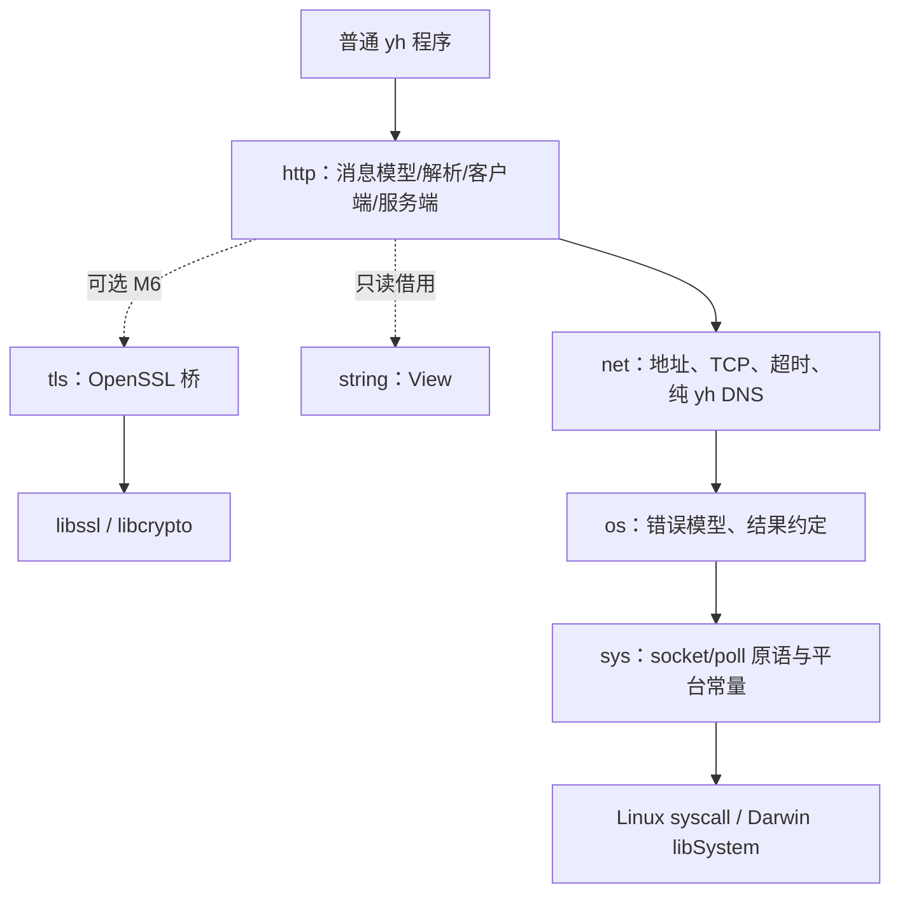

# yh HTTP 标准库设计（提案）

日期：2026-10-24。状态：**设计已定稿（用户确认六项决策），未实施**。本文件
确定范围、分层、接口与验收契约，不含实现代码；分期见 §14，决策记录与
libcurl 评估见 §16，对应 ADR 见
[ADR-0018](../adr/0018-yh网络与HTTP标准库分层.md)。

## 0. 前置核查（2026-10-24）

| 核查项 | 结论 |
| --- | --- |
| `libs/` 是否有 http/net | 无。现有模块为 cli/io/libc/math/memory/os/string/sys/testing/time/toml |
| `libs/project.toml` 是否注册 | 未注册 http 或 net |
| `docs/` 是否有 HTTP 设计/方案/ADR | 无。全仓 `grep -i http` 只命中编译器与工具链文档中的无关词 |
| `docs/todo.md` 是否登记 | 未登记 |
| sys 是否已有 socket 原语 | 无。`libs/sys` 只有文件/目录/进程/内存/时间 |
| os 是否承诺网络 | 否。[os 与 sys 联合设计](yh-os与sys标准库设计.md) §1 明确「不在首期扩展网络、DNS、线程」 |

因此 HTTP 不是「补一个解析器」：**TCP 与地址层在本仓库尚不存在**，必须先在
`sys` 补 socket 原语、再新建 `net` 模块，`http` 才有落脚点。本设计把这两级
一并纳入，但按 M0→M6 分期，每一期都能独立验收。

## 1. 目标

给普通 yh 程序一套**零外部依赖**的 HTTP/1.1 客户端与服务端：能连 TCP、收发
标准 HTTP/1.1 消息、增量读写 body、按 RFC 拒绝畸形输入；错误可分类，资源显式
释放，解析不逐字段分配。

约束沿用现有标准库路线：不改语言语法、不新增项目字段、不依赖泛型或异常、
不隐式分配大块内存、平台差异只落在 `.linux*.yh` / `.darwin.yh` 适配文件里。

明文 HTTP/1.1 是核心，零外部依赖；HTTPS 在 M6 通过**可选**的 `libs/tls`
（链接系统 OpenSSL）提供，只有用到 TLS 的项目才引入该依赖，明文路径不受影响。
TLS 与 http 的边界是一个 `Io`（§6.2），所以加密接入不触碰解析、分帧与两端
业务代码。

## 2. 标准与范围

依据 [RFC 9110](https://www.rfc-editor.org/rfc/rfc9110.html)（语义：方法、
字段、状态码）、[RFC 9112](https://www.rfc-editor.org/rfc/rfc9112.html)
（HTTP/1.1 消息语法、分帧、连接管理）、[RFC 3986](https://www.rfc-editor.org/rfc/rfc3986.html)
（仅 origin-form / absolute-form 的解析子集）。

| 能力 | 首期 | 说明 |
| --- | --- | --- |
| HTTP/1.1 消息解析与序列化 | ✅ | 请求行、状态行、字段、chunked、Content-Length |
| HTTP/1.0 兼容**读** | ✅ | 只读兼容（`HTTP/1.0` 版本号、until-close 分帧），不生成 1.0 响应 |
| 客户端 | ✅ | 单请求、连接复用、超时、可选重定向 |
| 服务端 | ✅ | 串行 accept + 处理函数、keep-alive、自动 400/413/431/501 |
| chunked 传输编码 | ✅ | 收发双向；忽略 chunk-ext，trailer 解析后丢弃 |
| HTTPS（TLS 1.2+） | ✅ M6 | 可选 `libs/tls`，链接系统 OpenSSL；客户端与服务端双向 |
| 多连接并发 | ❌ | 等并发标准库落地后再补（§16 决策 ④）；首期只有串行 accept |
| HTTP/2、HTTP/3 | ❌ | 二进制分帧 / QUIC，超出 1.x 文本协议范围；ALPN 不做 |
| gzip/deflate | ❌ | 需 inflate；首期只透传字节，不解压 |
| 代理、CONNECT 隧道、WebSocket | ❌ | 无消费者 |
| cookie jar、multipart、表单、路由 | ❌ | 属应用框架，不进标准库 |

选 1.1 而非 1.0：持久连接与显式分帧是当今基线，RFC 9112 已把 1.0 的隐式规则
收敛为兼容读路径；只读兼容可以覆盖存量服务端，又不引入两套生成逻辑。

## 3. 分层与依赖



- **sys**：socket/poll 具名原语、平台常量、sockaddr 布局；不做缓冲、不重试、
  不解析地址字符串、不分类应用错误（与现有 sys 契约一致）。
- **net**：地址类型与文本解析、TCP 连接/监听、超时归一化、纯 yh DNS。
  公开面只暴露 `Endpoint`/`TcpStream`/`TcpListener`，sockaddr 不进签名。
- **http**：消息模型、读写状态机、客户端、服务端。I/O 经 `Io` 两个函数指针
  收敛（§6.2），不直接调 sys；TLS 以后替换 `Io` 即可，公共接口不变。
- **tls**（M6，可选）：OpenSSL 定参入口的最小桥，产出 `Io`；`http` 不 import
  它，因此不用 TLS 的项目完全不引入 `libssl`/`libcrypto` 依赖。
- 依赖单向 `http → net → os → sys`；`http` 直接 import `string`/`net`/`os`，
  但只用 `os` 的 `Error`/`IoResult` 类型，不调 `os` 的文件接口；不依赖
  cli/toml/compiler；头字段用 `string.View` 零拷贝切片，不复制。

`net` 作为独立公开模块（而不是 http 私有实现）的理由：它是通用能力，后续
DNS、UDP、示例与工具都要用；藏在 http 内部会导致重复实现或被强行导出。

## 4. 前置：sys 网络原语（M0）

现有 sys 模式是「一次内核调用、返回原始结果或 `-errno`」，新原语照此办理；
Darwin 走 libSystem `@[extern]` + 现有 `errno_result` 归一化。

| 具名原语 | Linux | Darwin |
| --- | --- | --- |
| `socket_fd(domain int, kind int, protocol int) i64` | `NR_SOCKET` | `socket` |
| `connect_fd(fd int, addr *void, addr_len u32) i64` | `NR_CONNECT` | `connect` |
| `bind_fd(fd int, addr *void, addr_len u32) i64` | `NR_BIND` | `bind` |
| `listen_fd(fd int, backlog int) i64` | `NR_LISTEN` | `listen` |
| `accept_fd(fd int, addr *void, addr_len *u32) i64` | `NR_ACCEPT4` | `accept` |
| `get_socket_name(fd int, addr *void, addr_len *u32) i64` | `NR_GETSOCKNAME` | `getsockname` |
| `shutdown_fd(fd int, how int) i64` | `NR_SHUTDOWN` | `shutdown` |
| `set_socket_option(fd int, level int, name int, value *void, len u32) i64` | `NR_SETSOCKOPT` | `setsockopt` |
| `get_socket_option(fd int, level int, name int, value *void, len *u32) i64` | `NR_GETSOCKOPT` | `getsockopt` |
| `send_fd(fd int, buffer *void, count u64, flags int) i64` | `NR_SENDTO`（addr 传 0） | `send` |
| `recv_fd(fd int, buffer *void, count u64, flags int) i64` | `NR_RECVFROM`（addr 传 0） | `recv` |
| `poll_fds(entries *PollFd, count u64, timeout_ms int) i64` | `NR_PPOLL` | `poll` |

调用号按架构分文件（`constants.linux.arm64.yh` / `.linux.x64.yh`），与现有
`NR_*` 同风格：aarch64 的 socket/bind/listen/connect/accept4 为
198/200/201/203/242，x86_64 为 41/49/50/42/288，ppoll 两平台都是 73（x64 另有
`poll=7`，统一用 ppoll 以免多一套语义）。

`PollFd` 固定 8 字节（`fd int`、`events i16`、`revents i16`），两平台布局相同，
放在 `base.yh` 由 net 复用；`events` 首期只用 `POLLIN`/`POLLOUT`。

### 4.1 平台常量必须分文件

| 常量 | Linux | Darwin | 备注 |
| --- | --- | --- | --- |
| `AF_INET` | 2 | 2 | |
| `AF_INET6` | 10 | 30 | **不同**，不能共用 |
| `SOCK_STREAM` | 1 | 1 | |
| `IPPROTO_TCP` | 6 | 6 | |
| `SOL_SOCKET` | 1 | 0xffff | **不同** |
| `SO_REUSEADDR` | 2 | 4 | **不同** |
| `SO_RCVTIMEO` | 20 | 0x1006 | **不同** |
| `SO_SNDTIMEO` | 21 | 0x1005 | **不同** |
| `SO_NOSIGPIPE` | — | 0x1022 | Linux 无此项 |
| `MSG_NOSIGNAL` | 0x4000 | — | Darwin 无此项 |
| `EINPROGRESS` | 115 | 36 | |
| `ECONNRESET` | 104 | 54 | |
| `ECONNREFUSED` | 111 | 61 | |
| `EADDRINUSE` | 98 | 48 | |
| `ETIMEDOUT` | 110 | 60 | |

表内数值是设计输入，不是已核实事实：M0 必须逐条对照
`/usr/include/sys/socket.h`（Darwin）与 Linux `include/uapi` 后落到常量文件，
并用「故意制造错误」的负例确认 errno 映射（§13）。

### 4.2 sockaddr 布局

| 结构 | Linux（16 / 28 字节） | Darwin |
| --- | --- | --- |
| `sockaddr_in` | `family u16, port u16, addr u32, zero[8]` | `len u8, family u8, port u16, addr u32, zero[8]` |
| `sockaddr_in6` | `family u16, port u16, flowinfo u32, addr[16], scope u32` | `len u8, family u8, port u16, flowinfo u32, addr[16], scope u32` |

端口与地址都是**网络字节序**。这两块布局只出现在 `net` 的平台适配文件里，
`http` 与普通应用看不到。

### 4.3 SIGPIPE

向已关闭连接写入会触发 `SIGPIPE`，默认动作是终止进程——对库来说不可接受。
处理方式不安装全局信号处理器（会干扰宿主程序）：Linux 在 `send_fd` 传
`MSG_NOSIGNAL`，Darwin 在连接建立后 `setsockopt(SO_NOSIGPIPE, 1)`。两端都由
`net` 在 `dial`/`accept` 内完成，调用方无需知情。

## 5. net 模块

### 5.1 地址

```yh
pub enum Family {
    family_inet4
    family_inet6
}

// Endpoint 是 16 字节地址加端口；IPv4 只用前 4 字节，其余保持 0。
pub struct Endpoint {
    family Family
    address [16]u8
    port u16
}

pub enum Status {
    status_ok
    status_invalid_argument
    status_invalid_address
    status_unsupported
    status_overflow
}

pub struct EndpointResult {
    status Status
    value Endpoint
}

pub fn endpoint_ipv4(a u8, b u8, c u8, d u8, port u16) Endpoint
pub fn parse_endpoint(text string.View, default_port u16) EndpointResult
pub fn format_endpoint(endpoint Endpoint, out []u8) EndpointResult
```

- `parse_endpoint` 只接受**字面量地址**：`a.b.c.d[:port]`、`[v6]:port`、
  `[v6]`；不做 DNS 查询（§5.4），不接受 zone id 与 IPv4 简写形式（`127.1`）。
- `format_endpoint` 把 `host:port` 写入调用方缓冲，空间不足返回
  `status_overflow` 且不写半截内容；IPv6 必须带方括号。
- 不引入 `Ipv4Addr`/`Ipv6Addr` 两个结构体：16 字节定长 + `family` 已足够，
  减少类型转换；解析/格式化是纯函数，可离线单测。

### 5.2 TCP

```yh
pub struct TcpStream {
    fd int
    closed bool
}

pub struct TcpListener {
    fd int
    closed bool
}

pub struct StreamResult {
    status Status
    stream TcpStream
    error os.Error
}

pub struct ListenerResult {
    status Status
    listener TcpListener
    error os.Error
}

pub struct AcceptResult {
    status Status
    stream TcpStream
    peer Endpoint
    error os.Error
}

pub fn dial(endpoint Endpoint, timeout_ms int) StreamResult
pub fn listen(endpoint Endpoint, backlog int) ListenerResult
pub fn accept(listener *TcpListener, timeout_ms int) AcceptResult
pub fn listener_local(listener *TcpListener) EndpointResult
pub fn read_some(stream *TcpStream, buffer []u8) os.IoResult
pub fn write_some(stream *TcpStream, data []u8) os.IoResult
pub fn write_all(stream *TcpStream, data []u8) os.IoResult
pub fn shutdown_write(stream *TcpStream) os.Error
pub fn close_stream(stream *TcpStream) os.Error
pub fn close_listener(listener *TcpListener) os.Error
```

`read_some`/`write_some` 而不是 `read`/`write`：后两个名字在编译器 prelude 里
已经登记，模块内重名会报「顶层符号重定义」（2026-10-24 实测）。命名与
`os.read_some`/`os.write_some` 保持一致。

- `dial` 分平台实现（2026-10-24 M0 实测后修订）：
  - **Linux**：`socket` → `fcntl(F_SETFL, O_NONBLOCK)` → `connect` 得
    `-EINPROGRESS` → `poll(POLLOUT)` 等 `timeout_ms` → `getsockopt(SO_ERROR)`
    取真实结果 → `fcntl` 清回阻塞并设 `SO_RCVTIMEO`/`SO_SNDTIMEO`。
    连接超时与读写超时共用一个 `timeout_ms`。
  - **Darwin**：`fcntl`/`ioctl` 是 C 变参，yh 的 `@[extern]` 只能声明定参，
    无法切换阻塞模式，因此只能用**阻塞 `connect`**——`timeout_ms` 对连接阶段
    不生效（由内核 TCP 超时决定），只对之后的读/写生效
    （`SO_RCVTIMEO`/`SO_SNDTIMEO`）。这是已知能力差异，不在文档里假装对等。
  - `timeout_ms <= 0` 表示不设超时；`error_timed_out` 只在实际等超时时返回。
- `accept`：`timeout_ms` 用 poll 实现；超时返回 `status_ok` 之外的
  `error_timed_out`（§5.3），调用方可继续 accept。
- `read`/`write` 语义与 `os.read_some`/`os.write_some` 一致：一次调用、允许短读
  短写、`EINTR` 立即返回 `error_interrupted` 不重试；`write_all` 是唯一做循环
  的函数，保留已写进度。
- `close_stream` 幂等（`closed` 标志），重复调用返回 `error_none`；
  `shutdown_write` 用于半关闭（客户端发完请求后告知 EOF）。
- 不支持 `SO_LINGER`、`TCP_NODELAY` 以外的高级选项；`TCP_NODELAY` 在 M3 按
  需要暴露为 `set_no_delay(stream *TcpStream, on bool) os.Error`。

### 5.3 错误词汇：扩展 `os.ErrorKind`（增量）

网络错误要能被调用方区分，但再造一套 `net.Error` 会让 io/os/net 三套错误
并存。方案：**给 `os.ErrorKind` 增加网络成员**，`net` 与 `http` 统一用
`os.Error`：

```yh
// libs/os/base.yh：在现有 ErrorKind 末尾追加成员，原成员与顺序不变
pub enum ErrorKind {
    // error_none / error_not_found / ... 现有成员保持不变
    error_connection_refused
    error_connection_reset
    error_not_connected
    error_timed_out
    error_address_in_use
    error_host_unreachable
    error_network_unreachable
}
```

- 增量扩展对现有消费者源码兼容（未使用新成员的分支不受影响）；不改
  `Error` 结构、不改 `native_code` 含义（仍是目标平台正 errno）。
- 映射函数落在 `os.error_from_errno(code int) Error`（NET1 起公开，供 net
  复用同一套词汇）；net 的 `errors.yh` 只额外做一条改写：套接字读写超时
  的内核表现为 `EAGAIN`，在 net 语境下归类为 `error_timed_out`。
  `ECONNREFUSED` → `error_connection_refused`、`ECONNRESET`/`EPIPE` →
  `error_connection_reset`、`ENOTCONN`/`ECONNABORTED` → `error_not_connected`、
  `ETIMEDOUT` → `error_timed_out`、`EADDRINUSE` → `error_address_in_use`、
  `ENETUNREACH`/`EHOSTUNREACH` → 对应成员，其余落 `error_other`。
- os 层不把 `EAGAIN` 归为超时：普通非阻塞 I/O 与「套接字读超时」必须区分，
  只有 net 在知道套接字设了 `SO_RCVTIMEO`/`SO_SNDTIMEO` 时才改写分类。

### 5.4 DNS：三种方案

| 方案 | 收益 | 代价 | 结论 |
| --- | --- | --- | --- |
| A. libc `getaddrinfo` extern | 一次调用覆盖 `/etc/hosts`、nsswitch、mDNS | 引入宿主 libc 动态依赖；`addrinfo`/`hints` 布局跨 glibc/musl/Darwin 不同，`extern` 固定参数下易错；与 sys「Linux 走原始 syscall」的立场相反 | **不采用**（决策 ③） |
| B. 纯 yh 解析器（UDP + `/etc/resolv.conf` + `/etc/hosts`） | 无 libc 依赖；行为可测、可注入；与 sys 立场一致 | 约 400–600 行；需处理重试、截断（TC 位）、CNAME、AAAA | **采用，M5 交付** |
| C. 首期不做 DNS | 工作量最小 | 只能连字面量 IP，示例与实用价值受限 | 作为 M1–M4 的过渡状态 |

因此 M1–M4 用字面量地址（含 `127.0.0.1` 环回），M5 落 B。B 的实现约束：
查询超时 5s、最多 2 个 nameserver、单个 UDP 报文 512 字节起、响应被截断时
用 TCP 重试（可选，M5 可先只报 `status_unsupported`）、结果按顺序返回多个
`Endpoint` 供调用方逐个 `dial`。

## 6. http 公共模型

### 6.1 消息

```yh
import string
import net
import os

pub enum MethodKind {
    method_get
    method_head
    method_post
    method_put
    method_delete
    method_connect
    method_options
    method_trace
    method_patch
    method_extension
}

// Method 保留原始 token：扩展方法（如 PROPFIND）不能只靠枚举表达。
pub struct Method {
    kind MethodKind
    token string.View
}

pub enum Version {
    version_http_1_0
    version_http_1_1
}

// Header 的 name/value 都是对读缓冲的借用，不复制、不拥有。
pub struct Header {
    name string.View
    value string.View
}

// Headers 是调用方内存上的定长表；解析时指向读缓冲，构造时指向调用方数组。
pub struct Headers {
    entries *Header
    count u64
    capacity u64
}

pub struct Request {
    method Method
    target string.View
    version Version
    headers Headers
}

pub struct Response {
    version Version
    status u16
    reason string.View
    headers Headers
}
```

- 所有 `View` 都是**借用**：解析结果只在「同一 Reader 的下一次读取之前」有效，
  这与 string 库的视图契约一致。要跨请求保存必须复制。
- `Headers` 不做哈希表：默认上限 100 个字段，线性查找足够；查找按字节比较
  ASCII 小写化后的名字（字段名大小写不敏感），不分配小写副本。
- 重复字段：`headers_get` 返回首个；`headers_at` 按序号遍历全部，供
  `Set-Cookie` 这类可重复字段使用；不做自动逗号合并（合并规则随字段语义
  不同，交给调用方）。

### 6.1.1 头表构造与查询

```yh
pub struct HeaderResult {
    found bool
    header Header
}

// headers_init 绑定调用方数组：解析器用读缓冲，构造请求时用调用方数组。
pub fn headers_init(headers *Headers, storage []Header) Error
// headers_set 追加一项（构造用）；表满返回 error_too_large，不静默丢弃。
pub fn headers_set(headers *Headers, name string.View,
    value string.View) Error
pub fn headers_count(headers *Headers) u64
pub fn headers_get(headers *Headers, name string.View) HeaderResult
pub fn headers_at(headers *Headers, index u64) HeaderResult
```

`headers_set` 不校验语义（不禁止重复 `Host`、不禁止 CL+TE）：语义校验发生在
序列化与服务端接收路径，构造阶段只保证语法与容量。这样调用方可以故意构造
畸形请求来测试服务端的拒绝逻辑。

### 6.2 I/O 接缝：`Io`

```yh
// Io 是 http 唯一认识的 I/O 抽象：读/写各一次调用，返回字节数或 -errno。
// 用函数指针而非 fd，是为了 TLS 与内存源能在不改 http 接口的前提下接入。
pub struct Io {
    handle *void
    read fn(*void, *u8, u64) i64
    write fn(*void, *u8, u64) i64
}

pub fn io_from_stream(stream *net.TcpStream) Io
pub fn io_from_memory(data *u8, count u64, cursor *u64) Io
```

- `io_from_memory` 让解析器可以**完全离线**测试：喂一段字节，断言解析结果与
  错误偏移，不需要 socket。
- TLS 由 `libs/tls` 提供 `io_from_tls`（§10），`Reader`/`Writer`/客户端/服务端
  全部不用改——这是把 I/O 收成两个函数指针的唯一目的。

### 6.3 读写状态机

```yh
pub struct Limits {
    max_line_bytes u64
    max_header_bytes u64
    max_header_count u64
    strict_crlf bool
}

pub fn default_limits() Limits

pub struct Reader {
    io Io
    buffer *u8
    capacity u64
    begin u64
    end u64
    eof bool
    failure os.Error
}

pub struct RequestResult {
    error Error
    value Request
}

pub struct ResponseResult {
    error Error
    value Response
}

pub fn reader_init(reader *Reader, io Io, buffer []u8) Status
pub fn read_request(reader *Reader, limits Limits) RequestResult
pub fn read_response(reader *Reader, limits Limits) ResponseResult
```

上列 `Reader` 字段只说明布局，实际字段模块私有（应用只用 `reader_init` 与
两个读取入口）；`Request`/`Response` 的字段则是公开的，构造与读取都直接写
结构体，不另建 builder。

`Reader` 的缓冲契约（必须写进 doc.yh 与 README）：

1. 调用方提供缓冲，容量必须 ≥ `max_header_bytes + max_line_bytes`（默认
   40960 字节）；不足时 `reader_init` 返回 `status_invalid_argument`。
2. 解析头块期间**不回绕、不压缩**：整个头块必须一次性落在缓冲里，否则返回
   `error_too_large`。这样头字段视图永远不会被后续填充踩掉，零拷贝才成立。
3. body 可以超过缓冲：`body_read_some` 边读边消费，视图只在单次调用内有效。

### 6.4 错误

```yh
pub enum ErrorKind {
    error_none
    error_invalid_argument
    error_parse
    error_incomplete
    error_protocol
    error_unsupported
    error_too_large
    error_io
    error_closed
}

pub struct Error {
    kind ErrorKind
    offset u64
    io os.Error
}
```

- `error_parse`：语法不合法（坏 token、坏版本、缺 CRLF）；`offset` 指向读缓冲
  内的字节偏移，便于测试断言与日志定位。
- `error_incomplete`：字节流在消息完成前 EOF（截断）。
- `error_protocol`：语法合法但语义被禁止（CL+TE 并存、重复 CL 不一致、
  `Transfer-Encoding` 不以 chunked 结尾）。
- `error_too_large`：超出 `Limits`。
- `error_io`：底层 `os.Error` 在 `io` 字段里，`kind` 为 `error_io` 时有效。
- `error_closed`：连接已被本端关闭或对端正常关闭后继续使用。

不把 `os.Error` 直接当 http 错误返回：调用方需要区分「解析失败」与「连接被
重置」，两类信息都要保留。

### 6.5 body

```yh
pub enum BodyKind {
    body_none
    body_content_length
    body_chunked
    body_until_close
}

pub struct BodyReader {
    kind BodyKind
    remaining u64
    done bool
    truncated bool
    // 私有状态：chunk 状态机、已消费字节、trailer 计数
}

pub fn body_for(reader *Reader, response *Response, method Method) BodyReader
pub fn body_for_request(reader *Reader, request *Request) BodyReader
pub fn body_read_some(body *BodyReader, out []u8) os.IoResult
```

`body_for` 判响应 body（需要请求方法以处理 `HEAD`），`body_for_request` 判请求
body（服务端用；请求无 CL/TE 即 `body_none`）。

- 分帧判定完全按 RFC 9112 §6.3：`HEAD`、1xx、204、304 → `body_none`；
  有 `Transfer-Encoding: chunked` → `body_chunked`；有 `Content-Length` →
  `body_content_length`；都没有且是响应 → `body_until_close`；都没有且是
  请求 → `body_none`（请求无 CL/TE 即无 body）。
- `body_read_some` 返回 `count == 0 && error.kind == error_none` 表示 body
  结束；`truncated` 在 chunked 提前 EOF 时置位并返回 `error_incomplete`。
- 不提供 `read_all`：整块读取等于隐式分配，违反标准库约束。需要整块的应用
  自己循环追加到 `string.String`。

## 7. 解析与序列化规则（可逐条验收）

| # | 规则 | 依据 |
| --- | --- | --- |
| 1 | 行结束严格 `CRLF`；`strict_crlf=false` 时接受裸 `LF`（仅客户端便利开关，服务端强制 true） | 9112 §2.2 |
| 2 | 请求行 `method SP request-target SP HTTP-version CRLF`；method 为 token（1–32 字节：字母数字与 `!#$%&'*+-.^_~` 等符号） | 9110 §9.1 |
| 3 | 只接受 `HTTP/1.0`/`HTTP/1.1`；其他版本返回 `error_unsupported` | 9112 §2.3 |
| 4 | 状态行 `HTTP-version SP 3DIGIT [SP reason] CRLF`；reason 可为空且被忽略；状态码必须 100–599 | 9112 §4 |
| 5 | 字段行 `field-name ":" OWS field-value OWS CRLF`；名字必须 token，且行首不得是 SP/HTAB（**拒绝 obs-fold**） | 9110 §5.1/§5.5 |
| 6 | 值允许 VCHAR、SP、HTAB、obs-text(0x80–0xFF)；其余控制字符拒绝 | 9110 §5.5 |
| 7 | 重复 `Content-Length` 且数值不一致 → `error_protocol`；单个 CL 必须是纯十进制、无符号、无前导 `+` | 9112 §6.3 |
| 8 | `Transfer-Encoding` 存在但最后一项不是 `chunked` → `error_unsupported`；CL 与 TE 同时出现 → `error_protocol`（请求走私防御） | 9112 §6.1 |
| 9 | chunked：`chunk-size [chunk-ext] CRLF chunk-data CRLF`，终止块 `0 CRLF trailer CRLF`；chunk-size 最多 16 位十六进制，chunk-ext 语法合法但内容忽略 | 9112 §7.1 |
| 10 | HTTP/1.1 请求必须恰好一个 `Host`；缺失或重复 → 服务端回 400 | 9112 §3.2 |
| 11 | 序列化必须写 `Host`（客户端未设置时按 `Endpoint` 自动补）；字段名原样写出但必须通过 token 校验；值中的 CR/LF 一律拒绝 | 9110 §5.5 |
| 12 | 不自动加 `Connection`；`keep_alive` 由配置决定，HTTP/1.0 响应需显式 `Connection: keep-alive` | 9112 §9 |

`request-target` 只做**结构**校验（非空、无空格与控制字符、可含 query），
不解析成 path/query 组件——那是 URI 模块的职责，首期只提供
`target_path(target View) View` 与 `target_query(target View) View` 两个
切分辅助（按第一个 `?` 与 `#` 切），不建 URI 解析器。

## 8. 客户端

```yh
// Target 描述一次请求去哪里：连接地址、Host 头/SNI/证书校验用的主机名、是否 TLS。
// tls=true 时 host 必须非空（证书按主机名校验），否则 error_invalid_argument。
pub struct Target {
    endpoint net.Endpoint
    host string.View
    tls bool
}

pub struct ClientConfig {
    timeout_ms int
    limits Limits
    keep_alive bool
    follow_redirects bool
    read_buffer []u8
}

pub struct Client {
    handle *void
}

pub struct ClientResult {
    error Error
    client Client
}

pub struct ExchangeResult {
    error Error
    response Response
    body BodyReader
}

pub fn client_open(config ClientConfig) ClientResult
pub fn client_exchange(client *Client, target Target,
    request *Request, body []u8) ExchangeResult
pub fn client_get(client *Client, target Target,
    path string.View) ExchangeResult
pub fn client_release(client *Client) void
```

- `Client` 持有连接、`Reader`、`Writer` 与配置；`client_get` 是
  `client_exchange` 的便捷包装（GET + 自动 `Host`）。
- `Target.host` 三用：写 `Host` 头、TLS SNI、证书主机名校验。`tls=false` 时
  允许留空（自动用 `endpoint` 的字面量地址补 `Host`）；`tls=true` 时留空直接
  报错——没有主机名就没法验证证书。
- TLS 与明文共用同一套连接复用：`keep_alive` 的连接记录自己的 `tls` 与 `host`，
  目标不同就重建（不做跨主机复用）。
- body 与长度：`client_exchange` 的 `body` 是调用方缓冲区，函数内写完整再返回
  （内部循环 `net.write_all`）；若 `request.headers` 已含 `Content-Length` 或
  `Transfer-Encoding`，以调用方为准，否则按 `body.count` 自动补
  `Content-Length`。两者都没有且 `body` 非空 → `error_invalid_argument`。
- **连接复用**：`keep_alive=true` 时，若响应既没有 `Connection: close`、版本
  是 1.1、body 已完整消费，则保留连接给下一次 `client_exchange`；否则内部关闭
  并重连。body 未消费完就再次请求 → `error_protocol`（不静默丢弃剩余字节）。
- **返回视图的生命周期**：`ExchangeResult.response` 与 `body` 借用 `Client`
  的读缓冲，有效期到下一次 `client_exchange` 或 `client_release`。这条必须
  在 doc.yh 里用醒目段落写明，是本设计最容易误用的地方。
- 重定向：`follow_redirects=true` 时只处理 301/302/303/307/308，最多 5 跳；
  303 与 301/302 的 POST 改 GET（与浏览器一致），307/308 保留方法与 body；
  跨 `Endpoint` 时重建连接。默认关闭——静默改方法容易埋 bug。
- `100-continue`：请求带 `Expect: 100-continue` 时，客户端先只写头，读一个
  响应；若为 100 再写 body 并读最终响应。M3 只做「发送方」这一半，服务端
  自动 100 在 M4。
- `HEAD` 与 204/304 不读 body（`body_none`），避免连接被卡住。

## 9. 服务端

```yh
pub struct ServerConfig {
    limits Limits
    read_buffer []u8
    write_buffer []u8
    keep_alive bool
    max_requests_per_connection u64
    cert_path *char   // M6：非空即启用 TLS
    key_path *char
}

pub struct Handler {
    run fn(*Request, *Responder, *void) int
    user *void
}

pub fn serve(listener *net.TcpListener, config ServerConfig, handler Handler) int
```

`serve` 返回 `0` 表示正常退出（监听 fd 被关闭或收到退出条件），非 0 表示
连续 accept 失败次数超过阈值（默认 16）而放弃；单次 accept 失败（如
`ECONNABORTED`）只记计数并继续，不终止服务。

`Responder` 是「一次响应的写端」，把状态码、头、body 分三步写：

```yh
pub fn set_header(r *Responder, name string.View, value string.View) Error
pub fn write_head(r *Responder, status u16) Error
pub fn write_body(r *Responder, data []u8) os.IoResult
pub fn finish(r *Responder) Error
pub fn abort(r *Responder, status u16) void
```

- `set_header` 必须在 `write_head` 之前调用；`write_head` 之后调用返回
  `error_invalid_argument`（头已发出，改不了）。
- `write_body` 在头未写时隐式先写头（200）；重复调用自动切到 chunked
  （除非调用方预先给了 `Content-Length`）。
- `finish` 收尾：chunked 写终止块；有 `Content-Length` 时校验实际字节数，
  不一致就标记连接不可复用并记录（不篡改已发出的字节）。
- `abort(status)` 用于处理函数发现无法继续（如 body 超限）：写一个最小的
  错误响应并关闭连接，不抛异常、不 longjmp。
- 处理函数返回值：`0` 表示已完整响应；非 0 表示放弃（服务端记日志并关连接）。
  这与 cli 的 `int` 返回约定一致，不引入错误码枚举。

服务端内建行为（不由处理函数决定）：

| 场景 | 行为 |
| --- | --- |
| 请求行/头解析失败 | 400，关闭连接 |
| 头块超 `max_header_bytes` | 431，关闭连接 |
| 未知 `Transfer-Encoding` | 501，关闭连接 |
| 缺 `Host`（1.1） | 400 |
| `Expect: 100-continue` | 自动回 `100 Continue` 再交处理函数 |
| `Date` 头 | 自动补 IMF-fixdate（依赖 §16 决策 ⑤ 的 `time` 前置） |
| 连接空闲超时 | 关闭，不写响应 |

**并发模型（决策 ④）**：首期只做**单进程串行 accept**——一次服务一个连接，
连接内可 keep-alive。语义后果要写进 README，不能含糊：第二个连接必须等前一个
结束，慢客户端会造成队头阻塞，因此它适合本地工具、示例与低并发内网服务，
不适合公网生产。

`serve_fork`（每连接 fork 子进程）与 poll 事件循环**都不在首期承诺内**：
用户已定「等并发标准库实现后再补」，本设计不提前引入 fork 语义（fd 继承、
信号、子进程回收、错误传播都会外溢到 http 接口）。届时若做，`serve` 的签名
保持不变，新增 `serve_fork` 作为并列入口。

## 10. TLS 接入（M6，OpenSSL）

用户已确认允许链接系统 OpenSSL（§16 决策 ②）。TLS 单独成 `libs/tls` 模块，
`http` 不 import 它——只依赖 `Io`（§6.2），所以 http 的解析、分帧、客户端、
服务端代码在加密后**一行都不用改**。

### 10.1 依赖形态

- 链接：根项目 `[c].libs = ["ssl", "crypto"]`；需要特定发行版时用 `[link]`
  写 `.dylib`/`.so` 绝对路径（Homebrew 的 `openssl@3` 是 keg-only，不在默认
  搜索路径）。不写 rpath，与 ADR-0016 一致。
- 不 include OpenSSL 头（yh 没有 C 预处理器）：自己声明用到的最小原型，
  `SSL`/`SSL_CTX`/`X509_VERIFY_PARAM` 全部当不透明 `*void`。
- 只用**定参**入口（变参在 yh 里无法声明，见 §16.2）。所需的宏
  （`SSL_CTX_set_min_proto_version`、`SSL_CTX_set_verify`、
  `SSL_set_tlsext_host_name`）在 C 里最终都是 `SSL_CTX_ctrl`/`SSL_ctrl`，
  yh 侧直接按 ctrl 形式声明，不展开宏。

| 用途 | 原型（固定参数） |
| --- | --- |
| 初始化 | `OPENSSL_init_ssl(u64 opts, *void settings) int` |
| 方法/上下文 | `TLS_client_method() *void`、`TLS_server_method() *void`、`SSL_CTX_new(*void) *void`、`SSL_CTX_free(*void) void` |
| 证书校验 | `SSL_CTX_set_verify(*void, int mode, *void cb) void`、`SSL_CTX_set_default_verify_paths(*void) int`、`SSL_CTX_load_verify_locations(*void, *char ca, *char capath) int`、`X509_VERIFY_PARAM_set1_host(*void, *char, u64) int`、`SSL_get0_param(*void) *void` |
| 版本/SNI/选项 | `SSL_CTX_ctrl(*void, int cmd, i64 larg, *void parg) i64`、`SSL_ctrl(*void, int cmd, i64 larg, *void parg) i64` |
| 连接与读写 | `SSL_new(*void) *void`、`SSL_free(*void) void`、`SSL_set_fd(*void, int) int`、`SSL_connect(*void) int`、`SSL_accept(*void) int`、`SSL_read(*void, *void, int) int`、`SSL_write(*void, *void, int) int`、`SSL_shutdown(*void) int` |
| 诊断 | `SSL_get_error(*void, int) int`、`ERR_get_error() u64`、`ERR_error_string_n(u64, *char, u64) void` |
| 服务端证书 | `SSL_CTX_use_certificate_chain_file(*void, *char) int`、`SSL_CTX_use_PrivateKey_file(*void, *char, int) int`、`SSL_CTX_check_private_key(*void) int` |

### 10.2 校验策略（不可省）

1. 客户端固定 `SSL_VERIFY_PEER`；`SSL_CTX_set_default_verify_paths` 失败时按
   平台回退显式加载：`/etc/ssl/cert.pem`（macOS）、
   `/etc/ssl/certs/ca-certificates.crt`（Debian 系）、
   `/etc/pki/tls/certs/ca-bundle.crt`（RHEL 系）。
2. 连接前用 `X509_VERIFY_PARAM_set1_host` 绑定 `Target.host`——只验证书链不验
   主机名等于没验；SNI 走 `SSL_ctrl(SSL_CTRL_SET_TLSEXT_HOSTNAME, TLSEXT_NAMETYPE_host_name, host)`。
3. 最低 TLS 1.2（`SSL_CTX_ctrl(SSL_CTRL_SET_MIN_PROTO_VERSION, 0x0303, 0)`）。
4. `insecure` 开关存在但默认关，开启时在 README 与运行日志里显式告警；不做
   「自签自动放行」这类隐式降级。

### 10.3 错误映射

`SSL_get_error` 的分类落到现有错误模型：

| SSL 错误 | 处理 |
| --- | --- |
| `SSL_ERROR_WANT_READ` / `WANT_WRITE` | 阻塞 socket 上重试一次（不切非阻塞），仍失败返回 `error_timed_out` |
| `SSL_ERROR_ZERO_RETURN` | 视为对端正常关闭 → EOF（`count=0`、无错误） |
| `SSL_ERROR_SYSCALL` | 取 `os` 侧 errno → `os.Error` |
| `SSL_ERROR_SSL` | `ERR_get_error()` 存入 `Error.io.native_code`，`kind=error_io`；不上抛明文 |

### 10.4 接口

```yh
pub struct TlsConfig {
    cert_path *char      // 服务端；客户端为空
    key_path *char
    ca_path *char        // 覆盖默认 CA 搜索路径，可为空
    insecure bool        // 默认 false
    timeout_ms int
}

pub struct TlsResult {
    error os.Error
    io Io                // http 直接消费
}

pub fn tls_client(stream *net.TcpStream, host string.View,
    config TlsConfig) TlsResult
pub fn tls_server(stream *net.TcpStream, config TlsConfig) TlsResult
```

- 客户端：`Target.tls == true` 时 `client_exchange` 内部先 `tls_client` 再
  `io_from_tls`，对调用方透明（§8 的 `Target` 就为此设计）。
- 服务端：`ServerConfig.cert_path`/`key_path` 非空即启用；启动时一次性
  `SSL_CTX_new` + 载入证书链 + `check_private_key`，失败在 `serve` 返回前报错，
  不进入 accept 循环。
- 不做：客户端证书、会话恢复、OCSP/CRL、ALPN（因此不能协商 HTTP/2）、
  TLS 1.3 专属调优。

### 10.5 验收

- 测试用**入库的固定自签证书**（`tests/http/certs/`，长有效期、测试专用），
  不联网、不依赖 `openssl` 命令行。
- 用例：握手成功；CA 指向 fixture 根证书后校验通过；自签未加 CA 时拒绝；
  主机名不匹配拒绝；`insecure` 下可连但返回告警；服务端缺 key 时启动即失败。
- 平台：Darwin 系统库是 LibreSSL，Linux 多为 OpenSSL 3；两者在这些定参入口上
  源码兼容，但必须在两个平台各跑一次，不能只用一端推断。

## 11. 限制与默认值

| 限制 | 默认 | 理由 |
| --- | --- | --- |
| `max_line_bytes` | 8192 | 单行（请求行/状态行/字段行）上限，与 nginx 8k 缓冲同量级 |
| `max_header_bytes` | 32768 | 整个头块上限，防慢速大头部占用 |
| `max_header_count` | 100 | 线性查找上限，防 O(n²) |
| `max_chunk_size_line` | 1024 | chunk-size + chunk-ext 行 |
| `read_buffer` | ≥ 40960 | `max_header_bytes + max_line_bytes`，由调用方提供 |
| `timeout_ms` | 30000 | 连接/读/写共用；`0` 表示不限 |
| `max_requests_per_connection` | 100 | 防单连接长期占用 |
| `follow_redirects` | false | 静默改方法风险高 |

默认值集中在 `default_limits()` / `default_client_config()` /
`default_server_config()`，不散落在代码字面量里；测试通过改结构体覆盖边界。

## 12. 文件布局

```text
libs/net/
  base.yh          Family/Endpoint/Status/结果类型、PollFd 复用说明
  text.yh        解析/格式化（纯函数，无平台分支）
  tcp.linux.yh      Linux TCP：socket/connect/poll/bind/listen/accept
  tcp.darwin.yh     Darwin TCP：libSystem 桥 + SO_NOSIGPIPE
  30_dns.yh            M5：UDP 查询、/etc/hosts、/etc/resolv.conf（平台无关）
  surface.yh            dial/listen/accept 入口与 errno → os.Error 映射
  tests.test.yh          地址解析/格式化与分帧的 yh 内建测试
  doc.yh, README.md

libs/http/
  base.yh          Method/Version/Header(s)/Request/Response/Error/Status
  10_limits.yh         Limits 与默认值
  20_reader.yh         Reader、行读取、EOF/超时归一化
  30_parse.yh          请求行/状态行/字段/chunked 状态机
  35_body.yh           BodyReader（CL/chunked/until-close）
  40_writer.yh         序列化：头块、body、chunked 写端
  50_client.yh         Client、Target、连接复用、重定向、100-continue
  60_server.yh         serve、Responder、内建错误响应（串行 accept）
  70_uri.yh            target 切分辅助（path/query）
  surface.yh            便捷入口与生命周期
  tests.test.yh          yh 内建测试：12 条规则的正反例与错误偏移
  doc.yh, README.md

libs/tls/（M6，可选模块）
  base.yh          TlsConfig/TlsResult、错误映射常量
  10_openssl.yh        OpenSSL 定参原型声明（不 include 头）
  20_client.yh         握手、SNI、证书与主机名校验
  30_server.yh         证书链载入、check_private_key、accept
  40_io.yh             io_from_tls：SSL_read/SSL_write → http.Io
  tests.test.yh          自签 fixture 的正反例
  doc.yh, README.md
```

规则沿用现有约定：不加数字前缀，用语义名让文件名字节序保证「类型先于使用」
（共享类型文件叫 `base.yh`）；平台差异只出现在
`.linux.yh`/`.darwin.yh`；只在被别的模块真正使用时才 `pub`；`http` 不 import
`sys`，`net` 不 import `http`。`libs/project.toml` 在 M1/M2/M6 分别注册
`net`/`http`/`tls`。

## 13. 测试与验收

| 层 | 位置 | 内容 |
| --- | --- | --- |
| 纯解析 | `libs/http/tests.test.yh`（`yh test` 块） | 12 条规则的正反例、错误偏移、CL/TE 组合矩阵 |
| 纯序列化 | 同上 + `tests/http/reference.py` | 用 Python `http.client`/`email` 生成期望字节，逐字节比对 |
| 地址与分帧 | `libs/net/tests.test.yh` | IPv4/IPv6 解析与格式化、溢出、非法输入；chunked 状态机 |
| sys 原语 | `tests/modules/projects/net-sys/` | 负例：连不存在端口得 `ECONNREFUSED`、绑占用端口得 `EADDRINUSE`、非阻塞 connect 得 `EINPROGRESS` |
| 端到端 | `tests/modules/projects/http-e2e/` | 同进程内 `serve` + `dial 127.0.0.1:0`（`get_socket_name` 取实际端口）；GET/POST/chunked/keep-alive/大 body |
| TLS | `tests/modules/projects/http-tls/` + `tests/http/certs/` | 固定自签证书：握手成功、CA 校验通过、自签拒绝、主机名不匹配拒绝、`insecure` 告警 |
| 客户端对端 | `tests/http/peer.py` | 回放固定响应、慢速分片、提前断连；**仅测试对端**，不是运行时依赖，标准库本身不引入 Python |
| 门禁 | `tests/http/run.py` + `make test-http` | 复刻 `tests/string/run.py` 形态：`--compiler`/`--stdlib`/`--workdir`/`--group`，失败非零退出 |

硬性约束：

- **不联网**：全部用例走 `127.0.0.1` 或内存 `Io`，不访问外部主机、不做 DNS。
- 端口用 `0` 让内核分配，避免并行测试抢固定端口；`get_socket_name` 回读。
- 反向用例必须覆盖：截断头、超长行、obs-fold、CL+TE、重复 CL 不一致、
  负 CL、坏 chunk-size、chunk 提前 EOF、1xx 中间响应、204 带 CL、慢速分片
  写入（每次 1 字节）。
- 平台：Linux/AArch64 为本地主门，Darwin 原生跑同一套；x86_64 由 CI 容器
  模拟，不能当作原生证据（与 AGENTS.md 的本地/CI 分工一致）。
- 新增 fixture 需在 `tests/modules/build-check.py` 登记，避免只在本机通过。

## 14. 分期（每期独立可验收）

| 期 | 内容 | 验收 |
| --- | --- | --- |
| **M0** | sys socket/poll 原语与平台常量（Linux arm64/x64 + Darwin 桥） | **已交付（2026-10-24）**：`net0-sys-socket-loopback` 通过；负例 errno 映射正确；`make test` 八阶段全过（toml 阶段受会话删除守卫影响，换新目录复跑 6/6）。`make selfhost-native` 本轮未跑完——其清理步骤被会话批量删除守卫拦住、两代链接缺闭包参数，属环境问题；libs 改动不参与编译器固定点。未滚种子 |
| **M1** | net：Endpoint 解析/格式化、dial/listen/accept/read_some/write_some/close、超时、SIGPIPE 处理 | **已交付（2026-10-24）**：`net1-net-tcp-loopback`（端口 0 回读、accept 超时、双向收发、半关闭 EOF、连接被拒、IPv6 `::1` 环回）与 `yh test net` 4/4 通过；`read`/`write` 与 prelude 重名，接口改名 `read_some`/`write_some` |
| **M2** | http 模型 + Limits + Reader + 解析器 + 序列化（纯内存 `Io`） | §7 十二条规则的正反例全绿；与 Python 参考字节逐字节一致 |
| **M3** | 客户端：Target、单请求、body 增量读、keep-alive 复用、100-continue、可选重定向 | 对 `tests/http/peer.py`（Python 标准库 socketserver，回放固定字节、可断连/慢发）完成 GET/POST/chunked/keep-alive；视图生命周期用例 |
| **T1** | **M4 前置**：`time.wall_ns()` + `time.format_imf_fixdate()`（决策 ⑤） | 与 `date -u` 对照若干固定时间戳；闰年/月末边界；`monotonic_ns` 契约不变 |
| **M4** | 服务端：串行 accept、Responder、内建错误响应、keep-alive、`Date` 头 | e2e 夹具双向通过；400/413/431/501 路径覆盖；无 fd 泄漏（循环 1000 次） |
| **M5** | DNS（纯 yh）+ poll 精确 deadline | 解析 `localhost`/自定义 hosts 文件；resolv.conf 缺失时明确报错 |
| **M6** | TLS（OpenSSL）：`libs/tls` 客户端与服务端、`io_from_tls` | §10.5 的五类用例在 Linux 与 Darwin 各跑一遍 |
| **M7** | 文档与门禁：README、doc.yh、`examples/http-demo`、`make test-http`、todo/finish 更新 | 新读者按 README 能跑通示例；门禁进 CI |

M0–M2 不产生任何对外承诺（`net`/`http` 未注册到 `libs/project.toml` 前，
应用无法 import），因此可以先合入内部实现再逐步开放。并发相关能力
（`serve_fork`、poll 事件循环）不排期，等并发标准库落地后另立条目。

## 15. 明确不做

- 不做 HTTP/2 与 HTTP/3：需要二进制分帧、HPACK、QUIC，是另一个量级的项目；
  TLS 侧也不做 ALPN，因此不具备协商 HTTP/2 的前提。
- TLS 只做「TLS 1.2+ 传输 + 服务端单证书」，不做客户端证书、会话恢复、
  OCSP/CRL、TLS 1.3 专属调优（§10.4）。
- 不做多连接并发：`serve_fork` 与 poll 事件循环等并发标准库落地后再补
  （决策 ④），首期是单进程串行 accept。
- 不用 libcurl 作为 HTTP 实现：理由见 §16.2（变参入口、回调模型、动态依赖、
  错误模型、测试不可注入）。它最多以**可选** `libs/curl` 互操作模块的形式存在，
  不影响 http 模块。
- 不做 gzip：解压需要 inflate 实现，且属于内容编码而非消息语法。
- 不做 `read_all`/整块 body API：与「不隐式分配大块内存」冲突。
- 不做路由/中间件/模板：那是应用框架，标准库只提供消息级能力。
- 不做 cookie jar、认证、重试策略：调用方用现有模型自己组合。
- 不修改 `docs/yh.g4`：本设计不引入任何语法改动。

## 16. 决策记录与 libcurl 评估（2026-10-24）

### 16.1 已确认决策

| # | 决策 | 对设计的影响 |
| --- | --- | --- |
| ① | **首期含服务端** | M4 交付 `serve`（串行 accept）；e2e 用同进程 server + client 互测，不依赖外部服务端 |
| ② | **TLS 允许链接系统 OpenSSL** | 新增 §10 与 `libs/tls`（M6）；`http` 仍只认 `Io`，明文路径零依赖；OpenSSL 入口全为定参，可直接 `@[extern]` |
| ③ | **DNS 走纯 yh** | §5.4 采用方案 B（M5）；libc `getaddrinfo` 明确不采用，M1–M4 用字面量地址 |
| ④ | **并发模型后置** | 首期只有单进程串行 accept；`serve_fork`/poll 事件循环不排期，等并发标准库落地后另立条目；§9 写明队头阻塞的语义后果 |
| ⑤ | **服务端 `Date` 依赖先补 `time`** | 新增 M4 前置子任务 T1：`time.wall_ns()` + `time.format_imf_fixdate()`（约 60 行，含公历换算）；未完成前不发 `Date` |
| ⑥ | **补 ADR-0018** | 已写 [ADR-0018](../adr/0018-yh网络与HTTP标准库分层.md)，固化下列五条：net 独立模块 / HTTP 1.1 明文核心 + 可选 OpenSSL / DNS 纯 yh / 并发后置 / 不用 libcurl |

### 16.2 libcurl 可行性评估

**能不能链：能。** 仓库的 `[c]` 机制已实现（`compiler/gen/model.yh` 的
`c_sources`/`c_objects`/`c_libs`，见
[属性系统与 C 互操作方案](../02-plan/yh-属性系统与C互操作统一实施方案.md) §9）：
`[c].libs = ["curl"]` 走系统库，`[c].sources` 可把 C shim 编进来，`[link]` 还能
直接点名 `.dylib`/`.so` 绝对路径。所以「技术上不可行」不成立。

**该不该用：不该把它当作 HTTP 实现。** 五个具体理由：

| # | 障碍 | 说明 |
| --- | --- | --- |
| 1 | `curl_easy_setopt` 是 C 变参 | yh 的 `@[extern]` 只接受定参，方案明确「不新增用户 C 裸变参声明」。每个选项都要一个 C shim 包装；一个可用客户端要 20+ 选项，shim 就成了半个 curl 绑定 |
| 2 | 回调模型与零拷贝冲突 | `CURLOPT_WRITEFUNCTION`/`HEADERFUNCTION` 是 C 函数指针 + `void*` 用户数据；yh 没有闭包，状态要显式装箱；头字段由 curl 逐行回调给出，**借用读缓冲的零拷贝模型直接失效**，只能复制 |
| 3 | 依赖形态不可控 | `-lcurl` 把动态库、符号版本、TLS 后端（Darwin 系统 curl 走 LibreSSL/SecureTransport）一起带进每个用到 http 的二进制；标准库从「纯 yh、可自举」变成「依赖宿主 C 库」 |
| 4 | 错误模型丢失 | curl 只给 `CURLcode` 数字与 `curl_easy_strerror` 文本；我们设计的 `offset`（解析失败字节位置）、CL/TE 走私拒绝这些**可测语义**没有对应物 |
| 5 | 测试不可注入 | curl 内部实现不可替换，`Io` 内存源离线测试、与 Python 参考字节逐字节比对都做不了；门禁只能靠真网络或本地进程，退化 |

**结论**：不采用 libcurl 作为 `libs/http` 的实现。保留余地——若将来确有
HTTP/2、代理、cookie、压缩且愿意承担 C 依赖的应用，可以另做**可选**
`libs/curl`（`[c].sources` 放 shim、`[c].libs = ["curl"]` 链接、不默认构建、
不进 `libs/http` 依赖图）。它是互操作模块，不是标准库核心。

顺带说明为什么 OpenSSL 没有同样问题：TLS 用到的入口
（`SSL_CTX_new`/`SSL_set_fd`/`SSL_read`/`SSL_write`/`SSL_get_error`…）**全是
定参**，数据面是同步调用而不是回调驱动，因此能直接 `@[extern]`，不需要 shim。
这是 ② 成立而 libcurl 不成立的根本差别。

### 16.3 技术风险

- **sockaddr 平台差异**：Darwin 首字节 `len`、`AF_INET6`/`SOL_SOCKET`/`SO_*`
  取值都与 Linux 不同，错一个就是「能编译、连不上」。缓解：常量集中在平台
  文件，M0 用负例逐条验证。
- **视图生命周期**：头字段借用读缓冲，误保存会在下一次读取后读到脏数据。
  缓解：doc.yh 显式契约 + `tests` 里专门写一个「复用后旧视图失效」的用例
  说明边界（不断言脏数据内容，只断言 API 契约文字与结构）。
- **慢速分片**：每次 1 字节的请求会反复触发读，若行缓冲处理不当会越界。
  缓解：单行超过 `max_line_bytes` 立即 `error_too_large`，并有分片用例。
- **单连接队头阻塞**：串行 accept 下慢客户端会卡住后续连接。缓解：README
  显式声明适用范围；连接空闲超时默认 30s；不在文档里暗示「可用于公网」。
- **OpenSSL 版本差异**：Darwin 系统库是 LibreSSL、Linux 多为 OpenSSL 3，
  命令号语义一致但常量取值需按实际头文件核对。缓解：只用 §10.1 表内入口；
  两平台各跑一遍 §10.5 用例，不互相推断。
- **证书校验漏做**：只验链不验主机名是常见事故。缓解：`Target.tls=true` 时
  host 必填，`X509_VERIFY_PARAM_set1_host` 在握手前调用，并有「主机名不匹配
  必须拒绝」的用例。
- **无 poll 精确 deadline 时的超时精度**：M1–M4 用 `SO_RCVTIMEO` 只能粗粒度
  超时；M5 上 poll 后精化。这是已知的阶段性限制，不声称精确。

### 16.4 M0 实测结论（2026-10-24）

四个探针在 Darwin/arm64 上跑通（源码在 `tmp/probe/`，临时产物不入库）：

| 探针 | 验证内容 | 结论 |
| --- | --- | --- |
| `p1_shapes` | i16 字段、结构体字面量里的数组字段、函数指针字段与调用、结构体切片 | 全部可用；`PollFd`/`Endpoint`/`Handler` 的形状无需调整 |
| `p2_socket` | socket/bind/getsockname/listen/connect/accept/send/recv 单进程环回，以及关闭监听后 `ECONNREFUSED=61` | 闭环成功；Darwin sockaddr（首字节 `len`）与 errno 桥按设计工作 |
| `p3_poll` | `poll` 无数据超时返回 0、对端写入后返回 1 且 `POLLIN` 置位 | 语义符合预期 |
| `p4_io` | `Io` 结构体 + 经 `*Io` 调用函数指针 + `*void` 句柄转回自定义结构 | `io_from_memory` 设计成立，M2 可离线测解析器 |

实测暴露并已写进设计的约束：

- **`len` 是 yh 保留字**：extern 参数与字段不能叫 `len`（用 `count`/`opt_len`）；
  M0 的 Darwin 声明已避开。`while` 也不存在，循环统一写 `for <cond> {}`。
- **Darwin 没有 fcntl 通道**：`fcntl`/`ioctl` 是 C 变参，`@[extern]` 只能声明
  定参，因此非阻塞 connect 只在 Linux 可用，`dial` 的超时能力平台不对称
  （§5.2 已按此改写）。
- **本机出站连接被环境代理接受**：连 `192.0.2.1`（TEST-NET-1）也返回成功，
  所以 connect 超时在本机无法验证。测试一律只用 `127.0.0.1`，不依赖外部网络。
- **`read`/`write` 是 prelude 名字**：模块内同名会报「顶层符号重定义」，net 的
  接口因此叫 `read_some`/`write_some`（与 os 一致）。
- **`--syntax-check` 不接受限定名结构体字面量**：`os.IoResult{...}` 这种写法在
  单文件语法模式下报「期望 ';'」，既有 `libs/io/io.yh` 同样如此；项目构建不受
  影响，不要据此判断新代码有语法错误（用 `yh build`/`yh run` 验证）。

M0 的落点（已交付，未滚种子）：

- `libs/sys/base.yh`：`PollFd`（8 字节）、`Timeval`（16 字节）。
- `libs/sys/constants.{linux.arm64,linux.x64,darwin}.yh`：`AF_*`、`SOCK_*`、
  `IPPROTO_*`、`SOL_SOCKET`、`SO_*`、`POLL*`、`SHUT_*`、`MSG_NOSIGNAL` 与网络
  errno；Linux 侧另有 socket 族 `NR_*` 与 `F_GETFL`/`F_SETFL`。
- `libs/sys/socket.linux.yh` / `socket.darwin.yh`：12 个具名原语
  （Linux 另加 `fcntl_fd`）。
- `tests/modules/projects/netsys/`：环回闭环夹具，登记为
  `net0-sys-socket-loopback`；覆盖结构布局、收发、poll 超时/就绪、
  `shutdown(WR)` 后的 EOF 与 `ECONNREFUSED` 归一化。
