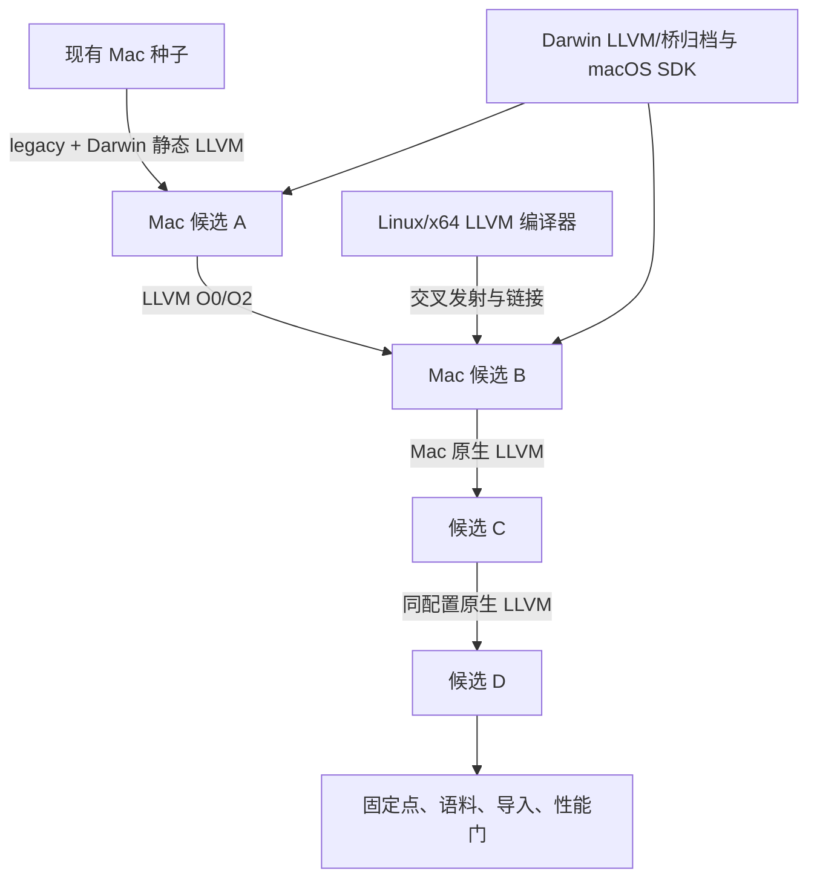

# yh macOS/ARM64 LLVM 后端接入设计

日期：2026-10-19。状态：方案已整理，代码尚未实施；原生先通、交叉随后验收的路线已由用户确认。
依据：[ADR-0014](../adr/0014-yh采用LLVM作为正式代码生成后端.md)、
[现状与交叉引导分析](../02-plan/yh-macOS-LLVM迁移差距分析.md)。
实施入口：[F2 分片计划](../02-plan/yh-macOS-LLVM后端接入实施方案.md)。

## 1. 范围与成功标准

首期只接 `aarch64-apple-darwin`，使 yh 在 macOS/ARM64 上通过进程内 LLVM 生成
对象并以进程内 lld 链接，能够运行现有语料、编译自身并形成原生固定点。
LLVM 与 lld 固定 21.1.8、静态嵌入，不调用外部 LLVM 工具完成正常代码生成/链接。
平台系统库及 C++ 运行库是单独审计的 OS/SDK 依赖；静态嵌入 LLVM 不要求整个
Mach-O 可执行文件完全静态。

不改变语言语法、`.yh` 后缀、pub/private、yh-llvm-v1 聚合语义和既有拒绝边界。
不在本方案扩展 macOS/x64、arm64e、universal、Windows、JIT 或 LTO。
默认切换仍等待公共 LL11、R2b 剩余与 R2c 硬门；旧后端删除仍归 LL12。
Linux/x64 → Linux/ARM64 → macOS/ARM64 的项目顺序保持不变。

五层成功标准分别记录：对象可发射、程序可链接、标准库可运行、编译器可运行、
编译器可原生自举。交叉格式探针不替代后四层。

## 2. 引导路线与取舍

| 路线 | 做法 | 取舍 |
| --- | --- | --- |
| 建议先行：Mac 原生 | 现有 Darwin 种子以 legacy 构建携带真实 LLVM 桥的 A，再由 A 显式 LLVM 编 B/C/D | 最少新增交叉配套，先验证 Apple ABI、运行时与 SDK |
| 后续独立验收：Linux/x64 交叉 | 经验证的 Linux A 生成 Darwin 对象，配 Darwin 静态库交叉链接 B；B 在 Mac 连续自编 | 提供独立于旧 Mac 种子的引导来源，需要目标依赖注入与交叉链接配置 |
| 不采用：长期双后端 | LLVM 只作实验，Mac 永久保留旧后端 | 与 ADR-0014 的最终替换目标不一致 |

用户已确认先 Mac 原生、再 Linux 交叉验收；交叉引导独立成片。本轮请求为整理方案，
尚未启动代码实施。
两条路线共用 Darwin SDK、Apple ABI、运行时、链接与缓存实现，不各建一套后端。
Linux/ARM64 LLVM 自举不是 Linux/x64→Mac 的技术中间步骤，但既有 F1/F2 排期保留。



## 3. 平台、版本与 SDK 身份

| 项目 | 首期契约 |
| --- | --- |
| 用户目标 triple | `aarch64-apple-darwin`，保持当前 canonical 身份 |
| SDK/桥运行宿主键 | `darwin-aarch64`；种子仍叫 `bin/yh-darwin-arm64` |
| LLVM/lld | 21.1.8；源码或发行包 URL、SHA-256、构建配置与许可必须固定 |
| 最低 macOS 版本 | 建议缺省 `14.0`，对齐现有 `macos-14` CI；`MACOSX_DEPLOYMENT_TARGET` 可显式覆盖，实际支持版本以运行门为准 |
| CPU/优化 | generic；O0/O2；不使用 native CPU、fast-math 或隐式 LTO |
| 重定位/链接 | Darwin PIC + PIE；所有用户对象、桥及静态 SDK 一致，禁止沿用 Linux `-no-pie` |
| OS 运行依赖 | libSystem；编译器允许经清单审计的 libc++/C++ ABI 依赖，不允许动态 LLVM/lld/libclang |

本机只读检查为 macOS 27.0、CLT SDK 27.0，SDK 采用 TBD v4，出现 arm64e.x1 等
目标标签；这不是 LLVM 21.1.8 已兼容该 SDK 的证据。F2-0/F2-1 必须用固定版本实际
解析并链接 libSystem/libc++；不兼容时记录明确失败并选择经验证的 SDK 重新锁定，
不悄悄升级 LLVM，也不在文档中宣称旧系统已经可运行。

LLVM 包与 Apple 系统 SDK 是两类输入：前者保存编译器静态归档，后者提供头文件和
系统库 stub。Darwin 原生允许 SDKROOT，未指定时通过 xcrun 解析实际 SDK；Linux
交叉模式必须显式提供 SDKROOT 和锁定记录，不执行 macOS 工具来发现依赖。

每个会话解析一次 `DarwinLinkConfig`：`sdk_root`、`sdk_version`、`min_os`、
`sdk_identity` 四个自有 NUL 字符串，由 cmd 持有至会话结束；不借用可扩容名字池。
无效版本、SDK 缺失、目标架构不符在发射/发布前失败。
`c_host_target` 始终表示当前正在运行的编译器，输出目标单独保存在 `c_target`。

## 4. 静态桥与构建注入

在固定源码 21.1.8 上构建 Darwin 静态包；优先由 macos-14 构建并验收最低运行版本，
本机可消费该包或构建本机研究包。身份记录必须区分构建机、归档运行宿主、部署版本、
Apple SDK、C/C++ 工具链、实际组件闭包、桥源码和每个归档摘要。
支持 X86/AArch64 代码生成；保留现有 lld shim 所注册的 ELF/MachO/COFF 驱动闭包，
本期不建设 LLVM 源码裁剪体系。非必需压缩/XML 支持显式关闭，避免引入未锁定库。
固定版本 clang/opt 等 oracle 单独存放，只供测试，不成为普通 yh 的运行依赖。

Darwin 用普通文件路径链接静态归档，不执行 Linux memfd、`/proc/self/fd`、GNU
archive group 或 libstdc++ 参数。只 force-load 桥归档，避免依靠全量强拉所有 LLVM
成员掩盖归档闭包错误。实际 C/C++ 驱动路径经 xcrun 解析并入键。

保留 `auto/require/off` 语义：require 缺固定包即失败；auto/off 的 legacy 构建可
链接一个小型 C 失败桩，明确报告“未内嵌 LLVM”。Darwin `.yh` 绑定改为 extern 后，
不得因缺固定包让旧后端冷编也链接失败。显式 `--backend llvm` 永远不回退 legacy。

现有 yh_llvm_emit C ABI v1 兼容保留，新增带部署版本的 v2：

```c
int yh_llvm_emit_v2(const char *text, uint64_t length, const char *triple,
    const char *min_os, int opt_level, int kind, const char *output,
    char *diagnostic, uint64_t capacity);
```

Darwin 必须提供有效 min_os；Linux 传空串。桥在核对 canonical 目标后生成带部署
版本的 LLVM 目标配置，设置 PIC，并验证模块/TargetMachine 布局一致；不把部署版本
只加在最终链接步。包的 bridge_abi 升至 2，v1 的 Linux 行为保持。

## 5. ABI、运行时与源码筛选

保留 yh-llvm-v1 内部聚合 ABI；Apple C ABI 单独 dispatch，声明、定义、直接调用、
间接调用共用规则。先接标量，再接小聚合/HFA/间接返回与回调，最后验收既有系统
入口允许的裸 C 变参。用户源码裸 C 变参、C 边界数组/切片等既有拒绝不放宽。
Clang 21.1.8 的 IR 与 O0/O2 双向真实运行共同作为 oracle，系统 clang 仅作附加对照。

新增 Apple ABI 和 LLVM runtime emitter 使用普通文件名，如 `llvm_apple_abi.yh`、
`llvm_apple_runtime.yh`，不能带 `.darwin.yh` 筛选后缀：Linux A 也必须编入这些目标
发射能力。只有编译器自身的 OS 桥及链接绑定按 `.darwin`/`.linux` 选择。

Darwin allocator 维持 `__yh_runtime_malloc/free` 命名，使用 mmap/munmap；输出使用
write，格式化仍由 yh 自己实现。OS 常量、签名按选定 SDK 的 C 探针核对。保留 16 字节
分配对齐、malloc(0)、free(NULL)、错误/短写、字节字符串与既有格式集合。
禁止把 libc malloc/free/printf/memcpy/strlen 导入作为完成迁移的方法。
内存 helper 的 Mach-O 弱符号、合并、用户强定义优先与 O2 防自递归单独检查。

## 6. Mach-O 链接与跨平台依赖

复用 `yh_lld_link(argv, argc, diagnostic, capacity)`，由 cmd 的 Darwin 路径构造
完整 argv；既有 GNU/ELF driver 不改成多平台参数模板。关键项为 arm64、macos
platform_version、显式 syslibroot、PIE、libSystem、ad-hoc 签名及受检对象/库。
普通程序不自动携带 LLVM 静态库；只有明确的编译器自举链接才追加固定桥与 SDK。

继续用一次性 fork worker 执行 lld，父进程验证 Mach-O CPU、文件类型、版本和签名
后原子发布。单文件、项目、worker 共用配置与发布协议。平台驱动回落保留为显式
选择；内嵌 lld 失败不能静默改走系统 clang。签名使用 lld 的既有能力并实际验证。

交叉构建区分 A 的运行库与 B 的运行库：Linux A 中的 ELF 版 LLVM 执行代码生成，
链接 B 必须使用 Darwin/ARM64 LLVM/桥归档。自举 manifest 按 B 的运行宿主选择，
路径可重定位，搬到 Mac 后重新解析构建输入；不得把 Linux 绝对归档路径固化为 B
唯一可用的自举配置。普通运行无需 LLVM SDK，冷编自举仍需固定静态归档作为输入。

## 7. 缓存、验收与发布

对象键增加有效部署版本、PIC/CPU/profile、桥 ABI/实现身份；链接键覆盖完整 argv、
SDK 身份、实际 `.tbd/.dylib/.a` 及 reexport 闭包、系统/C++ 库、链接驱动、目标依赖。
SDK 身份由确定排序的内容清单生成，路径、版本或 mtime 均不能单独替代内容。
复用现有 manifest 原子发布，依赖不明、损坏缓存、失败或取消都不得确认成功命中。

Mac 原生 A→B→C→D 与交叉 A→B 后的 Mac B→C→D→E 分别保存源码、工具/SDK 身份、
逐代覆盖与产物清单；O0/O2 分开，原生连续代 `.ll/.s.i/.s.ct` 精确固定点。
不能硬编码当前模块/项目数量，按会话实际 manifest 发现完整集合。
全量语法/运行/模块/项目与 compiler/asm/link/libs 消费者必须 fallback=0。

新增 Darwin 专门门，不放松 Linux/x64 的 test-llvm。macos-14 CI 继续手动触发，
增加 Darwin LLVM 原生门；Linux 交叉产物传到 Mac 作业运行，不把 Linux 出格式当作
Mac 支持。日常本地仍只跑本平台主门，其他平台交 CI。

至少 20 轮冻结输入比较 legacy 与 LLVM O0/O2，报告中位数/p95/RSS/子进程数和程序
运行性能；重复超过 10% 的回退归因或形成明确取舍。正式切默认后必须再跑
`make test` + `make selfhost-native`，两门绿后才以 Mac 原生验收候选滚 Darwin 种子。
候选失败留在 tmp，旧种子不被覆盖；不顺带删除旧后端。

## 8. 事实来源与待评审项

- [LLVM 21.1.8 Mach-O 驱动源码](https://github.com/llvm/llvm-project/blob/llvmorg-21.1.8/lld/MachO/Driver.cpp)：系统库 stub、搜索路径与 platform_version。
- [同版本 ad-hoc 签名测试](https://github.com/llvm/llvm-project/blob/llvmorg-21.1.8/lld/test/MachO/adhoc-codesign.s)。
- [Apple ARM64 ABI](https://developer.apple.com/documentation/xcode/writing-arm64-code-for-apple-platforms)：固定参数、窄型、栈和变参。
- [LLVM 交叉构建说明](https://llvm.org/docs/HowToCrossCompileLLVM.html)：运行宿主与代码生成目标分离。

引导顺序已确认；最低版本 14.0 为本方案建议值，由 F2-0 与 SDK/CI 契约一起冻结。
SDK 具体包 URL/摘要由 F2-0/F2-1 实际构建与兼容性测试锁定，禁止填写虚构哈希；
方案交付不表示这些依赖已可用，也不表示已验证 macOS 14 运行兼容性。
