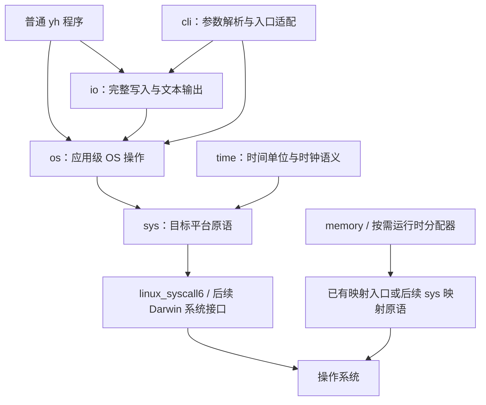

# yh os 与 sys 标准库设计

日期：2026-10-19；2026-10-21 更新。状态：**OS0–OS6 已完成**（含 OS1 短写/
EINTR/CLI 收尾、OS2 目录/cwd、OS3 环境查询、OS4 进程、OS5 io/time/内存时间
与 OS6 示例）；OS7–OS8 仍按图纸推进。用户已选择“标准库可用性优先”；编译器
迁移与 Darwin 新接口仍是设计目标，不代表已经实现。

实施分期见[联合实施方案](../02-plan/yh-os与sys标准库实施方案.md)，分层取舍见
[ADR-0015](../adr/0015-yh-os与sys标准库分层.md)。sys 的底层 ABI 细节继续见
[系统调用封装设计](yh-sys系统调用封装设计.md)；排期与平台事实以本次修订为准。

## 1. 目标与范围

先让普通 yh 程序能够打开和读写文件、操作目录、读取环境、启动并等待进程，
调用方能区分失败原因并明确管理资源；同时使这些能力可供编译器后续复用。
第一份可用交付是“文件读写闭环”，不要求先完成全部 syscall 或编译器迁移。

约束：不改语言语法、不新增项目字段、不依赖泛型或异常、不隐式分配大块内存，
保留当前 os/io/time 接口。平台按现行 LLVM 路线推进：Linux/x64 主线与既有
Linux/arm64 路径分别适配，Darwin 后续接入；不更改各平台种子或默认后端政策。

不在首期扩展网络、DNS、线程、信号处理器、递归目录操作、完整文件元数据、
PATH 搜索、shell 命令字符串、缓冲文件对象和完整 POSIX/libc。

## 2. 仓库基线与实际缺口

| 当前事实 | 对规划的影响 |
| --- | --- |
| `libs/os/os.yh` 已有文件、目录、PID、睡眠、退出及 platform/arch | 保留原名与原返回值，不能按空库重建 |
| `libs/sys/` 已实现结果模型、Linux 文件/目录/进程/内存/时间原语 | OS0–OS5 已落地；Darwin 仍待实施 |
| `libs/os/environment.yh` 已实现显式 envp 查询 | OS3 已落地；不改进程环境、不新增 getenv 系统调用 |
| os 大多数旧错误只有 -1，open 标志直接使用宿主数值 | 新接口已提供显式错误与 os 自有打开选项，旧接口继续兼容 |
| `libs/io` 自己调用 prelude write；CLI 使用 io 与 os.terminate | 收敛 I/O 路径时必须守住 CLI 输出和退出码 |
| `libs/time` 写死 Darwin 时钟号 6 | Linux 实现应走 sys.read_clock，不能照搬常量 |
| ARM64 原生后端和 Linux/x64 LLVM runtime 均已有 linux_syscall6 路径 | 已用于 sys.raw6；按 ISA 核对寄存器和编号 |
| `compiler/cmd` 已有 `.linux.arm64.yh` 与 `.linux.x64.yh` 目录/时钟文件 | 当前文件筛选已支持 OS 与架构组合后缀 |
| `tests/modules/projects/envp-api` 已验证三参数 main 的 envp | 环境查询可使用显式入口环境，不需要新增 getenv intrinsic |
| 标准库支持 YH_STDLIB、显式依赖与可执行文件附近默认发现 | OS6 已实现仓库/安装布局；显式配置优先 |

以上基线已由 2026-10-21 的 OS0–OS2 实现与 Linux/arm64 原生用例更新；工作区
既有 CLI/编译器修改不是本次规划成果。

## 3. 路线取舍

| 路线 | 收益 | 代价 | 建议 |
| --- | --- | --- | --- |
| sys 内核原语 + os 应用接口，逐条纵向交付 | 应用先获益，平台细节有唯一归属，保留独立性方向 | 需要一层错误与选项转换 | 采用此规划 |
| 只扩充当前 os 的 libc 薄封装 | 第一批代码最少 | 延续平台常量外泄，未来再迁一次，详细错误仍需桥接 | 仅保留旧接口兼容用途 |
| 先完成全部 sys、静态运行时与编译器迁移，再提供 os | 底层可统一收口 | 应用长时间没有新增可用能力，受工具链排期影响 | 不作为首期顺序 |

## 4. 分层与依赖方向

- **sys**：原始调用、具名原语、内核标志与结构布局、错误区间判定；不分配、
  不遍历、不处理完整读写、不解释 wait 状态，不 import os/io/time/memory。
- **os**：跨平台语义、应用级错误、打开选项、目录记录解析、进程状态与资源约定。
  首批新接口在 Linux 提供，Darwin 接口逐项接入后才声明同等能力。
- **io**：完整写入、打印及后续通用 I/O 算法；`write_all_result` 保留短写/中断进度，
  现有 `write_all/print/println` 契约不变。
- **time**：单调/墙上时钟、单位转换与新睡眠 API；保留 os.sleep_us 兼容入口。
- **memory**：显式分配与释放。编译器按需生成的 malloc/free 桩继续自有入口，
  不能为了本库强行依赖标准库模块；映射能力与分配策略分开验收。

sys 的调用号、ABI 结构不能进入 os 的公开签名。普通应用不必 import sys；
需要原始能力的底层程序可直接导入。编译器后续用显式项目依赖绑定库源码，
避免 YH_STDLIB 或本地同名模块改变工具链行为。

## 5. sys 的最小范围

| 能力组 | 具名接口 | 触发交付 |
| --- | --- | --- |
| 结果与入口 | raw6、is_error、error_code | OS0/OS1 |
| 文件 | open_at、read_fd、write_fd、close_fd、rename_at、remove_at | OS1 |
| 目录 | create_dir_at、getdents64、get_cwd、change_dir | OS2 |
| 进程 | process_id、fork_process、execute、wait_process、exit_process、create_pipe、send_signal | OS4（已实现） |
| 按消费者扩展 | duplicate_fd、fd_flags、send_signal、exit_thread | 实际重定向/工具链需求 |
| 时间与内存 | Timespec、read_clock、sleep_time、map_memory、unmap_memory | OS5 与 SYS3（已实现） |

前三个新增原语采用固定参数：`get_cwd(buffer *char, capacity u64) i64`、
`change_dir(path *char) i64`、`create_pipe(output *int, flags int) i64`。
pipe 输出为两个连续的 int，成功才读取；Linux 使用 pipe2，握手所需 O_CLOEXEC
由 sys 平台常量提供。get_cwd 保留内核返回，os 再归一化字符串长度。
OS1 收尾已为短写/EINTR 测试提前交付 create_pipe、O_NONBLOCK 与 EAGAIN；
OS4 已交付 fork/exec/wait/exit/send_signal。

Linux 具名原语保留成功结果或 `-errno`，只有 `[-4095,-1]` 是错误区间。
read/write 各调用一次并允许短读写；close 不重试；mmap 判错后才转指针。
raw6 仅供 Linux，不承诺 Darwin 有等价的稳定原始入口。

调用号与 O_* 等 ABI 常量按 `.linux.x64.yh` / `.linux.arm64.yh` 分开。
公共封装可放 `.linux.yh`，不能把 ARM64 编号复制给 x64。编号分别查
[Linux x64 表](https://github.com/torvalds/linux/blob/v6.12/arch/x86/entry/syscalls/syscall_64.tbl)
与 [Linux 通用表](https://github.com/torvalds/linux/blob/v6.12/scripts/syscall.tbl)。
v6.12 是来源基线，不是最低内核版本承诺。

## 6. os 的新 API 契约

6.1–6.4 的结果、文件、目录与环境 API 已落地；6.5 起的进程 API 仍是
拟议接口，不是已存在的可编译示例。首期使用具体结果结构，不增加通用
Result<T> 或全局 last_error。

### 6.1 错误与结果

- `Error`：`kind ErrorKind`、`native_code int`。kind 提供稳定分类：
  error_none/not_found/already_exists/permission_denied/interrupted/invalid_argument/
  unsupported/other；具体枚举成员采用不会冲突的完整名字。
- native_code 保留当前目标正错误号；库自己发现的无效参数等错误可为 0，
  不捏造内核错误。不得用 native_code==0 代替 kind 判断成功。
- `FdResult`：`fd int`、`error Error`；失败 fd 固定 -1，成功后由调用方关闭。
- `IoResult`：`count u64`、`error Error`；单次失败 count=0，完整写入函数失败
  可保留已写 count。EOF 是 count=0 且没有错误。
- 仅有成功/失败的操作直接返回 Error；错误分类比较不需要分配或格式化文本。

不把 sys.Error 或 Timespec 直接嵌入 os 的公开接口，也不自动打印错误或退出。
错误消息格式化留给应用/cli；native_code 不是跨平台可比较的编号。

### 6.2 第一份可用 API：文件闭环

| 已实现签名 | 语义 |
| --- | --- |
| `open_path(path *char, options OpenOptions) FdResult` | 使用 os 自有选项，成功转移 fd 所有权 |
| `read_some(fd int, buffer []u8) IoResult` | 一次读取，返回实际字节数与显式错误 |
| `write_some(fd int, data []u8) IoResult` | 一次写入，允许短写 |
| `close_file(fd int) Error` | 一次关闭；错误后不自动重试或继续使用该 fd |
| `make_dir(path *char, mode u32) Error` | 创建一层目录 |
| `remove_dir_path(path *char) Error` | 仅删除空目录 |
| `remove_path(path *char) Error` | 删除文件路径；不递归、不通过探测后再删除 |
| `rename_path(old_path *char, new_path *char) Error` | 同底层 rename 语义；跨设备不自动复制 |

早期图纸中的 `open/read/write/close/mkdir/rmdir/remove/rename` 与编译器 prelude
同名，模块内定义会被判为顶层符号重定义，因此实际接口改用上表名字。语义与
所有权不变，旧 `open_file/read_fd/write_fd/close_fd/...` 继续保留在 os.yh。

实现落在 `libs/os/00_model.yh`（结果与选项）和 `libs/os/file.linux.yh`
（Linux 文件适配）。数字前缀保证同模块内类型先于平台实现文件编译。
io 的 `write_all_result` 复用 `os.write_once(fd, buffer *void, count u64) IoResult`；
Linux 版本映射 sys -errno，Darwin 使用 prelude write 的兼容入口（native_code 0）。

`OpenOptions` 使用 `access`（只读/只写/读写）、`create/truncate/exclusive/append`
四个 bool 和 `mode u32`。提供 read_options()/write_options() 初始化函数，避免
依赖零值猜默认值；只读默认不创建，写默认不截断，exclusive 只能与 create 一起用。
只读与 truncate/append 的组合报 invalid_argument；创建权限默认 0666，再由 umask 裁剪。
新 open 默认 close-on-exec；精细继承由后续进程 API 显式安排。mode 只在创建时
使用，并受当前 umask 影响；不更改 umask。选项转换只在 os 平台适配处进行。

路径为 NUL 结尾字节串；不承诺 Unicode 规范化，长度按字节计算。切片借用到
调用返回，不保留指针，不返回局部数组视图；切片跨模块 ABI 先在 OS0 实测。
不引入自动 File 对象、析构、整文件读取分配或 read_all 的隐式内存增长。

read/write 遇 EINTR 返回 interrupted，保持单次调用可观察性。io 后续的
write_all_result 负责短写循环并保留进度；旧 io.write_all 的不重试中断契约保留。
短写与关闭语义依据 [write(2)](https://man7.org/linux/man-pages/man2/write.2.html)
和 [close(2)](https://man7.org/linux/man-pages/man2/close.2.html)。

### 6.3 目录与当前目录

已实现 `open_dir(path *char, buffer []u8) DirReaderResult`、
`next_entry(reader *DirReader) DirEntryResult`、`close_dir(reader *DirReader) Error`、
`get_cwd(buffer []u8) IoResult`、`change_dir(path *char) Error`。
目录读取采用调用方提供的字节缓冲，读取器保存 fd、缓冲、已用长度与游标；
不一次性分配所有目录项。公开读取器只使用公开基础类型，内部解析函数私有。

next_entry 区分 `dir_entry_ok/dir_entry_end/dir_entry_error`。`DirEntry` 的
`name *u8 + name_len u64` 借用读取器缓冲，只保证到下一次 next_entry 或
close_dir；要长期保存由调用方复制。语言暂不支持从裸指针构造 `[]u8`，因此
条目名称采用指针与长度，而不是切片字段。跳过 `.`/`..`，顺序不保证；类型保留
unknown，不把 DT_UNKNOWN 判为普通文件。getdents 记录按长度、剩余字节和 NUL
边界校验，不能越界后再判断。依据
[getdents(2)](https://man7.org/linux/man-pages/man2/getdents.2.html)。

get_cwd 使用调用方缓冲；成功写 NUL，IoResult.count 不包含终止 NUL；空间不足
返回 `error_invalid_argument`（原生 ERANGE），不隐式扩容。change_dir 明确修改
进程全局当前目录。路径拼接、清理等纯文本算法未来放 path，不放 sys；本次不因此
新建 path 模块。close_dir 重复调用幂等，关闭后 next_entry 返回明确错误。

### 6.4 环境

已实现 `get_env(envp **char, name *char) EnvResult`，显式接收 main 的环境。
EnvResult 含 `found bool`、`value *char`、`error Error`：不存在与空字符串不同，
缺失返回 found=0 且无错误；非法名字、空 envp 返回 invalid_argument（native 0）。
名字不能为空或包含 `=`；按完整键匹配，重复键取首项；值借用 envp 生命周期。
测试覆盖合成 envp、真实进程 envp、空值、重复键、前缀不匹配、值内等号与非法名字。

环境不是一条 getenv syscall；查询在 os 用 yh 扫描入口字节串完成。
先不提供 set_env/unset_env、全局懒初始化或隐式拷贝环境。启动子进程显式传 envp，
无需先修改父进程环境；后续确有需求时再增加有明确所有权的可编辑环境对象。

### 6.5 进程（已实现）

已实现 `spawn(path *char, argv **char, envp **char) PidResult`、
`wait(pid int) WaitResult` 与 `exit_now(code int)`。PID 使用 int；spawn 返回
独立 PidResult，wait 返回 WaitResult：`wait_exited` 时 exit_code 有效，
`wait_signaled` 时 signal 有效，`wait_error` 时 error 有效。首期 wait 阻塞且
只支持本库启动的普通子进程，遇 EINTR 内部重试；不把信号退出压成 128+signal。

spawn 使用精确路径、显式 NULL 结尾 argv/envp；不搜索 PATH、不经过 shell，
执行失败必须在父进程返回明确错误，不能仅返回 fork 成功的 PID。Linux 用
close-on-exec 错误管道：子进程 exec 失败写 4 字节 errno 并退出，父进程收齐
错误帧后回收失败子进程；成功 exec 通过写端关闭结束握手。读写握手处理 EINTR、
短帧与清理；测试覆盖成功 exec、缺失路径、无执行权限文件、正常退出与信号退出，
不能把 pipe 创建成功当作 exec 成功。

握手空 EOF 只能说明错误写端已关闭；正常执行后的任意早退仍由 wait 报告，
spawn 不承诺业务代码已经开始或持续存活。fork 后子路径仅做已审核的原始
write/close/exec/exit，不分配、不格式化、不运行普通退出清理；首期限定单线程
父进程。依据 [execve(2)](https://man7.org/linux/man-pages/man2/execve.2.html)
和 [pipe(2)](https://man7.org/linux/man-pages/man2/pipe.2.html)。

标准描述符默认继承，其余本库新建 fd 默认 close-on-exec。完整重定向、管线、
超时、进程组、信号处理与多线程 spawn 后续按需求扩展。exit 是立即终止进程，
不暗示刷新未来缓冲流或析构；CLI 保持先释放结果/parser 再终止的既有顺序。

## 7. 兼容与平台交付

旧 `open_file/open_file_mode/read_fd/write_fd/close_fd/create_dir/remove_dir/`
`remove_file/rename_file/process_id/sleep_us/terminate/platform/arch` 保留原契约。
尤其 old open 继续接受宿主标志，失败保持 -1；不能把 -errno 静默塞进旧 API。
兼容函数只做必要转换，不新增每个新接口的第二套 `_checked` 名字。

新接口在 Linux 平台文件中提供；Darwin 未接入前保留旧接口，缺少的新导出应在
编译时明确报错，不提供成功空桩，也不让公共文件引用该平台不存在的 sys 函数。
os 的新 API 是目标语义一致的设计，并非本轮已实现多平台。

本地只验收本宿主的 make test / make selfhost-native；Linux/arm64、Linux/x64
完整回归由现有 CI 对应作业承担，macOS 按仓库手动工作流验证。Darwin 上可做
模型/兼容测试，不能用 SKIP 或交叉语义检查宣称 Linux syscall 已运行通过。
若专门安排 Linux 环境，按 AGENTS.md 使用 Apple container；不要求日常为别的
平台预跑门禁，不在容器覆盖种子。

## 8. 交付顺序与成功标准
   
OS0 基线与结果模型 → OS1 文件闭环 → OS2 目录 → OS3 环境 → OS4 进程 →
OS5 io/time 收敛与 sys 内存/时间 → OS6 加载/发行体验。
OS7 编译器迁移和独立性验收、OS8 Darwin 新接口适配单列后续，不阻挡 OS1 可用。

每阶段必须有真实 `.yh` 正反例、资源清理与本平台构建门；具体用例见实施方案。
错误分类、EOF/空值、中断、短写、close 与 exec 失败不能只测成功路径。
性能要求限于不逐字节 syscall、不隐式整文件分配、不引入初始化网络/外部命令。
没有测量前不承诺吞吐、延迟或跨平台等速。

## 9. 已实施状态（2026-10-21）

- **OS0 已完成**：`libs/sys/00_types.yh` 提供 Timespec/is_error/error_code，
  `libs/os/00_model.yh` 提供 Error/ErrorKind、FdResult、IoResult、OpenOptions、
  DirEntry 候选布局与初始化函数。`sysresult` 断言已迁入 `libs/sys/99_tests.yh`，
  `os` 结果模型另见 `libs/os/99_tests.yh`；`osmodel` 仍作跨模块 smoke。
  迁移记录见 [YT4-P5](../01-finished/yh-YT4-P5-os-sys-time迁移-2026-10-25.md)。
- **OS1 首片已实现**：`libs/sys/10_constants.linux.{arm64,x64}.yh`、
  `20_raw.linux.yh`、`30_file.linux.yh` 提供 raw6 与文件/目录原语；
  `libs/os/file.linux.yh` 提供 `open_path/read_some/write_some/close_file/`
  `make_dir/remove_path/remove_dir_path/rename_path`。Linux 用例覆盖创建、写入、
  读取、EOF、追加、独占、重命名、目录删除、ENOENT/EEXIST/EBADF 与非法选项。
- **OS2 目录/cwd 已实现**：`libs/sys/30_file.linux.yh` 增加 getdents64/
  get_cwd/change_dir；`libs/os/20_directory.linux.yh` 提供 DirReader、
  next_entry、close_dir、get_cwd、change_dir。`sysdirs` 与 `osdirs` 在
  Linux/arm64 原生通过，覆盖多批读取、空目录、长名称、小缓冲、坏 fd、
  ENOTDIR/ERANGE、DT_UNKNOWN、损坏记录、重复关闭与 cwd 恢复。
- **OS3 环境查询已实现**：`libs/os/environment.yh` 提供 get_env/EnvResult；
  `osenv` 在 Darwin 与 Linux/arm64 原生通过，覆盖合成/真实 envp、空值、重复键、
  前缀、值内等号与非法名字。
- **OS1 已完成**：`syseintr` 用不带 SA_RESTART 的 SIGALRM 与 Unix 流式
  socket 稳定覆盖 -EINTR、短写与部分进度；`libs/cli/test/run.py` 9/9 通过。
  收尾时修复了 LLVM lowering 对 fn 值→普通指针显式 cast 的缺口，并新增
  `llvm-fnptr-null-cast` 运行语料。Linux/x64 原生门由 CI 承担。
- **OS4 已完成**：sys 提供 process_id/fork_process/execute/wait_process/
  exit_process/create_pipe/send_signal；os 提供 spawn/wait/exit_now、PidResult、
  WaitState/WaitResult。`sysprocess` 与 `osprocess` 在 Linux/arm64 原生通过，
  覆盖 fork 双返回、正常/信号退出、无僵尸、精确路径成功、缺失路径与无执行
  权限文件的 exec 失败握手。Linux/x64 由 CI 原生验收。
- **OS5 已完成**：sys 增加 mmap/munmap 与 clock_gettime/nanosleep；io 经
  os.write_once 提供 write_all_result（保留短写/EAGAIN/EINTR 进度），旧
  write_all/print/println 契约不变；time 拆为 Linux/Darwin 平台实现，Linux
  走 sys.read_clock；os.sleep_us 拆平台文件并保持旧契约。`sysmemory/systime/
  osio` 与扩展 `syseintr` 在 Linux/arm64 通过；libsbase/libsio/CLI 保持兼容。
- **OS6 已完成**：`examples/os-demo` 演示文件复制、目录枚举、envp 查询与自身
  spawn/wait，使用 YH_STDLIB；`examples/os-demo-explicit` 用 project.toml 依赖
  `yh_libs`。默认发现已实现：YH_STDLIB 非空优先，空/未设置时按可执行文件附近
  `<exe_dir>/libs`、`<exe_dir>/../libs`、`<exe_dir>/../share/yh/libs` 查找；
  `make install` 安装到 `share/yh/libs`。
- 本轮没有修改编译器语义、语法、种子或默认后端；Linux 运行结论来自 Apple
  Container 中的入库 ARM64 种子，不能替代 Linux/x64 原生门。

