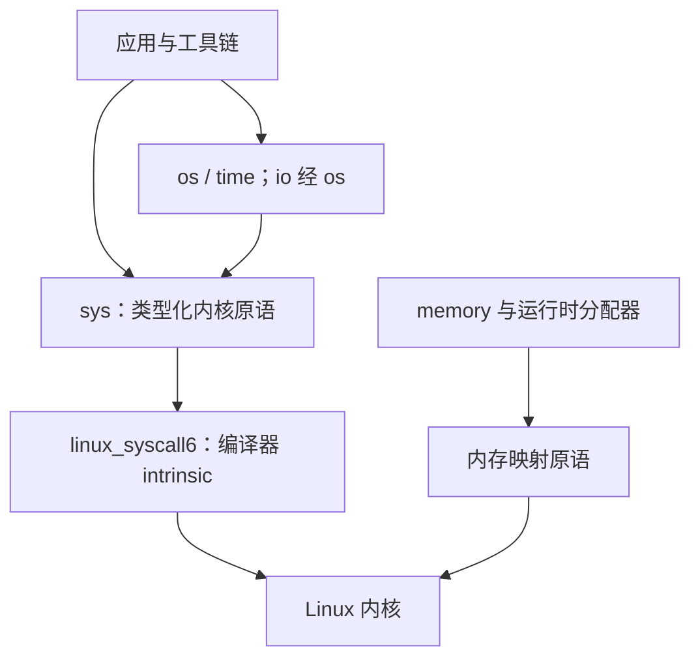

# yh sys 系统调用封装设计

日期：2026-10-03。状态：**规划交付，尚未实现**。

2026-10-19 修订：用户选择**标准库可用性优先**，新增
[os/sys 联合设计](yh-os与sys标准库设计.md)与
[联合实施方案](../02-plan/yh-os与sys标准库实施方案.md)。本文继续定义底层契约；
应用交付改为先打通文件，再目录、环境、进程，编译器整体迁移独立排期。
Linux/x64 已有 LLVM syscall 入口，文件筛选支持 OS/架构组合后缀；本地主门只
要求本宿主，完整回归交 CI。工具链依赖按 ADR-0014 的现行 LLVM/lld 路线审计。

实施与验收见[实施方案](../02-plan/yh-sys系统调用封装实施方案.md)，模块入口见
[libs/sys](../../libs/sys/README.md)。本设计承接用户“用 yh 实现运行所需能力、
脱离其他用户态依赖”的目标；平台范围按本次修订与联合设计推进。

## 1. 目标、假设与取舍

目标：在 `libs/sys/` 提供以 `.yh` 实现的系统调用层，使 yh 程序和编译器能够
直接访问 Linux 内核。运行产物不依赖宿主 libc、libc 的 syscall 函数或外部工具。
硬件、内核及程序显式读取的输入仍是运行条件。

本轮假设：用户要求规划，并指定实现位置为 sys 标准库；不开始实现、不修改语法。
Linux LP64 小端目标按 ISA 分别适配；Linux/x64 按 LLVM 主线推进，保留现有
Linux/arm64 路径。API 依据实际消费者需求冻结，macOS/arm64 后续适配。

| 路线 | 取舍 | 决定 |
| --- | --- | --- |
| Linux 直接 syscall + 显式错误返回，上层保留便利函数 | 独立于 libc，边界小；需要核对内核 ABI | 首期采用 |
| 仅给现有 libc 函数套标准库名称 | 工作少，仍依赖宿主库 | 不满足 Linux 独立目标 |
| 一次统一所有 OS、架构与完整 POSIX/libc | 大量结构、线程及兼容性工作 | 按真实使用场景分期 |

`sys` 不是完整 libc，也不承担格式化、PATH 搜索、文件遍历或资源管理策略。

## 2. 已核实的仓库基线

| 事实 | 位置及影响 |
| --- | --- |
| `libs/sys/` 仅有 README，清单已有 `[lib] sys` 预留项 | 实际模块由目录中的 `.yh` 发现，预留项不等于已有实现 |
| 标准库源码根为 `.`，无默认安装发现路径 | 应用当前需 `YH_STDLIB` 或显式项目依赖 |
| Linux 已登记 `linux_syscall6` intrinsic | `compiler/gen/symbols.yh`；七个 u64 参数、返回 i64 |
| ARM64 intrinsic 发射 `svc #0`，LLVM/x64 runtime 发射 `syscall` | `compiler/gen/emit_arm64.yh`、`compiler/backend/llvm_runtime.yh`；不能改为 libc syscall |
| Linux 目录与计时已有局部直接调用 | `compiler/cmd/project_dir.linux.{arm64,x64}.yh`、`clock.linux.{arm64,x64}.yh` |
| `os/io/time` 目前主要使用 prelude/宿主接口 | 迁移必须保留现有返回值及短写行为；time 尚为 Darwin 实现 |
| 编译器还有文件、fork/exec/wait、睡眠等外部入口 | 仅迁移目录/计时不足以证明编译器独立 |
| 文件筛选已有 OS/架构组合后缀 | `compiler/cmd/project_index.yh` 的 pj_source_target_match；已有 platformsource 用例 |

编译器调用流程中的 HostPlatform 与输出 TargetSpec 必须分开：sys 描述生成这个
程序的目标 ABI；运行中的编译器不能因正在输出另一个目标而切换自己的宿主 I/O。

## 3. 分层与依赖方向



- sys 不 import os、io、time、memory；所有缓冲区和所有权由调用方提供。
- 普通库消费者用 `import sys;`。编译器后续在 `compiler/project.toml` 显式添加
  `yh_libs = { path = "../libs" }`，使用 `import yh_libs.sys as sys;`，固定绑定。
- 内核调用号、平台标志和结构布局集中在 sys 的平台文件；不散落到新消费者。
- `memory` 的分配头部与策略继续属于分配器。现有生成器发射的按需 malloc/free
  桩不能直接改成未绑定的标准库符号；先保留其自有 syscall 路径，审计结果必须
  同时覆盖这些桩和 sys。将来共享事实表时也不得引入 sys → 分配器的循环。
- `_start`、入口栈解析、运行时初始化与静态 ELF 链接属于工具链与运行时；sys 只提供
  所需退出等原语。本模块完成不等于动态装载器已经移除。

## 4. 源码布局

以下是拟创建路径，当前只有 README。全部文件声明 `module sys;`，按已有项目
排序规则把类型、常量和底层函数放在消费者之前。

```text
libs/sys/
  README.md
  00_types.yh                 Timespec、错误判定与提取
  10_constants.linux.arm64.yh ARM64 私有 NR_*、公开标志/错误号
  10_constants.linux.x64.yh   x64 私有 NR_*、公开标志/错误号
  20_raw.linux.yh             raw6 → linux_syscall6
  30_file.linux.yh            文件与目录 syscall
  40_memory.linux.yh          mmap / munmap
  50_time.linux.yh            clock_gettime / nanosleep
  60_process.linux.yh         PID、fork、wait、exec、退出
```

后续 Darwin 对应文件使用 `.darwin.yh`，只补已经验证的接口；raw6 和 getdents64
保留 Linux 专属。不会提供返回伪成功的跨平台空函数。现有 os.platform/arch
已经实现，沿用现状；调用号与架构相关标志分别维护，不在两个 ISA 间复制数值。

文件长度按职责控制，不为凑到 500 行堆代码。每个公开类型、字段和函数用中文
说明单位、成功/错误结果、指针生命周期、修改的缓冲区及平台限制。

## 5. 原始调用与错误契约

拟公开入口：

```yh
// Linux 当前目标原始入口；调用方提供六个机器字，未用参数填零。
// 指针转 u64，负数按二补码转 u64；返回寄存器原始值，不读取 errno。
pub fn raw6(number u64, a0 u64, a1 u64, a2 u64,
            a3 u64, a4 u64, a5 u64) i64;

// 只识别 [-4095, -1] 的保留错误区间，不把任意负数当作错误。
pub fn is_error(value i64) int;

// 错误时返回正错误号，成功时返回 0；错误号属于当前目标平台。
pub fn error_code(value i64) int;
```

上面是 API 规格，普通 yh 函数实现必须带函数体，不能把这些无体规格作为源码。

Linux/arm64 使用 `svc #0`，调用号使用 x8 的低 32 位，参数放 x0–x5，结果取 x0；复用已有
intrinsic，不增加新语法。Linux/x64 复用 LLVM runtime 的 syscall 入口；编号与
传参按 x64 单独验收，来源为
[Linux x64 表](https://github.com/torvalds/linux/blob/v6.12/arch/x86/entry/syscalls/syscall_64.tbl)。
调用具有 I/O、内存和进程副作用，SSA/优化器不得删除、
随意移动或作为纯函数合并。寄存器与 ABI 依据 [Linux syscall 文档](https://man7.org/linux/man-pages/man2/syscall.2.html)。

所有具名原语除退出函数外返回 i64：成功是内核的字节数、fd、PID、地址位型或零；
错误保留 `-errno`。不设置进程全局错误变量，不把错误压成 -1。错误区间采用
[Linux v6.12 MAX_ERRNO 定义](https://github.com/torvalds/linux/blob/v6.12/include/linux/err.h)。

公开错误常量按需提供 `EINTR/EBADF/EINVAL/ENOENT/EEXIST/ENOSYS/ECHILD` 等，
值依当前目标定义，调用者不硬编码跨平台数字。Linux 值来源为
[errno-base.h](https://github.com/torvalds/linux/blob/v6.12/include/uapi/asm-generic/errno-base.h)
与 [errno.h](https://github.com/torvalds/linux/blob/v6.12/include/uapi/asm-generic/errno.h)。

sys 每次只执行一次 syscall，不处理短读写、不做 EINTR 重试。缓冲区零长度仍
交给内核判定，不能在 sys 层提前返回成功而掩盖无效 fd。指针、fd 和内核结构
由调用方按契约提供；sys 不增加通用指针检查或隐式缓冲。

## 6. 首期具名 API 与调用号

以下返回类型均为 i64，标注 void 的退出函数除外。调用号只是 Linux/arm64 的
实现映射；依据冻结的 [Linux v6.12 syscall 表](https://github.com/torvalds/linux/blob/v6.12/scripts/syscall.tbl)
核对，不表示首期已支持所有 6.12 接口，也不承诺未验收的最低内核版本。

| API 签名 | 内核映射 | 主要契约 |
| --- | --- | --- |
| `open_at(dir_fd int, path *char, flags int, mode u32)` | openat 56 | path 为 NUL 字节串；权限位始终显式传入 |
| `read_fd(fd int, buffer *void, count u64)` | read 63 | 返回实际读入字节数；0 可表示 EOF |
| `write_fd(fd int, buffer *void, count u64)` | write 64 | 一次写入，可能短写 |
| `close_fd(fd int)` | close 57 | 一次关闭，不自动重试 |
| `create_dir_at(dir_fd int, path *char, mode u32)` | mkdirat 34 | 只创建单层目录 |
| `remove_at(dir_fd int, path *char, flags int)` | unlinkat 35 | 文件删除或 AT_REMOVEDIR 空目录删除 |
| `rename_at(old_dir_fd int, old_path *char, new_dir_fd int, new_path *char)` | renameat2 276，flags=0 | 保持现有重命名语义；不隐式复制或回退 |
| `getdents64(fd int, buffer *void, count u64)` | getdents64 61 | Linux 专属，返回原始目录记录字节 |
| `map_memory(address *void, count u64, protection int, flags int, fd int, offset u64)` | mmap 222 | 成功值为地址位型，检查错误后才转指针 |
| `unmap_memory(address *void, count u64)` | munmap 215 | 成功 0，不维护分配器头部 |
| `read_clock(clock_id int, output *Timespec)` | clock_gettime 113 | 成功时填入秒和纳秒 |
| `sleep_time(request *Timespec, remaining *Timespec)` | nanosleep 101 | 被中断时保留错误和内核写入的剩余时间 |
| `process_id()` | getpid 172 | 返回 PID |
| `fork_process()` | clone 220，flags=SIGCHLD | 父进程返回子 PID，子进程返回 0 |
| `wait_process(pid int, status *int, options int)` | wait4 260，rusage=NULL | 输出原始 32 位状态字；不解释退出码 |
| `execute(path *char, argv **char, envp **char)` | execve 221 | 成功替换映像，不返回；失败返回错误 |
| `duplicate_fd(old_fd int, new_fd int, flags int)` | dup3 24 | 同 fd 传入是错误，与 dup2 不同 |
| `fd_flags(fd int)` | fcntl 25，command=F_GETFD | 验证 fd 并读取描述符标志 |
| `send_signal(pid int, signal int)` | kill 129 | 返回内核结果 |
| `exit_thread(code int) void` | exit 93 | 结束调用线程；不做语言清理 |
| `exit_process(code int) void` | exit_group 94 | 结束线程组；不做语言清理 |

以上调用号列仅适用于 Linux/arm64，不能作为 x64 的实现表。2026-10-19 为 os
目录/进程需求追加 `get_cwd(buffer *char, capacity u64) i64`、
`change_dir(path *char) i64`、`create_pipe(output *int, flags int) i64`；
分别映射目标 getcwd/chdir/pipe2。pipe 输出为两个连续 int，成功才读取；
os.spawn 的执行失败握手使用 O_CLOEXEC。新增能力分期见联合设计。

公开标志只覆盖已用场景：AT_FDCWD、AT_REMOVEDIR、O_RDONLY/O_WRONLY/O_RDWR、
O_CREAT/O_EXCL/O_TRUNC/O_APPEND/O_DIRECTORY/O_CLOEXEC、PROT_READ/PROT_WRITE、
MAP_PRIVATE/MAP_ANONYMOUS、CLOCK_MONOTONIC/CLOCK_REALTIME、WNOHANG、
SIGCHLD/SIGTERM、FD_CLOEXEC。NR_* 和 F_GETFD 留作私有实现常量。

open 与映射常量取自 [fcntl.h](https://github.com/torvalds/linux/blob/v6.12/include/uapi/asm-generic/fcntl.h)
和 [mman-common.h](https://github.com/torvalds/linux/blob/v6.12/include/uapi/asm-generic/mman-common.h)。
平台不同必须使用不同常量文件，不能沿用现有 libsbase 中的 Darwin 数字。

## 7. 必须落到测试的 ABI 细节

### 7.1 内存与时间

`Timespec` 使用两个 i64 字段 `sec/nsec`，首期 LP64 布局验收为大小 16、偏移
0/8、对齐 8。输出失败时不读取未初始化字段。纳秒合法范围为 0–999999999；
时间转换和溢出处理属于 time 层，sys 原样返回内核结果。

mmap 不用“指针是否为 NULL”判断失败，也不能把任意负 i64 当失败；先用
is_error 判断，再保持完整 64 位地址转指针。文件偏移单位为字节，遵守实际内核
页对齐要求。页大小由后续启动栈 auxv 提供给运行时，不能把 4096 写成跨环境
保证。依据 [mmap 文档](https://man7.org/linux/man-pages/man2/mmap.2.html)。

nanosleep 不自动循环；EINTR 时 remaining 的使用由上层决定。依据
[nanosleep 文档](https://man7.org/linux/man-pages/man2/nanosleep.2.html)。

### 7.2 文件与目录

Linux close 报错后不可直接重试，fd 可能已被释放并复用；依据
[close 文档](https://man7.org/linux/man-pages/man2/close.2.html)。

getdents64 只返回原始字节。目录记录逐条检查 d_reclen、剩余长度和 NUL 名称边界；
d_type=DT_UNKNOWN 不能直接当作普通文件。现有编译器消费者需补无类型信息时的
目录探测或明确限制，不能因引入 sys 保留静默漏模块行为。首期可用相对目录 fd
的 open_at(..., O_DIRECTORY) 探测，不要求先实现 stat 全结构。

### 7.3 进程与退出

ARM64 首期 fork_process 仅支持当前单线程父进程与 fork/COW worker：
raw clone 使用 SIGCHLD、空子栈及其余零参数，不带 CLONE_VM，不设置 TLS。
这保持普通函数返回点和复制栈语义。不能把它扩展成任意 clone(flags, stack)
并假装可在普通 yh 函数中安全切换栈；线程/新栈入口是单独任务。依据
[clone 原始接口文档](https://man7.org/linux/man-pages/man2/clone.2.html)。

execute 显式传 argv/envp，两者为 NULL 结尾指针数组；不搜索 PATH，不启动 shell，
ENOEXEC 不触发解释器回退。保留原有 execvp 的兼容工具路径属于过渡期；self
工具链路径不再调用外部工具。以后确需 PATH 搜索时在 os 层单独实现和验收。

duplicate_fd 的同 fd 行为保留 dup3 语义。旧 dup2 消费者由上层先用 fd_flags
验证原 fd，再返回原 fd，不能直接把 dup2 改成 dup3。wait_process 只返回原始
状态，上层维持现有退出/信号解码，并按调用点决定 EINTR 处理。

exit_thread 与 exit_process 区分线程和进程。退出函数以已有 noreturn 属性定义，
若 syscall 意外返回必须进入自有 trap 或不可返回路径，不能退回 libc exit。
语言刷新/析构后再调用 exit_process；依据
[exit_group 文档](https://man7.org/linux/man-pages/man2/exit_group.2.html)。

## 8. 上层库与编译器迁移

| 消费者 | 迁移与保留的契约 |
| --- | --- |
| `libs/os` | 新接口显式错误与 os 自有选项；旧接口保留 -1 和宿主标志，fd/PID 判错后窄化 |
| `libs/io` | 经 os 复用单次写入；write_all 循环短写，保留原有不自动 EINTR 重试契约 |
| `libs/time` | 改成平台文件，使用各自 CLOCK_MONOTONIC；保留失败 -1 |
| 编译器目录/计时 | 复用 sys 和 Timespec；目录解析保留在消费者，不放入 raw 层 |
| 编译器文件/进程与 worker | 按实际外部引用逐个替换，校验 wait/dup/exit 语义 |
| 分配器与发射运行时 | 保持提供方一致，单独审计残余 OS 引用，不重复定义 malloc/free |

现有 os API 不是 sys API 的别名：sys 保留错误细节，os 旧接口维持简化返回值，
新接口提供带错误的结果结构。
删除局部 syscall 常量和结构只能发生在其消费者已经成功迁移后。

旧 prelude 的 open/read/write 等仍是另一条调用入口，导入 sys 不会自动改写它们。
独立程序首期显式使用 sys；旧语料需要的兼容 OS 桥由运行时迁移按实际引用补齐，保持
旧返回约定。盘点同时覆盖 gen/buffer 中的编译器 I/O、发射运行时和用户 prelude，
不能只替换 cmd 的调用就宣称所有原有程序已无 libc 依赖。

## 9. 平台、交付与独立性边界

Linux sys 原语不产生外部 libc syscall/errno/文件/时间/进程引用。SYS6 对普通
syscall 产物验收静态 ELF 无 PT_INTERP、DT_NEEDED 和未解决强引用，并在独立
环境真实运行；编译器另按 ADR-0014 审计 LLVM/lld/SDK 的实际依赖并验收自举。
不把自研 asm/link 完成作为库可用的必要条件，也不把两类产物合并宣称无依赖。

应用加载仍遵守现有标准库规则。编译器和 link 项目若采用 sys，分别通过显式
依赖定位源码，不依赖用户设置 YH_STDLIB。标准库的默认安装发现布局另行规划，
当前不引入源码嵌入、自动下载或新项目字段。

Darwin 后续通过审核的 libSystem OS API 适配同一结果约定：原生失败时立即读取
__error 指向的线程错误号，再转换为负值；错误常量保持 Darwin 数字。必须逐项
核对 C ABI，尤其 open/openat 的变参 mode、mmap 指针结果和目录结构，不靠固定
参数假原型绕过未完成的 C 变参能力。只交付实际可正确桥接的接口。

原生失败判定按具体函数分别实现，例如 mmap 的 MAP_FAILED 与 fd 函数的 -1，
不能先统一转整数后对所有地址套负数判断。裸错误转换只对已审核的 OS API 使用。

Darwin 不使用 Linux raw6/getdents64，不承诺摆脱 dyld/libSystem，也不采用未验收
的直接 Darwin syscall ABI。Windows/WSL 的执行和 Linux 产物须明确区分。

## 10. 成功标准与暂缓范围

- Linux 真正调用内核的正例与错误例均通过，而非只匹配汇编文本。
- 具名 API 保留完整结果，结构布局、六参数传递与 fork 双返回得到实测。
- 标准库导入、依赖绑定、目标文件筛选及上层 API 兼容性得到项目验收。
- 静态产物和编译器的全部 OS 引用有审计清单；无外部工具连续自编通过固定点。
- 不修改语言语法；若实际发现需新增语法，另起设计并先更新 docs/yh.g4。

网络、DNS、stat 全结构、通用 ioctl/fcntl、共享库装载、线程/TLS/futex、信号处理器
与恢复 trampoline、完整 libc/stdio、GC/异常、尚未接入的 ISA 均不作为首期前置。
新增接口只由实际消费者或验收场景驱动，不为了覆盖 syscall 表机械生成几百个函数。
