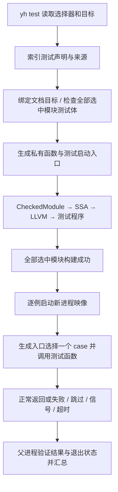

# yh test 语法块执行模型（分析提案）

日期：2026-10-23。状态：**YT0 语法与 YT1 发现/无运行检查已实施；执行模型尚未实现**。
承接[语言内测试设计](yh-test语言内测试设计-2026-10-23.md)，保留字符串行为测试、
标识符文档测试及统一 `$assert`。本文伪代码仅解释生成结构，不是可直接编译的 yh。
当前编译器识别并索引 test 声明，`yh test --list` 完成发现与文档目标绑定，
`yh test --no-run` 以临时函数上下文检查测试体语义；生产构建仍跳过测试体。
下文持久函数降低、运行时断言和逐例调度属于 YT2。

## 1. 执行单位与时机

test 是顶层声明，块体按“无参数、返回 void 的模块私有函数”编译。解析到声明
时只登记，不立即执行；普通程序启动时也不自动执行。只有 `yh test` 生成并
启动测试程序，才会运行其机器码，无须为 test 另造一个运行时解释器。

```yh
// addOne 返回输入值加一后的结果。
fn addOne(value int) int {
    return value + 1
}

test addOne {
    let actual int = addOne(41)
    $assert(actual == 42, "加一结果错误")
}
```

这里运行的是花括号中的语句；addOne 是文档关联目标，不是隐式调用。
块中显式写出的 `addOne(41)` 才会发起被测函数调用。`test "加一"` 采用相同
执行路径，只是没有关联声明。局部变量、for、if、switch、goto 等沿用函数规则。
正常走到块尾或执行 `return` 均为测试体正常返回；不强制每例至少写一个断言，
所以空块也是合法的成功用例。函数内不能嵌套 test，测试之间不能按名字互调。

## 2. 一条完整执行链



建议在所有选中模块的测试程序均编译、链接成功之后才执行第一例。任一语义、
编译期求值或链接错误都直接终止本次构建，不先运行一部分用例再发现构建错误。
测试运行失败则继续其他用例；这两种失败不能混为一种阶段。

`--list` 停在语法发现；不保证目标绑定或类型正确。`--no-run` 停在构建成功。
过滤决定哪些 case 执行，不跳过所选模块其他测试体的语义检查及必要编译期求值。

## 3. 前端怎样表示 test

声明索引先记录名字种类、名称 token、所属文件、块体范围与声明位置。
模块 pass1 登记全部普通声明与测试记录，随后解析 `test addOne` 的目标绑定，
从而支持声明写在测试后方，以及同模块跨文件私有声明。

每个测试记录至少关联以下事实；这是拟新增元数据，不是现有结构字段：

| 事实 | 用途 |
| --- | --- |
| 所属项目/模块、相对路径、源码顺序 | 发现、稳定排序与 case 身份 |
| 名称种类 test/decltest、显示名称 | 区分行为测试与文档测试、列表与过滤 |
| 关联声明身份（可空） | 文档关联；不决定运行函数 |
| 测试体的内部函数身份与根语句 | 调用、类型检查和后续 lowering |
| test 来源位置、断言来源位置/文本 | 失败报告与缓存重放 |
| 执行阶段为测试运行期 | 与既有编译期诊断分流 |

测试体捕获为受检 AST，然后按普通函数路径降低。内部函数名由编译器身份表
生成，不允许用户源码引用，也不能与用户函数同名碰撞。生成的本地分派表
持有函数身份，确保未被业务代码引用的测试也不会被死代码消除。

关键限制：不能把块体简单改名为普通 fn 后丢掉测试身份。否则现有前端会把
其中的 `$assert` 当作编译期诊断。身份、来源和断言节点必须保留到自有的
CheckedModule；后续不能依赖解析器的临时全局状态或已经释放的源文件缓冲。

## 4. `$assert` 怎样成为运行时指令

现有普通函数中的 `$assert` 在前端要求 bool 编译期常量并触发诊断；test 体
的新路径须取消这个常量要求，保留 bool 检查，捕获条件与来源，形成明确的
“测试运行时断言”受检语句。不能复用会被 lowering 当成已执行语句跳过的
编译期诊断节点，也不能在解析 test 时调用现有 `ct_diag_emit` 判定成败。

在 SSA 层不需要新增一套测试指令：把该语句降低为普通条件分支、报告调用
和不返回的失败路径即可。概念展开如下：

```text
actual = call addOne(41)
ok = (actual == 42)                 // 条件只求值一次
branch ok, continue, failed

failed:
    report FAIL(case_id, assert_id) // 位置、条件文本和消息可按 id 查询
    terminate current process      // 不返回，不跳回测试体

continue:
    execute next statement
```

失败报告/终止函数须在 IR 中体现不返回，并终结失败基本块。失败后不能继续
解引用无效值，也不能走到外层包装的 PASS。LLVM 可将 `$assert(false)` 优化成
必走失败路径，但不能将它变成编译错误；`--no-run` 仍可成功构建这类测试。
未选中的普通 if 分支不执行断言，短路与条件副作用遵守现有表达式语义。

阶段按词法上下文固定：普通 helper 内 `$assert` 仍是既有编译期规则，不因
从 test 调用而改变；内联优化也不能改变其阶段。test 中 `$if/$for` 先按既有
编译期规则选分支/展开，保留下来的 test 断言再运行；显式 `$函数(...)`
调用内部的编译期断言则仍可使构建失败。应由前端确定阶段，后端不猜测。

## 5. 谁调用测试函数，原 main 怎么处理

每个被测模块生成一个测试程序；其中含该模块普通定义、所有测试私有函数、
本地分派入口以及活动依赖的生产对象。私有声明无需导出，因为被测代码和
测试体在同一模块内一起编译；同一程序不再链接另一份该模块生产对象。
依赖模块既不重复装入被测模块，也不带入它们自己的测试。

编译器生成的入口概念如下：

```text
test_program_entry(case_id, report_channel):
    validate case_id and initialize report context
    call private_test_function[case_id]()
    report PASS(case_id)             // 仅在测试函数正常返回之后
    exit 0
```

生成入口及包装在受检/IR 验证之前进入编译流水线，不能在验证后直接拼接未经
检查的 LLVM 文本。测试私有函数不进 `.s.i`，无需新增语言层面的 pub 注册表。
只有启动入口需要满足目标启动 ABI；报告运行时遵守编译器内部 ABI，不扩展
用户模块的测试导出面。没有用户 main 的库模块也能生成测试程序。

原业务 main 必须与生成入口分离：源码名字绑定仍指向原声明，测试变体为它
分配独立链接身份；内部递归、取地址等引用统一使用该身份。运行测试不自动
调用原 main；用例若显式调用它则按普通函数执行。不能只改一处输出字符串，
也不能仅把文件标为“非入口”就假定所有 main 名称特例均已消失。

## 6. 多个用例怎样运行与判定

假设一个模块有三例，父进程执行的是以下私有调度过程；不是三个用户命令：

```text
编译 module → module_test_program             // 一次构建
启动 module_test_program，选择 case 0 → 等待 → PASS
启动 module_test_program，选择 case 1 → 等待 → FAIL
启动 module_test_program，选择 case 2 → 等待 → PASS
汇总 2 passed，1 failed，yh test 返回 1
```

启动采用新 exec 映像而非在编译器进程内执行函数指针。这样每例的全局变量与
分配器状态重新初始化，某例失败或崩溃不会破坏父进程及下一例的内存状态。
文件、网络、共享服务与遗留后代进程不会因此自动恢复，须明确清理责任。
首版串行，不在测试执行期间修改生产构建产物或共享闭包缓存。

父进程为每例准备独立结果通道与日志。最终记录至少带协议版本、case 身份
及 PASS/FAIL/SKIP，断言失败还带断言身份；记录不是从 stdout 文本猜测出来。
一个用例只能产生一个有效终态，父进程同时校验退出/信号与记录是否一致。

| 子进程结果 | 父进程处理 |
| --- | --- |
| 正常返回，有合法 PASS，正常成功退出 | PASS |
| `$assert` 或 testing.fail 报告失败并按失败约定退出 | FAIL，继续下一例 |
| testing.skip 报告理由并按跳过约定退出 | SKIP，继续下一例 |
| 提前 exit(0)、结果缺失/损坏/身份不符 | FAIL，不能误算通过 |
| 信号、启动失败、超时或终态与退出状态冲突 | FAIL，记录原因，回收后继续 |

普通 `return` 返回到包装并得到 PASS；`exit(0)` 直接终止进程，包装没有机会
写 PASS，故算异常提前结束。断言中止整个当前用例进程，不做语言异常展开，
也不保证执行失败点之后的手工资源清理。计时和等待在父进程，超时清理与
继承输出描述符不能让 runner 无限等待。

## 7. 与当前代码的接点与尚缺能力

| 当前接点 | 现有行为与拟议工作 |
| --- | --- |
| [PDecl](../../compiler/gen/model.yh) / [parse_decl](../../compiler/parse/parse_decl.yh) | YT0 已把 test 纳入顶层范围索引；YT1 在 `cmd/test_cmd.yh` 建立测试身份并绑定文档目标 |
| [parse_comptime](../../compiler/parse/parse_comptime.yh) / [parse_stmt](../../compiler/parse/parse_stmt.yh) | 已有编译期断言检查与立即诊断；YT0 在生产构建只对 test 体做语法解析，运行时断言分流仍待 YT2 |
| [CheckedModule](../../compiler/ast/module_snapshot.yh) / [check](../../compiler/check/checked_module.yh) | 自有受检函数、语句与来源；需保存并验证测试/断言事实 |
| [lowering](../../compiler/ast/module_snapshot_lower.yh) / [LLVM 流水线](../../compiler/cmd/llvm_pipeline.yh) | 已有函数降低和对象生成；复用普通分支/调用，补测试入口身份 |
| [main 检查](../../compiler/gen/sem_decl.yh) | 有必需/可选 main 检查；还需独立测试启动入口及统一链接重绑定 |
| [process](../../compiler/cmd/process.yh) / [scheduler](../../compiler/cmd/build_scheduler.yh) | 已有 fork/exec、日志重定向与非阻塞等待；尚无测试结果协议和逐例超时 runner |

测试阶段、断言节点版本与入口身份属于编译语义环境，必须进入生产/测试
隔离和函数级缓存规则。不能复用已经按编译期诊断消费过 `$assert` 的旧受检
切片；首版可暂不缓存合成测试函数与入口，不必为此重写现有函数缓存系统。
运行时失败记录按稳定来源 id 关联源码，O0/O2 均需验证其时机和来源一致。

以上是代码阅读后的实现方向，不是执行验证。实施仍按[分阶段方案](../02-plan/yh-test分阶段实施方案-2026-10-23.md)
推进，先添加 `.yh` 正反与故障用例，再构建并跑本平台门禁。

## 8. 同一组用例与 Zig 实测对照

2026-10-23 本机 Zig 版本为 **0.16.0**。参考
[官方测试声明与失败行为](https://ziglang.org/documentation/0.16.0/#Zig-Test)，
实际运行三例：文档测试通过、故意写错期望失败、后续用例通过。
yh 部分仍是提案输出，未执行；不能把两者的验证状态混写。

拟议 yh 文件 `demo.yh`：

```yh
module demo

// addOne 返回输入值加一后的结果。
fn addOne(value int) int {
    return value + 1
}

test addOne {
    $assert(addOne(41) == 42)
}

test "故意写错期望" {
    $assert(addOne(0) == 2, "零加一应为一")
}

test "失败后继续执行" {
    $assert(addOne(-1) == 0)
}
```

拟议命令 `yh test demo.yh`，预期输出与退出码：

```text
PASS demo::demo.yh::decltest::addOne
FAIL demo::demo.yh::test::故意写错期望
  断言位置: demo.yh:13:5
  $assert(addOne(0) == 2)
  消息: 零加一应为一
PASS demo::demo.yh::test::失败后继续执行
结果: 2 passed; 0 skipped; 1 failed
```

预期退出码为 1。第二例的函数实现没有错，是测试故意将 1 的期望写成 2。
失败结束第二例，不能结束整个 runner；第三例仍须运行。

对应 Zig 文件 `demo.zig`：

```zig
const std = @import("std");

/// addOne 返回输入值加一后的结果。
fn addOne(value: i32) i32 {
    return value + 1;
}

test addOne {
    try std.testing.expect(addOne(41) == 42);
}

test "故意写错期望" {
    try std.testing.expect(addOne(0) == 2);
}

test "失败后继续执行" {
    try std.testing.expect(addOne(-1) == 0);
}
```

运行 `zig test demo.zig` 的实测输出摘录（省略地址、绝对路径和堆栈）：

```text
1/3 demo.decltest.addOne...OK
2/3 demo.test.故意写错期望...FAIL (TestUnexpectedResult)
3/3 demo.test.失败后继续执行...OK
2 passed; 0 skipped; 1 failed.
error: the following test command failed with exit code 1:
```

实际命令在仓库根执行，使用 tmp 内样例并显式限制缓存目录：

```bash
zig test tmp/yh-test-comparison-2026-10-23/demo.zig \
  --cache-dir tmp/yh-test-comparison-2026-10-23/cache \
  --global-cache-dir tmp/yh-test-comparison-2026-10-23/global-cache --color off
```

命令实测退出码 1，属于故意断言失败的预期结果。未运行 yh 构建或主门。

| 比较项 | yh 提案 | Zig 0.16.0 |
| --- | --- | --- |
| 声明形式 | 字符串名称、标识符文档测试 | 两种均支持 |
| 基本断言 | 编译器处理 `$assert`，无导入、无 try | 标准库 expect 返回错误，try 将错误返回 runner |
| 当前用例失败 | 报告并结束当前用例子进程 | 本次终端 runner 捕获用例返回的错误 |
| 后续用例 | 父进程继续启动下一例 | 继续调用下一例，实测第三例通过 |
| 输出诊断 | 计划报告断言位置、条件文本、可选消息 | 实测报告 TestUnexpectedResult、位置及错误返回跟踪 |
| 实现状态 | 尚未实现，上述为预期输出 | 本机实际执行，2 通过 / 1 故意失败 |
