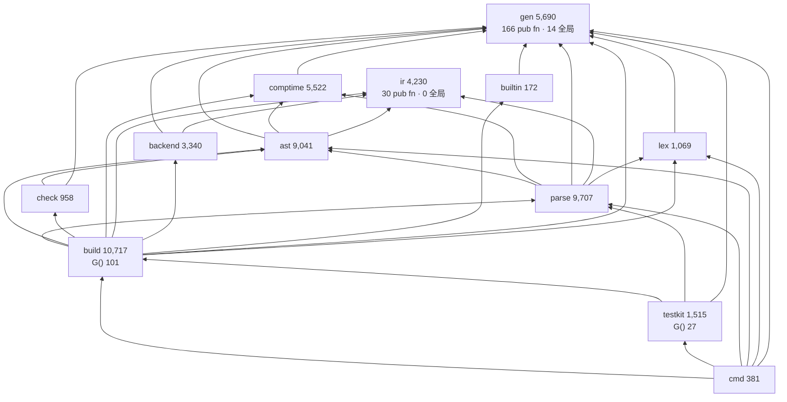

# yh 当前架构重新分析

日期：2026-10-25
性质：**以代码为准的架构复核**，不改代码、不改种子、不滚种子。
方法：`python3 tools/arch-check.py` 取门禁口径，再对 `compiler/` 逐文件实测
（import 边、符号级耦合、模块级可变 `let`、`pub fn`、状态结构字段数、产物契约常量）。
与既有文档冲突处一律在 §5 列明实测值。

上游文档：[系统架构与长期演进设计](yh-系统架构与长期演进设计-2026-10-24.md)、
[构建态对象化与 build 拆分重新规划](../02-plan/yh-构建态对象化与build拆分重新规划-2026-10-25.md)。

---

## 0. 结论速览

| # | 结论 | 证据 |
|---|---|---|
| C1 | 分层**方向正确且无环**，但形状是「**一个共享内核 + 一个 10.7k 单体的构建引擎**」，不是三层均质结构 | 33 条边全在 `ALLOWED` 内，`arch-check` 通过；`build` 占编译器 20.5% 行数 |
| C2 | 真实耦合面不在 import 条数，而在**符号数**：`parse → gen` 依赖 **272 个符号**、`ast → gen` 121 个。`gen` 是事实内核，却没有内部分层 | §2.3 |
| C3 | 10-24 设计里的 S1（驱动未分离）**已还掉一半**：`cmd` 从 24 文件 12,502 行降到 **2 文件 381 行**（0.7%），负载搬进 `build`/`testkit` | §1.2、§5 |
| C4 | 剩下三块欠账仍是 S2（状态进程级）、S3（契约版本分散）、以及 R4（对象级增量未落地）；**S1 的残余全部落在 `build` 内部** | §3 A1/A5/A8 |
| C5 | 有一类**没进任何计划的结构性欠账**：`gen` 导出面 436 个 `pub fn`、183 个模块级可变 `let`、`G()` 165 个读点，三者同源，却不在 B1/B2/B3 任何一项的验收门里 | §3 A3 |
| C6 | 文档与代码已实质漂移：`compiler/README.md` 提到的 76 个路径有 **14 个已失效**（全在 `cmd/`），116 个文件有 **54 个未收录**；`AGENTS.md` 仍写 8 个模块 | §3 A4 |
| C7 | 建议顺序：**D0 文档同步（当天）→ B3 → B1 → B2**，并把 `gen` 内部分层、契约登记、`testkit` 解耦各立独立议题，不要塞进本轮拆分 | §4 |

---

## 1. 实测基线

### 1.1 规模（`make arch-check`，2026-10-25）

| 指标 | 实测 |
|---|---|
| 模块 / 文件 / 代码行 | **12 / 116 / 52,342** |
| 依赖边 | 33（无环，全部在 `ALLOWED` 内） |
| 最大文件 | `build/module_build.yh` **2,242** |
| 最大函数 | `build/link_cache.yh:775` `mb_link` **674** |
| 模块级可变 `let` | **183** |
| `gen.G()` 读点 | **165**（build 101 · testkit 27 · parse 21 · main 5） |
| 未判空 `malloc` / 未接线 `pub` | 0 / 0 |
| 容量安全追加点 | 45（下界，只增不减） |

### 1.2 模块分工与体重

| 模块 | 文件 | 行数 | 模块级 `let` | `pub fn` | 全部 `fn` | `G()` | 实测职责 |
| --- | ---: | ---: | ---: | ---: | ---: | ---: | --- |
| `gen` | 14 | 5,690 | 14 | **166** | 201 | 2 | 词法常量、类型/符号表、语义表、缓冲/诊断、`TaskCtx`/`GenState`、目标描述符、ABI 分类 |
| `parse` | 13 | 9,707 | 19 | 20 | 209 | 21 | 语法 + **语义分析**（两遍声明处理）+ 接口读写 + CT 布局解析 + 插值合成 |
| `ast` | 24 | 9,041 | 42 | 63 | 243 | 2 | AST arena + `CheckedModule` 快照 + **SSA lowering 5,742 行** |
| `build` | 22 | 10,717 | 50 | 52 | 273 | **101** | 项目扫描/索引/导入绑定/拓扑/调度/模块发射/缓存/链接/TOML/进程/时钟 |
| `comptime` | 13 | 5,522 | 49 | 72 | 191 | 3 | 编译期登记 + typed IR 执行器 + 布局图 + 静态数据 |
| `ir` | 9 | 4,230 | 0 | 30 | 117 | 0 | SSA 模型、验证、序列化、函数级缓存/重绑定 |
| `backend` | 12 | 3,340 | 0 | 19 | 120 | 0 | IR → LLVM 文本、ABI/HFA 分类、运行时、桥绑定 |
| `testkit` | 1 | 1,515 | 9 | 1 | 44 | 27 | `yh test` 的发现/绑定/降低/执行 |
| `lex` | 3 | 1,069 | 0 | 2 | 28 | 1 | 词法器 + 布局 + 插值词法 |
| `check` | 2 | 958 | 0 | 2 | 17 | 3 | **只读一致性校验**（不是语义分析） |
| `cmd` | 2 | 381 | 0 | 7 | 13 | 5 | CLI 参数映射 + 调用面 |
| `builtin` | 1 | 172 | 0 | 2 | 3 | 0 | prelude 登记表 |
| **合计** | **116** | **52,342** | **183** | **436** | **1,459** | **165** | |

两个立即可见的形状问题：

1. **`build` 一个模块 = 项目模型 + 调度 + 发射 + 链接 + 平台适配 + TOML**，
   10,717 行占编译器 20.5%，且持有 101 个 `gen.G()` 读点（全仓 61%）。
2. **`cmd` 已经瘦到 0.7%**，10-24 设计里「`cmd` 24 文件 12,502 行、过载」的描述
   已过期。负载没有消失，而是整体搬到了 `build` 与 `testkit`。

### 1.3 依赖图（实测 33 条边）



读数：

- **`gen` 入度 10、出度 0，`ir` 入度 4、出度 0** —— 两个依赖根，边界成立
  （`ir`/`backend` 的 `G()` 均为 0，`ir` 连全局 `let` 也是 0）。
- **`build` 入度 2（`cmd`、`testkit`）、出度 9（除 `cmd`/`testkit` 外全部）** ——
  它是唯一的「装配层」，同时是唯一读 9 个模块内部符号的地方。
- **`check → ast` 是「校验」而非「分析」**：`check` 只读 arena 与快照，
  真正的语义检查仍在 `parse` + `gen.sem_*`。命名误导已在 10-24 文档记为
  「命名误导」，本轮仍未改。

### 1.4 符号级耦合（比 import 条数更能说明问题）

按 `模块.符号` 实测去重计数（剔除注释）：

| 边 | 去重符号数 | 代表符号 |
| --- | ---: | --- |
| `parse → gen` | **272** | `TK_*` 词法常量、`CType`/`CSym`、`ATTR_*`、`sem_*`、`G()` |
| `ast → gen` | 121 | `CType`/`CSym`、`F_*` 标志、`append_*`、`G()` |
| `lex → gen` | 107 | `TK_*`、`G()`、`GenState` |
| `comptime → gen` | 106 | `CType`、`F_*`、`CT_DIAG_*`、`sem_*` |
| `ast → ir` | 98 | `IRBlock`/`IRFunction`/`IRModule`/缓存类型 |
| `backend → ir` | 79 | `IRInst`/`IRCall`/`IRModule` |
| `parse → ast` | 69 | `AST_EXPR_*`/`AST_STMT_*` 节点种类 |
| `parse → comptime` | 67 | `CtFunction`/`CtValue`/`ct_call` |
| `build → gen` | 56 | `PFile`/`PMod`/`PDep`、`G()`、`fail` |
| `check → gen` | 42 | `CType`/`CSym`/`F_*` |
| `testkit → build` | **28** | `mb_link`、`mb_build_dir`、`mb_fnv`、`cmd_mkdirs`、`cmd_clock_ns` |

三条判断：

1. **`gen` 实际上就是「编译器的标准库」**：`parse` 一次性依赖 272 个符号，
   其中约一半是 `TK_*`/`TARGET_*`/`F_*` 常量（可接受），另一半是类型模型与
   `sem_*` 语义函数（**这是真正的耦合**）。`parse` 之所以重，不是语法复杂，
   而是它同时是语义分析器 —— 这与 10-24 文档 R5「数据模型与变换混层」是同一个病。
2. **`testkit → build` 的 28 个符号里有 `mb_link` 与 `mb_build_dir`** ——
   测试执行器越过 `build` 的公开面直接用了构建引擎的产物路径与链接函数。
   这不是 import 环，但是**分层泄漏**，`build` 任何内部改名都会打到 `testkit`。
3. **`build` 的 56 个 `gen` 符号里有 `PFile`/`PMod`/`PDep` 这些"项目表类型"** ——
   项目模型的定义在 `gen`、使用者与唯一写者在 `build`，这正是 10-25 规划
   判定的「跨模块错位」，B1（`proj`）要解的就是这条。

---

## 2. 实际运行架构

### 2.1 一次项目构建的真实路径

```
argv ──▶ cmd/driver.yh（只做参数 → 请求映射）
     ──▶ cmd/api.yh（单文件 / 项目两组调用面，返回 0/1/2/-1）
     ──▶ build：发现根 → 扫描源根 → 模块索引 → TOML schema → 三层来源解析
              → 导入绑定 → 拓扑排序 → 有界调度
     ──▶ fork worker（并发上限 4，COW 继承只读项目快照）
              lex ─▶ parse 两遍（pass1 签名 / pass2a 全局 / pass2b 函数体）
                  ─▶ gen.sem_*（语义表、类型布局、常量折叠）
                  ─▶ ast 捕获 CheckedModule（arena + 绑定 + 快照）
                  ─▶ check 只读校验（11 个失败阶段 → 既有诊断）
                  ─▶ lower：CheckedModule → ir.IRModule（按函数命中缓存）
                  ─▶ backend：IRModule → LLVM 文本
                  ─▶ 内嵌桥 → .o，原子 rename 发布
              ─▶ 发布模块接口 .s.i / .s.ct / ready
     ──▶ 父进程：waitpid 轮询 → 提交 manifest → 链接
     ──▶ link：内嵌 lld（Linux/Darwin 共用闭包文件）+ 平台驱动 → 可执行
```

三个约束决定了这套形状，且都不是"可以随手改"的：

| 约束 | 内容 | 证据 |
| --- | --- | --- |
| 模块内**按文件名序**编译 | 类型必须先声明后使用，文件序即声明序 | `ir/` 的 `00/10/20/30/40/50` 编号、`ct_00_model`；10-25 规划把它列为 K1 |
| 并发单位是**进程**不是线程 | `fork()` + `waitpid` 轮询，COW 隔离，**无锁** | `build_scheduler.yh:59/347` |
| `pub` 同时决定 `.s.i` 接口与 `.globl` | 补一个 `pub` 会同时改接口与符号可见性，触发下游对象键全变 | `AGENTS.md` 模块导出面规则 |

### 2.2 三层缓存（已落地的部分）

| 层 | 产物 | 键 | 状态 |
| --- | --- | --- | --- |
| 模块接口 | `.s.i` / `.s.ct` / `ready` | 源内容 + 接口版本区间 + 目标 + 符号后缀 | **已用**：InterfaceReady 调度，提供方不必等函数体完成 |
| 函数 check 切片 | `.fchk` + `index.check` | 函数 token 流 + 布局/签名事实 | **已用**：`firc_check_load`（`module_worker.yh:316`） |
| 函数 IR | `.fir` + `index` | 同上 + 环境键 | **已用**：`firc_load`/`firc_commit`（`:397`/`:413`） |
| 对象/链接 | `obj/<tag>.o`、最终程序 | 内容哈希 + 编译器指纹 + 闭包身份 | **已用**：`link_cache` |
| 文件级对象 | — | — | **未落地**：仍按模块发一个 `.o`，单函数改动要重跑整模块代码生成 |

一个具体的遗留：`module_worker.yh:110` 明写「参数 `out_dir`/`ir_cache_salt`
是**旧按文件汇编路径的遗留，待 C2 清理调用链**」。也就是说，文件级汇编目录
的**参数链还在**，只是语义已废 —— 属于「拆分没拆干净」的残留，不是功能。

### 2.3 自举与产物契约

```
bin/yh-darwin-arm64（70 MB，SHA-256 入库的只有哈希，种子本身 gitignore）
  ── yh build compiler/ ──▶ cc2 ──▶ cc3 ──▶ cc4
  门：cc3/cc4 的模块 .s/.s.i 逐字节相同（固定点）
```

- **仓库无法独立重建编译器**：没有 C 版 stage0，正确性由「固定点 + 语料」保证，
  git 历史承担每一代种子的存档职责。
- **LLVM 闭包不烘焙进种子**：`make llvm-host` 在构建机生成
  `selfhost-flags.txt`，`make seed` 会拒绝仍带构建机 `$HOME` 路径的种子。
- **契约版本是五处独立常量，没有统一登记表**：

| 契约 | 常量 | 当前值 | 位置 |
| --- | --- | ---: | --- |
| 模块接口 | `IFACE_VERSION_MIN/MAX` | 1–3 | `parse/iface.yh:436` |
| 编译期接口 | `CTIFACE_VERSION` | 1 | `parse/iface.yh:438` |
| SSA 函数编码 | `IR_SERIAL_VERSION` | 9 | `ir/ssa_serialize.yh:4` |
| 模块 IR 编码 | `IR_MODULE_SERIAL_VERSION` | 3 | `ir/ssa_module_30_serialize.yh:62` |
| 函数缓存 | `IR_FUNCTION_CACHE_VERSION` | 1 | `ir/ssa_module_40_function_cache.yh:21` |

读取端各自校验、各自拒绝，**升级一处不影响其余四处的提示路径** —— 这是
S3「契约未版本化」的剩余形态：不是没有版本号，而是**没有统一入口**。

### 2.4 复合体边界

| 部分 | 规模 | 与编译器的关系 |
| --- | --- | --- |
| `compiler/` | 116 文件 / 52,342 行 | 编译器本体，单二进制，含构建引擎与链接驱动 |
| `libs/` | 15 库 / 104 文件 / 24,069 行（`cli` 11,120 独占 46%） | 独立 `project.toml` 项目，经 `YH_STDLIB` 与三层来源解析接入 |
| `tests/` | 1,077 文件（`yh-run` 360、`modules` 278、`yh` 130、`selfhost` 24、`perf` 25） | 门禁语料，与编译器同语言 |
| `tools/` | 32 文件（`arch-check.py`、`link-closure.py`、`*tests*.py`） | 门禁与工具 |
| CI | Gitea Actions 双 workflow（分支门 + 发布） | 多平台回归与 Release |

值得记的一句：**编译器二进制里装着一个构建系统**（TOML 解析、目录扫描、
进程管理、lld 驱动都在 `build/`）。好处是「一个 `yh` 走通全部」，代价是
`yh` 无法作为库被别的程序内嵌 —— LSP/IDE 只能通过子进程协议（`--emit-module`）
接入。这是 10-24 文档 `Session`/`api` 议题的真实动机，本轮不做。

---

## 3. 结构性问题（证据 → 影响 → 归属）

### A1 `build` 单体：10,717 行 / 2,242 行单文件 / 674 行单函数 / 101 个 `G()` 读点

- **证据**：§1.2 表；`module_build.yh` 同时含哈希、构建目录布局、标签、
  依赖拓扑、两遍文件处理、manifest、stdlib 装载、CLI 命令；
  `link_cache.yh` 的 `mb_link` 674 行、20+ 处 4 连 `free` 错误分支。
- **影响**：新增「包管理来源 / 构建图导出 / 增量报告」只能改这一个模块，
  且它 61% 的读点走 `gen.G()`，没有可独立测试的面。
- **归属**：**已规划** —— 10-25 规划的 B1（`proj`）+ B2（`link` 抽离、`mb_link` 阶段化）。
  本轮不重复设计，只确认其数字仍然成立（10,717 / 2,242 / 674 与规划一致）。

### A2 `ast` 混层：24 个文件里 15 个是 lowering

- **证据**：`module_snapshot_lower*.yh` + `ast_ir*.yh` + `ctx/forin/global/static/template`
  共 5,742 行；`ast` 仅剩 3,297 行是纯 AST/快照/切片。
- **影响**：`ast` 是「前端数据结构」与「到 IR 的变换」两种职责同模块，
  表现为 `ast → ir` 98 个符号依赖、`check_slice` 里 1,214 行的离线等价性探针。
- **归属**：**已规划** —— B3（`lower` 独立成模块）。10-25 规划已把规模从
  10 文件/4,739 行修正为 **15 文件/5,742 行**，实测一致。

### A3 `gen` 无内部分层：436 个 `pub fn`、183 个模块级 `let`、165 个 `G()` 读点

- **证据**：§1.2 与 §1.4。`gen` 单模块 5,690 行里混了五类东西：
  词法常量、类型/符号表、语义函数（`sem_*`）、缓冲与诊断原语、目标/ABI 描述符。
  `parse` 一次依赖 272 个符号，`ast` 121、`lex` 107、`comptime` 106。
- **影响**：这是本轮**唯一没有对应任务**的欠账。
  ① 任何新增前端能力都要在 `gen` 加 `pub`，导出面只增不减（`arch-check` 只守
  「未接线 pub」和行数，不守导出面结构）。
  ② 183 个模块级 `let` 里 `parse` 19 / `comptime` 49 / `ast` 42 / `testkit` 9
  是**前端私有但跨文件可见**的可变状态，全靠命名前缀（`if_*`、`ct_*`、`tc_*`）
  维持纪律，编译器不检查。
  ③ `G()` 165 个读点的真实病灶是**字段读次数**（10-25 规划实测 1,550 次），
  不是调用点数 —— 所以「加窄口」必然本末倒置，这一点规划已经论证过。
- **归属**：**未规划**。建议单独立项（§4 D1），本轮**不要**塞进 B1/B2/B3，
  否则固定点排障面会从「三类改动」变成「四类」。

### A4 文档与代码漂移（可量化）

| 文档 | 漂移 | 量化 |
| --- | --- | --- |
| `compiler/README.md` | 模块表仍写 `cmd/module_build.yh`、`cmd/llvm_emit.yh`、`cmd/link_cache.yh` 等；正文写「十个模块、114 个 `.yh`」 | 提到的 **76 个路径里 14 个已失效**，116 个文件里 **54 个未收录** |
| `AGENTS.md` | 「编译器源码在 `compiler/`（gen/lex/parse/ast/comptime/cmd/ir/backend 多模块）」 | 实际 12 个模块，少 `build`/`check`/`builtin`/`testkit` |
| `build/llvm_emit.yh` 头注释 | 「共用驱动在 `cmd/llvm_pipeline.yh`」 | 该文件现在在 `build/` |
| `parse/parse_decl.yh` 头注释 | 「编译模式的限制（B5 子集，B7 解除）：切片、for-in、结构体字面量作值、结构体按值传参/返回、类型化变参、浮点运算」 | 这些语义 README 已列为「已实现」，注释是旧状态 |
| `docs/todo.md` 基线表 | 12 / 114 / 51,484 | 实测 12 / 116 / 52,342 |

- **影响**：新人按 README 找文件会**找进不存在的 `cmd/`**；注释里的过期限制会
  让人误判语言子集，进而写出多余的规避代码。这类成本不高但持续发生。
- **归属**：**未规划**，但**零风险、当天可完成** → 建议作 D0 先做。

### A5 契约版本分散（S3 剩余形态）

- **证据**：§2.3 五处独立常量。`IFACE_VERSION_MIN/MAX` 已支持区间读取（A1b/A1c
  的成果），但 `IR_SERIAL_VERSION`(9) / `IR_MODULE_SERIAL_VERSION`(3) /
  `IR_FUNCTION_CACHE_VERSION`(1) 各自只有「相等即通过」的判定。
- **影响**：跨代种子、`yh-explorer`、VSCode 扩展都靠隐式一致。不一致时报错位置
  在序列化深处，而不是边界处 —— 对「种子即二进制」的自举体系这是最贵的一类 bug。
- **归属**：**部分完成**（接口侧），IR/缓存侧**未规划**。

### A6 `testkit` 对 `build` 内部符号的依赖（分层泄漏）

- **证据**：`testkit → build` 28 个符号，含 `mb_link`/`mb_build_dir`/`mb_fnv`/
  `mb_module_obj_row`；`testkit` 自身 1,515 行、9 个模块级 `let`、27 个 `G()` 读点。
- **影响**：`build` 拆模块（B2）时 `testkit` 会被动改 28 处；反过来 `testkit`
  的任何需求也会顶到 `build` 内部。
- **归属**：**未规划**，但**与 B2-1（art 抽进 `proj`）天然同步** ——
  产物路径与键一旦进 `proj`，这 28 个里至少 6 个应改为 `proj.*`。

### A7 平台适配靠文件名三份复制

- **证据**：`clock.{darwin,linux.arm64,linux.x64}.yh`、
  `project_dir.{darwin,linux.arm64,linux.x64}.yh`；筛选规则在
  `project_index.yh` 的 `pj_target_tag_is`（按目标标签匹配文件名段）。
- **影响**：机制是对的（编译期按目标选文件，不是 `#ifdef`），但**新增一个平台
  要写第三份同类文件**，且三份之间没有共享声明头。当前 3 平台 × 2 组 = 6 个文件，
  尚可维护；一旦加 Windows 就是 4 份。
- **归属**：**不紧急**，但应在「换平台第一步是 `gen/target.yh`」这条既有认知旁
  记一笔：第二步就是这两组文件的复制。

### A8 增量粒度停在函数级 + 一条废参数链

- **证据**：函数级 check 切片与 IR 缓存已接入（§2.2），文件级对象未落地；
  `module_worker.yh:110` 自述 `out_dir`/`ir_cache_salt` 是遗留待清。
- **影响**：大型项目的编辑—编译回路被**模块大小**锁死，不是被函数数锁死；
  废参数让「哪些参数还活着」需要读注释才知道。
- **归属**：**已规划**（R4/RS3 在 10-21 重规划里；C2 清理在 `finish.md` 有记录），
  但**不属于 B1/B2/B3**，不要混做。

---

## 4. 建议顺序

### 4.1 五个动作

| 序 | 动作 | 为什么现在 | 规模 | 风险 |
| --- | --- | --- | --- | --- |
| **D0** | 同步四份文档（README 模块表、AGENTS 模块清单、`llvm_emit`/`parse_decl` 过期注释、todo 基线表） | 零代码风险；不修的话后面每个任务都要先解释「README 里那个文件不存在」 | 4 文件 | 无 |
| **B3** | `lower` 独立（15 文件 5,742 行搬出 `ast`） | `ast` 9,041 → 3,297（**−63%**），此后所有 ast 改动都在 1/3 规模上做；环只剩 2 条边（3 个 hash helper + 1 个探针） | 5,742 行迁移 · 4 个 `pub` | 中（文件名序 K1） |
| **B1** | `proj`（项目表 + 目标/配置 + `pj_canon` 显式出参） | `build` 的 56 个 `gen` 符号里项目表类型是最大一块；B2 的两个硬前置（art、canon）靠它 | ≈1,100 行迁入 · 69 处前缀 | 中高（禁影子字段） |
| **B2** | `link` 独立 + `mb_link` 阶段化 + `module_build` 拆 3 文件 | `build` 10,717 → ≈6,000；单函数 674 → ≤260 | 3,476 行迁移 · 674 行拆分 | 中 |
| **D1** | `gen` 内核分层**立项评估**（只出结论，不动代码） | 436 `pub fn` / 183 全局 / 165 读点是同一病灶，且**当前无任务覆盖**；不评估就会在 B1 之后重新长回来 | 评估文档 | 低 |

D1 要回答的三个问题（供后续排期，不在本轮展开）：

1. `gen` 是否应按 **常量 / 类型模型 / 语义表 / 缓冲诊断 / 目标 ABI** 五片切开？
   切的话 `parse → gen` 272 个符号能落到几个稳定面上？
2. 183 个模块级可变 `let` 里，哪些该进 `TaskCtx`（每任务）、哪些该进新的
   前端私有上下文？判据是「fork 后是否允许子进程各自不同」。
3. `G()` 归零（B1-4 的目标）之后，`gen` 是否还需要对 `parse` 暴露 `GenState`？
   若不需要，`parse` 的 21 个读点可以整体换成窄口，272 个符号里的 `G()` 类
   耦合随之消失。

### 4.2 明确不做

| 项 | 理由 |
| --- | --- |
| 拆 `parse`（9,707 行） | 它是第二大模块，但拆它不改善任何依赖方向，只会和 B3/B1 抢同一批文件。`parse` 真正的问题是「语法与语义混在一起」，那是 D1 的议题，不是搬家能解的 |
| `gen → base + sem` 立即拆 | 10-24 设计已决策「暂不拆」；先做 D1 评估，避免拆完还要按新导出面再改一遍 |
| 线程池 / 线程化 worker | 实测是 fork 进程池，COW 天然隔离，无锁需求。收益未测量，成本极高（`TaskCtx` 传递 + 锁 + 共享状态） |
| 引入 `api` 模块 / `Session` 门面 | 会与 `BuildCtx` 形成两套上下文并存期，违反「一个字段只允许一处存储」 |
| 对象级增量（文件级 `.o`） | 与四块拆分正交，但需要先有 `link` 独立（对象命名与缓存都在 `link_cache`），排在 B2 之后 |

---

## 5. 与既有文档的口径修正

| 项 | 旧文档说法 | 本次实测 |
| --- | --- | --- |
| 模块数 / 文件数 | 10 / 114（10-24 设计、10-25 规划 §1.1） | **12 / 116** |
| 代码行 | 51,578（10-24）/ 51,493（10-25 规划）/ 51,484（todo） | **52,342** |
| `cmd` | 24 文件 12,502 行，占 24.2%，"过载" | **2 文件 381 行，0.7%**，负载已迁 `build`/`testkit` |
| `gen.G()` 读点 | 463（10-24 设计） | **165**（10-25 规划已修正，本次复核一致） |
| 模块级可变 `let` | 189（10-24 设计） | **183** |
| `ir` 行数 | 4,766（10-24 设计） | **4,230** |
| `parse` 行数 | 9,108（10-24 设计） | **9,707** |
| `gen` 行数 | 5,453（10-24 设计） | **5,690** |
| `parse → gen` 耦合 | 未量化 | **272 个去重符号**（本次新增指标） |
| 契约版本 | "契约未版本化"（10-24 S3） | 已有 5 处版本常量，问题是**无统一入口**，不是没有版本号 |

> 口径差异原因：10-24 设计文档写于 A6（`testkit` 抽出）之前，`cmd` 尚未拆分；
> 10-25 规划只统计到 `build` 拆分前。本次为 `llvm` 分支 HEAD `8be0e1a` 的实测值。

---

## 6. 验收与度量

拆分完成后，`make arch-check` 应达到（目标值取自 10-25 规划 §3.1，本次复核仍成立）：

| 指标 | 当前 | B3 后 | B1 后 | B2 后 |
| --- | ---: | ---: | ---: | ---: |
| 模块数 | 12 | 13 | 14 | **15** |
| `ast` 行数 | 9,041 | **3,297** | 3,297 | 3,297 |
| `lower` / `proj` / `link` | — | 5,742 | +≈1,100 | +3,476 |
| `build` 行数 | 10,717 | 10,717 | ≈9,600 | **≈6,000** |
| 最大文件 | 2,242 | 2,242 | 2,242 | **≤900** |
| 最大函数 | 674 | 674 | 674 | **≤260** |
| `gen.G()` | 165 | 165 | ≈64 | **0**（B1-4） |
| 模块级 `let` | 183 | 183 | ≈130 | ≈130 |

驱动命令（本轮未执行，只作复现）：

```bash
python3 tools/arch-check.py          # 基线报告 + 违规即失败
make arch-check                      # 同上（Make 目标）
make && make test && make selfhost-native   # 任一拆分任务的三门
```

---

## 附录 · 本次读数复现

```bash
python3 tools/arch-check.py
```

- 模块表、顶层 `let`、`pub fn`、`G()` 分布：按目录统计 `^let ` / `^pub fn ` / `gen.G()`。
- 依赖边：`^import (\w+)` 去重。
- 符号级耦合：剔除 `//` 注释后匹配 `\b模块\.符号`，按边去重。
- 状态字段：`gen/state.yh` 的 `TaskCtx` = 188、`GenState` = 64。
- 文档漂移：抽取 `compiler/README.md` 反引号内路径，与磁盘比对（14 失效 / 54 未收录）。
