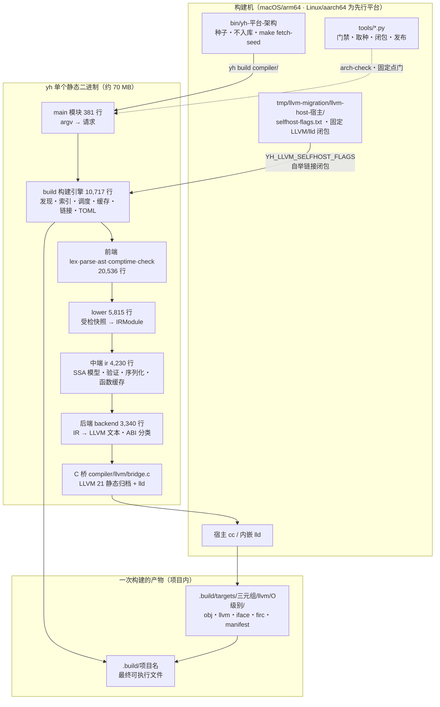
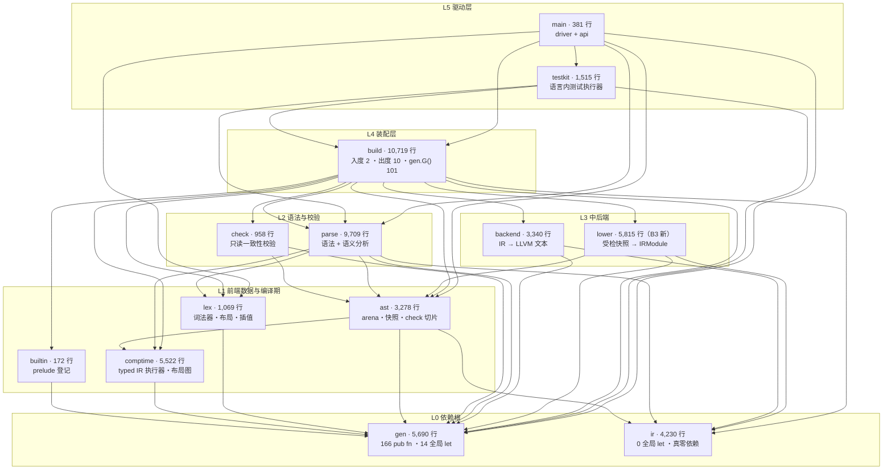
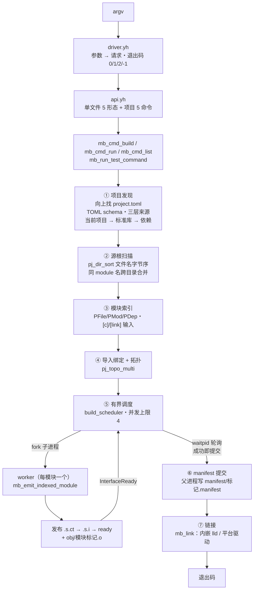
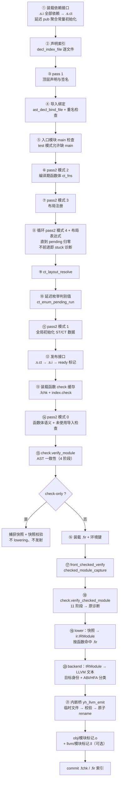
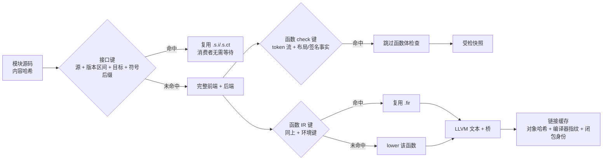
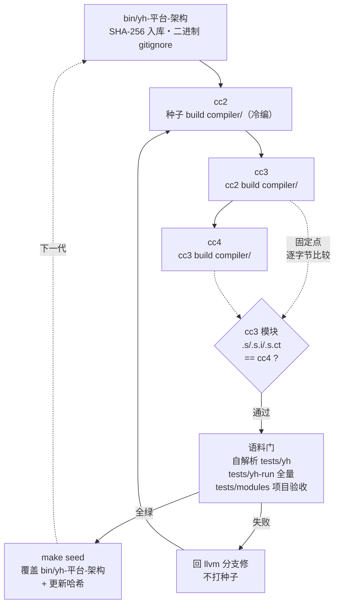
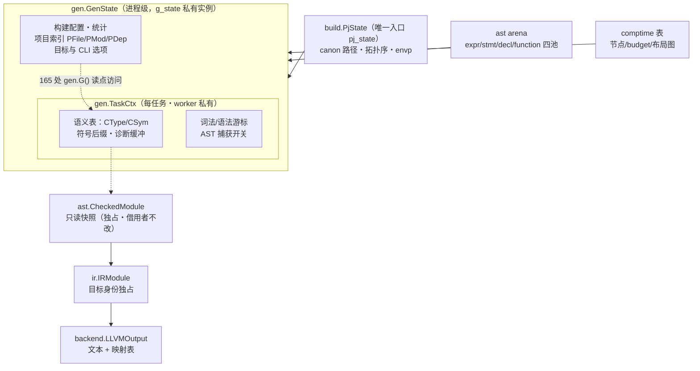
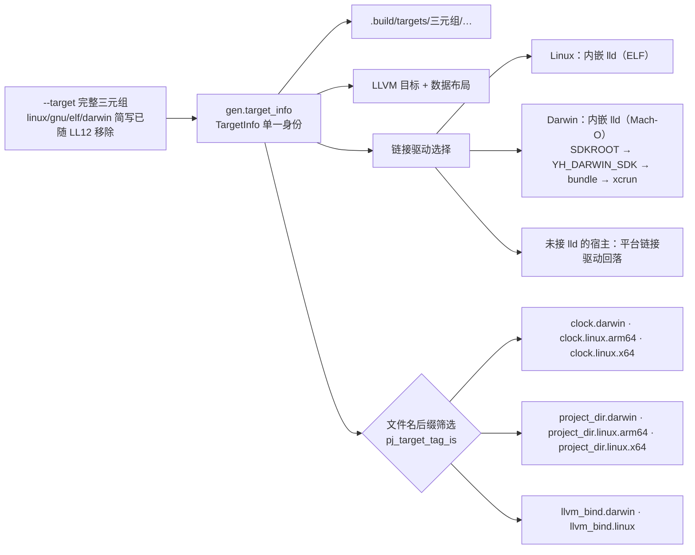
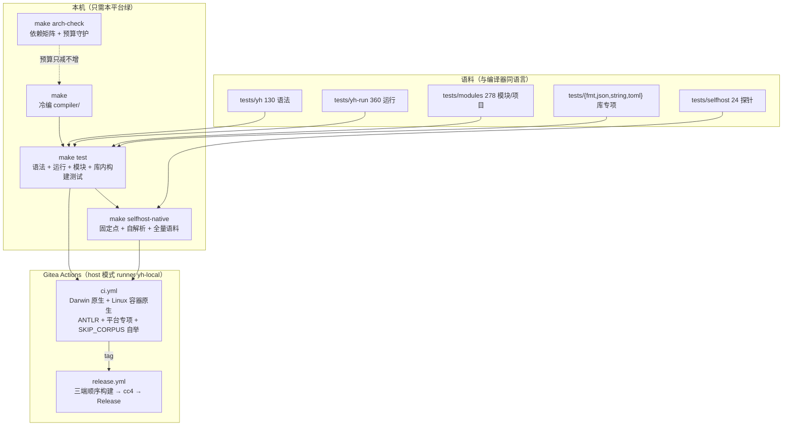

# yh 当前架构图

日期：2026-10-25　分支：`llvm`（HEAD `8be0e1a`）
性质：**只读取证**——不改代码、不改种子。所有数字来自
`python3 tools/arch-check.py` 与对 `compiler/` 的逐文件实测。
配套文字分析见 [当前架构重新分析](yh-当前架构重新分析-2026-10-25.md)，
本文只负责「图」与「读数」。

复现基线（2026-10-25 16:20 工作区实测）：

```sh
python3 tools/arch-check.py    # 13 模块 / 118 文件 / 52,398 行 / 37 边
```

口径说明：本文以**工作区实测**为准——含当日 B3 迁移（`compiler/lower/` 从
`ast/` 拆出，`arch-check` 已登记其依赖面），该迁移**尚未提交**。提交前的
HEAD `8be0e1a` 是 12 模块 / 118 文件 / 52,372 行 / 33 边，差异只在 `ast`
与 `lower` 两行（§10 附注）。

---

## 1. 系统全景：一台自举编译器 + 一个构建系统



读数：

- **编译器二进制里装着一个构建系统**：TOML 解析、目录扫描、进程池、lld
  驱动都在 `build/`。好处是一个 `yh` 走通全部；代价是 `yh` 无法作为库内嵌，
  LSP 只能走子进程协议（`--emit-module`）。
- **没有 C 版 stage0**（0.0.3 起）：仓库无法独立重建编译器，正确性靠
  「固定点 + 语料」，git 历史承担种子存档。
- 链接闭包**不烘焙进种子**（Zig 式）：由构建机经 `selfhost-flags.txt` 提供，
  `make seed` 拒绝带构建机 `$HOME` 路径的种子。

---

## 2. 模块依赖：一个内核 + 一个构建引擎

实测 33 条边（`arch-check` 的 `ALLOWED` 全部命中，无环）。箭头 = 「依赖」，
同一 subgraph 内为同层。



读数：

- **`gen` 入度 11、`ir` 入度 5，两者出度 0** —— 边界成立。`ir` 连模块级
  可变 `let` 都是 0，是可以整块搬走的。
- **`lower` 的分层面是干净的**：只依赖 `gen`/`ir`/`ast`，不 import
  `parse`/`check`/`build`；`ast` 也没有反向 import `lower`（B3 立的约束）。
  `ast` 因此从 9,069 行降到 3,278 行，只剩数据模型。
- **`build` 是唯一装配层**：出度 10，读各下层的内部符号（`build → gen` 56 个），
  同时被 `testkit` 反向吃掉 28 个内部符号（含 `mb_link`/`mb_build_dir`）。
- **真实耦合面看符号数，不看 import 条数**：`parse → gen` 272 个去重符号，
  `lex → gen` 107。`gen` 是事实上的「编译器标准库」。
- **`check` 名不副实**：它只读 arena 与快照做一致性校验，真正的语义检查在
  `parse` + `gen.sem_*`。改名不在本轮范围，图里按实际职责标注。

---

## 3. 一次 `yh build` 的进程结构

并发单位是**进程**不是线程：父进程扫描一次，`fork` 出有界 worker 池，
写时复制继承只读项目快照，**无锁**。



读数：

- **接口先于函数体发布**是并行度的关键：`InterfaceReady` 让消费者不必等
  提供方的私有函数与代码生成完成。
- **子进程重启同一二进制**（`argv0` + `--emit-module`），没有再入库的路径；
  worker 里的参数 `out_dir`/`ir_cache_salt` 是旧按文件汇编链的遗留
  （`module_worker.yh:110` 自述待清）。
- 单文件形态不建项目：`--syntax-check` 只到 `parse`，`-o`/`--emit-asm`
  共享 `llvm_check_single_file` 受检前端。

---

## 4. worker 内单模块编译流水线

一个模块 = 一组按文件名字节序排好的 `.yh`；**文件序即声明序**，所以
`ir/` 用 `00/10/20/30/40/50` 编号、`comptime/` 用 `ct_00_model`。



读数：

- **接口（⑫）先于函数体检查（⑭）发布**，这是并行度的来源：消费者只等
  `.s.i`/`.s.ct`/`ready`，不等提供方的函数体与代码生成。
- **三处可复用的切片**：模块接口、函数 check 切片（`.fchk`）、函数 IR
  （`.fir`）。文件级 `.o` 增量尚未落地。
- **check 与编译共用同一条受检遍历**（`front_checked_*`），`yh check` 只是
  在 ⑮ 之后提前返回，不会长成另一套语义。
- **失败不发布**：对象先写临时文件、校验后 `rename`；缓存提交只在模块完整
  成功后进行，写失败只报告。

---

## 5. 构建目录与缓存层次

```text
<项目根>/
├── .build/
│   ├── <项目名>                        最终可执行文件
│   ├── check/                          yh check 专用（与生产隔离）
│   └── targets/<triple>/llvm/O<级别>/   ← 按目标 × 优化级别隔离
│       ├── obj/<项目-模块标记>.o       内嵌桥直接产出的对象（无 .s 中间产物）
│       ├── llvm/<标记>.ll             --emit-llvm 审阅文本
│       ├── iface/<标记>.s.i|.s.ct|.ready
│       ├── asm/<标记>/<file>.s        遗留目录（旧按文件汇编链）
│       ├── firc/<标记>/index · index.check · <key>.fir · <key>.fchk
│       └── manifest/<标记>.manifest · link-libs.manifest
└── tmp/yh-test/check/                 yh test 的接口/会话文件
```



读数：

- **接口缓存只省前端**：`.s.i`/`.s.ct` 命中让消费者不必等提供方，但链接
  仍需要对象；能否跳过链接由对象哈希 + 编译器指纹 + 闭包身份决定。
- **契约版本有五处独立常量，没有统一登记表**：接口 1–3、编译期接口 1、
  SSA 函数编码 9、模块 IR 3、函数缓存 1。读取端各自校验 → 跨代种子不一致
  时报错位置在序列化深处，`yh version --contracts` 是目前的唯一出口。
- 缓存写入一律「临时文件 + rename」，写失败只报告，不改构建结果。
- `check` 模式**始终完整检查**，不装载函数缓存——否则「检查」会变成
  「缓存命中报告」。

---

## 6. 自举闭环与种子推进



读数：

- **正确性来源是固定点 + 语料，不是可重建源码**：改动一旦让 `.s.i` 变化，
  下游对象键全变，固定点门会立刻暴露。
- `make seed` 是唯一写种子的路径，且拒绝带构建机 `$HOME` 的产物；
  CI 的 tag 流水线用「上一个 Release 的种子」编译，发布资产不可修改。
- 日常三条门：`make`（冷编）、`make test`（三层语料）、
  `make selfhost-native`（固定点 + 自解析 + 全量语料 + 项目验收）。

---

## 7. 运行期状态模型

编译器没有「会话对象」，状态分三层居住，靠 `fork` 的 COW 做任务隔离。



读数：

- **`GenState` 装进程级，`TaskCtx` 装任务级**，这是 RS1c 的物理收敛结果；
  fork 后每个子进程一份 `TaskCtx`，因此不需要锁。
- **`PjState` 是项目模型的唯一可变游标**，93 处直接读写被收进一个结构；
  `build` 拆分（B1）要动的就是它。
- **快照是唯一跨阶段交付物**：`CheckedModule` 由前端独占，lowering 只借；
  `IRModule` 由 lowering 独占，LLVM 只读。失败时出参保持零值。
- 模块级可变 `let` 全仓 183 处，前端私有但跨文件可见，靠命名前缀
  （`if_*`/`ct_*`/`tc_*`）维持纪律，编译器不检查。

---

## 8. 平台适配：目标三元组贯穿，文件按后缀筛



读数：

- 机制是**编译期按目标选文件**，不是 `#ifdef`；代价是新增平台要写第三份
  同类文件（当前 3 平台 × 2 组 = 6 个文件，可维护）。
- 后端只剩 LLVM 一条路：`--backend legacy` 拒绝执行，没有旧发射回退。
- Darwin 多一层 SDK 身份：编译器自带 `compiler/darwin-sdk/`（Zig 式），
  内嵌 lld 21 尚不支持 SDK 27 的 `arm64e.x1` TAPI。

---

## 9. 门禁与 CI 各自守什么



读数：

- `arch-check` 是**唯一守结构的门**：依赖矩阵 + 行数预算 + `gen.G()` 读点，
  预算上调必须改脚本并说明理由（刻意的摩擦）。
- 平台专属语料用头部指令 `// platform:` 标注，不匹配记 `SKIP`，不算失败；
  本地不为其他平台预跑门禁。
- Linux/x86_64 是容器模拟，不能当原生证据；完整多平台回归归 CI。

---

## 10. 实测基线（2026-10-25）

| 模块 | 文件 | 代码行 | 模块级 `let` | `pub fn` | `gen.G()` 读点 |
| --- | ---: | ---: | ---: | ---: | ---: |
| `build` | 22 | 10,719 | 50 | 52 | 101 |
| `parse` | 13 | 9,709 | 19 | 20 | 21 |
| `lower` | 16 | 5,815 | 2 | 3 | 0 |
| `gen` | 14 | 5,690 | 14 | 166 | 2 |
| `comptime` | 13 | 5,522 | 49 | 72 | 3 |
| `ir` | 9 | 4,230 | 0 | 30 | 0 |
| `backend` | 12 | 3,340 | 0 | 19 | 0 |
| `ast` | 10 | 3,278 | 40 | 66 | 2 |
| `testkit` | 1 | 1,515 | 9 | 1 | 27 |
| `lex` | 3 | 1,069 | 0 | 2 | 1 |
| `check` | 2 | 958 | 0 | 2 | 3 |
| `main`（目录 `cmd/`） | 2 | 381 | 0 | 7 | 5 |
| `builtin` | 1 | 172 | 0 | 2 | 0 |
| **合计** | **118** | **52,398** | **183** | **442** | **165** |

附注（B3 前，HEAD `8be0e1a`）：`ast` 26 文件 9,069 行、`lower` 尚不存在，
模块级 `let` 与 `gen.G()` 读点总量不变（183 / 165），`pub fn` 少 6 个。

周边规模：`libs/` 15 库 145 文件（`cli` 11,120 行占 37%）、`tests/` 1,075 文件、
`tools/` 19 个门禁与工具脚本。最大文件 `build/module_build.yh` 2,242 行，
最大函数 `build/link_cache.yh:775` `mb_link` 674 行。

---

## 11. 这张图的已知缺口

| 缺口 | 现状 | 归属 |
| --- | --- | --- |
| B3 `lower` 独立 | **已完成（工作区，未提交）**：`lower` 16 文件 5,815 行，`ast` 26→10 文件、9,069→3,278 行；`lower` 已进 `arch-check` 的 `ALLOWED`（只依赖 gen/ir/ast），环只剩 2 条边 | 提交后关闭，文档无需再改 |
| `build` 单体 | 10,717 行含项目模型/调度/发射/链接/平台/TOML | 已规划 B1（`proj`）+ B2（`link`） |
| `ast` 混层 | 已由 B3 解掉；`ast` 现有 1 个离线等价性探针（`check_slice` 1,214 行）仍在 | B3 收尾时决定探针去留 |
| `gen` 无内部分层 | 436 `pub fn` / 183 全局 / 165 读点，同一病灶 | **未规划**，建议单独立项评估 |
| 契约无统一登记 | 5 处独立版本常量 | 部分完成（接口侧有区间） |
| `testkit → build` 分层泄漏 | 28 个内部符号，含 `mb_link`/`mb_build_dir` | 未规划，随 B2-1 同步 |
| 文件级对象增量 | 仍是模块一个 `.o` | 已规划（R4/RS3），排在 B2 之后 |

推荐顺序（与复核文档一致）：**B3 已落地 → D0 文档同步 → B1（`proj`）→ B2（`link`）**，
`gen` 分层只做评估（D1），不要塞进本轮拆分。
