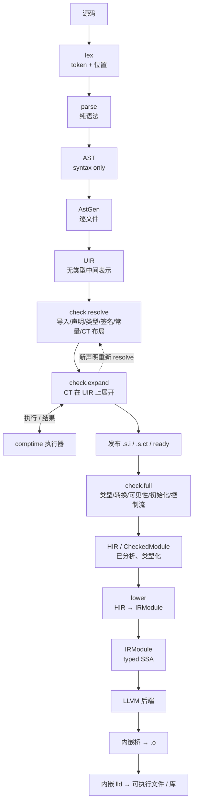

# yh 编译器架构设计

修改时间：2026-11-06

状态：**现行唯一的系统/编译器架构文档**。本文合并并取代 2026-09-30 至 2026-11-05
期间的架构分析、目标设计、代码复核、差距分析与迁移方案；被合并文件的清单见
[附录 A](#附录-a已合并文档)。历史版本仍可从 git 历史取回。
基线：`llvm` 分支（0.0.12 + C0–C6 + GEN1 + F1），`compiler/` 19 个 yh 模块 / 171 个
`.yh` / 60,545 行 / 93 条依赖边；`python3 tools/arch-check.py` 全绿。

> **文档边界**：本文只回答“系统怎么分层、模块负责什么、阶段契约是什么、下一步
> 怎么改”。语言语义、标准库 API、平台 ABI、编码规范、测试语法仍是独立领域文档，
> 继续保留并在本文对应章节链接。它们不是“架构分析文档”，不参与本次合并。

---

## 0. 结论摘要

1. **分层方向是对的**：17 个模块的显式 import 图无环，`gen` 与 `ir` 是依赖根，
   `proj` 是项目数据层，`build` 是总装层，`cmd` 只做参数映射与分派。依赖矩阵由
   `tools/arch-check.py` 强制。
2. **真正的乱不在依赖环，而在“名字、所有权、契约”三件事**：
   - `gen` 同时是基础设施、语义模型、语义分析、C ABI 与平台层，15/17 个模块依赖它，
     183 个 `pub fn`；拆分决定见 [ADR-0021](../adr/0021-yh-gen职责拆分.md)；
   - `parse` 不是纯 parser，它边解析边做语义动作并写 AST；`check` 当前仍是只读
     verifier；`ast` 不只装 AST，还装 `CheckedModule` 快照；
   - 会话状态分散在 `gen.state`、`proj.ctx`、`build.BuildCtx`、`link.context`，
     缓存分散在 `build/module_cache`、`build/function_ir_cache`、`link/link_cache`；
   - 契约版本是六处独立常量，没有统一入口。
3. **前端两遍化已决定（2026-11-06）**：`parse` 只出语法 AST，语义分析统一收进
   `check`（`check.resolve → check.expand → check.full`），CT 语法在 resolve 之后
   展开；`lower` 只消费受检结果。这是高成本重构，按 `docs/todo.md` 的 F0–F7
   分阶段迁移；目录/缓存/`proj` 整形仍可先行。
4. **不要现在做查询系统/LSP/线程池**：fork/COW 进程模型仍是正式执行器；
   线程池的前置是 AST/CT/诊断/缓存全部显式上下文化。当前没有证据证明收益大于成本。
5. **Zig 对齐草案（待评审）**：§6.11 提出在 `parse` 与 `check` 之间增加
   AstGen/UIR，并把 `check` 做成真正的 Sema；未批准前 F0–F7 仍是执行基线。

---

## 1. 系统全景

### 1.1 复合体边界

yh 不是“一个编译器源码目录”，而是 **语言 + 前端 + 语言 IR + LLVM 后端 + 构建系统
+ 标准库 + 自举/发布流水线** 的复合体。

| 部分 | 位置 | 与编译器的关系 |
| --- | --- | --- |
| 编译器本体 | `compiler/` | 单个 yh 项目；一个 `yh` 二进制内含前端、IR、LLVM 发射、构建引擎与链接驱动 |
| 标准库 | `libs/` | 独立 `project.toml` 项目，经三层来源解析接入；不是编译器内部模块 |
| 测试语料 | `tests/` | 与编译器同语言的运行/语法/模块/自举/性能语料 |
| 工具与门禁 | `tools/` | `arch-check.py`、`link-closure.py`、性能/发布/种子脚本 |
| 固定 LLVM/lld 闭包 | `vendor/`、`tmp/llvm-migration/` | 由 `just llvm-host`/`just bootstrap` 准备；种子不烘焙构建机路径 |
| 种子 | `bin/yh-<平台>-<架构>` | 上一代编译器二进制，不入库；`just fetch-seed` 从 Release 下载并核对哈希 |

编译器二进制里装着一个构建系统：TOML 解析、目录扫描、进程管理、lld 驱动都在
`build/`/`link/`。好处是“一个 `yh` 走通全部”；代价是 `yh` 不能作为库直接内嵌，
LSP/IDE 只能经子进程协议接入。

### 1.2 一次项目构建的真实路径

```text
argv
 └─ cmd/driver.yh（module main；只做 argv → 请求映射与分派）
     └─ cmdline（libs/cli 声明与解析）
         └─ cmd/cmd_*.yh（一命令一文件；调用 build/testkit）
             └─ build：项目发现 → 扫描源根 → 模块索引 → TOML → 三层来源解析
                       → 导入绑定 → 拓扑排序 → 有界调度
                 └─ fork worker（上限 4，COW 继承只读项目快照）
                     lex
                       → parse 两遍（pass1 签名 / pass2a 全局 / pass2b 函数体）
                       → gen.sem_*（语义表、类型布局、常量折叠）
                       → ast 捕获 CheckedModule（arena + 绑定 + 快照）
                       → check 只读校验
                       → lower：CheckedModule → ir.IRModule（函数级命中缓存）
                       → backend：IRModule → LLVM 文本
                       → 内嵌桥 → .o，原子 rename 发布
                     → 发布 .s.i / .s.ct / ready
                 └─ 父进程：waitpid → 提交 manifest → link
                     → 内嵌 lld + 平台链接模板 → 可执行
```

三个约束决定了这个形状：

| 约束 | 内容 | 证据 |
| --- | --- | --- |
| 模块内按文件名序编译 | 类型必须先声明后使用，文件序即声明序 | `ir/` 的 `00/10/20/30/40/50`、`ct_00_model` |
| 并发单位是进程不是线程 | `fork()` + `waitpid`，COW 隔离，无锁 | `build/build_scheduler.yh` |
| `pub` 同时决定 `.s.i` 接口与 `.globl` | 加一个 `pub` 会同时改接口与符号可见性 | `AGENTS.md` 模块导出面规则 |

逐阶段、逐函数、逐缓存与链接六段的详细**当前实现**见
[编译流程-当前实现](yh-编译流程-当前实现.md)；本文只保留架构级概览。

### 1.3 自举闭环与种子

```text
bin/yh-<平台>-<架构>（Release 种子）
  └─ yh build compiler/ → cc2 → cc3 → cc4
     门：cc3/cc4 的全部模块 .s/.s.i 逐字节相同（固定点）
         + cc4 自解析全部 compiler/ 源文件
         + 全量语法/运行语料 + modules/项目验收
```

- 仓库**无法独立重建编译器**：没有 C 版 stage0；正确性由固定点与语料保证，
  git 历史承担每一代种子的存档职责。
- 种子不入库；`just fetch-seed` 从最新 Release 取当前平台种子并核对 SHA-256。
- LLVM/lld 闭包不烘焙进种子：`just bootstrap`/`just llvm-host` 在构建机准备
  `tmp/llvm-migration/llvm-host-<宿主>/selfhost-flags.txt`；`just seed` 拒绝仍带
  构建机 `$HOME` 路径的种子。
- 每次行为变更必须过 `just` + `just test` + `just selfhost-native`，全绿后才
  `just seed`；不得跳过固定点或合并迁移阶段。

### 1.4 进程与并行模型

- 构建父进程完成项目扫描与只读快照，`fork` 最多 4 个模块 worker；子进程通过
  COW 继承只读项目/token 快照，语义状态各自隔离。
- `lld` 继续放一次性子进程，不进入共享线程；LLVM 每次调用使用私有
  Context/TargetMachine。
- `gen.G()` 已归零；跨模块状态经 `gen.task()`/`gen.stats()`/`proj.ctx()`/
  `build.BuildCtx`/`link.context` 访问。但模块级可变 `let` 仍有 174 处，
  **“G() 归零”不等于“状态可线程化”**。
- 线程池/常驻编译/LSP 的前置：AST、CT、诊断、缓存全部显式上下文化；当前不做。

---

## 2. compiler/ 目录职责

### 2.1 目录表（按当前源码实测）

#### 前端与语义

| 目录（模块） | 规模 | 实际职责 | 主要问题 |
| --- | ---: | --- | --- |
| `lex/`（lex） | 3 / 1,044 / 2 pub | 字节词法、布局（隐式 `;`）、字符串插值词法 | 依赖 support/token，仍读 gen 的 TaskCtx 源/词法状态 |
| `parse/`（parse） | 14 / 9,776 / 22 pub | 递归下降 + **语义动作** + AST 捕获 + 模块头/import + `.s.i`/`.s.ct` 接口读写 + CT 布局 | 名字只覆盖“解析”；`parse_expr.yh` 2,042 行，是当前最大文件（建议拆分）；依赖 ast/comptime/gen/ir/lex/proj |
| `ast/`（ast） | 6 / 1,364 / 81 pub | 纯语法 AST arena（expr/stmt/decl/function）、只读视图与 arena 扩容入口 | F1 已把快照/切片/键迁 check；pub 仍偏多 |
| `check/`（check） | 12 / 5,224 / 92 pub | 受检契约（`CheckedModule`/视图/切片/键）+ 语义动作 `sem_*` + C ABI 分类 + arena/快照校验 | 语义动作已归位；类型/符号模型仍留 `gen`（`comptime` 依赖，待 F4）；`resolve/expand/full` 未落地 |
| `support/`（support） | 16 / 1,185 / 37 pub | GEN1 基础层：源/池/统计/诊断/目标/ABI/字节工具 | 消费面已直连；不得塞语义 |
| `token/`（token） | 3 / 265 / 4 pub | GEN1 词法/语法词汇：`Tok`/`TK_*`/`PDecl`/`TokenCtx`/游标/`is_assign_op`/`err_tok` | `gen` 暂留同名 type/const 别名；直接消费面后续收口 |
| `gen/`（gen） | 2 / 1,026 / **28 pub** | 语义内核：符号/类型表写入、带位置诊断的折叠 | 语义动作已迁 check；`comptime` 仍读其类型/值规则（F4 解锁后才能迁） |
| `comptime/`（comptime） | 13 / 5,550 / 72 pub | 编译期 typed IR 执行器、布局图、枚举/全局聚合、静态数据 | 49 个模块级 `let`（全仓最多）；与 `gen` 的 CT 类型/值边界需要契约 |
| `builtin/`（builtin） | 1 / 173 / 2 pub | prelude 名字登记表 | 干净；依赖 gen/support |
| `cache/`（cache） | 7 / 1,031 / 34 pub | 缓存键、`ActionID`/`OutputID`、全局 content store、flock 平台封装 | C0/C4/C6 新增 |

#### 中端、后端与工具链

| 目录（模块） | 规模 | 实际职责 | 主要问题 |
| --- | ---: | --- | --- |
| `lower/`（lower） | 16 / 5,998 / 3 pub | `CheckedModule → IRModule`，按 expr/call/flow/place/aggregate 分片 | 干净（只 3 个 pub）；`module_snapshot_*` 前缀偏长 |
| `ir/`（ir） | 10 / 5,384 / 34 pub | SSA 模型、验证、序列化、函数级缓存、重绑定 | **最干净**：0 依赖、0 全局 `let`；增长最快，契约版本分散 |
| `backend/`（backend） | 14 / 4,149 / 20 pub | IR → LLVM 文本、ABI 分类（Apple/ZABI/Windows）、桥绑定、运行时 | 干净；后端契约是“文本”而非对象 API（设计选择） |
| `link/`（link） | 7 / 4,325 / 20 pub | 汇编/链接驱动、内嵌 lld、进程、时钟、**链接缓存 1,647 行** | 4,272 行，是当前最大模块（建议拆分）；缓存与工具链调用混居；平台链接分 darwin/windows |

#### 项目、构建与入口

| 目录（模块） | 规模 | 实际职责 | 主要问题 |
| --- | ---: | --- | --- |
| `proj/`（proj） | 4 / 1,464 / 42 pub | 项目/模块/文件三张表 + 目标/构建配置 + 产物键 + 缓存根 | 新枢纽（9 个模块依赖）；只依赖 `gen`；40 pub 偏多 |
| `build/`（build） | 22 / 8,058 / 44 pub | 发现/索引/调度/模块发射/LLVM 流水线/缓存/全局 store、trim/verify/debug/项目装配/TOML/统计 | 仍过载；依赖 14 个模块；`project*`、`toml`、`cache` 三类还能下沉 |
| `testkit/`（testkit） | 1 / 1,616 / 1 pub | `yh test` 发现、绑定、执行 | 15 处（8 个符号）直接引用 `build` 内部 `mb_*`/`cmd_*`，分层泄漏 |
| `cmdline/`（cmdline） | 1 / 661 / 7 pub | CLI 声明与解析（`libs/cli`） | 干净；编译器里唯一 `→ libs` 边 |
| `cmd/`（模块名 **main**） | 11 / 497 / 1 pub | argv → 请求映射 + 一命令一文件分派 | 干净；目录名 `cmd` 与模块名 `main` 不一致 |
| `llvm/`（不是 yh 模块） | 6 个 C/C++ 文件 | `bridge.c/h`、`lld_bridge.cpp`、`windows_shim.c`、stub；由 `tools/llvm-*host.py` 编进闭包 | 隐性“第 18 个模块”；不在 arch-check 依赖图，只靠闭包哈希守护 |

`compiler/.build/`、`compiler/tmp/`、`compiler/.codegraph/` 是构建缓存、临时产物与
代码图 DB，不是源码。

### 2.2 一句话记忆

**当前前端是 `lex → parse(语义动作 + ast 捕获) → check(验证) → lower`；目标前端是
`lex → parse(纯语法) → AST → check(resolve/expand/full) → lower`。`gen` 是所有层
共享的语义/基础底座；`build` 是总装车间；`proj` 是数据层；`link` 是工具链调用层；
`cmd` 是薄入口。**

### 2.3 耦合读数

| 模块 | 出度 | 入度 | 模块级 `let` | `pub fn` |
| --- | ---: | ---: | ---: | ---: |
| gen | 0 | 15 | 18 | 183 |
| ir | 0 | 5 | 0 | 34 |
| proj | 1 | 9 | 1 | 40 |
| parse | 6 | 3 | 19 | 20 |
| ast | 5 | 5 | 43 | 64 |
| comptime | 2 | 3 | 49 | 72 |
| cache | 2 | 3 | 0 | 34 |
| lower | 5 | 1 | 2 | 3 |
| backend | 2 | 2 | 0 | 20 |
| link | 4 | 3 | 18 | 20 |
| build | 15 | 2 | 15 | 44 |
| testkit | 5 | 1 | 9 | 1 |
| lex | 1 | 3 | 0 | 2 |
| check | 3 | 1 | 0 | 2 |
| cmdline | 2 | 1 | 0 | 7 |
| cmd | 9 | 0 | 0 | 1 |
| builtin | 1 | 1 | 0 | 2 |
| 合计 | 63 条边 | — | 174 | — |

---

## 3. 依赖规则

### 3.1 允许的依赖边（`arch-check` 强制）

```text
gen        → （无）
ir         → （无）
lex        → gen
comptime   → gen, proj
builtin    → gen
proj       → gen
cache      → gen, hash（标准库）
ast        → gen, comptime, ir, proj, cache
lower      → gen, ir, ast, proj, cache
check      → gen, ast, proj
parse      → gen, lex, comptime, ast, ir, proj
backend    → gen, ir
link       → gen, proj, backend, hash（标准库）
build      → gen, lex, parse, comptime, ast, check, ir, backend, builtin, lower, proj, link, hash, cache, libs（os）
testkit    → gen, parse, build, proj, link
cmdline    → gen, libs
main       → gen, lex, comptime, ast, check, parse, ir, backend, builtin, build,
             testkit, lower, proj, link, cmdline
```

新增边必须同时改 `tools/arch-check.py` 的 `ALLOWED` 与本文；环数必须为 0。

### 3.2 分层与根

```text
根（零业务依赖）        gen（共享内核）      ir（SSA）
                              ↑                 ↑
前端数据与语义          lex  ast  comptime  builtin
                              ↑
语法与准入              parse  check(verifier)
                              ↑
变换                    lower → ir
                              ↑
发射                    backend → ir, gen
                              ↑
工具链                  link → backend, proj, gen
                              ↑
项目/构建               proj  build
                              ↑
测试/入口               testkit  cmdline  cmd(main)
```

- `ir` 不得 import 任何前端模块；`backend` 不得 import `ast`/`parse`/`comptime`/`check`；
  `lower` 不得 import `parse`/`build`/`gen`，只消费 `check` 的 `CheckedModule` 契约；
  `ast` 不得反向 import `lower`/`check`。
- 任何模块不得 import `cmd`；`cmd` 只做参数映射与调用面。
- `cmdline` 是唯一允许依赖标准库 `libs/cli` 的编译器模块。
- `link` 必须位于 `build` 之下；`build` 不得被 `link` 反向 import。

### 3.3 模块可见性与 `pub` 规则

依据 [ADR-0013](../adr/0013-yh模块私有类型.md) 与
[模块私有类型设计](yh-模块私有类型设计.md)：

| 声明 | 同模块 | 其他模块 |
| --- | --- | --- |
| `fn` / `const` / `type`（无 `pub`） | 可访问 | 不可访问 |
| `pub fn` / `pub const` / `pub type` | 可访问 | 导入后可访问 |
| `struct` / `union` / `enum`（无 `pub`） | 可访问 | 不可访问，不进 `.s.i` |
| `pub struct` / `pub union` / `pub enum` | 可访问 | 可命名、可构造、可用字段 |
| `let` | 可访问 | 不导出；跨模块经 `pub fn` 窄口 |

硬规则：

1. **只有别的模块真的用到才 `pub`**；`pub` 同时决定 `.s.i` 接口与 `.globl`。
2. 私有类型不得出现在本模块的 `pub` 签名、`pub` 字段或 `pub` 类型别名里；
   要对外提供私有类型的操作，只能返回 `*void` 句柄或把类型改成 `pub`。
3. 入口模块 `cmd/` 只保留 `main` 为 `pub`。
4. 新增跨模块接口必须有真实消费者；仅模块内使用的声明不写 `pub`。

### 3.4 文件、平台变体与子目录

- 模块源码目录支持子目录；子目录内文件仍属同一模块，按文件名序编译。
- 平台特化文件统一按 `<name>.<os>[.<arch>].yh` 命名（`clock.darwin.yh`、
  `project_dir.linux.arm64.yh`），扫描按文件名后缀筛选；不用 `#ifdef`。
- 类型必须先声明后使用；文件序即声明序。新增文件时先确认依赖顺序。

---

## 4. 阶段与契约

### 4.1 逻辑阶段

阶段是逻辑边界，不要求每个边界都额外遍历全部源码。

| 阶段 | 输入 → 输出 | 职责与停止条件 | 当前落点 |
| --- | --- | --- | --- |
| 词法 | 源字节 → token、源位置 | 一次扫描；词法错误终止该单元 | `lex/` |
| 语法 | token → 文件 AST、声明/函数索引 | 保留源位置与语法结构，不解析符号 | `parse/`（当前同时做语义动作；目标纯语法） |
| 语义 | AST + 模块环境 + 目标数据模型 → 绑定和类型注解 | 解析名字、导入、类型、常量、成员和调用 | 当前 `parse/` + `gen.sem_*`；目标 `check.resolve/full` |
| check | 带注解的表示 → `CheckedModule`/`CheckedFunction` | 检查类型、转换、控制流、可见性、初始化 | `check/`（当前只读 verifier；目标语义分析入口） |
| IR | 受检函数/全局 → typed SSA + 显式内存操作 | 只接收受检函数；不接收未受检函数 | `lower/` → `ir/` |
| 后端 | SSA + 目标描述 → LLVM 文本/对象 | 语言语义保护、ABI 分类、LLVM 合法化 | `backend/` |
| 汇编/链接 | 对象 + 启动/运行时 + 链接配置 → 程序 | 符号解析、重定位、入口与装载格式 | `link/`（内嵌 lld） |

**当前事实**：`parse` 是“递归下降 + 语义动作 + AST 捕获”，不是纯语法阶段；
`check` 是结构校验器，不是类型检查器；`lower` 只吃 `CheckedModule`，不 import
`parse`/`check`/`build`。

**2026-11-06 决定**：目标为 `parse(纯语法) → AST → check.resolve → check.expand
→ check.full`；CT 语法在 resolve 之后展开，语义分析统一归 `check`。迁移见
`docs/todo.md` 的 F0–F7；当前代码仍是语义动作解析器。

> **草案补充（待评审）**：§6.11 拟在 AST 与 check 之间增加 AstGen/UIR，并把
> `check.expand` 从 AST→AST 改为 UIR→UIR；批准前本表按现状/F0–F7 执行。

### 4.2 关键产物与契约

| 契约 | 内容 | 稳定性 | 变更流程 |
| --- | --- | --- | --- |
| token/源位置 | 词法输出、文件 ID、行/列/字节偏移 | 演进 | 语料 + 固定点 |
| `AstExpr`/`AstStmt`/`AstDecl` | 前端 arena 节点、子节点 ID、源范围 | 演进 | 语料 + 固定点 |
| `CheckedModule`/`CheckedFunction` | 独占 arena、类型/签名/符号、源码映射、导入、静态数据 | **演进** | ADR + 语料 + 固定点 |
| `IRModule`/`IRFunction` | 符号、布局、全局、函数、`type_map`、locs；可序列化、可重绑定 | **演进** | ADR + 重绑定用例 |
| `.s.i`/`.s.ct` | 模块接口/编译期接口：公开声明、类型、常量、CT 布局 | **冻结后演进** | 版本号 + 失效矩阵 |
| `ArtifactKey`/manifest | 模块/对象/链接键：源码、依赖接口、目标/布局/ABI、编译器身份、桥版本 | **冻结后演进** | 版本号 + 失效矩阵 |
| `TargetDesc` | triple、数据模型、ABI 分类、平台文件后缀、链接驱动 | **演进** | 描述符表 + 逐目标门 |
| `Diagnostic` | 稳定错误码、位置、严重级、渲染 | **演进** | 错误码目录 + 文案快照 |

> 草案 §6.11 拟增加 `UIR` 契约（逐文件、无类型、可序列化）；是否引入与放在
> `ast` 内部还是独立 `uir` 模块，待评审。当前 `CheckedModule`/`IRModule` 不变。

**契约版本化的最小要求**（尚未全部落地）：

1. 每个持久产物头部写 `magic + schema_version`（`.s.i`、`.s.ct`、IR 序列化、
   manifest）。
2. 读取端在边界检查：不兼容 → 明确报“接口版本 N 需要 M”并给出修复建议
   （重建/升级种子），而不是在解析深处崩。
3. 缓存键把 `schema_version` 纳入哈希（现在只有编译器指纹）。
4. `yh version --contracts` 输出契约版本集合，便于 CI 与外部工具协商。

### 4.3 当前契约版本（六处独立常量）

| 契约 | 常量 | 当前值 | 位置 |
| --- | --- | ---: | --- |
| 模块接口 | `IFACE_VERSION_MIN/MAX` | 1–3 | `parse/iface.yh` |
| 编译期接口 | `CTIFACE_VERSION` | 1 | `parse/iface.yh` |
| SSA 函数编码 | `IR_SERIAL_VERSION` | 9 | `ir/ssa_serialize.yh` |
| 模块 IR 编码 | `IR_MODULE_SERIAL_VERSION` | 3 | `ir/ssa_module_30_serialize.yh` |
| 缓存键 schema | `CACHE_SCHEMA_VERSION` | 3 | `cache/cache_key.yh` |
| 函数缓存 | `IR_FUNCTION_CACHE_VERSION` | 3 | `ir/ssa_module_40_function_cache.yh` |

读取端各自校验、各自拒绝；升级一处不会提示其余四处。这是“契约没有统一入口”，
不是“完全没有版本号”。下一步应建立统一注册表，至少让 `yh version` 能列出全部版本。

### 4.4 缓存层次

| 层 | 产物 | 键 | 状态 |
| --- | --- | --- | --- |
| 模块接口 | `.s.i` / `.s.ct` / `ready` | 源内容 + 接口版本区间 + 目标 + 符号后缀 | 已用：InterfaceReady 调度 |
| 函数 check 切片 | `.fchk` + `index.check` | SHA-256 + 相对路径：函数 token 流 + 类型/签名表 | 已用；schema 3 / slice v5 |
| 函数 IR | `.fir` + `index` | SHA-256 + 相对路径：逐声明布局 + 环境键 | 已用；版本 3 |
| 全局 content store | `v1/actions` + `v1/outputs` | ActionID + OutputID（SHA-256） | C4 已用：module/check/IR |
| 对象/链接 | `obj/<tag>.o`、最终程序 | 内容哈希 + 编译器指纹 + 闭包身份 | 已用 |

对象粒度停在模块级：文件级对象不做，函数级 `.o` 暂缓（[ADR-0020](../adr/0020-yh对象粒度停在模块级.md)）。

缓存规则（目标态，强制）：

1. 缓存键/schema/编码放 `cache/`（前端与构建层共享）；构建侧 store/提交与
   manifest 编排放 `build/`。实现文件不得调用流水线文件，也不得再出现第五套
   私有键。
2. 每个缓存必须声明：键组成、失效条件、存储路径（经 `proj` 的产物路径与缓存键层，
   不自行拼路径）。
3. 命中/未命中必须进 `stats`；`YH_BUILD_CACHE` 语义不变（只迁缓存位置，不改变
   产物位置）。
4. 缓存版本不兼容、内容损坏、依赖缺失或完成标记缺失都不算命中。

四层缓存的当前键、manifest、命中/提交与失效矩阵见
[缓存设计](yh-缓存设计.md)。

### 4.5 状态所有权

| 状态 | 所有者 | 共享规则 |
| --- | --- | --- |
| 源快照、文件 AST | 构建会话 | 发布后只读，生命周期覆盖引用它的任务 |
| 模块声明、类型、导入绑定、常量 | 模块准备任务 | 完成依赖闭包检查后发布只读视图 |
| 局部符号、作用域、控制流、诊断缓冲 | 函数任务 | 任务私有 |
| SSA 值/块表、函数 arena、标签、后端缓冲 | 函数任务 | 任务私有，不用全局递增标签 |
| 目标数据模型、ABI 描述 | 目标实例 | 初始化后只读 |
| 调度、缓存记录、输出提交 | 构建协调者 | 统一处理依赖和提交 |

当前实现有 174 个模块级可变 `let`：`comptime` 49、`ast` 43、`parse` 19、`gen` 18、
`build` 15、`testkit` 9，其余模块少量。判据：**fork 后子进程是否允许各自不同**。
是则必须是每任务态（`TaskCtx` 或模块私有上下文）；不是则归构建会话/目标/符号表。
`gen.G()` 已归零，但字段读次数仍高，不能靠“加窄口”代替状态归位。

### 4.6 对象粒度（结论）

2026-11-06 决定（[ADR-0020](../adr/0020-yh对象粒度停在模块级.md)）：对象粒度停在
**模块级**，每个模块一个 `.o`。不做文件级对象（每个 `.yh` 一个 `.o`）；
函数级 `.o`（PC7）暂缓，不进入当前路线。

理由：

- 模块对象缓存命中已跳过整个 worker；文件级对象只在模块失效后提供二级复用。
- 前端仍是模块级 parse/check/CT，文件对象不减少同模块其他文件的前端工作；
  函数 check 切片与函数 IR 缓存已覆盖函数级增量。
- 函数级 `.o` 的桥调用会从 13 次量级升到约 1460 次，固定开销可能抵消收益。
- 文件级对象需要 hidden linkage、按文件发射、N 对象链接与提交协议，复杂度和
  风险高；O0 单函数改动 3.6 s 中发射约 0.5 s、链接约 1.3 s，收益集中在函数
  缓存负责的约 1.8 s 前端/lowering。

接受的结果：单函数/单文件改动仍重发整模块 LLVM 并重跑链接；`≤3 s` 不作为
当前承诺。只有未来测量证明整模块发射重新成为主瓶颈，才以新 ADR 重新评估。

---

## 5. 现状：已完成与未解决

### 5.1 已落地

| 项 | 结果 |
| --- | --- |
| `build` 拆分（A2c/B2） | 项目模型、调度、模块发射、链接从 `cmd` 拆出；`cmd` 从 1.2 万行降到 469 行 |
| `proj`（B1） | 项目/模块/文件表、目标/构建配置、产物键自 `gen`/`build` 拆出；9 个模块依赖 |
| `link`（B2） | 汇编/链接/lld/进程/时钟独立；`mb_link` 阶段化，最大函数从 674 降到 351 |
| `lower`（B3） | `CheckedModule → IRModule` 从 `ast` 拆出；`ast` 回到 3,438 行 |
| `check`（2026-10-20） | AST/快照只读校验独立；`parse` 不依赖 `check` |
| `cmdline`（CLI-R） | CLI 声明/解析交给 `libs/cli`；`cmd` 只做参数映射 |
| `cmd` 一命令一文件（P1） | `driver` + `common` + 8 个 `cmd_*.yh`；导出面只有 `main` |
| `gen.G()` 归零（B1-4） | 跨模块状态改走 `gen.task()`/`gen.stats()`/`proj.ctx()` |
| LLVM 单后端（LL12） | 旧机器发射退役；LLVM 是唯一代码生成后端 |
| Windows/x64（W2） | 原生宿主、COFF/PE、零 CRT、平台变体接入 |
| 0.0.12 发布 | 三端种子、固定点、发布验收完成 |

### 5.2 结构性问题（按当前证据）

| 编号 | 问题 | 证据 | 状态 |
| --- | --- | --- | --- |
| S1 | 驱动与内核未分离 | 已大体解决：`build`/`proj`/`link`/`cmd` 拆分；`testkit → build` 仍有 15 处（8 个符号）内部引用 | 部分 |
| S2 | 状态隐式且进程级 | 174 个模块级 `let`；`G()` 已归零但字段读仍多；无线程隔离 | 部分 |
| S3 | 产物契约未版本化 | 六处独立常量；`.s.i` 已支持区间，IR/缓存各自相等判定 | 部分 |
| A1 | `build` 仍过载 | 6,990 行；project*/toml/cache 可下沉 | 未解决 |
| A3 | `gen` 无内部分层 | 183 `pub fn`、14 入度、基础设施+语义+ABI+平台混居 | 未解决 |
| A4 | 文档与代码漂移 | 2026-11-06 已把 `compiler/README.md` 模块表改为实测 17/158/59,815；README 断言尚未加入 `arch-check` | 部分 |
| A6 | `testkit → build` 泄漏 | 15 处（8 个符号）`mb_*`/`cmd_*` 直接引用 | 未解决 |
| A7 | 平台适配靠文件复制 | `clock`/`project_dir`/`argv`/`console`/`llvm_bind`/`*_runtime` 各 4 份 | 未解决 |
| A8 | 增量粒度 | 函数 check/IR 缓存已用；对象粒度固定模块级（ADR-0020）；`module_worker` 废参数链仍在 | 部分 |

### 5.3 规模观察项（仅记录，不阻断）

| 编号 | 项 | 当前值 | 观察 |
| --- | --- | ---: | --- |
| N1 | `link` 模块行数 | 4,272 | 当前最大模块；下一次 Windows 链接功能前建议先拆分 |
| N2 | `parse/parse_expr.yh` 文件行数 | 2,042 | 当前最大文件；表达式语法扩展前建议先拆文件 |
| N3 | `compiler/README.md` 模块表 | 已同步 | 仍建议把模块表纳入 `arch-check` 断言，防止复发 |
| N4 | `ir` 增长速度 | 5,384 行 | 函数缓存/序列化扩展快；契约版本升级成本落在该模块 |

### 5.4 其他未解决项

- `build/toml.yh`（604 行）与 `libs/toml` 两套 TOML 解析器并存；编译器侧尚未迁移。
- `module_worker.yh` 的 `out_dir`/`ir_cache_salt` 是旧文件汇编路径的遗留参数。
- 函数级 IR 缓存有三个前置契约（符号/type_map/locs 重绑定、语义依赖键、体键与
  源位置分离），实现中仍需逐项验收。
- `parse` 与 `check` 的命名/职责不一致：`check` 不是类型检查器；真正的语义检查
  散在 `parse` 两遍扫描与 `gen.sem_*`。
- 诊断无源码行/caret/错误码/JSON；一次只报一条；无错误恢复。这是对标工业级编译器
  的最大单点差距（见 §8）。

### 5.5 已知边界（语言/运行时）

| 边界 | 现状 | 依据 |
| --- | --- | --- |
| 切片越界与生命周期 | 无运行时防护；越界不保证 trap | ADR-0001（0.0.1 既定） |
| 浮点参数超过 8 个 | ABI 分类仍有限制；超出 d0–d7 的形态未覆盖 | 现有 ABI 门与语料 |
| 裸 C 变参 | 用户源码显式拒绝；仅编译器内置 prelude 使用 | 用户裸 C 变参交互设计 |
| GC / 异常 / panic / 线程 | 无；错误用返回值/诊断表达 | 语言定位 |
| 安全默认 | 无 checked 档；溢出/越界/除零语义需逐项文档化 | §8.2 P0-1 |

---

## 6. 目标架构

### 6.1 设计原则

| 编号 | 原则 | 可检验判据 |
| --- | --- | --- |
| P1 | 单向依赖，内核不依赖驱动 | 依赖矩阵由 `arch-check` 强制，环数 = 0 |
| P2 | 数据与变换分离 | `ast` 只存，`lower` 只变 |
| P3 | 状态显式 | 新增模块级可变 `let` 需 ADR；每任务态进上下文 |
| P4 | 契约版本化 | 每个产物有 magic + 版本 + 兼容策略 |
| P5 | 扩展用静态注册表，不做动态插件 | 新增目标/命令 = 加表项，不改内核分支 |
| P6 | 一切可对照 | 每个切片有“改前/改后”字节、固定点、差分、负例 |
| P7 | 一个关注点一个家 | 缓存进 `build/cache/`，项目模型进 `proj/`，命令进 `cmd/` |

P5 是刻意克制：不引入通用插件框架、全仓库查询数据库或常驻守护进程。扩展点应是
编译期确定的表，不是运行时加载的 `.so`——后者会破坏可重现构建、自举闭包与固定点。

### 6.2 目标分层（17→18 模块）

```text
L4 入口     cmd（一命令一文件，导出面只有 main）
L3 驱动     build（纯流水线编排）  testkit  proj（项目模型/扫描/TOML/产物路径）
L2 前端     lex  parse  ast
L2 语义     check（语义动作 + 受检契约）  gen（类型/符号/值规则内核）  comptime（CT 求值）
L1.5 变换   lower
L1 中端     ir（不依赖任何 yh 模块）
L1 后端     backend（LLVM 描述）  link（工具链调用，缓存移出）
L0 支撑     support（含诊断/目标身份）  token
```

### 6.3 目标依赖矩阵（2026-11-06，ADR-0021）

| 模块 | 允许依赖 |
| --- | --- |
| support | 无 |
| ir | 无 |
| token | support |
| cache | support, token, hash |
| lex | support, token |
| proj | support, token（+ 评估后可加 libs/toml） |
| comptime | support, token, proj（纯 CT IR 执行器；不得 import check/gen/ast） |
| ast | token, support（F1 后；过渡期含 comptime/proj/ir/gen） |
| check | ast, comptime, token, support, proj, gen, cache, ir |
| parse | token, ast, lex, support（F2 后；过渡期含 check/proj/gen/comptime/ir） |
| lower | check, ast, ir, token, support, proj, cache |
| backend | ir, support |
| builtin | check, support |
| link | support, proj, backend, hash |
| build | ast, backend, builtin, cache, check, comptime, hash, ir, lex, libs, link, lower, parse, proj, support, token（GEN3 前另含 gen） |
| testkit | build, parse, link, proj, support, token |
| cmdline | support, libs/cli |
| cmd | 全部（入口唯一例外） |

### 6.3.1 当前依赖实测与两条解锁链（2026-11-06）

`gen` 仍是 13 个模块的依赖，但**按被依赖内容分成五类**（实测符号引用数，
列内为该 gen 文件贡献的符号数）：

| 模块 | model | state | symbols | value_rules | static_data | front_stage | abi_model |
| --- | ---: | ---: | ---: | ---: | ---: | ---: | ---: |
| check | 46 | 17 | 24 | 6 | 6 | 0 | 7 |
| parse | 47 | 7 | 28 | 3 | 3 | 0 | 0 |
| lower | 41 | 0 | 0 | 0 | 1 | 0 | 0 |
| builtin | 14 | 2 | 5 | 0 | 0 | 0 | 0 |
| comptime | 1 | 2 | 4 | 8 | 4 | 0 | 0 |
| build | 5 | 2 | 2 | 0 | 0 | 3 | 0 |
| ast | 6 | 2 | 1 | 0 | 0 | 0 | 0 |
| cmd | 0 | 3 | 1 | 0 | 0 | 0 | 0 |
| lex / link / proj / testkit | 0 | 2 | 0 | 0 | 0 | 0 | 0 |
| cache | 0 | 1 | 0 | 0 | 0 | 0 | 0 |

按依赖**性质**归类，得到两条互不阻塞的解锁链：

**链 A — F4 → 语义模型迁 `check`**（解锁 6 个模块）

```text
F4 完成（comptime 只剩 10 个值规则符号）
  → gen/symbols + value_rules + static_data + model 的 TY_*/SYM_*/F_* 迁 check
  → check/parse/builtin/ast/lower/comptime 全部脱 gen
```

- `lower` 只剩 41 个 `model` 常量、0 个函数 → 常量迁 `check` 后立刻脱 gen
  （`lower → check` 已在允许边内）。
- `builtin` 只剩 prelude 常量 + `ty_*`/`scope_push`/`prelude_add` → 同批迁。
- `ast` 只剩 `Res`/`SYM_*`/`F_GLOBAL`/`TY_I32`/`sym_lookup` → 同批迁。
- `check`/`parse` 是语义模型的主消费者，迁完后 `gen` 的 `pub fn` 从 82 降到
  `front_stage` 3 个 + `state` 的 `task`/`state_init`。

**链 B — GEN4 拆 `TaskCtx`**（解锁 7 个模块）

```text
TaskCtx 按所有者拆（SemaCtx→check / ParseCtx→parse / SourceCtx→support / …）
  → lex/link/proj/testkit/cache/build/cmd 脱 gen
```

- 这 7 个模块对 gen 的依赖**只有** `gen.task()`/`gen.TaskCtx`（lex/link/proj/
  testkit 各 2 个符号，cache 1 个）——完全不涉及语义模型。
- 它们可以在 F4 之前就做：把用到的字段先移进各自上下文（如 `lex` 的
  `lx_line` 已可迁 `lex.LexCtx`）。

### 6.3.2 codegraph 实测：`gen.task()` 的爆炸半径（2026-11-06）

用 `codegraph` 索引全仓（1,136 文件 / 12,999 节点 / 38,129 边）后：

| 查询 | 结果 |
| --- | --- |
| `codegraph callers gen.task` | **212 个调用点**，按模块：`parse` 148、`check` 54、`ast` 6、`gen` 2、`builtin` 2（**`comptime` 已清零**） |
| `codegraph impact gen.task` | 约 260 个受影响符号（跨 5 个模块） |
| `codegraph callers sem_can_assign` | `check` / `comptime` / `gen` / `parse` |
| `codegraph callers sem_fold_norm` / `sem_res_const` / `fp64_bits` | `check` / `comptime` / `gen`（`sem_res_const` 还有 `parse`） |

结论（与 §6.3.1 一致，但量化了成本）：

- **链 B 的规模就是 `gen.task()` 的调用点**，其中 `parse`(148)+`check`(54) 占 95%；
  `lex`/`link`/`proj`/`testkit`/`cache` **已全部清零**（`lex.LexCtx`、
  `cache.store_bind` 落地，`TaskCtx` 150→147），`import gen` 的模块
  从 13 降到 **8**（ast/build/builtin/check/cmd/comptime/lower/parse）。
- **链 A 的规模是值规则的 4 个消费方**（`check`/`comptime`/`gen`/`parse`）；
  `comptime` 已是白名单内的 3 个符号、`parse` 15 个，`check` 迁完即完成。
- 因此两条链的收尾都可以用「受影响符号数」当进度指标：
  链 B 从 306 → 0（TaskCtx 消失），链 A 从 4 个消费方 → 1（只剩 `check`）。

用 codegraph 复核（`codegraph impact <symbol>`）应作为后续每次拆分的前置检查；
它比 `rg` 多给出「受影响的函数集合」，便于判断一次拆分要改多少处。

**与 ADR 的对应**：链 A = F4 + F3 剩余；链 B = GEN4。两者都完成后 `gen`
只剩 `model` 的别名与极薄兼容层，即可删除（模块数 19 → 18）。

现有 `import gen` 的边按符号实际归属 1:1 改写为 `import support`/`token`/
`check`；除表中列出的边外不得新增。过渡期临时边
（`gen → support/token/check`、`parse/build/testkit/cmd → gen`、
`ast/check/comptime → gen`（捕获/残余））在 GEN3/GEN4 删除。F1 前 `ast` 仍
import `ir`（`check_key`/`check_slice`）与 `proj`；F1 后快照/切片键迁 `check`。
目标矩阵是方向，不是当前状态；每个阶段必须保持依赖图无环。

2026-11-06 的前端两遍化决定会进一步调整：`check` 拥有语义分析与 CT 展开
（需要 `comptime`），`lower` 消费 `check.CheckedModule`/HIR，`ast` 回归纯语法。
`HIR` 是 `check` 的输出契约，不是新模块；本表的模块所有权已由 ADR-0021 冻结，
F0 ADR 只冻结 AST/HIR/`CheckedModule` 契约。

### 6.4 `cmd/`：一命令一文件（已完成）

```text
cmd/
  driver.yh         main：argv → 请求映射 + 子进程协议识别 + 分派（无业务）
  common.yh         命令共享前奏、API_* 形态常量、退出码契约
  cmd_build.yh      yh build / yh check
  cmd_run.yh        yh run
  cmd_test.yh       yh test（含 --timeout 范围校验）
  cmd_list.yh       yh list [--resolve]
  cmd_version.yh    yh version / --contracts
  cmd_single.yh     单文件五形态：--syntax-check / --emit-asm / --emit-llvm /
                    -o <out> <file.yh> / check-with-src
  cmd_emit_module.yh  内部子进程协议 --emit-module
  cmd_lld_link.yh     内部子进程协议 --lld-link（委托 link.mb_coff_link_child）
```

规则：`driver` 每个分支不超过一行函数调用；no-fork 子进程协议（`--emit-module`
上界 23 项参数、`--lld-link`）的识别仍在 driver；退出码契约不变：0 成功、
1 源/语义错误、2 用法错误、-1 内部或桥失败。新增命令 = 新增一个 `cmd_<命令>.yh`
+ driver 一行分派 + cmdline 声明。

### 6.5 `build/` + `cache/`

```text
cache/                  ← 前端与构建层共享的键实现（C0 已建）
  cache_key.yh          统一 schema、ActionID/OutputID、公共键前缀/token/长度分帧
build/
  build_ctx.yh          会话级构建上下文
  build_scheduler.yh    模块调度（fork / no-fork worker，PC3 冷构建判定）
  module_build.yh       单模块构建驱动
  module_worker.yh      worker 入口
  module_emit.yh        模块产物发射
  llvm_pipeline.yh      LLVM 流水线
  llvm_emit.yh          单文件 LLVM 发射
  stats_print.yh        统计输出
  unused_function.yh    未用函数裁剪
  cache_global.yh       YH_CACHE 初始化、模块发布/物化、全局 miss 回退
  module_cache.yh       模块 iface/产物缓存
  function_ir_cache.yh  函数 check/IR 缓存 I/O
  link_cache.yh         链接缓存键/manifest（不含 lld 驱动）
cache/
  cache_key.yh          统一 schema/ActionID/OutputID/公共键原语
  cache_store.yh        全局 content store：actions/outputs/tmp/lock、atomic put/get
```

缓存规则见 §4.4。`link_cache.yh` 是唯一跨模块搬家：`link` 模块职责收窄为
“汇编/链接/lld/进程/时钟”调用层，与 AGENTS.md 对 `link` 的定义一致。

### 6.6 `proj/`：项目模型 + 扫描 + TOML + 产物路径

迁移清单：`build/project.yh`、`project_index.yh`、`project_resolve.yh`、
`project_link.yh`、`project_dir.<平台>.yh`×4、`toml.yh` → `proj/`。

- 前置校验：这批文件不得引用 `build` 其余符号；若有引用，先把被引符号下沉
  `proj` 或改经 `proj.ctx()` 传递。
- `toml.yh` 与 `libs/toml` 二选一：先评估 `libs/toml` 对 `project.toml` 解析需求
  的覆盖度（含 `tools/link-closure.py` 生成节的容错读取）。能覆盖则删除编译器侧
  自研解析器；不能覆盖则保留并在本文记录差异清单。
- 迁移后 `build/` 只剩流水线与缓存；`proj/` 职责 = 项目模型 + 源码扫描 + TOML +
  产物路径/缓存键。

### 6.7 `gen` 职责拆分（2026-11-06 重新分析；ADR-0021）

按用户反馈收窄：**只新增 `support`/`token` 两个模块**；**语义分析全部归
`check`**，不建 `sema`；`diag`/`target` 并入 `support`，`state`/`hir` 不建；
复用现有 `lex`/`check`/`comptime`/`proj`/`builtin`。`token` 从 GEN1 开始
（词汇 + `PDecl` + token 数组/游标 + `err_tok`）；`builtin` 保留内置函数/
内置类型登记表。

| `gen` 内容 | 目标 | 说明 |
| --- | --- | --- |
| `TK_*`/`TOK_*`/`ATTR_*`/`Tok`/`PDecl` | `token` | 词法/语法共享词汇；`PDecl` 放 `token` 避免 `proj↔ast` 环 |
| token 数组/游标/`err_tok`/`sem_err` | `token`（GEN1） | token 状态与词汇同批迁；`token → support` |
| `Res` | `check`（过渡/最终删除） | `ast`/`comptime` 在 F1/F5 前消费 |
| `CType`/`SField`/`TName`/`CSym`/`ModInfo`/`ImportEnt`/`ModNsEnt`/`PubAggDeferred` | `check` | 语义模型归语义分析模块 |
| `TY_*`/`SYM_*`/`F_*`/`CT_DIAG_*` | `check` | 语义枚举与标志 |
| `symbols.yh` | 拆到 `support`（名字池）+ `check`（类型/符号/折叠/命名空间） | 名字池是通用 intern 池 |
| `sem_*.yh` | 全部 → `check`（F5 重写后迁） | 语义分析统一入口 |
| `TaskCtx` | 按所有者拆上下文；**不设万能 `state`** | 不集中到 build/proj |
| `GenState` | 删除 | 会话初始化按所有者分发 |
| `TargetCfg` | 类型/默认值/绑定在 `support`；存储在 `proj` | 唯一存储，fork 前绑定 |
| `buffer.yh` 追加/写出/分配 | `support` | 后续评估换 libs |
| `read_source`/`set_source_path`/`fail`/`fail_path` | `support` | I/O、路径、基础错误 |
| `err_lc`/`warn_lc` | `support` | 诊断与基础错误同层，不拆 `diag` |
| `clock.*`/`console.*`/`argv.*` | `support` | 后续可换 libs |
| `target*.yh` | `support`（身份/数据模型/配置/ABI 常量） | 结构体布局函数归 `check` |
| `abi_c.yh` | `check` | C ABI 需要 `CType` |
| `static_data.yh` / `front_stage.yh` / `model_store.yh` / `file_scope.yh` / `task_ctx.yh` / `tables.yh` / `value_rules.yh` / `symbols.yh` / `layout.yh` / `target.yh` / `abi_model.yh` | **`support`（已迁）** | 只依赖 `support`；被 `gen`/`check`/`comptime`/`parse`/`lower` 共用，放 `gen` 必然成环 |
| `front_stage.yh` | `check` | 受检阶段守卫 |
| `builtin` prelude/内置类型登记 | `builtin` 保留，`builtin → check, support` | 内置函数 + 内置类型登记表；`ty_register_builtins` 实现在 `builtin` |

**`support` 的角色**：L0 基础层，不是流水线阶段。会话初始化时绑定目标/源/
统计/诊断；读源（lex 前）、词法/语法/检查、CT 展开、lower/backend、link/build
各阶段按需调用缓冲/名字池/诊断/目标/时钟。它不持有类型/符号/分析状态。

**`HIR` 不是模块**：它指 `check` 产出的受检契约（`CheckedModule` + AST 边表 +
静态数据 + 目标身份），由 `lower` 消费；当前放在 `check/base.yh`，
`lower → check`。只有未来出现“多个消费者只要契约、不要分析器”或
`lower→check` 依赖失控时，才另立 `hir`。

硬约束：

- **只新增 2 个模块**：`support`/`token`；`sema` 不建，语义模型/规则/分析全部
  进 `check`；`diag`/`target` 并入 `support`；`state`/`hir` 不建。
- **`comptime` 必须是纯 CT IR 执行器**：只执行 `check.expand` 构造的 CT IR；
  若继续调用类型规则/读 `CSym`，会形成 `check ↔ comptime` 环。F4 是前提。
- **`check` 是唯一语义入口**：`CType/CSym/...`、折叠/布局/ABI/静态数据、
  名字/类型检查、`resolve → expand → full` 都在 `check`。
- **`TaskCtx` 不能整体放 `build`/`proj`，也不新建万能 `state`**。
- **不要五拆 `symbols.yh`**：按所有权分文件，不按 `pub` 数硬切。
- **`fail`/`err_lc` 同在 `support`**：基础层自足，不拆 `diag`。
- **`sem_*` 不得先搬 `check`**：`parse` 在 F2 前仍驱动它们；F2/F5 后再迁/删。
- **`ABI_YH`/`ABI_C` 放 `support`**：`backend` 不必 import 整个 `check`。

目标依赖矩阵见 §6.3。分步（GEN0–GEN4，与 todo 对齐）：

1. **GEN0**：ADR + 归属表 + `arch-check` 预算守卫（`gen` 的 `pub fn` 数、
   `import gen` 模块数、`TaskCtx` 字段数只减不增）；递归扫描按 `module` 分组。
2. **GEN1**：`support`（工具/源/池/统计/宿主/诊断/目标/`ABI_*`）+ `token`
   （词汇/`PDecl`/**状态/游标/`err_tok`**）；先让 `cmdline`/`cache`/`link`/
   `proj`/`lex` 摆脱 `gen`；parse 的 `c_pos` 本阶段改完。
3. **GEN2**（= F1–F5）：`ast`/`parse` 纯语法；`check` 接全部语义与
   `CheckedModule`；`comptime` 收窄为纯 CT IR 执行器；残余字段归
   `support/ast/check`；`gen` 只剩残余 `TaskCtx`。
4. **GEN3**：清 `gen` 语义残片/空壳；`lower`/`builtin` 改 import `check`，
   `backend` 用 `support.ABI_*`；`build`/`cmd` 改调 `check` 入口。
5. **GEN4**：重盘 `TaskCtx`，拆 parse/check/build/link 残余上下文；
   删 `GenState`/`gen`；更新 `ALLOWED`/预算/文档/种子。

验收口径：同模块文件搬家要求 `.s`/`.s.i`/`.s.ct` 逐字节一致；跨模块搬家**不**
要求编译器自身 `.s.i` 一致（模块身份/符号后缀会变），以固定点 + 全量语料等价
为准；每阶段 `just` + `just test` + `just selfhost-native`。

### 6.8 `ast` 快照基础设施（2026-11-06 归 `check`）

`module_snapshot*.yh` 是 `CheckedModule` 的捕获/视图/切片导入/检查缓存键，被
`check`、`lower`、`build`、`cmd` 消费。**不能**搬进 `build`（`lower → build` 会
成环）。F1 已决定：快照/切片键随 `CheckedModule` 从 `ast` 迁 `check`，`ast`
回归纯语法。**不新建 `hir` 模块**：`HIR` 是 `check` 输出契约的称呼，放在
`check/base.yh`；只有 F0 发现 `lower → check` 依赖失控时才另议。

### 6.9 平台抽象

当前平台适配靠文件名后缀复制：`clock.*`、`project_dir.*`、`argv.*`、`console.*`、
`llvm_bind.*`、`*_runtime.*` 各 4 份。机制是对的（编译期按目标选文件，不是
`#ifdef`），但新增平台要写第 5 份同类文件，且文件之间没有共享声明头。

目标：

- 新增 `TargetDesc` 描述符表：triple、数据模型、ABI 分类、平台文件后缀、链接驱动名；
- 平台实现放 `libs/sys/*.<os>.<arch>.yh` 与 `backend/llvm_bind.<os>.yh`；
- 新平台 = 加表项 + 平台变体文件 + 该目标原生构建/运行/自举/固定点证据；
- 不以 WSL 冒充 Windows 支持；不让平台差异渗进 `lower`/`ir`。

### 6.10 前端契约：已决定两遍化（2026-11-06）

**当前事实**（迁移前）：

```text
lex → parse（边解析边调 gen.sem_*，同时写 AST）→ check（结构校验）→ lower
```

当前 `parse` 是语义动作解析器，AST 节点创建时就带 `type_id`/`sym_id`/常量事实；
`check` 只做范围、后序编号、快照完整性等结构校验，不是类型检查器。

**目标**（用户 2026-11-06 决定）：

```text
lex → parse（纯语法）→ AST
    → check.resolve（导入/声明/类型/枚举成员/字段/常量，供 CT）
    → check.expand（comptime AST→AST：$if/$for/$field/$compile_*/插值）
    → check.full（名字/类型/可见性/初始化/控制流）→ CheckedModule/HIR
    → lower → IR
```

规则：

- **语义分析就叫 `check`**：`check` 是语义分析入口，现有 `check.verify` 降为结构
  verifier 子阶段；不要让 `check` 继续只做 verifier 却承担语义名字。
- `parse` 只出语法 AST：移除 `gen.sem_*`、`ast_expr_set_semantics`、`proj` 依赖；
  `parse_decl` 的 pass1/pass2、声明索引、test/entry 选择上移 `build`/`check`；
  `iface`/`iface_ct`/`parse_ct_layout` 移出 `parse`。
- `ast` 回归纯语法：只留 kind/op/span/children；CT 语法节点归 `ast`；
  `CheckedModule`/快照/HIR 从 `ast` 迁到 `check`（或新 `hir`）；移除
  `ast -> comptime` 边。
- `comptime` 只做 CT IR 求值：不 import `ast`/`check`；`check.expand` 负责从 AST
  构造 CT IR、调用 `comptime` 执行、把结果写回 AST/生成新声明。
- `lower` 只消费 `check.CheckedModule`/HIR，不再读 `parse` 的语义状态。

**为什么不是 `parse → expand → check` 三个独立阶段？**

CT 展开不能严格早于所有语义分析：

- `$for values` 需要枚举类型与成员表；
- `$for fields` 需要结构体/联合体字段与布局；
- `$field(x, "name")` 需要 `x` 的类型；
- `@[comptime]` 函数需要类型检查后执行；
- 插值 `"${expr:spec}"` 需要 `expr` 的类型来校验 spec。

这些事实来自声明/类型解析。`@[comptime]` 还要求先检查/捕获其正文才能执行，
所以 `check` 内部实际是：

```text
check.resolve（先建声明/类型/常量环境）
  → 检查/捕获 @[comptime] 函数正文
  → check.expand（用环境展开 CT，生成的新声明重新 resolve，迭代到无 CT）
  → check.full（对展开结果做完整检查）
```

而不是把 expand 放在 check 之前。若坚持“expand 必须在任何 check 之前”，只能
保留纯字面量 CT，现有 `$for values/fields` 与 `@[comptime]` 无法保留；不建议。

**迁移方式**：按 `docs/todo.md` 的 F0–F7 分阶段；F0 先做 ADR + 3 点 spike
（聚合字面量、`$for values/fields`、字符串插值），验证纯语法 AST 可表示，再动
`parse`。每阶段保持固定点；旧语义动作路径保留用于差分，逐特性切换后删除。

> **与 §6.11 草案的关系**：若 §6.11 批准，本节的目标链路改为
> `parse → AST → AstGen → UIR → check.resolve → check.expand(UIR) →
> check.full → HIR → lower`，并在 F2/F3 之间插入 F2b；否则按原文 F0–F7 执行。

---

### 6.11 Zig 对齐：AstGen/UIR/Sema（草案，待评审）

状态：**草案，未批准**。当前实现与 F0–F7 不变；本节只用于评审“是否在
`parse` 与 `check` 之间增加 AstGen/UIR，并把 `check` 做成真正的 Sema”。
若批准，本节成为阶段 B 的目标流程，并在 F2/F3 之间插入 **F2b**；§6.10 的
“`check.expand` AST→AST”相应改为“UIR→UIR”。本轮已确认两点：**CT 展开放
UIR**；**暂不接受惰性 Sema**（`check.full` 仍检查模块内全部函数）。

目标不是复制 Zig 的后端，而是复制它的前端分层：

```text
Parse → AST → AstGen → UIR（无类型）→ Sema → HIR（已分析）→ 后端
```

yh 保留 LLVM 唯一后端与内嵌 lld；只改前端与缓存粒度。



#### 6.11.1 阶段与契约

| 阶段 | 输入 → 输出 | 负责 | 关键约束 |
| --- | --- | --- | --- |
| 语法 | token → AST | `parse` | 不解析符号/类型；不调用 `gen.sem_*`；保留 span |
| AstGen | AST → UIR | `ast`（暂定） | 逐文件、纯函数；不读导入/目标；不生成符号 ID |
| resolve | UIR + 依赖接口 → 类型/符号/签名环境 | `check` | 处理签名/类型/常量/CT 布局；只检查 `@[comptime]` 正文，不检查普通函数体 |
| expand | 环境 + UIR → UIR | `check` + `comptime` | CT 展开；新声明重新 resolve；有迭代/预算上限 |
| full | 展开后的 UIR + 环境 → HIR | `check` | 类型/转换/可见性/初始化/控制流；eager 检查模块内全部函数 |
| lower | HIR → IRModule | `lower` | 只消费 HIR；不读 AST/parse 语义状态 |
| 后端/链接 | IRModule → LLVM → .o → 可执行 | `backend`/`link` | 保持 LLVM + lld，不引入第二后端 |

**UIR** 是 Zig ZIR 的对等层，建议先作为 `ast` 的内部契约，不急着新增模块：

- 逐文件、无类型、无符号绑定；名字用 intern 字符串/文件内索引；
- 表达式/语句/声明/CT 语法均为显式节点；
- 源位置单独存 locs，不进入语义键；
- 可序列化、带 `UIR_VERSION`；不含 arena 指针/进程地址/调度顺序；
- 必须有独立 verifier：子节点越界、span 越界、跨文件引用都拒绝。

**HIR** 是 Zig AIR 的对等物，不是新模块：它是 `check` 产出的受检契约。
`CheckedModule` 保留为版本化容器/元数据，但 body 从 AST 快照改为 HIR；
`lower` 只消费它。

**UIR 与当前 `IRModule` 的关系**：两者不是同一层，也不是替代关系。

| 层 | 类型状态 | 粒度 | 目标/ABI | 消费者 | 当前对应 |
| --- | --- | --- | --- | --- | --- |
| `UIR` | 无类型、无符号绑定、未解析名字 | 逐文件 | 无关 | `check.resolve/expand/full` | **新增**（Zig ZIR 对等） |
| `HIR` | 已解析类型/符号、CT 已展开 | 模块 | 含类型布局/ABI 事实 | `lower` | `CheckedModule`/HIR |
| `IRModule` | typed SSA、显式内存操作 | 模块 | 目标/优化相关 | `backend` | 现有 `ir.IRModule`，不变 |

- `UIR` 不做 SSA、不做寄存器/内存 lowering；它是 Sema 的输入契约。
- `IRModule` 是 `lower` 的输出、LLVM 后端的输入；当前 `.fir` 缓存的是
  **函数级迷你 `IRModule`**，不是 UIR。
- UIR 若落盘，使用独立缓存/扩展名（如 `.uir`），不要混用 `.fir`。
- `lower` 的输入从“`CheckedModule` 里的 AST 快照”改为 HIR；`IRModule` 与
  后端不变。

#### 6.11.2 Sema 内部顺序

```text
check.resolve
  → 建导入/声明/类型/枚举/字段/签名/常量/CT 布局环境
  → 检查并捕获 @[comptime] 函数正文
check.expand
  → 在 UIR 上执行 CT（$if/$for/$field/插值/compile_*）
  → 新声明重新 resolve，迭代到无 CT
  → 发布 .s.i / .s.ct / ready
check.full（eager）
  → 检查模块内全部函数：类型/转换/可见性/初始化/控制流
  → HIR
```

InterfaceReady 的时点从“parse pass1 之后”移到“resolve/expand 之后、full 之前”。
这样仍能在函数体检查完成前发布接口；但 `.s.i/.s.ct` 依赖 Sema，不能更早。

#### 6.11.3 缓存与并行

| 缓存 | 键 | 命中后跳过 |
| --- | --- | --- |
| UIR 文件缓存 | 文件 token + UIR schema + 编译器身份 | parse + AstGen |
| HIR 函数缓存 | UIR 函数 + 依赖 `.s.i/.s.ct` + target/ABI + 编译器 | check.full |
| IR 函数缓存 | HIR + target/opt/ABI | lower |
| 模块对象 | 模块源 + 依赖接口 + target/opt | 整个 worker |
| 全局 C4 | ActionID/OutputID | 模块/函数 action |
| 链接 | 对象集合 + 工具身份 | lld |

- UIR 文件缓存是 target-independent，可跨目标复用；
- HIR 缓存取代现有 `.fchk`（AST 受检切片）；`.fir` 继续保留；
- `parse/AstGen` 可按文件并行；`check.resolve/expand/full` 仍以模块为单位，
  状态共享较多；`check.full` 采用 eager 全函数检查，不按可达性惰性裁剪。

#### 6.11.4 迁移切片

在现有 F0–F7 中插入 F2b，不改变 GEN0–GEN4 的模块所有权：

```text
F0  ADR + AST/UIR/HIR 契约 + CT 节点与 UIR 版本
F1  ast 纯语法
F2  parse 纯语法
F2b AstGen + UIR（含 verifier/序列化/--emit-uir）
F3  check.resolve 消费 UIR
F4  check.expand 在 UIR 上展开 CT
F5  check.full → HIR
F6  lower 切换为消费 HIR
F7  删除旧语义动作路径、固定点、滚种子
```

每一步保留旧路径差分：同一输入比较 AST/UIR/HIR/IR/对象/诊断；纯移动切片要求
产物字节一致，语义变化单独切片。每个切片都过 `just` + `just test` +
`just selfhost-native`。

#### 6.11.5 需要评审的取舍

1. **UIR 放哪里**：先放 `ast` 内部（不新增模块，符合 ADR-0021）；若文件级
   AstGen 缓存/并行收益成立，再抽 `uir` 模块（需要新 ADR）。
2. **CT 语义（已定）**：`$for/$if` 继续走宏式展开，但展开位置定在 **UIR**：
   UIR 保留 CT 节点，`check.expand` 负责 UIR→UIR；不是 Zig 的 Sema 内 comptime，
   也不回到 AST→AST。
3. **惰性 Sema（暂不接受）**：`check.full` 保持 eager，检查模块内全部函数，
   维持现有未使用函数/诊断行为；惰性化不进入本方案。
4. **接口就绪时点**：Sema 之后才能发 `.s.i/.s.ct`，模块并行会略降；用
   resolve/expand 与 full 分离来保住“函数体未完成也能启动消费者”。
5. **后端不跟抄**：Zig 的 self-hosted/LLVM/C 三后端不引入；LLVM/lld 不变。


## 7. 关键决策记录

| 决策 | 结论 | 状态 | 依据 |
| --- | --- | --- | --- |
| 自举方式 | 滚动自举，无 C stage0；种子是上一代二进制；固定点 + 语料保证正确性 | 生效 | ADR-0006/0007 |
| 代码生成 | LLVM 是唯一后端；旧机器发射退役；lld 内嵌 | 生效 | ADR-0014、LL12 |
| 优化架构 | Nanopass 只保留 NP3（受检契约与 lowering 解耦）；NP0/1/2/4/5 关闭；通用优化交给 LLVM | 生效 | ADR-0011 |
| `check` 定位 | 目标：语义分析入口（resolve/expand/full）；当前仍是只读 verifier；迁移见 todo F0–F7 | 目标/待迁移 | 2026-11-06 决定 |
| Zig 对齐前端 | 草案 §6.11：AstGen/UIR/Sema/HIR；是否引入 UIR 待评审 | 草案 | 2026-11-06 讨论 |
| 模块私有类型 | `struct`/`union`/`enum` 的 `pub` 可选；私有类型不进 `.s.i` | 生效 | ADR-0013 |
| 模块导出面 | 只导出别的模块真的使用的声明；`pub` 同时决定 `.s.i` 与 `.globl` | 生效 | ADR-0007、导出面收缩 |
| 项目模型 | `project.toml` + `module` 声明 + 按名称导入；无 `internal` 特例 | 生效 | ADR-0005 |
| 包管理 | 本地路径依赖 + 三层来源（本项目 → 标准库 → 直接依赖）；无中央 registry | 生效 | 模块与项目管理设计 |
| 扩展点 | 静态注册表，不做动态插件/常驻守护进程/查询数据库 | 生效 | 10-24 系统架构 |
| 并发 | fork/COW 进程 worker；lld 一次性子进程；线程池待上下文隔离 | 生效 | 10-25/LA5 |
| 对象粒度 | 模块级唯一；文件级不做，函数级 `.o` 暂缓（ADR-0020） | 生效 | ADR-0020、LA3 |
| 前端阶段 | 两遍化：`parse` 纯语法 → AST → `check`（resolve/expand/full）→ lower；当前仍是语义动作解析器 | **已决定，待迁移** | §6.10、todo F0–F7 |
| CT 展开位置 | `check.resolve` 之后、`check.full` 之前；AST→AST；`comptime` 只做求值 | 已决定 | §6.10 |
| `gen` 拆分 | 目标只新增 `support`/`token`；语义分析全部归 `check`；`diag`/`target` 并入 `support`；复用 `lex`/`comptime`/`proj`/`builtin`；GEN0–GEN4 分阶段 | 目标 | ADR-0021 |
| 平台顺序 | Linux 优先；Windows/x64 已接入；Darwin 默认 LLVM | 生效 | AGENTS.md |
| 标准库 | 独立 `libs/` 项目；编译器经三层来源接入；不是 prelude | 生效 | 标准库设计 |

---

## 8. 差距与优先级

### 8.1 对标 Rust：P0/P1/P2

| 优先级 | 事项 | 验收 |
| --- | --- | --- |
| P0-1 | Diagnostic 模型 + 源码渲染 + 多条错误恢复 | 一个含 5 个独立错误的文件一次输出 5 条，每条含 caret |
| P0-2 | `--message-format=json` + 错误码 | 任意诊断可解析出 code/spans/severity |
| P0-3 | 独立类型检查阶段（从 `parse` 抽出，`yh check` 可用） | 只做语义检查不产码；首错后继续检查后续函数 |
| P0-4 | DWARF 调试信息（`-g`） | gdb/lldb 停在 `.yh` 行；`bt` 显示函数名与行号 |
| P0-5 | 安全默认：边界检查、整数溢出语义、enum switch 穷尽性 | 越界 trap；溢出有明确文档语义；缺分支报错 |
| P0-6 | 对象级增量 + 编译时间门禁 | 改一个函数体，重编 < 全量 10% 且产物逐字节相同 |
| P1 | LSP、fmt、lint、包管理最小版、ThinLTO、fuzz/覆盖率、Windows/x64 原生门 | 按项验收 |
| P2 | edition/稳定性属性、签名与可复现构建、C++ interop、远程缓存、PGO | 按需 |

### 8.2 对标 Zig：P0

| 优先级 | 事项 | 验收 |
| --- | --- | --- |
| P0-1 | 安全档位（checked：溢出/越界/除零/窄化 trap） | 三条探针在 checked 下 trap、`-O2` 保持现状 |
| P0-2 | comptime 类型参数 + 单态化命名 | `Vec(i32)`/`Map(str,i32)` 落地，≥2 库替换；固定点绿 |
| P0-3 | 目标包解耦（链接模板/自带 crt 与目标 libc 描述） | macOS 产 x64 ELF、Linux 产 Mach-O 各一条 `file` 门 |
| P0-4 | DWARF（`-g`） | lldb 停在 `.yh` 行；无 `-g` 时产物无 debug 节 |
| P0-5 | `yh fmt` + `yh doc` | fmt 幂等且语料不变；doc 覆盖全部 `pub` 声明 |

### 8.3 明确不做（当前）

- 泛型/trait（除非先解决单态化与 `.s.i` 接口稳定性）、宏系统、GC；
- 自研机器 IR/寄存器分配/JIT/32 位/LTO 落地（LLVM 已承担）；
- 中央 package registry（Zig 自己也没有）；
- 通用优化 pass 插件族、运行时动态插件；
- 线程池/常驻编译/LSP（上下文隔离完成前）。

---

## 9. 迁移路线

### 9.1 阶段 A：目录与缓存整形（低风险，优先）

| 阶段 | 内容 | 风险 | 前置 |
| --- | --- | --- | --- |
| A1 | `link/link_cache.yh`（1,647 行）迁 `cache/` + `build/`；`link` 回到纯工具链调用层 | 中：缓存键/接口变化，固定点注意 | 无 |
| A2 | `build/project*.yh` + `toml.yh` 迁 `proj/`；评估删除自研 TOML | 中：需先校验 `pj_*` 符号引用 | A1 |
| A3 | `gen` 按 GEN0–GEN4 拆到 `support`/`token`，语义归 `check`（`diag`/`target` 并入 `support`）；先 GEN1，再 GEN2/F5；GEN3/GEN4 收尾 | 高：全仓 import/状态改写 | A1/A2、前端 F0–F7 |
| A4 | `ast` 快照独立（P5，候选） | 中 | A3 |
| A5 | `testkit` 15 处（8 个符号）`build` 内部引用改走 `proj`/`link` 窄口 | 小 | A1/A2 |
| A6 | 平台 `TargetDesc` 描述符表 + 平台变体收敛 | 中 | A1–A3 |

### 9.2 阶段 B：前端契约重构（高成本，单独决策）

- `parse` 回归纯语法；`check` 承担类型/符号模型、纯规则与
  `resolve → expand → full`；`ast` 变无类型契约；`CheckedModule` 版本化；契约
  版本统一入口。
- 前置：1 个语法 spike + ADR + 独立阶段；预计 8–10 次滚种子。
- 若 §6.11 草案批准，阶段 B 增加 F2b（AstGen/UIR），`check.expand` 从 AST
  改为 UIR；未批准则按 F0–F7 执行，不引入 UIR。
- 不在 A 阶段夹带；不要为了“看起来像 lex→parse→check”而搬迁。

### 9.3 阶段 C：查询/会话架构（暂缓）

- 唯一 `Session` + query 键 + 统一缓存层；支持并行、常驻编译、LSP。
- 只有产品目标明确需要 LSP/常驻服务时才立项；当前 fork/COW 足够。
- 若做，先做 `Session` + 缓存键 + 诊断上下文，不先做线程池。

### 9.4 每阶段验收门

1. `just` 冷编 + 新 `yh` 自编，两代模块 `.s`/`.s.i` 逐字节相同（固定点）；
2. `just test` + `just selfhost-native` 全绿；
3. `just seed` 滚种子（仅全绿后）；
4. 结构性变更在 `tests/modules/` 或 `tests/yh-run/` 补用例；
5. `docs/finish.md` 记录，涉及决策的立 ADR；同步 `AGENTS.md` 与本文；
6. 纯移动阶段要求产物逐字节相同；跨模块搬家不要求编译器自身 `.s.i` 一致
   （模块身份/符号后缀会变），改判为固定点 + 全量语料等价；语义变更单独切片。

### 9.5 立即可做（不改变语义）

1. `parse_expr.yh` 文件级拆分（primary/postfix/binary），降低当前最大文件规模；
2. `link` 文件级拆分（platform/link_driver/coff），降低当前最大模块规模；
3. `compiler/README.md` 模块表改为实测数据，并纳入 `arch-check` 断言；
4. `testkit` 的 15 处（8 个符号）`mb_*`/`cmd_*` 引用改走 `proj`/`link` 窄口；
5. 契约版本统一入口（至少 `yh version --contracts` 列出六处版本）。

### 9.6 风险

| 风险 | 触发信号 | 缓解 |
| --- | --- | --- |
| 种子约束 | 新代码无法被上一代种子编译 | 两阶段落地；每切片保持固定点 |
| 双轨状态 | 新代码继续读旧全局 | 门禁“只减不增”+ 白名单 |
| 契约升级 | 版本一改全量重编 | 版本只在边界检查；提供清缓存指引 |
| 拆分导出面 | 跨模块搬家导致 `.s.i` 身份变化 | 同模块搬家比字节；跨模块改用固定点 + 全量语料等价，不把编译器自身 `.s.i` 当基准 |
| 增量正确性 | 偶发陈旧对象 | 保守失效面 + 依赖矩阵测试 + 负例 |
| 平台扩张 | 某平台只有“能编译”没有“能自举” | 每平台四格验收（构建/运行/自举/性能） |
| 文档漂移 | README/注释与实现不符 | `arch-check` 断言 + 随切片更新 |

### 9.7 项目布局与依赖查找（候选，未实施）

当前已支持并行兄弟目录 + `[dependencies]` 路径依赖 + 三层来源解析；以下是消除
摩擦的方向，按性价比排序：

1. **依赖键 ↔ `project.name` 一致性校验**：键与项目名脱节时给出两侧名字；现有
   语料存在键≠名（`alias`/`keyimp`/`comptimecross`），属破坏性变更，先盘点语料。
2. **解除 64 条依赖快照上限**：`pj_load_project` 用栈上定长数组静默截断；改为
   堆快照，并补 >64 条依赖的生成式用例。
3. **`path` 可省略**：`b = {}` 时按 `../<键>` → `<键>` 搜索兄弟目录；需改
   `build/toml.yh` 的空表诊断与 `project_index` 装载循环。
4. **非传递依赖的智能诊断**：导入未命中时遍历直接依赖的 deps，命中则提示“在
   依赖 b 的依赖 c 中，请声明 c”；导入语义保持非传递。
5. **workspace 根清单（后置）**：`workspace.toml` 的 `members` + 名字→路径推导；
   方向 3 是其子集，先做 3 不堵 5。

---

## 10. 架构守护

### 10.1 现有 `arch-check`

`python3 tools/arch-check.py` 检查：

1. **依赖矩阵**：模块间 import 必须在 `ALLOWED` 内，且无环；
2. **状态/资源预算**：模块级可变全局、`gen.G()` 读点、未判空 `malloc`、未接线
   `pub fn`、容量安全追加点，只减不增；
3. **报告**：依赖边与状态读数一览，便于 release 记录跟踪趋势。

代码行数不在 `arch-check` 里检查：规模统计由 `just code-stats` 单独报告，
`arch-check` 只守依赖方向与状态/资源纪律。预算上调必须改
`tools/arch-check.py` 的 `BUDGETS` 并说明理由——刻意摩擦，防止“改一行就放宽”。

### 10.2 建议新增的断言

| 断言 | 目的 |
| --- | --- |
| `compiler/README.md` 模块表与 `arch-check` 实测一致 | 终结 README 漂移（N3） |
| 目录职责表与 `compiler/` 实际模块集合一致 | 新增/删除模块必须同步本文 |
| 缓存键在 `cache/`、提交在 `build/` | 防止第四套缓存出现 |
| `testkit` 不得新增对 `build` 内部符号的引用 | 守住 A6 |
| 契约版本统一注册表 | 让 `yh version --contracts` 可核对 |
| 平台变体文件数量与目标数匹配 | 防止第 5 份复制悄悄出现 |
| Markdown 链接检查 | 防止合并/删除文档后留下死链 |

### 10.3 健康度指标

每版本记录一次（进 `docs/01-finished/release-<ver>.md`）：

| 指标 | 采集方式 | 期望 |
| --- | --- | --- |
| 依赖环数 / 越界边数 | `arch-check` | 0 / 0 |
| 模块/文件规模、单文件/函数最大行数 | `just code-stats`（仅报告，不作门禁） | 趋势可追踪 |
| 单模块 `pub fn` 数 | `grep -c '^pub fn '` | 稳定；新增需说明消费者 |
| 模块级可变 `let` 数 / `G()` 点 | `grep` | 下降 |
| 无界拼接点 / 未判空分配 / 未接线 `pub` | 静态扫描 | 0 / 0 / 0 |
| 契约版本覆盖率 | 产物清单核对 | 100% |
| 增量命中率 / 单函数时间 / 冷编时间 | 性能脚本 | 上升 / 下降 |
| 新增平台改动面 | `git diff` 模块数 | ≤3 |
| 文档与实现差异项 | 人工清单 + 链接检查 | 0 |

---

## 11. 开放问题

以下问题决定迁移顺序与边界；在 F0 ADR 完成前不要开始大改。

1. **“混乱”具体指哪种痛？** 读代码找不到该改哪 / 改一个功能牵动很多模块 /
   编译慢 / 加 Windows 和平台 / 想上 LSP 和工具。不同答案对应不同顺序：
   - 可读性/耦合 → A（缓存/proj/gen）；
   - 编译速度 → 先做缓存键/性能测量，不先拆前端；对象粒度已定（ADR-0020）；
   - 语言特性/工具 → B（前端契约）优先级上升；
   - 平台 → `TargetDesc` + 平台变体收敛优先。
2. **`gen` 拆分按 2026-11-06 的 GEN0–GEN4 执行**：只新增 `support`/`token`；
   语义分析全部归 `check`，不建 `sema`；`diag`/`target` 并入 `support`，复用
   现有 `lex`/`comptime`/`proj`/`builtin`；`symbols.yh` 保持一个语义内核，
   不五拆。GEN2 起与 F1–F5 合并；详细任务见
   [ADR-0021](../adr/0021-yh-gen职责拆分.md) 与 `docs/todo.md`。
3. **前端两遍化已决定；是否再加 UIR/AstGen 待评审**：F0 ADR 要冻结 AST/
   `CheckedModule` 契约、`check` 内部文件拆分、`iface`/CT 布局迁移边界；F0
   spike 要验证聚合字面量/`$for values/fields`/插值能被纯语法 AST 表示。
   §6.11 给出 Zig 对齐草案（含 UIR/AstGen）；批准后在 F0–F7 中插入 F2b，
   未批准则按现有 F0–F7 执行。见 `docs/todo.md`。
4. **能接受几次滚种子？** A 约 4–5 次，B 8–10 次；若 §6.11 的 UIR/F2b
   批准，预计再增加 2–3 次；每阶段必须冷编 + 固定点 + 全语料，不能合并阶段，
   否则回滚粒度消失。

---

## 附录 A：已合并文档

以下文档的架构结论已并入本文；文件已删除，历史版本在 git 历史中。领域契约/设计
（语言语义、标准库、平台 ABI、编码规范、测试语法等）未合并，继续保留。

| 已删除文档 | 主要内容并入 |
| --- | --- |
| `yh-系统架构与长期演进设计-2026-10-24.md` | §0、§3、§4、§6、§7、§8、§10 |
| `yh-系统架构与长期演进设计-产品评审-2026-10-24.md` | §5.2、§9.6 |
| `yh-当前架构重新分析-2026-10-25.md` | §2、§4、§5、§9 |
| `yh-当前架构重新分析-2026-11-04.md` | §2.3、§5.2、§5.3 |
| `yh-模块架构目标设计-2026-11-05.md` | §6.2–§6.8、§9.1 |
| `yh-架构图-2026-10-25.md` | §1.2–§1.4、§4.4 |
| `yh-代码复核-2026-10-24.md` | §5.2、§10 |
| `yh-编译器ast模块拆分设计.md` | §2.1、§6.8 |
| `yh-编译器check模块拆分设计.md` | §2.1、§4.1、§7 |
| `yh-编译器源码模块化设计.md` | §2、§3 |
| `yh-编译器模块导出面收缩设计.md` | §3.3 |
| `yh-gen内核分层评估-2026-10-25.md` | §2.1、§6.7 |
| `yh-LLVM分支架构复核-2026-10-22.md` | §1.2、§4.1、§4.4、§7 |
| `yh-并行项目布局与依赖查找优化方向-2026-11-05.md` | §9.1、§11 |
| `yh-编译流程重规划.md` | §4.1–§4.5、§9.4 |
| `yh-编译流程设计决策树.md` | §7 |
| `yh-对标Rust工业级编译器差距分析-2026-10-25.md` | §8.1 |
| `yh-对标Zig工业级编译器差距分析-2026-10-25.md` | §8.2 |
| `yh-Nanopass风格优化架构.md` | §7（NP3 定位） |
| `yh-函数级目标文件可行性-2026-10-26.md` | §4.4、§9.5 |
| `yh-函数受检事实缓存设计-2026-10-22.md` | §4.4、§5.4 |
| `yh-LLVM显式上下文与线程池设计-2026-10-22.md` | §1.4、§4.5 |
| `yh-LLVM文件对象与提交清单设计-2026-10-22.md` | §4.4、§5.4 |
| `yh-自举后端架构.md` | §1.3、§4.1、§5.5（旧 emit_arm64 细节已随 LL12 退役，不再保留） |
| `yh-自举能力边界.md` | §1.3（内容已指向自举统一方案，无独立结论） |
| `yh-Go风格模块与包设计.md` | §7（已被 `project.toml` 模块/项目管理设计取代） |

`yh-函数级目标文件可行性` 与 `yh-LLVM文件对象与提交清单设计` 的对象粒度内容已不再
采用（[ADR-0020](../adr/0020-yh对象粒度停在模块级.md)）；其中仍有效的缓存/提交部分
见本文 §4.4/§5.4。

未合并、继续保留的领域设计/契约（不是架构分析文档）：

- [模块与项目管理设计](yh-模块与项目管理设计.md)：用户程序的项目/模块/导入语义；
- [模块私有类型设计](yh-模块私有类型设计.md)：`pub` 类型可见性细则；
- [标准库设计](yh-标准库设计.md)：`libs/` 的 API 与加载约定；
- [LLVM 后端替换设计](yh-LLVM后端替换设计.md)、
  [LLVM 目标身份设计](yh-LLVM目标身份设计.md)、
  [LLVM 语义与 ABI 契约](yh-LLVM语义与ABI契约.md)、
  [macOS LLVM 后端接入设计](yh-macOS-LLVM后端接入设计.md)、
  [Windows LLVM 后端设计](yh-Windows-LLVM后端设计.md)、
  [Darwin 交叉编译遗留边界](yh-Darwin交叉编译遗留边界.md)：平台/ABI 契约；
- [受检 → SSA → LLVM 能力矩阵](yh-受检到LLVM能力矩阵.md)：当前覆盖
  实测，不是架构分析；
- [编码规范](yh-编码规范.md)：源码写法规则。

## 附录 B：测量与复现

```bash
# 模块/文件/依赖边/状态预算（行数见 just code-stats）
python3 tools/arch-check.py

# 模块规模
just code-stats

# 依赖边（无环核对）
rg -n '^import ' compiler --glob '*.yh'

# 模块级可变 let / pub fn / G() 读点
rg -c '^let ' compiler/<module>
rg -c '^pub fn ' compiler/<module>
rg -o 'gen\.G\(\)' compiler | wc -l

# 契约版本
rg -n 'IFACE_VERSION|CTIFACE_VERSION|IR_SERIAL_VERSION|IR_MODULE_SERIAL_VERSION|IR_FUNCTION_CACHE_VERSION' compiler

# 固定点与全量门
just
just test
just selfhost-native
```

## 附录 C：变更记录

| 日期 | 变更 |
| --- | --- |
| 2026-11-06 | 创建本文；合并 26 份架构分析/目标设计/代码复核/差距分析文档；确定“先 A 后 B、C 暂缓”的路线；把前端契约列为独立待决策 |
| 2026-11-06 | `docs/03-design` 文件名去掉日期后缀；每份文档标题下增加“修改时间”，删除旧 `日期：` 元数据；全仓引用同步 |
| 2026-11-06 | 新增 §6.11 Zig 对齐草案：AstGen/UIR/Sema/HIR、UIR 缓存与 F2b 迁移切片；待评审，不改变当前执行基线 |
