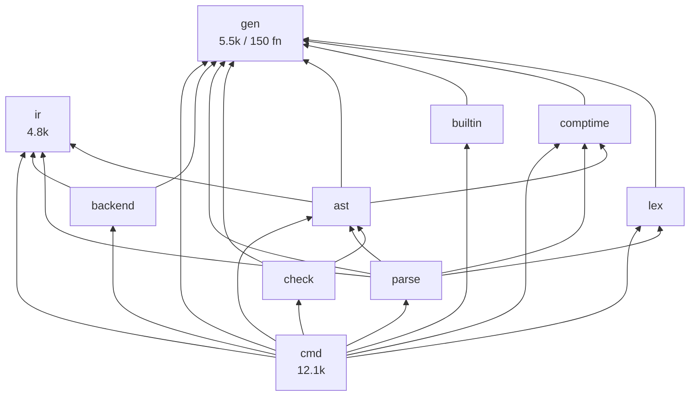
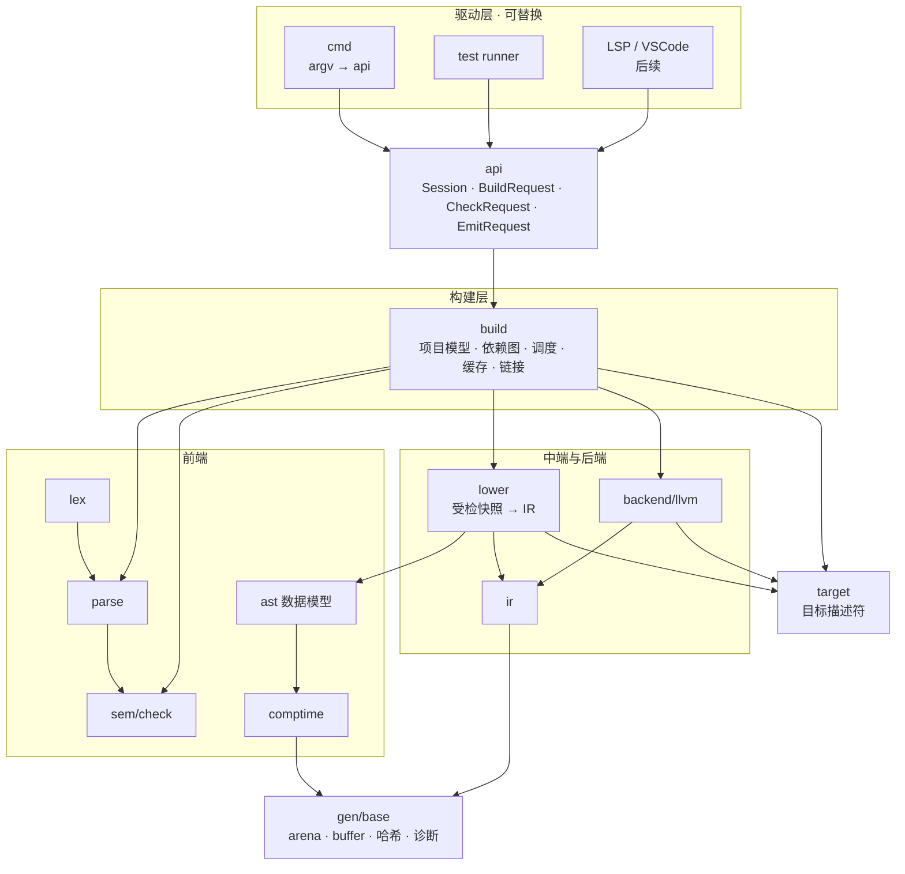

# yh 系统架构与长期演进设计

日期：2026-10-24
性质：**架构设计与长期规划**，不是实现验收；本文只做静态核对与设计，不改代码、不改种子。
基线：工作区 `0.0.9`，`compiler/` 10 个模块、114 个 `.yh`、51,578 行（不含 `tmp/`、`.build/`）。

> **2026-10-24 代码复核后的修订**：规模、导出面构成、增量缓存接线状态已按源码
> 逐条核对并修正；修正清单见 [代码复核](yh-代码复核-2026-10-24.md) §9。
> 本文中"`gen` 导出面过大、预算 ≤150"一项已作废，改用 `pub fn` 与稳定性分级；
> 新增 R7（边界纪律）与 R8（未接线代码）两项风险。
上游依据：[LLVM 分支架构复核](yh-LLVM分支架构复核-2026-10-22.md)、
[编译流程重规划](yh-编译流程重规划.md)、ADR-0009/0011/0014/0015。

> **范围说明**：本文以本仓库的「yh 工具链」为对象——语言前端、IR、LLVM 后端、
> 构建/缓存/链接、标准库、发布流水线。若你们要设计的是另一套业务系统，
> 第 2 章的「契约分层 + 扩展点准入 + 预算守护」和第 3/4 章的方法可直接迁移，
> 第 1/5 章需替换为你们的现状与里程碑。

---

## 0. 结论

yh 已经不是"一个编译器源码目录"，而是**语言 + 前端 + 语言 IR + LLVM 后端 +
构建系统 + 标准库 + 自举/发布流水线**的复合体。好消息是分层方向是对的：实测
10 个模块的显式 import 图**无环**，`gen`/`ir` 是依赖根，`cmd` 只做协调。

真正制约长期扩展的不是"缺少某个功能"，而是三处结构性欠账：

| 编号 | 欠账 | 一句话后果 |
| --- | --- | --- |
| **S1** | 驱动与内核未分离 | `cmd` 一个模块同时是 CLI、项目模型、构建调度、缓存、链接器驱动、测试执行器、平台适配层；每加一种能力都往这里堆 |
| **S2** | 状态隐式且进程级 | 189 个模块级可变 `let`、`gen.G()` 有 463 个调用点；线程池、常驻进程、多目标批量、LSP 都无法安全接入 |
| **S3** | 产物契约未版本化 | `.s.i` / `.s.ct` / 缓存键 / 对象元数据没有显式版本与兼容拒绝；跨代种子与外部工具只能靠"正好一致" |

因此建议下一阶段**先还地基，再谈平台，最后谈生态**：不新增语言特性作为主线，
用 1～2 个版本把 S1/S2/S3 收口，同时用"架构预算 + 门禁"把结果锁住，
避免重构完两年又长回原样。

**排序理由**：拆分（S1）是低风险高收益、可字节对照；会话化（S2）是并行/增量/
常驻/LSP 的共同前置；契约版本化（S3）是唯一能让"种子是二进制"的自举体系长期
演进的地基。反过来，先扩平台（Windows/x64、包管理、LSP）只会在膨胀的 `cmd`
和未隔离的状态上叠加债务，返工面更大。

---

## 1. 现状评估

### 1.1 规模与形状

| 模块 | 文件 | 行数 | 实测职责 | 判断 |
| --- | ---: | ---: | --- | --- |
| `cmd/` | 24 | 12,502 | CLI、项目模型、构建调度、模块编译、缓存、链接、测试执行、平台时钟/目录、TOML 适配 | **过载**，占编译器 24.2% |
| `ast/` | 24 | 9,041 | AST arena + 快照捕获 + 受检快照 + **SSA lowering 4,739 行** | **混层**：数据模型与变换同模块 |
| `parse/` | 12 | 9,108 | 语法、接口读写、CT 布局解析 | 偏大，`parse_expr` 2,003 行 |
| `comptime/` | 13 | 5,521 | CT 模型、执行器、布局图、静态数据 | 合理，`ct_ir` 1,644 行 |
| `gen/` | 14 | 5,453 | 语义函数、符号表、ABI、目标、缓冲、**150 个 `pub fn`** | **共享内核**：导出集中，但外部零引用仅 4% |
| `ir/` | 10 | 4,766 | IR 模型、SSA、序列化、函数缓存/重绑定 | 合理，依赖根 |
| `backend/` | 12 | 3,340 | yh IR → LLVM 文本、ABI 分类、运行时 | 合理 |
| `check/` | 2 | 958 | **只读一致性验证**（不是语义分析） | 命名误导 |
| `lex/` | 2 | 729 | 词法 + 布局 | 合理 |
| `builtin/` | 1 | 160 | 内置名登记 | 合理 |

周边：`libs/` 约 2.1 万行（`cli` 11,120、`toml` 3,747、`os` 2,088、`string` 1,458、
`libc` 1,285、`sys` 1,004，`memory`/`math`/`fmt` 尚未成形）；`tests/` 803 个 `.yh`
+ 162 个 `.toml`；门禁由 Make 目标 + `tools/*.py` 承担。

### 1.2 实测依赖图



结论：**无环、方向正确**（数据向上、协调在顶）。但无环只说明"可以编译"，
不说明"可以并发、可以复用、可以扩展"。三个值得记录的异常边：

- `parse → ir`、`ast → ir`：解析器/快照持有 IR 类型，说明 IR 已不是纯"下游产物"，
  而是被前端当数据结构用。可接受，但要求 IR 模型保持**零依赖**（当前成立）。
- `cmd` 对**全部 9 个模块**都有依赖：任何模块的导出面变化都打到驱动层，
  驱动层的变化又无法被单独测试。
- `gen` 被 7 个模块依赖、有 150 个 `pub fn`（外部零引用仅 4%）：它是事实上的
  "标准库"，但没有
  稳定的分层与预算，任何一处新增 `pub` 都会扩大全仓库的耦合面。

### 1.3 六个结构性风险

**R1 驱动与内核未分离（S1）**

`compiler/cmd/module_build.yh`（2,187 行）一个文件内同时存在：哈希与指纹
（`mb_hash_*`）、构建目录布局（`mb_build_dir`）、模块标签与汇编 stem、
依赖拓扑（`mb_dep_order_rank`）、接口/就绪文件路径与复制、两遍文件处理
（`mb_pass1_file`/`mb_pass2_file`）、清单提交（`mb_manifest_commit`）、
标准库加载（`mb_load_stdlib`）、以及 CLI 命令 `mb_cmd_build`/`mb_cmd_run`/
`mb_cmd_list`。`link_cache.yh`（1,448 行）同理，把 C 源编译、工具身份哈希、
lld 身份、链接查询与 `mb_link` 放在一起。

后果：新增"包管理来源""增量报告""构建图导出""LSP 的按文件诊断"时，只能改
`cmd`；而 `cmd` 无法被单独链接进别的程序（它是 `main` 模块），也无法被单元测试
覆盖（当前靠 `tests/` 端到端）。

**R2 状态隐式且进程级（S2）**

实测：`compiler/` 内模块级可变 `let` 共 **189** 处（AST arena、CT 节点/预算、
`checked_check_cache_*` 等），`gen.G()` 共 **463 个调用点**：`cmd` 174、`parse` 152、
`comptime` 83、`ast` 31、`lex` 14、`check` 5、`gen` 2、`builtin` 2；`ir` 与
`backend` 均为 **0**（边界成立）。

后果：`GenState` 里已有 `TaskCtx` 字段，但 `gen.G()` 仍返回进程单例——**字段存在
不等于隔离**。当前 fork/COW worker 能绕过，因为每个子进程有独立地址空间；
一旦要线程池（J4/R2c）、常驻编译服务、同进程多目标批量、LSP 增量，这条路径
直接失效。这是"扩展性"最硬的天花板。

**R3 产物契约未版本化（S3）**

`.s.i`（模块接口）、`.s.ct`（编译期接口）、缓存键、对象元数据、manifest 格式，
目前靠"编译器版本 + 内容哈希"间接区分，没有**显式 schema 版本 + 不兼容拒绝**。
`iface` 已经演进到需要 v4（IF3 接口特性）才能承载新语义，但版本协商机制没有
统一入口。

后果：跨代种子、外部工具（`yh-explorer`、VSCode 扩展）、以及"用 rc 二进制验收"
的流程，都依赖隐式一致；一旦不一致，报错位置在解析深处而不是边界处。对自举
体系来说，这是最贵的一类 bug。

**R4 增量粒度仍是模块**

函数级**已落地**：项目 worker 会装载/提交函数级 check 缓存与 IR 缓存
（`module_worker.yh:318-415` → `firc_check_load`/`firc_load`/`firc_commit`），
`lower_module_cached` 按函数复用受检切片与 IR。**未落地**的是对象粒度：
LLVM 仍按模块整体发一个 `.o`，单函数修改要重跑该模块的代码生成；
J5 的"单函数 200ms / 冷编 1s"仍未达，J2/LA4 文件级对象未落地。

后果：大型项目（数千模块）的编辑—编译回路被**模块大小**锁死，而不是被函数数锁死；
这也是"大型系统"体验的分水岭。

**R5 数据模型与变换混层**

`ast/` 9,041 行中，`module_snapshot_lower*.yh` + `ast_ir*.yh` 共 **4,739 行**是
"受检快照 → SSA"的变换，与 AST 数据结构同模块。LA2 已按表达式/调用/控制流/
存储拆分文件（这是对的），但**仍在 `ast` 模块内**：`ast` 的 `pub` 面因此同时
服务"数据访问"和"lowering 驱动"，两者生命周期与测试方式不同。

后果：想单独测试 lowering、想给 lowering 加阶段契约、想换一种 IR 构造策略，
都必须动 `ast` 的导出面。

**R6 扩展点缺失**

现状新增能力的落点全部是"改 `cmd` + 改 `gen`"：新目标平台、新链接驱动、
新 CLI 子命令、新标准库平台变体、新诊断、新包来源。没有"描述符/注册表"这一层，
所以每加一个平台就是一次跨模块改动，且没有"只加数据、不加分支"的路径。

**R7 边界纪律未成体系（2026-10-24 复核新增）**

`gen.append_str(buf, n, s)` 没有容量参数，只在遇到 NUL 时停止；带容量的
`append_str_limit` 仅用于诊断拼装。全仓库有 **236 个固定栈缓冲**
（`[700]u8`×34、`[900]u8`×18、`[1200]u8`×12…）依赖调用方自觉；未发现
`PATH_MAX` 或"路径过长"诊断；解析器**没有嵌套深度上限**（`ast_expr_parse_depth`
是 CT 捕获计数器，不是递归守卫）；293 个 `malloc` 中约 **57 个**随后未判空。

后果：当前输入规模下不暴露，但"大型项目 / 生成代码 / 编辑器里的半成品"会以
**崩溃而不是诊断**的形式出现。对 LSP 与超大工程而言这是硬门槛，且修复成本
随调用点增长而上升——越晚做越贵。

**R8 已维护但从不执行的代码（复核新增）**

`ir/ssa_inline.yh`（283 行）与 `ir/ssa.yh::ir_simplify`（217 行）的调用点均为
**0**，测试也不引用。它们能被编译、能被静态检查、却从不运行，且让 `@[inline]`
看起来"已经实现"（实际后端无效果，I4-5）。这比删掉的代码更危险：它制造了
错误的能力预期，并持续消耗维护与复核成本。

**R9 同一格式两套语义（复核新增）**

`cmd/toml.yh`（604 行，`project.toml` 子集）与 `libs/toml`（3,747 行，完整 1.1）
并存。前者是**有意的**临时实现（文件头写明其余形态一律报错），迁移路径见 T6。
不算缺陷，但同一格式存在两套语义，长期必须收敛，否则"清单能读"与"库能读"
会分叉。

### 1.4 已经正确、必须保留的边界

这些是过去两年最值钱的架构资产，任何重构不得破坏：

1. **`ir` 零依赖**，`gen` 不反向依赖前端——依赖根干净。
2. **`CheckedModule` 独占快照 + `CheckedModuleView` 借用**，生命周期明确。
3. **LLVM 每次调用私有 Context/TargetMachine**，桥不可重入问题被隔离在桥内。
4. **lld 放一次性子进程**，不把全局状态带进编译线程。
5. **原子对象发布**（临时文件 + rename + manifest 校验）。
6. **两代固定点 + 全量语料**作为"重构不改语义"的判据——这是重构安全网。
7. **模块私有类型（ADR-0013）**：`pub` 同时决定 `.s.i` 与 `.globl`，隐私与
   可链接性分离，方向正确。
8. **阶段契约（编译流程重规划 §3）与状态所有权表（§4）**：本文的 Session 设计
   就是那张表的工程化，不是另起一套。

---

## 2. 目标架构

### 2.1 设计原则

| 编号 | 原则 | 可检验的判据 |
| --- | --- | --- |
| P1 | **单向依赖**：内核不依赖驱动 | 依赖矩阵（§4.1）由脚本强制，环数 = 0 |
| P2 | **数据与变换分离**：`ast` 只存，`lower` 只变 | `ast` 不含 SSA 构造；`lower` 不定义 AST 节点 |
| P3 | **状态显式**：会话/任务/诊断三件套，全局只读 | 新增模块级可变 `let` 需 ADR |
| P4 | **契约版本化**：产物可拒绝、可协商 | 每个产物有魔数 + 版本 + 兼容策略 |
| P5 | **扩展用静态注册表，不做动态插件** | 新增目标/命令 = 加表项，不改内核分支 |
| P6 | **一切可对照**：字节、固定点、差分、负例 | 每个切片有"改前/改后"对照证据 |

> P5 是刻意的克制。仓库既有约束是"不引入通用插件框架、全仓库查询数据库或
> 常驻守护进程"（编译流程重规划 §4）。编译器的扩展点应该是**编译期确定的表**，
> 不是运行时加载的 `.so`——后者会同时破坏可重现构建、自举闭包和固定点。

### 2.2 目标分层



关键变化（相对现状，**只增三个模块 + 两个拆分**）：

| 变化 | 内容 | 风险 | 收益 |
| --- | --- | --- | --- |
| 新增 `build` | 从 `cmd` 迁出项目模型、依赖图、调度、缓存、链接驱动 | 低（纯搬迁，字节对照） | `cmd` 变薄壳；构建能力可被 LSP/CI 复用 |
| 新增 `api` | 4 个请求结构 + 1 个 `Session`，作为唯一对外门面 | 低（先包装） | 驱动收敛，`check`/`build`/`emit`/`test` 同一条流水线 |
| 新增 `lower` | 从 `ast` 迁出 4.7k 行 lowering | 中（导出面重排） | 数据/变换分离，lowering 可独立测试与替换 |
| 新增 `target` | 从 `gen/target*.yh` 提为目标描述符表 | 低 | 新平台 = 加表项 |
| 拆 `cmd` | `cmd` 只留 argv 解析与输出渲染（目标 ≤1.5k 行） | 低 | 驱动可替换 |
| 收 `gen` | 状态移出；`target`/`abi` 簇独立；**不按 `pub` 数裁剪** | 中 | 命名空间与耦合面收敛 |

`check` 建议保留模块名但**在文档与注释里正名为 verifier**；真正的语义分析
（名字/类型/可见性/初始化）当前在 `parse`+`gen`。是否把语义分析整体迁到 `check`
是**另一个决策**（ADR 候选 D4），本文不建议在 M1 做——那是"为获得表面上的
lex → parse → check 排列"而搬迁，收益未被证明。

### 2.3 核心契约（不可随意变）

这六张契约是长期演进的"宪法"。每张都标了稳定性等级，等级决定改动流程。

| 契约 | 内容 | 现状 | 稳定性 | 变更流程 |
| --- | --- | --- | --- | --- |
| **CheckedModule** | 独占 arena、类型/签名/符号、源码映射、导入、静态数据 | 已存在，无版本号 | **演进**（加字段需版本） | ADR + 语料 + 固定点 |
| **IRModule / IRFunction** | 符号、布局、全局、函数、`type_map`、locs；可序列化、可重绑定 | 已存在，序列化已有 | **演进** | ADR + 重绑定用例 |
| **ArtifactKey** | 模块/文件对象键：源码、依赖接口、目标/布局/ABI、编译器身份、桥版本 | 分散在 `module_build`/`link_cache` | **冻结后演进** | 版本号 + 失效矩阵测试 |
| **TargetDesc** | triple、数据模型、ABI 分类、平台文件后缀、链接驱动 | 分散在 `gen/target.yh`、`backend/llvm_*`、`cmd/*_link` | **演进** | 描述符表 + 逐目标门 |
| **Diagnostic** | 稳定错误码、位置、严重级、渲染 | 目前是文案字符串 | **演进** | 错误码目录 + 文案快照 |
| **Session** | 目标、缓存根、诊断 sink、统计、预算 | 不存在（`gen.G()`） | **新增** | ADR + 并发确定性测试 |

**契约版本化的最小实现**（不引入大框架）：

1. 每个产物头部写 `magic + schema_version`（`.s.i`、`.s.ct`、IR 序列化、manifest）。
2. 读取端在**边界**做一次检查：不兼容 → 明确报"接口版本 N 需要 M"并给出修复
   建议（重建/升级种子），而不是在解析深处崩。
3. 缓存键把 `schema_version` 纳入哈希（现在只有编译器指纹）。
4. `yh version` 输出契约版本集合，便于 CI 与外部工具协商。

### 2.4 目标模块图与依赖规则

```
base(gen 的基础部分)  ir  target        ← 根，零业务依赖
  ↑                    ↑
lex  comptime  builtin  ast              ← 前端数据
  ↑
parse  check(verifier)                   ← 语法与准入
  ↑
lower → ir                               ← 变换
  ↑
backend → ir, target                     ← 发射
  ↑
build → frontend, lower, backend, target, cache   ← 编排
  ↑
api → build, frontend, lower, backend              ← 门面
  ↑
cmd → api（只允许这一个业务依赖）                   ← 薄壳
```

**硬规则**（由 `make arch-check` 强制，§4）：

- `ir`、`base`、`target` 不得 import 任何前端模块。
- `backend` 不得 import `ast`/`parse`/`comptime`（后端只认 IR）。
- `lower` 不得 import `parse`（只吃受检快照）。
- 任何模块不得 import `cmd`；`cmd` 除 `api` 外不得 import 业务模块。
- 新增依赖边必须在依赖矩阵中登记，否则门禁失败。

---

## 3. 可扩展性机制

扩展点的设计目标：**新增一类能力时，改动是"加表项 + 加用例"，不是"改内核分支"**。

| 扩展意图 | 落点 | 做法 | 验收 |
| --- | --- | --- | --- |
| 新目标平台（Windows/x64） | `target/` 描述符表 | 加一条 `TargetDesc`：triple、数据模型、ABI、平台文件后缀、链接驱动名；平台实现放 `libs/sys/*.windows.x64.yh` 与 `backend/llvm_bind.windows.yh` | 该目标原生构建 + 运行语料 + 自举 + 固定点 |
| 新后端（理论） | `backend` 的 `emit` 接缝 | 后端只暴露 `emit_module(IRModule, TargetDesc) → Object`；LLVM 是唯一实现 | 现有后端回归零差异 |
| 新标准库模块 | `libs/<name>/` | 遵循既有命名：`NN_topic.yh`、平台变体 `*.linux.yh`/`*.darwin.yh`、`doc.yh`、内建测试 `99_tests.yh` | `make test-<name>` + 安装导入用例 |
| 新 CLI 子命令 | `cmd/` 的命令表 | 子命令表项：名字、用法、处理函数、是否需要项目 | `yh --help` 快照 + 端到端用例 |
| 新诊断 | `diag/` 错误码目录 | 稳定错误码 + 文案模板 + 位置策略；文案变更走快照 | `tests/yh-run/fail/` 的 `// fail-contains:` |
| 新包来源（远程/锁文件） | `build/` 的 resolver 接缝 | `Resolver` 接口只有 `resolve(key) → SourceTree`；本地路径是首个实现 | 锁文件 + 可重现构建 |
| IDE / LSP | `api/` | 复用 `Session` + 按文件 `CheckRequest` + 增量缓存；不复制前端 | 未保存缓冲诊断 + 跳转 |

**扩展点准入规则**（防止抽象通胀）：

1. **三个真实消费者**：少于三个，先写具体代码，不做接口。
2. **可测量收益**：要么减少改动面（文件/模块数），要么减少耗时；写进方案。
3. **可回退**：新接缝必须有"关闭开关"或"旧路径保留一个版本"。
4. **不破坏可重现**：任何扩展点不得引入运行期动态加载、环境相关默认值、
   非确定性顺序。

---

## 4. 架构守护（让架构活过下一个两年）

架构文档会过期，门禁不会。建议把下列约束做成 `tools/arch-check.py`，
接入 `make test`（先报告、后阻断）。

### 4.1 依赖矩阵

行 = 消费者，列 = 被依赖；`✓` 允许，`·` 禁止，`—` 自身。

| ↓依赖→ | base | ir | target | lex | ct | ast | parse | check | lower | backend | build | api | cmd |
| --- | :-: | :-: | :-: | :-: | :-: | :-: | :-: | :-: | :-: | :-: | :-: | :-: | :-: |
| base | — | · | · | · | · | · | · | · | · | · | · | · | · |
| ir | ✓ | — | · | · | · | · | · | · | · | · | · | · | · |
| target | ✓ | · | — | · | · | · | · | · | · | · | · | · | · |
| lex | ✓ | · | · | — | · | · | · | · | · | · | · | · | · |
| comptime | ✓ | ✓ | ✓ | · | — | · | · | · | · | · | · | · | · |
| ast | ✓ | ✓ | · | · | ✓ | — | · | · | · | · | · | · | · |
| parse | ✓ | ✓ | · | ✓ | ✓ | ✓ | — | · | · | · | · | · | · |
| check | ✓ | ✓ | · | · | · | ✓ | · | — | · | · | · | · | · |
| lower | ✓ | ✓ | ✓ | · | · | ✓ | · | · | — | · | · | · | · |
| backend | ✓ | ✓ | ✓ | · | · | · | · | · | · | — | · | · | · |
| build | ✓ | ✓ | ✓ | ✓ | ✓ | ✓ | ✓ | ✓ | ✓ | ✓ | — | · | · |
| api | ✓ | ✓ | ✓ | · | · | · | · | · | ✓ | ✓ | ✓ | — | · |
| cmd | ✓ | · | · | · | · | · | · | · | · | · | · | ✓ | — |

> 上表的 `base`/`target`/`api`/`cmd` 是设计期名字，**实际强制口径**以
> `tools/arch-check.py` 的 `ALLOWED` 为准（`gen`/`ir`/`lex`/`comptime`/`builtin`/
> `proj`/`ast`/`check`/`parse`/`lower`/`backend`/`build`/`testkit`/`main`）。
> 2026-10-26 B1-1 新增数据层 `proj`（只允许依赖 `gen`）：项目/模块/文件表与
> 目标/构建配置从 `gen`、`build` 收起，前端经窄口 `proj.file()` 等读取。

### 4.2 预算（现状 → 目标）

| 指标 | 现状 | 目标 | 强制方式 |
| --- | ---: | ---: | --- |
| 单个 `.yh` 文件行数 | 2,187（`module_build`） | ≤1,200（存量白名单，只减不增） | `arch-check` 比对白名单 |
| 单个函数行数 | 674（`mb_link`）；>200 行共 24 个 | 新增函数 ≤200；存量白名单只减不增 | 同上 |
| 单模块行数 | 12,502（`cmd`） | ≤8,000 | 同上 |
| 单模块 `pub fn` 数 | 150（`gen`）、72（`comptime`） | 不设硬上限；新增需说明消费者 | 评审清单 + `arch-check` 报告 |
| 模块级可变 `let` | 189 | 0（除 `state.yh` 显式登记） | 白名单 + "只减不增" |
| `gen.G()` 调用点 | 463 | 只减不增，最终 0 | 白名单 + 阻断新增 |
| 无界字符串拼接 | 236 个固定栈缓冲 | 0 处新增；路径构造必须带容量与诊断 | 白名单 + 负例（超长路径） |
| 未判空的 `malloc` | 57 | 0 | 白名单 + 逐点清理 |
| 未接线的 `pub fn` | 2（`ir_inline_one`、`ir_simplify`） | 0（接线或删除） | 调用点扫描 |
| `cmd` 占比 | 24.2% | ≤10% | 同上 |
| 依赖环 | 0 | 0 | 阻断 |
| 越界依赖 | 未检查 | 0 | 阻断 |
| 契约版本缺失 | 全部 | 0 | 阻断 |

> `pub` 数量**不再作为预算**：复核显示 `gen` 的 334 个 `pub` 中 157 个是 token/
> 类型/目标常量（`model.yh` 单文件 151 个 `const`），外部零引用仅 16 个（4%）。
> 用"`pub` 总数"当耦合指标会把共享常量误判为耦合，进而诱导无意义的搬迁。

### 4.3 变更评审清单（PR 模板）

1. 是否新增了模块级可变状态？→ 需 ADR。
2. 是否新增了跨模块 `pub`？→ 说明消费者；只被本模块用的不写 `pub`。
3. 是否改了产物格式？→ 版本号 + 兼容策略 + 跨代种子验证。
4. 是否新增依赖边？→ 更新依赖矩阵。
5. 是否有"改前/改后"对照证据（字节、固定点、差分、负例）？
6. 是否同时更新了 `docs/03-design` 与 `docs/todo`？

---

## 5. 长期路线图

版本号沿用 `0.0.x`，里程碑用 M1–M5 表示；正式版号与里程碑的对应关系由发布
决策确定（见 §8 D5）。每个里程碑都写清"**不做什么**"，防止范围蔓延。

### M1 · 地基：契约、会话、拆分（0.0.10 候选）

| 交付 | 内容 | 门禁 |
| --- | --- | --- |
| K1 契约版本化 | `.s.i`/`.s.ct`/IR 序列化/manifest 加 magic + version；读取端边界拒绝；缓存键纳入版本 | 跨代种子（rc.N-1 编 rc.N）+ 版本不匹配负例 |
| K2 Session 上下文 | `Session{TargetDesc, CacheRoot, Diag, Stats}`；`TaskCtx` 覆盖 AST/CT/诊断；`gen.G()` 读点逐步改为显式传参（先包装，不删全局） | 串行/多 worker 输出一致；新增 `gen.G()` 读点门禁 |
| K3 `api` 门面 | `CheckRequest`/`BuildRequest`/`EmitRequest`/`TestRequest` 四个入口共用一条流水线 | 四条入口对同一输入的产物字节一致 |
| K4 `cmd` → `cmd` + `build` | 纯搬迁：项目模型、依赖图、调度、缓存、链接驱动 | 两代固定点 + 全语料 + 产物逐字节相同 |
| K5 架构门禁 | `tools/arch-check.py`：依赖矩阵、预算、全局白名单 | 先报告模式跑通，M1 末转阻断 |

**不做**：不新增语言特性；不改增量粒度；不动线程模型；不扩平台。
**退出条件**：`make test` + `make selfhost-native` 全绿；`cmd` ≤8k 行；
`arch-check` 阻断模式通过；契约版本在 `yh version` 可见。

### M2 · 增量与确定性（0.1）

| 交付 | 内容 | 依赖 |
| --- | --- | --- |
| L1 文件级对象 | LA4.1 分区模型 → LA4.2 hidden 私有身份 → LA4.3 键/manifest/原子提交 → LA4.4 回归 | K1/K4 |
| L2 函数级 IR 缓存 | RS2 三项契约：可重绑定、语义依赖键、体键与位置分离 | K2 |
| L3 并行 | 上下文隔离后接宿主线程桥 + 固定线程池；lld 仍隔离；保留 fork 回退 | K2 |
| L4 性能口径 | PF1–PF3：A/B 交错、阶段归因、O0/O2 对照；单函数 200ms / 冷编 1s 判定 | L1/L2 |

**不做**：不为命中率牺牲依赖正确性（保守扩大失效面）；不把 lld 放进线程池。
**退出条件**：单函数修改只重建相关对象（统计可证）；串行/并行产物一致；
性能目标达标或给出可解释预算。

### M3 · 平台化（0.2）

| 交付 | 内容 |
| --- | --- |
| P1 `target` 描述符表 | 新平台 = 加表项；平台文件后缀、链接驱动、ABI 分类集中 |
| P2 Windows/x86_64 | MSVC ABI/LLP64、COFF/PE、OS 桥（文件/目录/Unicode/进程/时间/内存/入口） |
| P3 其余三格 | macOS/x64、Windows/ARM64 的原生种子与验收 |
| P4 分发 | 固定 SDK 预编译资产（C1）、SDK 27 兼容（C3）、标准库随 Release 分发（T5.2） |

**不做**：不以 WSL 冒充 Windows 支持；不让平台差异渗进 `lower`/`ir`。
**退出条件**：四格原生构建/运行/自举/性能各自有证据；新增平台的平均改动面
≤3 个模块（用 git 统计验证）。

### M4 · 生态（0.3）

| 交付 | 内容 |
| --- | --- |
| E1 包管理 | 锁文件、版本规则、远程来源（I1 MOD-U6）；resolver 接缝 |
| E2 编辑器 | LSP（诊断/跳转/补全）+ VSCode 扩展（I2）；复用 `api` 与增量缓存 |
| E3 标准库收口 | `memory`（M0–M4）、`math`（P1–P7）、`fmt`（R0–R3/I0–I5）、`string`/`toml` 测试迁移（YT4） |
| E4 工具 | `yh fmt`、文档生成、`yh-explorer` 接 `api` |

**不做**：不为生态新增内核抽象（三个消费者规则）；不让包管理进编译器核心。

### M5 · 稳定（1.0）

| 交付 | 内容 |
| --- | --- |
| S1 语言规范 | 语法/语义/ABI 规范冻结；`docs/yh.g4` 与实现一致性门 |
| S2 ABI 稳定 | 调用约定、布局、名称修饰、`.s.i` 契约进入兼容承诺 |
| S3 兼容性套件 | 跨版本 ABI 测试、旧种子编新代码、新种子编旧代码 |
| S4 发布纪律 | semver、LTS 种子、rc→release 祖先校验（R2 剩余） |

**退出条件**：两个相邻正式版的 ABI 兼容套件通过；规范与实现差异清单为空。

### 与现有 todo 的映射

| 现有条目 | 归属 |
| --- | --- |
| J2/LA4、J3/RS5、J4/LA5、J5 | M2 |
| R1–R5（分支与发布） | M1 收尾 + M5 |
| A2/A3、B1/B2、C1/C3/C4/C5 | M3 |
| E1–E4、MEM、MATH、FMT、TOML T6 | M4（`memory`/`math` 可提前并行） |
| I1 MOD-U6、I2 VSCode | M4 |
| IF1–IF5（接口特性） | 独立特性线，M1 期间可并行（只动前端 + `.s.i`，需 K1 版本号） |
| I4-1..I4-6（缺陷与文档漂移） | 随版本修，不阻塞里程碑 |

---

## 6. 风险登记

| 风险 | 触发信号 | 缓解 |
| --- | --- | --- |
| **种子约束**：自举种子是二进制，大改需种子先支持新语法 | 新代码无法被上一代种子编译 | 两阶段落地（先让种子支持，再改用法）；每切片保持固定点 |
| **双轨期状态混乱**：`gen.G()` 与 `Session` 并存 | 新代码继续读 `G()` | 门禁"只减不增"+ 白名单；每切片删除一批读点 |
| **契约版本化引发大面积失效** | 版本一改全量重编 | 版本只在边界检查，不参与细粒度键；提供"清缓存"明确指引 |
| **拆分导致导出面重排** | `.s.i` 变化 → 固定点失败 | 纯搬迁切片要求产物逐字节相同；导出面变化单独切片 |
| **增量优化换来正确性回退** | 偶发陈旧对象 | 保守失效面 + 依赖矩阵测试 + 负例（改依赖/改布局/改 CT） |
| **平台扩张摊薄质量** | 某平台只有"能编译"没有"能自举" | 每平台四格验收（构建/运行/自举/性能）缺一不算完成 |
| **文档漂移**（已发生，I4-6） | README 描述与实现不符 | 文档随切片更新；`arch-check` 校验版本号引用 |
| **R7 边界纪律**：无界拼接/固定缓冲/无深度上限 | 长路径或深嵌套以崩溃而非诊断出现 | A0 先做；新增点白名单；补负例 |
| **R8 未接线代码**：`ssa_inline`、`ir_simplify` | 有人以为内联/化简已生效 | A0b 接线或删除，禁止第三种状态 |
| **R9 双 TOML 语义**：清单解析 vs 标准库 | 同一文件两套接受/拒绝规则 | T6 迁移；迁移前用差分用例锁住子集一致 |

---

## 7. 架构健康度度量

建议每版本记录一次，进 `docs/01-finished/release-<ver>.md`：

| 指标 | 采集方式 | 期望方向 |
| --- | --- | --- |
| 依赖环数 / 越界边数 | `arch-check` | 0 / 0 |
| 最大文件行数 / 最大函数行数 / `cmd` 占比 | `wc -l` + 函数切片统计 | 下降 |
| 单模块 `pub fn` 数（**不看 `pub` 总数**） | `grep -c '^pub fn '` | 稳定，新增需说明消费者 |
| 模块级可变 `let` 数 / `gen.G()` 调用点 | `grep -c '^let '` / `grep -ro 'gen.G()'` | 下降至 0 / 只减不增 |
| 无界拼接点数 / 未判空分配数 / 未接线 `pub fn` | 静态扫描 | 0 / 0 / 0 |
| 契约版本覆盖率 | 产物清单核对 | 100% |
| 增量命中率 / 单函数时间 / 冷编时间 | PF 脚本 | 上升 / 下降 |
| 门禁总时长 | CI 计时 | 可控（不随平台数线性爆炸） |
| 新增平台改动面 | git diff 模块数 | ≤3 |
| 文档与实现差异项 | 人工清单 | 0 |

---

## 8. 待决策（建议）

| 编号 | 决策 | 建议 |
| --- | --- | --- |
| **D1** | 是否采纳本分层与依赖矩阵 | 采纳；`arch-check` 先报告后阻断 |
| **D2** | `lower` 是否独立成模块 | 是，但排在 K4 之后；纯搬迁，产物逐字节相同 |
| **D3** | `gen` 是否拆成 `base` + `sem` | 暂不拆模块（334 个 `pub` 里 157 个是常量、外部零引用仅 4%）；先迁状态、把 `target`/`abi` 簇独立 |
| **D4** | 语义分析是否整体迁入 `check` | 暂不迁；先正名 verifier，避免为排列而搬迁 |
| **D5** | 里程碑与版本号如何对应 | M1→0.0.10，M2→0.1，M3→0.2，M4→0.3，M5→1.0；rc 线不变 |
| **D6** | 扩展点是否允许动态加载 | 不允许；静态注册表 + 编译期确定 |

需要新写的 ADR：**0018 系统分层与依赖规则**、**0019 会话上下文与状态所有权**、
**0020 产物契约版本化**、**0021 扩展点准入（静态注册表）**、
**0022 增量粒度顺序（文件对象优先于函数缓存）**。

---

## 附录 A · 第一批切片（可直接开工）

按"低风险、可字节对照、独立可回退"排序（2026-10-24 代码复核后调整，理由见
[复核 §10](yh-代码复核-2026-10-24.md)）：

1. **A0 边界纪律**：给 `append_str` 系列加容量上界（或引入携带 `cap` 的缓冲描述），
   路径构造改为"失败即诊断"；解析器加嵌套深度上限（复用 `ast_expr_depth_*` 计数）。
   补超长路径 / 深层嵌套负例。**这是减法，且是 LSP 的前置。**
2. **A0b 删除未接线代码**：`ir/ssa_inline.yh`（283 行）与 `ir_simplify`（217 行）
   二选一——按 I4-5 接线，或删除。不要保留第三种状态。
3. **A1 契约版本常量**：在 `iface`/`ir` 序列化/manifest 三处加 `magic + version`，
   读取端边界拒绝；补"版本不匹配"负例。不改语义。
4. **A2 `build` 模块骨架**：先搬 `mb_link`（674 行、7 职责）与 `mb_compile_start`
   （292 行）到 `build/link`、`build/module`；`cmd` 只调用；产物逐字节对照。
5. **A3 `api` 门面（包装态）**：`api.check/build/emit` 三个函数，内部仍调现有
   入口；把 `driver.yh` 的分支收敛到门面。此步不删旧路径。
6. **A4 状态白名单**：`tools/arch-check.py` 冻结当前 189 个全局与 **463 个 `G()`
   读点**，之后只减不增（`parse` 的 152 个优先）。
7. **A5 前端装配收敛**：`driver`/`llvm_emit`/`module_worker` 三处
   `sem_init_tables → ty_register_builtins → scope_push → sem_register_prelude →
   front_checked_*` 收敛为一个 `front_prepare(require_main, indexed)`。
8. **A6 `test_cmd` 迁出**：1,655 行测试执行器是**产品表面**，不是编译器职责；
   移到独立命令或 `libs/testing` 驱动。
9. **A7 `lower` 搬迁**：`module_snapshot_lower*` + `ast_ir*` 移到 `lower/`，
   调整 `pub` 面；固定点 + 全语料。
10. **A8 预算门禁**：文件/函数/模块/`cmd` 占比/无界缓冲/未判空分配六条预算入
    `make test`。

每片的验收统一为：`make test` + `make selfhost-native` 全绿；有"改前/改后"
对照；更新 `docs/todo.md` 与对应设计文档；不夹带语义变更。

---

## 附录 B · 与既有设计的关系

| 既有文档 | 关系 |
| --- | --- |
| [代码复核 2026-10-24](yh-代码复核-2026-10-24.md) | 本文的规模、导出面、增量接线与边界纪律结论均以该复核为准；§9 列出全部修正项 |
| [LLVM 分支架构复核](yh-LLVM分支架构复核-2026-10-22.md) | 本文承接其 §4 的六项问题与 §6 实施顺序，把它上升为系统级分层与预算 |
| [编译流程重规划](yh-编译流程重规划.md) §3/§4 | 阶段契约与状态所有权表是本文 Session/依赖矩阵的直接来源 |
| [编译器源码模块化设计](yh-编译器源码模块化设计.md) | 本文在其模块图上增 `build`/`api`/`lower`/`target`，并给出硬规则 |
| [Nanopass 风格优化架构](yh-Nanopass风格优化架构.md) | 按 ADR-0014 重新定位为"阶段契约 + 独立验证"，不作为通用优化中端 |
| [多平台架构整理与优化方案](../02-plan/yh-多平台架构整理与优化方案.md) | 本文 M3 的目标描述符表是其收敛形态 |
