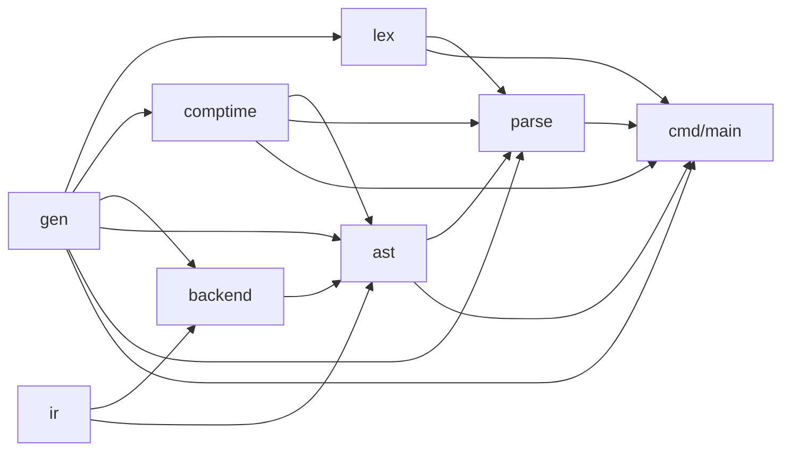

# yh 编译器 AST 模块拆分设计

日期：2026-10-12。状态：**已实施**（Linux/WSL 上 `make`、`make test`、
`make selfhost-native` 全绿，并按流程滚 Linux 种子）。相关决定见
[ADR-0007](../adr/0007-yh编译器使用源码模块.md)（编译器使用源码模块）与
[ADR-0006](../adr/0006-yh自举产物为主要开发编译器.md)（滚动自举）；
模块化沿革见[编译器源码模块化设计](yh-编译器源码模块化设计.md)。

## 1. 问题

0.0.3 的编译器按 lex / parse / gen / comptime / ir / backend / cmd 七模块组织，
其中 `parse/` 同时承载两件事：语法分析器（`parse_*.yh`、`iface*.yh`）与
**AST 阶段**（`ast_*.yh`，11 个文件）。yh 的编译单元是**模块**（一个模块产出
一份 `.s` / `.s.i` / `.s.ct`），于是：

- `yh-parse.s` 是全部模块中最大的编译单元（3.31 MB），AST 占其中约 1.13 MB；
- 任何 AST 改动都要重编整个 parse 单元（含语法分析器），AST 与语法分析
  无法并行；
- 模块图上没有「AST 阶段」这一层，Nanopass 风格阶段边界（ADR-0011）无处附着。

## 2. 目标与非目标

目标：

1. AST 阶段独立成模块 `ast`，编译单元与并行度按阶段切分；
2. 不改变语言语义、产物行为与既有验收口径；
3. 为后续受检表示 / Core 阶段（NP3）留出模块边界。

非目标（本次不做）：不改任何 `.yh` 语言规则；不拆 SSA 与后端；不做 pub 收缩；
不引入新的中间表示（NP 优化管线仍是后续工作）。

## 3. 拆分结果

### 3.1 文件归属

| 模块 | 文件 | 职责 |
| --- | --- | --- |
| `ast/`（新） | `ast_decl.yh` | 文件级声明节点与函数体关联 |
| | `ast_expr.yh` | typed 表达式 AST、绑定/常量快照与结构校验 |
| | `ast_stmt.yh` | 语句树、绑定关联、编译期 `$for` 模板目录 |
| | `ast_function.yh` | 函数上下文 arena 切片与编译期导出 |
| | `ast_ir.yh` | 函数级 typed SSA 构造接线 |
| | `ast_ir_build.yh` | AST → typed SSA 构造器 |
| | `ast_ir_call.yh` | 固定/变长调用的目标符号与实参降低 |
| | `ast_ir_control.yh` | 局部赋值、受限分支 CFG/phi |
| | `ast_ir_inline.yh` | 编译期内联候选登记与套用 |
| | `ast_ir_template.yh` | 编译期 `$for` typed AST 模板实例化 |
| | `ast_ir_cache.yh` | 目标隔离的函数 IR 内容键与缓存 |
| `parse/`（保留） | `parse_type/expr/stmt/decl/global_init/module/comptime/ct_layout.yh`、`iface*.yh` | 语法分析、接口导出、编译期语法接缝 |

### 3.2 模块依赖图

（箭头读作「上层使用下层」：`X --> Y` 表示 Y 的源码 import X。）

文字版（import 方向）：lex→gen；comptime→gen；ir→（无）；backend→gen,ir；
ast→gen,comptime,ir,backend；parse→gen,lex,comptime,**ast**；
cmd→gen,lex,parse,comptime,**ast**。模块图无环。

### 3.3 解环：`is_assign_op` 迁入 gen

拆分前 `parse/ast_stmt.yh` 调用 `parse/parse_type.yh` 的 `is_assign_op`；AST 独立后
这条边会是 ast→parse，与 parse→ast 构成环。该函数是纯 token 判定，按 ADR-0007 P3
的既有先例（`err_tok` 自 `parse_type.yh` 迁入 `gen/buffer.yh`）迁入
`gen/buffer.yh`，两处调用改为 `gen.is_assign_op`。

### 3.4 跨模块状态：访问函数而非导出 let

「let 不导出」（2026-10-02 起）意味着 AST arena 的模块级可变状态无法直接跨模块
读写。拆分后有 7 个 AST 状态被 parse/cmd 使用（`ast_stmt_nodes`、`ast_stmt_current`、
`ast_expr_nodes`、`ast_expr_parse_depth`、`ast_expr_count`、`ast_stmt_count`、
`ast_binding_count`），另有语句节点 `first_child` 字段读取，按 `gen.G()` 的既定模式
在 ast 模块内补 12 个 `pub fn` 访问函数（读 9 / 写 3），调用点约 33 处：

| 访问函数 | 用途 |
| --- | --- |
| `ast_expr_count_now` / `ast_stmt_count_now` / `ast_binding_count_now` | 编译期模板区间测量 |
| `ast_expr_depth_add` / `ast_expr_depth_now` | `$if` 表达式的 capture 语义门 |
| `ast_stmt_current_now` | 当前语句节点（-1 表示不在语句内） |
| `ast_expr_op_set` / `ast_expr_first_of` | `$field` 字段下标与 token 起点 |
| `ast_stmt_node_kind_of` / `ast_stmt_node_first_of` / `ast_stmt_node_op_of` / `ast_stmt_node_op_set` / `ast_stmt_node_first_child_of` | 语句节点字段读写 |

`pub struct` 字段一律公开（2026-10-02 一等化），且 AST 结构类型在 parse/cmd 中
没有任何具名引用，故结构体声明无需改动。

## 4. 产物与收益（同一编译器、同一源码，仅差拆分）

| 模块 | 拆分前 `.s` | 拆分后 `.s` |
| --- | --- | --- |
| parse | 3,310,028 | 2,174,107（−34.3%） |
| ast（新） | — | 1,132,669 |
| gen | 1,959,997 | 1,960,569（+`is_assign_op`） |
| main | 1,461,958 | 1,461,844（限定调用） |
| lex / ir / backend / comptime | — | 与拆分前**逐字节一致** |

模块数 7→8，固定点产物 21→24（8 模块 × `.s` / `.s.i` / `.s.ct`）。
`lex`、`ir`、`backend`、`comptime` 的 `.s` 与 `.s.i` 逐字节一致，说明拆分对不涉及
AST 的模块完全中性；`yh-parse.s.i` 不再导出 AST 结构，`yh-ast.s.i` 新增其导出。

增量收益：改 ast 文件只重编 ast 单元与依赖方（parse、cmd），不再重编语法分析器；
改 parse 文件也不再重编 AST 与 SSA 降低代码。

## 5. 验证

见[完成报告](../01-finished/yh-编译器ast模块拆分-2026-10-12.md)。要点：
`make test`（语法正例 76/76、反例 45/45、运行语料 292/292），
`make selfhost-native`（cc3→cc4 共 24 个产物逐字节一致、cc4 自解析 71 个源文件、
modules 17/17、项目验收 86/86），随后滚 Linux 种子并用新种子复跑主门全绿。

## 6. 后续

- pub 收缩：2026-10-12 已完成（`pub` 声明 1048 → 585，`ast` 87 → 78）；
  `struct` 受「类型必须写 pub」的语言规则限制，不能私有化，见
  [模块导出面收缩设计](yh-编译器模块导出面收缩设计.md)。
- NP3/NP4：受检表示 / Core 与机器 IR 可继续按模块边界落位
  （[Nanopass 设计](yh-Nanopass风格优化架构.md) §9）。
