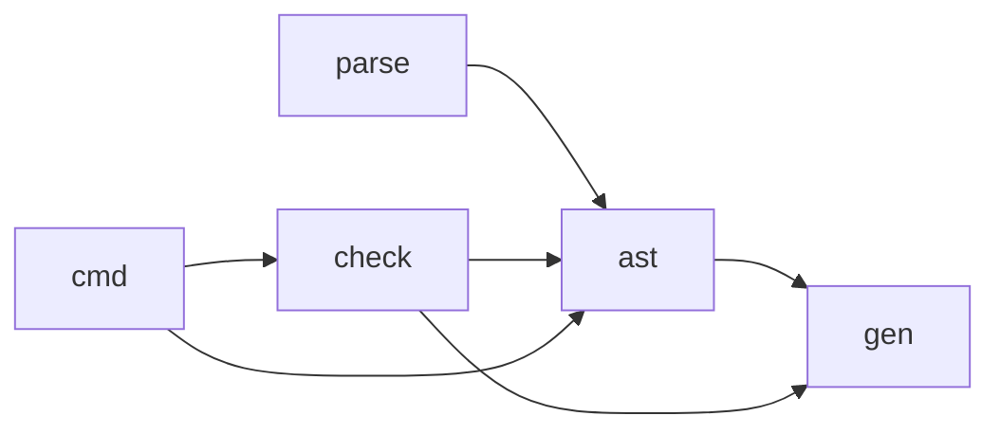

# yh 编译器 check 模块拆分设计

日期：2026-10-20。状态：已实施（含快照校验迁移）。

## 背景与边界

`ast` 同时承担节点捕获和表达式、语句、声明、函数上下文四类一致性检查。
检查逻辑只读 arena，却直接读取 `ast` 的私有数组，导致 AST 数据构造与结构
校验无法独立编译、替换或测试。本设计将四项结构校验迁入 `compiler/check/`，
`ast` 继续负责捕获、节点构造、编译期导出和 SSA lowering。

本拆分不迁移 `parse` 或 `gen` 中的语义检查，不调整语法和 lowering。初始
arena 校验拆分后，第二阶段继续将 `CheckedModule` 快照一致性校验迁入 `check`。

## 边界与依赖

`ast` 导出只读借用视图 `AstView` 及 `ast_view(out *AstView)`。视图包含表达式、
语句、语句表达式边、绑定、编译期 `$for` 模板、声明与函数上下文的 arena
指针和计数，以及表达式解析深度、当前语句根链和函数封存状态。`AstView`
和校验使用的节点类型公开；原有构造状态与 arena 所有权仍留在 `ast`。

视图不复制、不分配，也不转移所有权。调用方仅能在 AST 捕获完成后、任何
AST 修改或 reset 发生前借用；`check` 按只读约定访问。捕获关闭时，统一入口
直接返回成功。

`ast/parse` 不依赖 `check`，避免前端捕获反向依赖验证器。`cmd` 在所有原有
校验位置创建视图并调用对应入口，然后继续既有 lowering。

## 校验契约

`check.verify_module(view)` 按表达式、语句、声明、函数上下文顺序执行；每个
具体校验器为模块私有。节点关系、返回成败和 `gen.fail` 具体诊断沿用原实现。
入口用不同的非零状态表示失败阶段，以便原调用点继续输出原有外层诊断；调用方
只依赖成功为 0、失败非零。

校验不写入节点、计数、链接或解析状态。表达式、语句、声明、函数上下文的
具体校验条件保持原样；修改只限于将隐式访问换成 `AstView` 字段访问。

## CheckedModule 快照校验

`ast.CheckedModuleView` 以借用指针和计数公开快照自有表、嵌套数据及目标身份；
它不复制、不分配、不转移所有权，仅在所有者有效且未修改时使用。快照结构与
闭包规则由 `check.verify_checked_module` 只读验证，`ast.checked_module_capture`
只负责安全复制和所有权提交。所有调用方必须在读取或 lowering 前验证快照，
验证后到 lowering 期间不得修改。

`ast` 不依赖 `check`，因此捕获和 lowering 保持在 AST 模块内，项目 worker 与
单文件 LLVM 入口在捕获后调用 `check`。分配、复制和释放所需的非空指针 guard
留在捕获器；SSA 函数/模块验证仍由 `ir` 负责。这些边界避免循环依赖，也不把
语言语义检查迁入 AST 一致性校验模块。

## 验收

- 独立项目探针覆盖成功与损坏 arena/快照、捕获关闭和只读行为。
- 项目验收脚本把当前编译器中实际需要的模块源码复制到 `tmp/` 后运行探针。
- Linux/arm64 容器执行 `make`、`make test`、`make selfhost-native`；固定点覆盖
  新增的第九个模块，不更新入库种子。

实施结果：三条调用路径已迁移，`parse` 不依赖 `check`；Apple Container Linux/arm64
验证通过。arena 迁移阶段固定点报告 128 项产物一致；快照迁移的追加验证见
[完成记录](../01-finished/yh-check模块拆分-2026-10-20.md)和对应的
[实施方案](../02-plan/yh-CheckedModule校验迁入check方案.md)。
