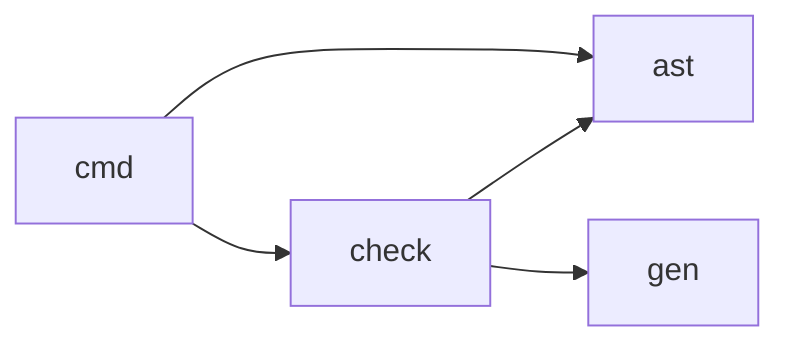

# yh 自举编译器按目录模块化设计

日期：2026-09-30。状态：**已实施**（2026-09-30 完成四模块成模，
`make` 由入库种子 `bin/yh` 冷编 `compiler/` 项目产出根 `yh`；
清单为 `compiler/project.toml`，`make selfhost-native` 全绿）。
实施步骤见[详细方案](../02-plan/yh-编译器模块化详细方案.md)，
架构决定见 [ADR-0007](../adr/0007-yh编译器使用源码模块.md)。

2026-10-20 补记：当前编译器已扩展为九模块，AST 一致性校验从 `ast` 拆入
`check`。下文记录 0.0.3 首轮四模块成模时的设计基线；当前 `check` 边界见
[check 模块拆分设计](yh-编译器check模块拆分设计.md)。

2026-10-22 补记：新增第十个模块 `builtin`（`compiler/builtin/prelude.yh`），
把内置（prelude）函数登记表从 `gen/symbols.yh` 迁出：`builtin` 只 `import gen`，
用 `gen.prelude_add` 写符号表并设置 `F_*` 标志；`gen` 不反向 import `builtin`，
入口模块在 `gen.ty_register_builtins()` / `gen.scope_push()` 之后调用
`builtin.sem_register_prelude()`。运行时函数体仍在 `backend/llvm_*_runtime.yh`，
本次只搬登记层，不改 prelude 名字、签名、顺序或运行时行为。

## 1. 现状与边界

编译器源码已按 **lex / parse / gen / cmd** 四模块成模，共 29 个 `.yh`
文件、约 1.5 万行：`lex/lexer.yh`；`parse/{parse_type,parse_expr,ast_expr,
ast_stmt,ast_decl,parse_stmt,parse_decl,parse_global_init,parse_module,iface}.yh`；
`gen/{model,buffer,symbols,target,sem_value,sem_expr,sem_decl,sem_flow,
sem_call_literal,emit_arm64}.yh`；
`cmd/{driver,compile,toml,project_state,project_index,project_resolve,
module_build,link_cache}.yh`。清单 `compiler/project.toml`（name = `yh`，
version = `0.0.3`，source = `.`），无 `entry` 字段——入口是
`cmd/*.yh` 中的 `module main;`。

0.0.3 起仓库已无 C 版 stage0（[ADR-0006](../adr/0006-yh自举产物为主要开发编译器.md)
的冻结对象随 `src/` 一并删除），也没有 `bootstrap/`；构建种子是入库的
`bin/yh`（哈希见 `bin/yh.sha256`）。项目使用 `project.toml`、`module`、
按短名 import 及本项目→标准库→直接依赖的搜索顺序；没有 internal 特例。

先前在 tmp/compiler-modularization/probe/ 进行的“17 文件同属一个
module compiler”实验成功，也生成可自编译的可执行文件。它证明现有
项目构建器可用，但不能证明四目录接口已通过。graphify 本轮扫描会
跳过 .yh，不能作为目录间调用图；以下函数边根据实际源码逐项复核，
最终仍由项目构建与运行用例确认。

## 2. 推荐模块图

保持当前四个目录作为四个 yh 模块：

~~~mermaid
flowchart LR
    G[gen] --> L[lex]
    G --> P[parse]
    L --> P
    G --> C[cmd]
    L --> C
    P --> C
~~~

上图只表达“下层被上层使用”，以实际 import 写法说明更准确：

- lex 的使用文件 import gen；
- parse 的使用文件 import gen、lex；
- cmd 的使用文件 import gen、lex、parse；
- gen 不 import 其他编译器模块；任何模块都不 import cmd。

gen 拥有 model、buffer、symbols、sem、target、emit；lex 拥有 lexer；
parse 拥有 parse_*、iface；cmd 拥有 toml、project、module_build、
link_cache、driver 及编译编排。模块内可以继续分多个文件，不靠每个文件建模块
取得“模块化”名义。

~~~toml
[project]
name = "yh"
version = "0.0.3"
source = "."
~~~

清单保留在已有 `compiler/project.toml`。清单**没有 `entry` 字段**：入口
由源码中的 `module main;` 决定（`compiler/cmd/*.yh` 声明
`module main;`），与目录名无关。`source` 是 compiler 当前目录，构建时
在 compiler 目录内寻找此清单；构建种子在仓库根的 `bin/yh`，本就在
扫描范围之外（无 `bootstrap/`）。

## 3. 为无环图移动的具体函数

当前 gen/sem.yh 的 sem_compile 调用 parse_source、
parse_source_globals、parse_source_fns，导致 gen→parse；把整个
编译编排函数放进 cmd/compile.yh，gen 只保留语义钩子和发射。
cmd 早已调用这些解析入口，归属一致。

parse/parse_type.yh 的 err_tok 只用 gen 自有的 token 位置和
err_lc，却被根目录 symbols.yh 的 sem_err 等函数调用。把 err_tok
放到 gen/buffer.yh，避免 gen→parse；parse 通过 gen.err_tok 使用。

cmd/toml.yh 的 tml_intern_str 只处理通用名字池字节，却被
parse_decl 和 iface 使用。把它提为 gen/symbols.yh 的通用辅助函数，
再更新 cmd、parse 的调用，避免 parse→cmd。函数 tml_intern
仍处理 TOML 自有缓冲，留在 cmd。

根目录 iface.yh 同时调用 parse_*、lex_all，parse 又调用其中的
mod_ns_lookup。把 iface 放入 parse，同模块互调，无需制造独立
iface 模块。model、buffer、symbols 归 gen，使 Tok、Res、类型表和
发射状态与主要实现属于同一模块。

上述是已知的函数反向边；共享全局变量也要检查。若首次四模块探针
发现新的反向依赖，按提供函数/状态的实际职责修正本节，不绕过
模块导入环诊断。

一次按函数名的近似扫描，在假定这三处函数已迁移、根部四文件已归位
后，只得到 cmd→gen/lex/parse、parse→gen/lex、lex→gen 的调用方向；
该扫描没有做完整 yh 解析，也不包含直接访问全局变量，所以只作为
小项目探针的候选图，不能替代真实接口导出和项目构建。

## 4. 模块接口和状态

当前接口生成器只能导出本模块定义的具名类型。把 Tok、Res、CType、
CSym 等放在 gen，使 gen 的 pub 函数签名可引用自己的类型。parse
对 cmd 的公开入口尽量只用内建类型；cmd 为入口模块，无需被 import。
这样可以先使用现有接口格式，不把语言级接口扩展变成本轮前置目标。

gen/model 中有大量可变全局表，lex、parse、cmd 暂时会读写部分表。
只有跨模块真实使用的声明与结构字段才导出；每个 pub 应能找到
对应消费者。先让接口实际可编，再按改动成本收紧状态访问。不把
307 项全部 pub 作为自动步骤，也不引入万能 CompilerContext。

每模块独立子进程编译，错误诊断仍指向源文件；项目绑定身份从
cmd 的索引传到 parse/gen，不在模块边界重新搜索同名提供方。
.s 与 .s.i 必须成对发布，失败不能留可命中的半成品。模块缓存键已包含编译器
二进制身份；过渡对象/链接缓存按汇编、对象、参数和目标配置校验，但尚未包含
外部工具版本，自举代次仍须隔离缓存。

## 5. 文件拆分与顺序

目录模块和文件拆分是两件事。先保证构建与四模块接口，再在原模块内
按完整函数边界拆分 sem.yh（2403 行）、project.yh（1390 行）、
parse_decl.yh（1215 行）；具体文件名、原函数范围和每步测试见
[实施方案 §5](../02-plan/yh-编译器模块化详细方案.md)。
emit_arm64.yh 为 1014 行，只略超建议上限，先保留；symbols.yh
981 行、parse_expr.yh 913 行先保留。`module_build.yh` 当前 1183 行，
新拆出的 `link_cache.yh` 290 行独立管理对象与链接缓存。

gen 模块中的模型声明必须先于引用它的文件读取。给 model 文件稳定
序号前缀，并检查项目构建器实际扫描顺序；不要以“文件系统通常排序”
代替验证。文件重命名、函数迁移和语义修改分开验收，便于定位回归。
所有新函数/结构体保留详细中文注释。

## 6. 种子、自举与正式验收

0.0.3 起没有 stage0：种子是入库的上一代编译器二进制 `bin/yh`（哈希
`bin/yh.sha256`），构建时对 `compiler/` 项目执行一次 `yh build`。不需要
扁平化器剥离 module/import。

~~~text
bin/yh ──yh build──▶ cc2（冷编）
cc2   ──yh build──▶ cc3（冷编）
~~~

每代冷编（`compiler/tmp/yh-build` 缓存键不含编译器身份，滚动代次下冷编
才安全）。比较 cc2 构建 cc3 产出的全部模块 `.s`/`.s.i` 是否逐字节一致；
另让各代运行语法、运行、模块项目及诊断语料。链接后二进制需要可运行，
不默认要求跨链接器逐字节相同。

日常主门 `make selfhost-native`（两代模块固定点 + 自解析 + 全量语法/运行
语料 + 模块语料 + 项目验收），实现见 `tests/selfhost/native-selfhost.py`
与 `tools/selfbuild-gate.py`；旧的单文件固定点脚本 `make bootstrap` /
`make g3` 已随 stage0 删除而移除。全绿后 `make seed` 滚种子。

正式代码修改的每一步都新增 tests/ 里的 .yh 正反或运行用例，
运行 make 和相关门；Windows 在 WSL 内执行。计划状态写
docs/todo.md，实际命令和结果写 docs/finish.md 与
docs/01-finished/。2026-09-30 历史记录：当时仅修订方案，未填充空清单或改动
用户移动的源码。

## 7. 现行 AST 校验模块边界（2026-10-20）

`check` 只依赖 `ast` 与 `gen`，通过 `ast.AstView` 读取表达式、语句、声明和
函数上下文 arena，并通过 `ast.CheckedModuleView` 读取独立快照；`cmd` 调用统一
校验入口。两种视图都不拥有内存，仅在对应 AST/快照仍有效且未修改时使用。
`parse` 不依赖 `check`，AST 构造、编译期导出、快照构造与释放、只读访问器及
SSA lowering 仍属于 `ast`，快照一致性验证由 `check` 承担。

`ast.checked_module_capture` 只做快照复制安全检查，不调用 `check`；调用方必须在
快照读取或 lowering 前调用 `check.verify_checked_module`。`ast.lower_module` 本身不
依赖验证器，调用方负责保证验证后快照未被修改。`ir` 的 SSA 函数/模块验证继续归
`ir`，不属于 AST 一致性校验。
