# yh 当前编译流程图（`yh build`）

修改时间：2026-11-06

状态：**当前实现参考**，对应 `llvm` 分支的 LLVM 唯一后端。逐阶段文字说明见
[编译流程-当前实现](yh-编译流程-当前实现.md)；目标架构见
[架构设计](yh-架构设计.md)。

## 生产构建

```mermaid
flowchart TD
    A["yh build ..."] --> B["cmdline.parse_request<br/>argv → CliRequest"]
    B --> C["cmd/driver: cmd_session_init<br/>GenState / proj / target / argv0"]
    C --> D["cmd/cmd_build → build.mb_cmd_build"]
    D --> E["mb_load_stdlib<br/>加载标准库项目"]
    E --> F["pj_find_root / pj_load_project<br/>project.toml + 依赖 + 源码扫描 + 模块索引"]
    F --> G["pj_bind_imports<br/>KEY.MOD → 本项目 → 标准库 → 直接依赖"]
    G --> H["入口模块 + pj_topo<br/>proj.order[]"]
    H --> I["proj.build_dir<br/>targets/TRIPLE/llvm/OOPT"]
    I --> J["mb_schedule_modules<br/>最多 4 个 worker + InterfaceReady"]
    J --> K{"本地模块 manifest 命中?"}
    K -->|是| L["[缓存] 跳过 worker"]
    K -->|否| M{"C4 全局 action 命中?"}
    M -->|是| N["物化 obj/.s.i/.s.ct<br/>补写本地 manifest"]
    M -->|否| O["fork/COW worker<br/>Windows: --emit-module 子进程"]

    O --> P["lex<br/>token + 源位置"]
    P --> Q["parse pass1<br/>声明/签名索引 + gen.sem_* 语义动作"]
    Q --> R["CT 函数 / layout / globals<br/>pass2 mode 2/3/4/1"]
    R --> S["写 .s.ct / .s.i / .ready<br/>InterfaceReady：依赖方可以提前启动"]
    S --> T["parse pass2b<br/>函数体语义动作 + AST 捕获<br/>函数 check 切片可命中"]
    T --> U["check.verify_module<br/>当前只读结构校验"]
    U --> V["CheckedModule 快照"]
    V --> W["lower.lower_module_cached<br/>函数 IR 缓存可命中"]
    W --> X["ir.IRModule"]
    X --> Y["backend.llvm_emit_module<br/>IRModule → LLVM 文本（内存）"]
    Y --> Z["内嵌 LLVM 桥<br/>生成对象；--emit-llvm/--emit-asm 时额外落盘"]
    Z --> AA["原子发布 obj / iface"]
    AA --> AB["父进程 manifest 提交<br/>+ C4 全局 cache 发布"]

    L --> AC
    N --> AC
    AB --> AC["link.mb_link<br/>prepare → objects → key → args → libs → exec"]
    AC --> AD{"链接 manifest 命中?"}
    AD -->|是| AE["复用最终产物"]
    AD -->|否| AF["内嵌 lld / 平台链接器"]
    AE --> AG["输出 .build/PROJECT<br/>或 -o 路径"]
    AF --> AG
```

## 读图

- 图中只描述生产构建；`yh check`、`yh test`、单文件形态的差异见
  [编译流程-当前实现](yh-编译流程-当前实现.md) §10 与 §13。
- 缓存命中点分别对应：模块 manifest、C4 全局 action、函数 check 切片、
  函数 IR 记录和链接 manifest。
- 当前 `parse` 仍是“递归下降 + 语义动作 + AST 捕获”，`check` 仍是只读结构
  校验器；目标的两遍化（纯语法 `parse` + `check.resolve/expand/full`）尚未迁移。
- 对象粒度是模块级；文件级对象未落地，函数级 `.o` 暂缓。
- Windows 无 fork，模块 worker 走 `--emit-module` 子进程；Windows 项目锁
  仍是占位实现。
