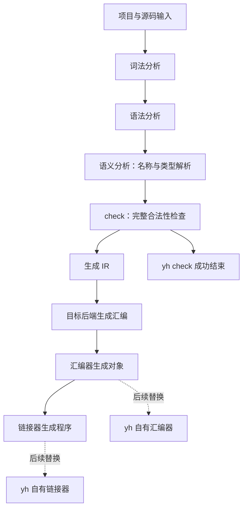

# yh 编译流程设计决策树

日期：2026-10-01。状态：D1–D15 与完整方案均已确认，GrillMe 研讨结束；R0–R6 已进入实施。
本文件记录已确定需求、已核对事实与整体评审结果；实施状态见
[计划](../02-plan/yh-编译流程重规划实施方案.md)与[待办](../todo.md)。
方向决定见 [ADR-0009](../adr/0009-yh采用check与IR及早期并行.md)。

当前并行过渡实现由 exec worker 演进为 fork/COW worker：父进程一次扫描项目并
生成词法快照，worker 继承只读输入、隔离可变语义状态，声明索引按实际重建模块
惰性执行。阶段计时与对齐 64 位内容指纹优化后，20 轮 M1 数据为无改动 32.8/37.3ms、
改单函数 663.2/753.4ms、冷编 1,734.1/1,900.6ms（中位数/p95）；无改动已达
50ms 目标，函数修改与冷编目标仍未达到。详细阶段数据见[R2b 阶段计时报告](../01-finished/yh-编译流程R2b缓存指纹分块与阶段计时-2026-10-01.md)。

## 1. 已确认方向

- 主线为词法 → 语法 → 语义 → check → IR → 各平台汇编 → 汇编 → 链接。
- 增量编译速度第一，冷编第二；时间包含汇编和链接。
- check 是独立逻辑阶段，覆盖完整类型、控制流、可见性等合法性
  检查，提供 yh check 命令，在 IR 前结束；允许合并部分遍历提速。
- 多模块并行是早期架构要求，不后置为收尾优化。
- 最终 yh 与普通 yh 程序不需要外部工具、shell、libc/CRT，保留
  OS API；开发与测试工具暂允许。后续自研汇编器、链接器及所需运行时。
- 首批 macOS arm64 与 Linux arm64；Linux 先完成自有汇编/链接
  闭环，再扩展 x64 和 Windows。
- 首版采用 SSA IR，线程池与任务私有上下文；迁移过渡可用进程 worker。
- 模块公开声明、类型和常量完成检查后，下游可在本次构建内提前
  使用只读接口；不必等待私有函数、IR 和汇编完成。持久产物单独提交。
- 增量粒度是文件解析、函数 check/IR、文件对象；公开接口变化
  首版保守扩大失效范围。
- macOS 可保留经过审核的 libSystem OS 接口与 dyld，按导入 API
  验收；内存、字节操作、格式化和语言启动由 yh 自己实现。
- Linux 自有工具链首版限定为 yh 后端/运行时汇编子集、普通目标
  文件与静态 ELF；默认仅低成本优化，昂贵优化留给显式发布模式。
- 词法/语法可跨目标共享，check/IR 首版按目标数据模型与 ABI 隔离。
- 最终工具链在固定约 1.3 万行语料、本机 M1、无常驻守护进程下，
  暂定无改动≤50ms、真实单函数修改≤200ms、冷编≤1s，均含汇编链接。
- 允许按职责重组 compiler/ 内部模块，控制公共模块、模块数量和依赖环。
- 独立配置不提供隐式 system；编译器改用显式 OS 进程 API，旧行为
  只留在过渡兼容配置。
- 上一轮“保留 token 驱动、延后 IR 与并行”的建议已撤回。



阶段顺序、D1–D15 和具体工程方案已由用户整体确认；
研讨收敛不表示编译器已经实现这些能力。

## 2. 决策前沿

### 第一轮：已确认

| 编号 | 用户答案 | 影响 |
| --- | --- | --- |
| D1 | 增量第一，冷编第二，包含汇编和链接 | 需要分别测无改动、函数修改、接口修改与冷编的端到端时间 |
| D2 | check 是独立逻辑阶段与命令，允许合并部分遍历 | 保留阶段契约，避免为了阶段名强制重复遍历；IR 只接收受检输入 |
| D3 | 产品无外部工具/shell/libc/CRT，保留 OS API | 自研汇编/链接还必须配套最小运行时、程序入口、宿主接口 |
| D4 | 首批双 arm64，Linux 先闭环自有工具链 | 实施分别覆盖平台 ABI/对象格式，后续再增加 x64/Windows |

### 第二轮：已确认

| 编号 | 选择 | 推荐候选 | 依赖 |
| --- | --- | --- | --- |
| D5 | IR 路线 | 用户选择首版 SSA，接受更多前期成本；与原非 SSA 推荐不同 | D1、D2 |
| D6 | 并行执行模型 | 线程池及任务私有上下文；迁移过渡可用进程 worker | D1、D3 |
| D7 | 依赖方的启动条件 | 公开声明/类型/常量完成检查后提供本次构建内的只读接口；不等待依赖后端 | D2 |
| D8 | 增量缓存粒度 | 文件解析、函数 check/IR、文件对象；接口变更首版保守扩大失效 | D1、D2 |

### 第三轮：已确认

| 编号 | 决策事项 | 用户答案 |
| --- | --- | --- |
| D9 | macOS 的 OS 库与 API 边界 | 允许审核后的 libSystem OS 接口，禁止通用 C 服务；披露 dyld/libSystem |
| D10 | Linux 自有汇编/链接首版范围 | yh 后端/运行时汇编子集、普通对象、静态 ELF 程序 |
| D11 | 默认优化成本 | SSA 前提下默认低成本优化，昂贵优化放后续显式发布模式 |
| D12 | 多目标缓存共享 | AST 可共享，check/IR 首版按目标数据模型与 ABI 隔离，后续证明等价再复用 |
| D13 | 最终工具链性能目标 | 固定约 1.3 万行/M1/无守护进程：无改动≤50ms、真实函数修改≤200ms、冷编≤1s；只是待验收目标 |

这些候选均已接受。不能将性能目标写成已实现保证，或者无条件承诺
布局敏感 IR 在所有平台复用。

### 第四轮：已确认

| 编号 | 决策事项 | 用户答案 |
| --- | --- | --- |
| D14 | 编译器内部模块 | 允许按职责重组；公共模块只放必要数据与基础能力，控制模块数量和依赖环 |
| D15 | system 与无 shell 的边界 | 编译器用显式 OS 进程 API；独立配置不提供隐式 system，旧行为仅在过渡兼容配置保留 |

最终共同理解在规划评审时确认，用户当时要求不开始编码；之后用户明确启动实施。
本轮决策前沿为空；R0–R3 正在分片实施，R1/R2a/R2b 已有阶段切片但未达到
整体验收，完整进度见
[待办](../todo.md)与[实施记录](../finish.md)。

```text
已确认：增量优先、check/IR、早期并行、产品独立、首批双 arm64
├─ D5：IR 路线
│  ├─ 表示契约、值/内存/控制流/调用指令
│  ├─ 目标数据布局与平台共享范围
│  └─ IR 校验与默认优化成本
├─ D6：执行模型
│  ├─ worker 生命周期、任务私有状态、只读共享输入
│  └─ 并行资源上限、诊断与产物确定性
├─ D7：接口就绪
│  ├─ pub 常量与类型布局的就绪条件
│  └─ 私有函数失败后的取消、回收与提交规则
└─ D8：增量粒度
   ├─ 失效依赖与稳定身份
   └─ 性能规模、硬件、时间及内存预算

自有工具链（已确认方向）
├─ 首批汇编子集、对象格式、重定位和链接范围
├─ 最小运行时与启动契约
└─ 各宿主 OS API 的依赖边界与验证
```

## 3. 与速度和并行直接相关的事实

源码基线为 `8e17bdb`。静态路径计数不能当作加速比例；旧流程实测
另见第 6 节。当前 25 个 `.yh`，464,518 字节、13,338 行。

冻结的 R0 基线未设置 YH_STDLIB、四模块全部冷编成功时，父进程与四个子进程分别
索引完整项目，产生 125 次源文件词法分析；模块三遍又产生 75 次，
总计 200 次，扫描源字节 3,716,144；依赖接口另外计算。依据是
project_index 的 pj_index_file 和 module_build 的索引、三遍文件入口。
新设计需要避免每个 worker 重扫项目、每阶段重复读源和词法。

这是 R0 优化前的热缓存表现。当前对象/链接缓存下，无改动会继续扫描/哈希输入，
但汇编/链接调用降为 0/0，编译器身份每构建读取一次；函数变化仍是 1/1。
最新 20 轮端到端测量见[函数 IR 缓存切片报告](../01-finished/yh-编译流程R2b函数IR缓存切片-2026-10-01.md)。

源码主项目依赖链为 gen → lex → parse → main，独立 `ir` path 依赖由
parse 导入。当前调度仍等待模块对象完成后再编消费者，因此没有任务重叠；
需要把公开接口完成与私有函数/对象完成分离，才可兑现并行推进。
需分别测有独立分支的 DAG 和自举项目，不用 worker 数代替速度证据。

pub 函数显式签名、pub 变量类型、结构体/联合体字段与布局可在函数
体前确定；pub const 和枚举成员必须完成常量求值。当前已提前写
接口，但 iface_emit 以 O_TRUNC 直接写最终文件，不能作为安全通知。

源字节/token/游标、名字池、类型/符号/作用域、输出缓冲、函数帧和
标签均是 gen/model 的可变全局。项目还共用
`/tmp/yh-proj-scratch.txt`。直接并发调用或仅给标签加锁都不足以安全
并行；新架构必须区分任务私有状态与可共享的只读输入。

## 4. 脱依赖的事实边界

| 层 | 当前依赖 | 需要替代的职责 |
| --- | --- | --- |
| 外部工具 | clang/gcc 汇编与链接 | 指令编码、对象读写、重定位、程序格式 |
| shell/命令 | `--legacy-system` 兼容接口；目录枚举已改为 Darwin `getattrlistbulk` / Linux arm64 `getdents64`，环境向量直接经 `envp` 读取 | 移除兼容 shell 接口；继续替换进程/线程宿主调用 |
| 运行时 | malloc/free/memcpy/open/read/write 等外部符号 | 内存、字节操作、I/O、退出、程序入口 |
| OS/装载器 | 当前 Mach-O 的 dyld 与 LC_MAIN | 按平台明确保留的 OS API，不能与 libc/CRT 混称 |
| 开发测试 | make、Python、ANTLR/Java、CI 打包工具 | 产品依赖与开发测试依赖分别验收 |

file、otool -L/-l、nm -u 的只读检查确认 yh/bin/yh 为 Mach-O arm64，
链接 libSystem.B.dylib，并引用上述运行时符号。自研汇编/链接不能
独自取消所有这些依赖；平台 OS API 的具体适配仍需核对官方契约。

## 5. 当前记录边界

规划评审结束后，用户明确启动 R0–R6 实施。R0 已完成；R1 的 token/声明索引、
`yh check` 与 AST/绑定为迁移切片；R2a 已有独立 typed SSA、低成本简化、稳定序列化、
指令字段校验，以及标量参数、顺序单绑定 `let`/同类型标量赋值、简单分支/phi、整数算术/比较和固定参数标量直接调用。
这部分受检函数已由 SSA arm64 后端发射，其他函数仍走旧发射路径。直接调用 IR 保存稳定的目标符号与变长带类型实参，
项目回归覆盖嵌套、九参数、调用副作用及跨模块链接；自编项目 528 个函数上下文仅 5 个进入 SSA。
R1 的独立 check/任务私有状态/接口就绪和函数 check 缓存、R2a 的完整 AST→SSA/双平台后端、
R2b–R6 仍按实施方案推进；当前有限 IR 子集缓存不能替代这些交付要求。
R3 已开始兼容配置迁移：默认不提供 `system`，显式 `--legacy-system` 才开放；
汇编、链接和运行通过 argv 调用宿主程序，目录扫描已转为 OS API；
构建目录通过 `mkdir` OS API 创建，自举门使用默认配置。编译器入口直接扫描
`envp` 读取 `PATH` 与 `YH_STDLIB`，`printenv` 依赖已移除；目录扫描使用 Darwin
`getattrlistbulk` 和 Linux arm64 的 syscall 适配，特殊文件名、隐藏项与大目录
有项目回归。Linux arm64 适配已交叉编译并组装为 ELF，但原生验证、runtime 与导入审计未完成，完整 R3 仍未完成。
`memcpy`、`strlen` 已有自有 arm64 汇编入口，直接与函数值调用、边界长度和 UTF-8
用例通过；普通程序与自编编译器导入审计已确认不再依赖这两个 C 符号。`malloc/free`、
线程与其他运行时服务、Linux 原生验证以及自有汇编器/链接器仍待完成。

## 6. 实测旧流程基线

在 tmp/grill-pipeline-baseline/run-1/compiler 的独立副本串行测试，
YH_STDLIB 清空，以当前根 yh 构建；每次检查没有其他 yh 构建进程。
冷编仅清空项目构建缓存，没有清空 OS 页缓存。计时包括汇编和链接。

| 场景 | 3 次耗时（秒） | 中位数（秒） |
| --- | --- | --- |
| 冷编 | 3.211 / 2.478 / 5.192 | 3.211 |
| 无改动热编 | 1.915 / 3.062 / 2.420 | 2.420 |
| 函数体注释修改 | 2.504 / 2.389 / 2.230 | 2.389 |

环境：Apple M1、8 核、8 GiB、macOS 27.0 arm64、clang 23.1.1。
9 次全部构建成功且四份接口内容一致；函数体注释变化仅让 gen
重编，其余三模块命中。该负载仅验证旧的模块内容哈希失效，不能
代替新流程“真实函数体变化”的验收，也不能据波动说它比热编快。
结果与逐次日志在仓库 tmp/grill-pipeline-baseline/run-1/，可清理。

## 7. SSA 与平台契约的事实依据

Braun 等人的按需 SSA 构建算法可在 CFG 尚未完整时放置未完成 phi，
在块不会新增前驱后封闭并补齐操作数。yh 有 goto、break、switch 和
循环回边，不能把“已经扫描到标签”当作前驱已经完整。该算法是待
评估候选；尚未承诺具体加速比例。[作者论文](https://pp.ipd.kit.edu/uploads/publikationen/braun13cc.pdf)

语言 check 与内部 IR 校验分别验收：SSA 定义须支配使用，phi 输入
须对应前驱边且类型一致。标量值 SSA 不要求首版实现 MemorySSA；
有地址/别名的存储可保留显式 load/store，调用的副作用必须明确。
[LLVM well-formedness](https://llvm.org/docs/LangRef.html#well-formedness)、
[phi 契约](https://llvm.org/docs/LangRef.html#phi-instruction)、
[MemorySSA 的独立分析结构](https://llvm.org/docs/MemorySSA.html#memoryssa-structure)

macOS 的 libSystem 同时承载 OS 接口与标准 C 功能，不能只按库文件名
判断是否直接使用 malloc/printf 等。Apple 2011 年归档说明不保证内核
syscall 接口二进制兼容；Go 1.12 Darwin 则改用 libSystem 执行系统
调用。Linux 官方文档将 syscall 列为稳定的内核接口，但架构各异。
[Apple intro(3)](https://developer.apple.com/library/archive/documentation/System/Conceptual/ManPages_iPhoneOS/man3/intro.3.html)、
[Apple QA1118](https://developer.apple.com/library/archive/qa/qa1118/_index.html)、
[Go Darwin 说明](https://go.dev/doc/go1.12#darwin)、
[Linux syscall ABI](https://github.com/torvalds/linux/blob/master/Documentation/ABI/stable/syscalls)
