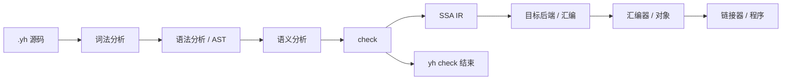
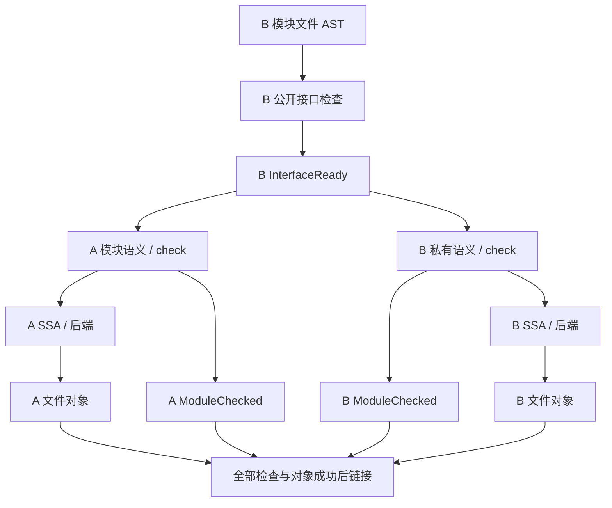

# yh 编译流程重规划

日期：2026-10-01。状态：D1–D15 与完整方案均已确认；R0 已完成，R1、R2a、R2b、R3 持续实施。
本方案替代上一轮保留 token 直发射、延后 IR 与并行的建议。

[决策树](yh-编译流程设计决策树.md)记录问答与事实，
[ADR-0009](../adr/0009-yh采用check与IR及早期并行.md)记录路线，
[实施方案](../02-plan/yh-编译流程重规划实施方案.md)规定任务与验收。

## 1. 用户已确认的目标

增量速度第一，冷编第二；两者计入汇编与链接。首版 IR 就采用 SSA，
默认只做低成本优化。多模块并行、线程池与任务私有状态属于早期架构，
不能等后端全部开发结束才处理。

主线为：

首批 macOS arm64 与 Linux arm64；Linux 先完成自有汇编/链接闭环，
随后补 macOS 闭环，再扩展 x64 和 Windows。最终 yh 与普通 yh 程序
不需要外部工具、shell 或直接使用 libc/CRT 服务，继续使用 OS API。
macOS 可保留审核后的 libSystem OS 接口与 dyld，必须披露并按导入 API
验收；这项承诺不等于“零系统库”或对 OS 库内部实现的承诺。
开发与测试阶段可继续使用 make、Python 等工具。

保留用户语言的 module/import/pub 规则、仅 .yh 源文件、project.toml
清单及滚动自举。允许重组 compiler/ 内部模块，不扩大语言特性。
独立配置不提供隐式 system；旧行为只在迁移期兼容配置中保留。

## 2. 现状与性能问题

源码基线为 8e17bdb：25 个 .yh、464,518 字节、13,338 行。
基线语义分析与 AArch64 汇编发射交织，没有持久 AST/IR；当前迁移版已在普通 build
同步收集 AST，为受限函数构造/验证 SSA 并保存函数 IR 缓存，完整函数仍走旧发射器。
可变全局包含 token 游标、名字/类型/符号表、函数状态、输出与标签；
不能直接由多个线程共享调用。

编译器源码主项目为 gen、lex、parse、main；独立 `ir` 子项目通过本地
path 依赖加入构建，parse 导入 ir。源模块主链为 gen → lex → parse → main，
旧实现曾等完整对象后才启动消费者；当前已增加接口就绪的进程调度（见第 7 节）。
基线流程的冷构建
还会由父/子进程重复索引项目、各模块重复三遍
词法；未设 YH_STDLIB 时静态路径共 206 次词法分析（含依赖接口文本）。
R0 前的热缓存仍进行四次 clang -c 和最终链接；当前计数与复测见本节后续实施记录。

R0 基线在 Apple M1、8 GiB、macOS 27.0、Homebrew clang 23.1.1 上，针对冻结
提交 `8e17bdbb41b4dcb66306c79e784c89dc4420a6d9` 的 25 个 `.yh`、13,338
行语料，每类测量 20 次独立进程。中位数/p95 为：无改动 1.985/2.403 秒，
真实单函数体变化 2.075/2.751 秒，清 `.build` 冷编 2.455/2.741 秒。
语料冷编路径共触发 206 次词法扫描：父构建器及四个模块 worker 各索引
全项目一次，再由每个模块自身完成三遍词法/解析，并词法分析 6 个依赖接口；
无改动热构建仍扫描全项目 25 个文件，并每轮启动四次汇编器和一次链接器。
完整输入哈希、峰值 RSS、阶段访问次数和限制见
[R0 性能基线](../01-finished/yh-编译流程R0性能基线-2026-10-01.md)。
早先每类三次的试测已由这组冻结结果取代。R1 计数器加入后复核旧调用路径，
发现基线文档曾漏计依赖接口的词法分析，已在该报告中更正。

## 3. 阶段契约

阶段是逻辑边界，不要求每个边界都额外遍历全部源码。任何函数进入
IR 前必须通过自身 check；项目最终链接还必须等待所有必要检查成功。

| 阶段 | 输入 → 输出 | 职责与停止条件 |
| --- | --- | --- |
| 词法 | 源字节 → token、源位置 | 一次扫描，词法错误终止该单元 |
| 语法 | token → 文件 AST、声明/函数索引 | 保留源位置与语法结构，不解析符号、不发射汇编 |
| 语义 | AST + 模块环境 + 目标数据模型 → 绑定和类型注解 | 解析名字、导入、类型、常量、成员和调用；准备合法性检查 |
| check | 带注解的表示 → CheckedModule/CheckedFunction | 检查语言定义的类型、转换、控制流、可见性、初始化与声明规则 |
| IR | CheckedFunction/受检全局 → typed SSA + 显式内存操作 | 表达值、控制流、内存和调用；不接收未受检函数 |
| 后端 | SSA + 目标描述 → 平台汇编 | 指令选择、调用约定、phi 消解、寄存器/栈分配、符号与数据段 |
| 汇编 | 汇编 → 目标对象 | 指令编码、段、符号、重定位与对象格式 |
| 链接 | 对象 + 启动/运行时 + 链接配置 → 程序 | 布局、符号解析、重定位、入口与装载格式 |

语义分析负责解析，check 负责准入，内部实现可一次遍历同时完成。
函数的受检控制流结构可供 IR 构造复用，避免再次解析源文本。
全局数据和公开常量也必须经过检查，不能作为函数之外的漏检通道。

新增 yh check：单文件或项目完成完整前端检查后结束，不生成 IR、
汇编、对象或程序。库模块可检查而不要求程序入口；程序构建检查入口。
现有 --syntax-check 继续只做词法/语法检查，两种模式必须有不同语料。
现有 --emit-asm 走受检 SSA 后端路径。

当前已实现项目级 `yh check [module]` 的首个过渡版本：它复用现有模块
语义遍历，并由 `c_check_only` 屏蔽文本/数据段缓冲写入；不会调用汇编器、
链接器，也不会执行汇编文件写出。检查接口暂存于独立 `.build/check/iface/`
供本轮依赖检查使用，完成或失败后删除，避免覆盖正式构建缓存。R1 新增的 AST 迁移层
目前包含带类型、已解析符号与常量事实的表达式节点、带父子、表达式和绑定行引用的语句树，
以及复用 PDecl 索引的文件级声明节点；函数声明连接到函数体根。局部绑定按
`(file_id, owner_decl, AstBinding.id)` 标识，表达式通过 arena 行号指向绑定；旧 `sym_id`
只作捕获时的符号槽诊断信息。参数、局部变量/常量与 for-in 隐式绑定保存类型/类别/标志/偏移
快照，避免作用域弹出并复用符号槽后 AST 引用混淆。普通 build/check 都同步收集 AST，模块结束前
验证范围、文件归属与树/声明引用关系；它仍不是独立语法阶段产物，也不跨构建缓存。
完整 CheckedFunction、彼此独立的语义/check 遍历和任务私有上下文仍未建立，parser
仍会触及被抑制的发射路径。

普通 build 在 check 与 AST 结构校验后，将受支持的标量函数降低为 typed SSA，并运行低成本简化与 verifier。
表达式覆盖整数算术/比较、整数参数与常量、显式整数 `to_type` 转换，以及按前端公共整数类型
提升插入的窄化/扩展；入口块以连续 `PARAM` 指令定义参数。分支切片构造条件入口块和合流块，
受支持的整数函数由 AArch64 SSA 后端发射；其他函数继续走旧解析器的汇编发射。
`yh check` 不调用 lowering，stats 回归要求其 `ir_functions=0`。这是主路径接入探针，
不代表完整 CheckedFunction 或 R2a 完成。

本轮不借重构新增“所有路径必须 return”、生命周期或切片边界检查
等语言规则。保留现有已定义语义；发现旧缺陷时单列修复与正反用例。

## 4. AST、模块环境与状态归属

首次构建由项目入口统一发现文件、绑定来源与导入、检查依赖环，
生成本次构建的源码快照。每个文件只词法/语法分析一次。
worker 接收已有索引和快照，不再各自扫描整个项目。
文件内容、AST 与源位置映射可以只读共享，后续阶段不会改写 AST。
当前 build/check worker 都收集表达式、语句、函数内绑定和文件级声明节点，仍依赖每次解析的
可变 `Res` 与旧语义钩子；它不是可跨构建缓存或供 SSA builder 使用的完整文件 AST。

**函数范围切片进度（2026-10-01）**：每个函数完成语义遍历后会封存
`AstFunctionContext`，保存该函数在表达式、语句、语句表达式边、绑定 arena
中的半开区间及声明/文件身份。校验器确认区间不重叠，节点引用留在本函数范围内。
SSA lowering 按函数上下文迭代，只扫描本函数参数绑定，并按本函数表达式数分配
指令缓冲；函数 AST 同一 arena 的其余部分在 lowering 阶段只读。当前解析、语义表、
发射器与统计仍是模块 worker 全局状态，这个描述符不是完整 FunctionContext，也还不能
直接并发运行函数任务。

建议用连续节点表、索引 ID 与批量 arena 管理 AST/函数数据；
避免每个表达式单独分配堆对象。先采用可测量的简单结构，不引入
通用插件框架、全仓库查询数据库或常驻守护进程。

| 状态 | 所有者 | 共享规则 |
| --- | --- | --- |
| SourceStore、文件 AST | 构建会话 | 发布后只读，生命周期覆盖引用它的任务 |
| 模块声明、类型、导入绑定与常量 | 模块准备任务 | 完成对应依赖闭包检查后发布只读视图 |
| 局部符号、作用域、控制流、诊断缓冲 | 函数任务 | 任务私有 |
| SSA 值/块表、函数 arena、标签、后端缓冲 | 函数任务 | 任务私有，不用全局递增标签 |
| 目标数据模型、ABI 描述 | 目标实例 | 初始化后只读 |
| 调度、缓存记录、输出提交 | 构建协调者 | 统一处理依赖和提交，避免散布可变全局 |

共享类型和名字的分配需有明确归属：模块准备阶段完成可共享项，
函数新增的临时类型/名字在私有上下文内，输出用稳定描述序列化；
不以进程内地址或并发分配顺序作缓存身份。

模块登记仍遵守现有声明顺序与前向调用规则。构建入口不先对所有
模块完成语义分析再启动函数任务，也不为了并行接受当前禁止的导入环。

## 5. 首版 SSA IR

IR 按函数保存，值有明确类型，基本块以 terminator 结束。
首批指令覆盖常量、算术/比较/转换、地址、load/store、调用、分支、
switch、return 和 phi；聚合值、数组/切片按现有语义表达。
目标相关 sizeof、对齐、结构布局、整数宽度与调用信息有明确输入。

建议采用按需 SSA 构造：读变量时查当前块定义，必要时创建 phi，
在前驱集合完整后封闭基本块并补全输入。yh 的 goto、循环、break
和 switch 要纳入完整前驱关系；扫描到标签不代表该块可以封闭。
采用按需算法时，只能从指令与变量映射已经完成的 filled 块发布
后继边；sealed 块不得再新增前驱，防止读取尚会变化的前驱定义。
实现可先确定函数 CFG 再构造 SSA，或延迟封闭未完成块，以正确性
和测量结果决定。[Braun 等人的作者论文](https://pp.ipd.kit.edu/uploads/publikationen/braun13cc.pdf)

标量临时值采用 SSA；取地址、别名、全局和聚合存储保留显式内存
操作，调用标注副作用。首版不要求 MemorySSA 或全程序别名分析。
不得把“SSA 值只赋值一次”误当成“内存不会变化”。
语义阶段记录局部取地址情况；首版保守保持可能别名访问与未知调用
的可观察顺序，不跨可能影响该地址的 store/call 复用或移动 load。
[内存影响与 MemorySSA](https://llvm.org/docs/MemorySSA.html#memoryssa-structure)

内部 IR verifier 独立于语言 check，检查定义/使用、支配关系、
phi 前驱和类型、terminator、边、未完成块及调用类型等。
首次生成的新 IR 与开发/CI 走完整校验；缓存读入校验版本、结构、
内容和完成标记。后续只有性能证据支持时才调整重复校验成本。
SSA 与 phi 的基本约束可参考
[LLVM IR well-formedness](https://llvm.org/docs/LangRef.html#well-formedness)和
[phi 契约](https://llvm.org/docs/LangRef.html#phi-instruction)。

默认构建只做常量折叠、平凡 phi 消除与低成本局部简化。
全程序优化、跨函数内联、MemorySSA 和复杂循环优化不进入首版速度
关键路径，后续有需求时进入显式发布模式。

**实现进度（2026-10-01）**：`compiler/ir/` 已有第一版独立 typed SSA
容器与 `ir_verify`，使用目标编号隔离、连续指令/块/phi 表和整数索引。测试
确认分支合流 phi 能通过，并拒绝重复前驱、错型输入和未支配值。独立
`ir_simplify` 已能折叠定宽整数常量运算，并把同值 phi 规范化为别名/拷贝；优化
前后运行 verifier。另有版本化稳定编码切片：字段按固定顺序写入 little-endian
64 位字，包含目标编号；解码核对版本、目标、精确长度和资源上限，并在接受前运行
verifier。`.yh` 用例逐字节比对 round-trip，并拒绝错目标、错版本、截断及损坏的
CFG terminator。当前指令的 verifier 同时拒绝非规范保留字段，避免 CONST 隐藏操作数、
除 CONST 位型与 PARAM 形参序号外的非零 immediate、phi immediate 与算术 aux；`PARAM` 只能在入口块 phi 后的连续
前导区定义形参。此 IR 尚未由 CheckedFunction 构造或被主编译器后端消费；完整指令
规则、CFG/SSA 构造、缓存提交协议和后端仍待实现。IR 编码不含内容摘要；持久缓存须由
缓存层另外校验工具身份、目标输入、内容摘要和原子完成标记。以上均为 IR 模块切片。

## 6. 目标后端与文件级对象

目标描述明确区分 ISA、OS、数据模型、ABI、汇编方言和对象格式。
Linux arm64 使用 ELF，macOS arm64 使用 Mach-O；不能把方言变化
当成完整平台适配。前端不调用 em_ins 或拼接目标指令。

后端先采用成本可控的指令选择和寄存器分配；线性扫描是候选。
phi 消解必须处理边上的并行复制、复制环和必要的临界边拆分，
不能直接按 phi 顺序写 mov。函数帧、调用保存和聚合传参/返回按 ABI
验收；不以“汇编成功”代替运行结果验证。

每个源文件生成一个对象，文件中的函数可从各自缓存取得 IR，
随后按稳定顺序组合汇编。修改一个函数仍需重新汇编该文件并链接，
但不重新 check/生成同文件其余函数的 IR。

同模块私有函数/全局可以被另一文件引用。拆成文件对象后，目标层
须生成模块内可解析、唯一命名且不对语言 import 开放的符号。
语言 private 与对象文件 LOCAL 绑定不能混为一谈；跨文件私有符号
不能简单全设为文件局部。跨模块访问仍由 check 与接口控制。

公共接口只记录语言允许导出的声明、类型、常量与必要布局，
不泄漏私有函数体。接口格式升级、目标信息与版本一起进入缓存。
共享可变字符串、聚合复制、浮点与已有数组/切片 ABI 均保持语义。

用户要求的汇编阶段保留：首版以稳定汇编作为后端到汇编器的契约，
不直接绕过汇编生成对象。自有汇编器/链接器可在 yh 进程内调用，
不必为了阶段独立启动额外进程。

## 7. 早期并行调度

线程池是首个完整 SSA 版本的验收项；迁移时可用进程 worker，
但先建立同一套任务依赖和私有上下文。所有并行任务共用资源预算，
外部汇编子进程也计入；不得每个模块再无限创建自己的线程池。
worker 只取就绪任务，不占线程等待尚未完成的依赖。

公开声明、类型、常量及其语义依赖闭包检查成功后产生 InterfaceReady；
它只表示本次构建内可消费的接口。消费者可立即准备/检查函数，
生产者同时继续私有函数、IR 和后端。完整模块检查产生 ModuleChecked，
对象完成产生 ObjectReady；最终链接要求全体必要模块检查与对象成功。

即使公开模块链较长，接口之后的函数任务也可重叠；这不能消除声明
本身的依赖串行区。并行验收同时包含宽 DAG、菱形和长链，
不承诺 worker 数与加速倍数相等。

**当前过渡实现（2026-10-01）**：构建父进程先完成项目扫描和词法快照，
再 fork 最多四个模块 worker。子进程通过写时复制继承只读项目/token 快照，
语义状态在各自进程中隔离；不再 exec 编译器、重载项目并重复词法分析。
声明索引延迟到实际重建的模块，热缓存路径不做声明解析。每轮构建用唯一接口
后缀隔离暂存接口；生产者原子发布本轮 InterfaceReady 后，消费者可在其私有
函数仍运行时开始；worker 完整成功后才提交持久接口和 manifest。任一 worker
失败会停止新任务、回收运行中 worker 并跳过最终链接。该模型减少了重复扫描，
但仍是进程 worker 过渡，不代表线程池、任务私有线程上下文、完整函数级 check
缓存或并行诊断合并已经完成。
项目语料测得宽度为 2 的 provider/consumer DAG 中 `workers_peak=2`、
`iface_early=1`；菱形 DAG 实测 `workers_peak=3`、`iface_early=3`，最终行为通过。

缓存内容指纹按小端 8 字节块计算；在已支持的小端主机上改用对齐的原生 64 位读取，
尾部仍逐字节处理。缓存哈希版本已提升，旧 manifest 自然失效。
`--stats` 新增项目装载、模块调度、对象缓存/汇编、最终链接决策与构建内总耗时；
Darwin 使用从 libSystem 导入、纳入允许清单的 `clock_gettime(CLOCK_MONOTONIC)` OS API，
Linux arm64 使用 clock syscall，不导入 libc 时钟函数。
计时不改变普通构建输出。

冻结 25 文件语料各 20 轮含汇编/链接复测：无改动、函数体变化、冷编中位数/p95
分别为 32.8/37.3、663.2/753.4、1,734.1/1,900.6 ms；汇编/链接调用为
0/0、1/1、4/1。阶段中位数（无改动/函数变化/冷编）为：项目 13.0/14.6/14.5ms，
调度 4.1/59.3/102.5ms，对象缓存与汇编 7.0/443.4/1,467.9ms，最终链接
2.9/132.9/137.4ms。原生 64 位分块读取后，无改动构建达到 50ms 中位数与 p95
目标；仍对全部 25 个文件词法分析和建索引。函数变化只重建 main、仍捕获 80 个
AST 函数上下文，200ms 目标未达到；冷编 1s 目标也未达到。主要剩余成本在全项目词法/索引、模块语义检查、
外部汇编器与链接器。细节见[阶段计时与缓存指纹报告](../01-finished/yh-编译流程R2b缓存指纹分块与阶段计时-2026-10-01.md)。

稳定项目/模块/文件/函数身份、函数内块和值编号、符号与输出排序
不取决于任务完成顺序。诊断按源位置稳定合并。比较串行、多 worker
以及重复调度的汇编、接口与运行结果，保证自举固定点可复现。

任一必要模块失败，构建失败并停止最终链接和运行；停止派发相关
后继任务，回收任务私有状态。已启动工作在安全边界取消。
不通过在最终路径出现接口文件来触发消费者。

## 8. 增量缓存与失效

首版无常驻守护进程，磁盘缓存覆盖完整构建；一个进程内共享前端
结果与本次依赖图。编译器身份一次构建计算一次。
源内容不能只凭 mtime/文件大小判定未变。

| 产物/粒度 | 关键输入 |
| --- | --- |
| 文件解析 | 规范化文件身份、源内容、语法/AST 格式版本 |
| 模块环境/公开接口 | 声明、导入绑定、类型/常量依赖、目标数据模型、prelude/运行时接口配置、check 版本 |
| 函数 check/SSA | 函数身份与语义正文、名字解析环境、引用的类型/常量/签名/全局属性、prelude/运行时接口配置、目标/ABI、编译器与 IR 版本 |
| 文件汇编 | 函数 IR、全局数据、符号属性、目标、后端版本与模式 |
| 文件对象 | 汇编内容、汇编器身份、对象格式、目标与参数 |
| 链接结果 | 有序对象内容、入口、启动/运行时及配置、目标、链接器身份与参数 |

输入记录有字段边界，使用可靠内容指纹；缓存版本不兼容、内容损坏、
依赖缺失或完成标记缺失都不算命中。内容身份不包含瞬时地址或调度 ID。

词法/语法结果可跨目标共享；check/IR 首版按目标数据模型和 ABI
隔离，直到证明某组布局及语义输入等价才考虑复用。macOS/Linux
都叫 arm64 不构成等价证明。

函数语义正文与注释/源位置分离：文件原始内容变化仍重新解析文件，
函数正文和环境不变可复用 check/IR，同时刷新源位置映射。
私有签名、类型、常量或新增声明也可能改变解析，必须纳入环境身份；
不能只记录旧引用集合而漏掉新名字遮蔽。首版对此允许保守失效。

| 修改场景 | 首版预期工作 |
| --- | --- |
| 无改动 | 验证输入和完整产物，跳过 check、IR、后端、汇编与链接 |
| 单函数实现变化，接口不变 | 解析该文件，重检/生成该函数，重新生成该文件对象，重新链接 |
| 仅注释/空白变化 | 解析该文件并刷新源映射；语义指纹未变时复用 check/IR/对象/链接 |
| 公开接口变化 | 重检受影响模块及依赖方，未变文件 AST 可继续复用；首版保守扩大传播 |
| 私有类型/常量/签名变化 | 按模块环境与使用关系重检相关函数，首版可保守扩大模块内范围 |
| 目标、工具或运行时变化 | 按变化层失效；不混用不同目标的 check/IR 或对象 |

过渡实现已在旧模块 `.s` 层增加 `.o` 缓存和最终程序缓存：无改动时仍执行
项目扫描与词法索引，但模块缓存命中后跳过 worker、汇编和链接；函数体变化时
旧 parser 仍检查整个所属模块，模块汇编变化后只重汇编该模块并重链。对象清单
校验汇编键与对象内容，链接清单校验有序对象/参数键与可执行文件内容；缓存键
使用 64 位 FNV-1a。当前实现未把外部汇编器/链接器版本纳入身份，且产物粒度
仍是模块级，不能替代上表要求的函数/文件级 SSA 缓存。测量与失效边界见
[对象与链接缓存报告](../01-finished/yh-编译流程对象链接缓存-2026-10-01.md)。
编译器自身二进制指纹在每个构建进程内只计算一次，随后各模块复用该值。

默认不开跨函数内联，函数实现变化不应无条件导致消费者重检。
文件增删、函数增删/改名、全局初始化和可见性变化均有独立失效用例。
独立/兼容配置切换必须失效对应语义缓存；允许 system 的旧检查结果
不能让独立配置绕过拒绝规则。

## 9. 临时接口、缓存提交与失败

本次构建内的 InterfaceReady 使用会话后缀隔离的只读接口文件；
依赖模块私有函数失败后，本轮提前推进的结果不能当成全项目成功。

可复用的持久产物按自身有效性提交：语义/IR 缓存必须等待所有它
依赖的模块完整检查成功，不能把有失败语义依赖的推测结果正式发布。
仅发生汇编/链接失败时，已经通过语义依赖与内部校验的 IR 可保留复用。
程序产物始终要求完整构建成功。

当前过渡实现已将接口与 manifest 分别写入临时文件并原子替换；会话后缀
阻止本轮消费者误读其他构建的接口。同项目并发时持久对象与链接清单的协调
仍需单独验收，不能由接口隔离推定已满足。
临时任务放 tmp/ 内；最终发布保证同文件系统原子替换，跨文件系统
需在相应文件系统的 tmp/ 下完成暂存，不能把失败拷贝视为成功发布。

失败、中断或取消不发布成功标记；保留旧用户程序，但本轮失败的
yh run 不能运行旧程序。重复构建、同项目并发与损坏缓存需要验证。

## 10. 编译器内部职责结构

下列是起始职责建议，具体文件拆分服从 500–1000 行规模与实际耦合。
不为了每个流程框各造一个语言模块，不建立全状态公共模型。

| 位置建议 | 职责 |
| --- | --- |
| compiler/core/ | 必要 ID、诊断/类型/目标数据契约与纯数据操作；不保存函数/调度可变全局 |
| compiler/front/ | 源快照、词法、语法 AST、名称/类型解析、check、受检表示与接口 |
| compiler/ir/ | SSA 构造、校验、低成本优化、稳定序列化 |
| compiler/backend/ | 平台 lowering、寄存器/栈、符号、汇编输出 |
| compiler/toolchain/ | 汇编、对象读写、重定位、链接；过渡外部工具适配 |
| compiler/runtime/ | 宿主 OS、内存/字节/格式化、进程/线程及目标启动资源 |
| compiler/build/ | 项目索引、DAG、就绪调度、缓存、提交与取消 |
| compiler/cmd/ | CLI 薄入口，语言模块 main；不重新实现前端 |

起始依赖方向：core 不导入其他内部模块；runtime 依赖 core；
front 依赖 core/runtime；ir 消费 front 的受检表示；backend 消费 ir；
toolchain 依赖 core/runtime；build 编排这些组件，cmd 消费 build。
front 不依赖 backend/toolchain，runtime 不反向依赖 front/build。
分配、OS 与线程放 runtime，不从 core 回调上层模块形成环。
只在实际共享数据时提取公共类型，不把今天 gen 的全部状态搬到 core。

目标程序运行时与宿主编译器运行时可以共享经验证的基础实现，
OS/入口部分按目标独立；不能将宿主二进制直接作为交叉目标运行时。

## 11. 自有工具链与运行时（2026-10-20 已取消）

2026-10-20 用户决定删除 asm/、link/ 独立项目；LLVM 路径由内嵌桥与内嵌
lld/平台链接驱动承担。本节的自有工具链规划仅作历史保留。

过渡阶段仍用系统汇编/链接，但同一目标描述、缓存和提交契约从首版
建立。编译器先将目录/环境/进程操作迁移到显式 OS API，
保留兼容配置给旧 system 行为；独立配置不隐式登记 system。

| 平台/阶段 | 自有能力 | 允许的产品系统边界 |
| --- | --- | --- |
| Linux arm64 首闭环 | 后端/运行时所用汇编子集，ELF 对象与必要重定位，普通对象 → 静态 ELF，自己的入口与运行时 | Linux OS 接口，无 libc/CRT、shell、外部编译工具 |
| macOS arm64 闭环 | 所用汇编子集，Mach-O 对象/链接、入口、装载所需元数据与签名能力，自己的语言运行时 | 审核后的 libSystem OS API 与 dyld；按 API 清单披露 |
| 后续 x64/Windows | 各 ISA 编码、ABI、ELF/Mach-O/PE-COFF、宿主入口和 OS 适配 | 按同一产品边界单独验收 |

Linux 首版只保证 yh 后端与自有运行时生成的汇编，以及约定范围内的
普通对象、静态可执行程序。完整 GNU 汇编语法、第三方库兼容、归档
和动态链接按需求后续扩展，不能拿受限汇编器当通用 GNU 替代品。
yh 与自有运行时必须共同遵守这份汇编/重定位契约。

自有运行时覆盖分配、字节复制/字符串、格式化、I/O、退出、参数入口、
进程与线程所需基础操作。普通程序由需求决定带入哪些部分，
不默认携带编译器调度器；兼容已有服务时用 yh 自有实现或明确兼容边界。

Linux 可使用对应架构的稳定 syscall 接口；macOS 使用审核 OS API，
不将未经验证的内核 trap 作为脱库承诺。

R3 迁移已让默认 prelude 隐藏 `system`，`--legacy-system` 显式启用兼容接口，
并将配置身份写入模块、IR 与链接缓存键。汇编、链接和程序运行通过显式 argv
启动宿主进程；自举门在默认配置下
构建。构建和临时目录由 `mkdir` OS API 逐段创建。编译器入口通过 `envp` 直接
读取 `PATH`、`YH_STDLIB`，不再启动 `printenv`。项目扫描已移除 `/bin/ls`：Darwin
通过 `getattrlistbulk` 读取记录，Linux arm64 通过 `linux_syscall6` 发射
`openat/getdents64/close`；公共扫描器收集目录项、按字节序排序并递归。Darwin
计时所用 `clock_gettime` 也作为审核后的 libSystem OS API 纳入允许导入清单。
过渡工具链仍调用系统汇编/链接器。arm64 编译器与普通程序的 `memcpy`、`strlen`、
`malloc`、`free` 与有限格式子集 `printf` 已由本地汇编入口实现。运行时入口只在本模块实际调用或取址时发射。分配器每次申请独立映射：Darwin 调用审核后的
`mmap/munmap` OS API，Linux arm64 直接发射 mmap/munmap syscall；映射头记录长度，用户
指针偏移 16 字节并保持 ABI 对齐，`malloc(0)` 返回可释放的非空地址，`free(null)` 无操作。
`printf` 支持 `%%`、`%d/%i/%u`、`%lld/%llu`、`%s` 与 `%c`，使用分块缓冲和 OS `write`；宽度、精度、浮点与 locale 尚未实现。Darwin 普通程序与自编编译器导入审计未发现通用 C 内存/格式化服务，Linux arm64 对象交叉组装成功且无未定义符号。最新 `nm -u yh` 导入清单只有记录在案的 OS API；Linux 原生验证、线程接口和完整导入审计仍未完成，所以 R3 未完成。当前状态与剩余边界见
[实施方案 §7](../02-plan/yh-编译流程重规划实施方案.md)。
目录扫描项目验收覆盖换行等特殊文件名、隐藏项过滤与 512 项以上目录；Darwin
arm64 已过本机全门；Linux arm64 适配已交叉编译并组装为 ELF，Linux 原生验证、runtime、线程接口与通用 C 导入审计仍待完成。
SDK 禁用 64 位 inode 下的 `getdirentries`，故 Darwin 不采用该接口。
[Linux 官方 ABI 文档](https://github.com/torvalds/linux/blob/master/Documentation/ABI/stable/syscalls)、
[Apple libSystem 说明](https://developer.apple.com/library/archive/documentation/System/Conceptual/ManPages_iPhoneOS/man3/intro.3.html)
与[归档 QA1118](https://developer.apple.com/library/archive/qa/qa1118/_index.html)
支持这一分界；最终实现还需按届时目标系统验证。

验收检查产物导入 API、启动和进程执行记录；Linux 检查无 libc/动态
装载依赖，macOS 明列允许符号并拒绝直接 malloc/free/printf/memcpy/
strlen/system 等通用 C 服务。不只检查某个库名是否出现。
在不安装 clang/gcc/as/ld、无需 shell 的受控产品环境里，让编译器
构建并运行普通程序，再自行构建下一代编译器。
SDK、外部 codesign 或装配工具不得成为最终必需产品依赖。

## 12. 性能验收

最终工具链暂定目标：本机 Apple M1、8 核、8 GiB、无常驻守护进程，
固定约 1.3 万行当前编译器语料，端到端包含 CLI 启动、分析、缓存、
汇编和链接。目标不是本次交付已实现的保证。

| 场景 | 暂定目标 |
| --- | --- |
| 无改动构建 | ≤50 ms |
| 真实单函数体修改，公开接口不变 | ≤200 ms |
| 清空 yh 缓存的完整构建 | ≤1 s |

验收前冻结源码提交、输入内容、目标、编译器身份、OS/硬件和模式，
先预热 OS 文件缓存，至少 20 次独立进程测量中位数与 p95；
暂以中位数判目标，p95 与峰值内存一并披露。清 yh 缓存的冷编和
首次冷 OS 页缓存分开报告；更大项目、改写后更大编译器另立基线。
冻结语料若含过渡 system 等 API，独立配置先完成相应源码迁移再
冻结可构建版本；保留旧语料与修订记录，报告实际行数/字节数，
不直接用不同语料计算加速比。重构后同时报告实际编译器项目耗时，
不能只用较小负载宣布编译器速度目标达成。

阶段实测（2026-10-01）：Apple M1，冻结语料 25 个文件、13,338 行，
20 次独立运行；滚种子后的编译器无改动中位数/p95 为 32.2/37.9 ms，
单函数体修改为 610.8/643.4 ms，冷编为 1,686.0/1,824.0 ms。无改动达到
50 ms 目标；单函数 200 ms 与冷编 1 s 目标未达到。单函数修改仅重建一个模块并
汇编/链接一次，但仍封存/检查 80 个函数 AST；冷编用 4 个 worker、4 次汇编和
一次链接，对象阶段占主耗时。无实际运行时调用的程序不再带入映射和输出 OS API。详见[自有运行时和性能报告](../01-finished/yh-编译流程R3自有分配器与性能-2026-10-01.md)。

单函数修改改变实际计算且执行结果变化，不能用 touch 或注释变化
代替。另测公开接口修改、目标切换、宽 DAG/菱形/长链以及并发预算。
每场景统计源解析、函数 check/IR、后端、汇编和链接次数，
无改动必须全部跳过这些生成阶段。线程数量、加速比与峰值内存同时
记录，在 8 GiB 本机避免以过量内存换并行。

默认模式、外部工具过渡模式、自有工具链模式分别报告；外部汇编/
链接超出预算时如实记录，不因此提前宣布最终目标完成。
先建立阶段计数与总时间，只有证据显示瓶颈时才扩大优化范围。

## 13. 滚动自举与迁移门

先修正两个自举脚本的代间快照覆盖与空集合门，及 Makefile 冷编
清理的实际路径。每代结束立即保存独立字节快照，按项目发现预期
模块/文件产物，禁止固定写死四模块、八产物、25 源文件。
增加人为扰动、缺失和空集合反例，证明门会失败。

使用 bin/yh 编译候选版本，候选再编后代，比较相邻稳定代的确定性
汇编/接口并运行全量语料。后端切换可改变旧种子生成的汇编，
不能要求旧算法与新算法完全一样；新编译器连续自编必须达到固定点。

初期使用旧种子能理解的 yh 子集和过渡工具链完成新前端/SSA。
Linux 首个 ELF 候选由已验证 macOS arm64 候选输出 Linux 目标汇编，
经开发阶段过渡交叉汇编/链接生成；原生通过全门后才归档为 Linux 种子。
构建、自举门与滚种子共用平台、种子路径和内容哈希，避免 Makefile
选择 ELF 后脚本仍固定读取 Mach-O，滚种子也不能覆盖另一平台资产。
新 OS/线程服务若旧种子不认识，先用兼容桥构建验证过的下一代，
全门通过再滚种子，随后迁移宿主实现；不恢复 C stage0。
首个完整 SSA 版本的门包括线程池、接口提前推进与函数级增量，
不能以“串行 IR 已能自编”为由将这些列为可选收尾。

每次代码行为变更新增 tests/yh-run/ 或 tests/modules/ 的 .yh 用例，
执行 make 和相关验收；阶段门包含 make test、修正后的
make selfhost-native，必要时补自举门反例和目标平台运行证据。
只有全部相应门通过后才执行 make seed。
