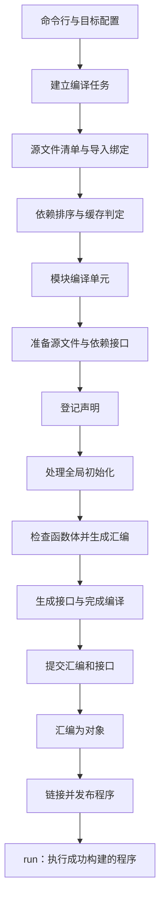

# yh 编译流程重规划

日期：2026-09-30。状态：建议稿，尚未实施。基于当前工作区源码，
不以旧 stage0 文档推导现行能力。

实施顺序见[实施方案](../02-plan/yh-编译流程重规划实施方案.md)，
路线取舍见 [ADR-0008](../adr/0008-yh编译流程分阶段整理.md)。

## 1. 范围与成功标准

本次将“编译器流程”理解为源码到可执行文件的端到端流程，并将项目
构建、自举验证作为配套。目标是统一编排、明确状态与产物边界，解决
现有验证和缓存缺口。若主要目标转为优化器、LSP 或第二种 ISA，应再
评估 AST/IR 路线，不把本建议稿视为该方向的最终决定。

- 用户源文件继续只使用 `.yh`；清单是 `project.toml`。
- 保留 `compiler/gen`、`lex`、`parse`、`cmd` 四目录；`cmd` 目录声明的
  语言模块实际是 `main`，不得将目录名当模块名。
- 保留滚动自举：入库 `bin/yh` 编译当前 `compiler/`，没有 C stage0。
- 保留语法、前向调用、声明顺序、可见性和现有 ABI 规则。
- 每个阶段失败都停止下游工作；失败或中断留下的产物不能命中缓存。
- 固定点必须比较各代独立保存的非空产物，允许有意扰动证明门能报错。
- 完全热构建应能跳过编译、汇编和链接；不承诺未经测量的加速比例。

本次仅交付方案。语法不变，因此不修改 `docs/yh.g4`，也不新增代表
新行为的测试；实施各阶段时必须先新增 `tests/` 中的 `.yh` 用例。

## 2. 当前真实流程

### 2.1 单文件

```text
driver.main
  → 解析选项、确定汇编方言、读源、初始化语义表
  → lex.lex_all：一次词法分析，保存 token
  → --syntax-check：parse_source，纯语法检查
  或
  → cmd.sem_compile
      pass 1：登记类型、函数签名、全局名字
      pass 2a：全局初始化检查、常量求值、数据发射
      pass 2b：函数体解析、语义检查、指令发射
      收尾：发射零初始化全局的 .bss
  → --emit-asm：成功后将汇编缓冲写到 stdout
  或 -o：写临时汇编，由 clang/gcc 汇编并链接
```

源码见 `compiler/cmd/driver.yh`、`compiler/cmd/compile.yh` 与
`compiler/parse/parse_decl.yh`。这不是单遍编译，也不是 AST 流水线：
编译模式有三次顶层遍历，语义检查与汇编发射交织进行。

### 2.2 项目

```text
发现 project.toml、装载本地依赖与可选 YH_STDLIB
  → 扫描 .yh 文件、解析 module/import 头、建立项目索引
  → 绑定导入、检查导入环、生成依赖在前的顺序
  → 逐模块检查 manifest
      命中：复用 .s/.s.i
      未命中：启动自身 --emit-module 子进程
        → 重新装载项目和绑定导入
        → 加载依赖接口
        → 所有文件 pass 1
        → 所有文件 pass 2a
        → 写接口 .s.i
        → 所有文件 pass 2b、.bss、写 .s
        → 父进程写 manifest
  → 程序构建：逐个 .s 汇编为 .o，再链接 .o
```

项目中每个源文件在三个遍历中分别重读、重新词法分析。模块子进程
隔离了共享全局表，是当前可靠的状态隔离方式；本方案先保留它。
默认入口是名为 `main` 的模块，默认程序输出 `.build/<project.name>`。

当前缓存已加入编译器二进制内容，不再将“补编译器身份”列为待办。
但命中不代表 `.o` 可复用，`mb_link` 每次仍重新汇编和链接。

### 2.3 自举

日常 `make` 使用 `bin/yh build` 产出根目录 `yh`；`make test` 跑
ANTLR 参考语法、编译器语法模式和运行语料；`make selfhost-native`
另跑自举、自解析、模块语法与项目验收。

| 缺口 | 源码依据 | 对流程的影响 |
| --- | --- | --- |
| 两个自举脚本延后读取快照，保存的目录路径完全相同 | `tests/selfhost/native-selfhost.py` 的 `d2/d3`；`tools/selfbuild-gate.py` 的 `gens` | 后一代覆盖前一代后，比较实际变成最后一代与自身比较 |
| Makefile 清理旧的 `compiler/tmp/yh-build`，实际缓存已在 `compiler/.build` | `Makefile` 与 `mb_build_dir` | “每次冷编”的说明和执行不一致 |
| 接口在函数体成功前直接写到正式路径 | `mb_emit_module` | 函数体失败后可能残留新接口和旧汇编组合 |
| 缓存键没有显式混入目标方言；子进程命令没有传递 `-target` | `mb_compile_one`、`drv_scan_target` | 目标切换与子进程输出缺少一致性保证 |
| 项目扫描使用共享 `/tmp/yh-proj-scratch.txt` | `project_state.yh` | 独立构建会互相覆盖临时内容，暂不应并行构建 |
| 语义文件仍直接发射 AArch64 字符串 | `gen/sem_decl.yh` 等的 `em_ins` | 不能据现有文档声称前端已经完全与 ISA 解耦 |

2026-09-30 本轮独立验证：在 `tmp/compiler-flow-review/` 复制源码，
每代冷编后立即保存字节快照；cc2/cc3 各 8 个 `.s/.s.i` 逐字节一致。
该结果只证明本轮独立快照通过，不能证明原脚本有能力发现代间差异。

## 3. 路线选择

| 路线 | 收益 | 代价与适用条件 |
| --- | --- | --- |
| **A：整理现有 token 驱动流程（推荐）** | 可逐阶段保持自举，直接处理编排、状态、缓存问题 | 语义与代码生成仍交织；独立语义检查和多后端能力有限 |
| B：解析为 AST，再做语义和直接发射 | 保存源结构，便于语义检查、导航和诊断 | 要迁移现有语义钩子；内存和自举验证成本增加；AST 本身不解决 ABI/ISA 耦合 |
| C：AST → 类型化表示 → IR → 后端 | 适合优化与多 ISA，前后端契约更明确 | 改造面最大；当前没有必须一次性引入这些层的需求证据 |

先完成 A 的公共基础。只有明确需要独立语义分析、LSP 或优化/第二
ISA 时，才单独选择 B/C。阶段划分不等于已经存在可保存的中间表示。

## 4. 推荐的统一主线



单文件任务使用一个源文件和空导入集合，同样进入模块编译核心。
纯语法检查在准备源文件后直接进入语法解析并结束，不要求 `main`，
也不创建构建产物。`--emit-asm` 在完成编译后写 stdout；项目库任务
完成对象与接口后结束；程序任务才链接。

### 阶段契约

| 阶段 | 输入 | 成功输出 | 失败时禁止的操作 |
| --- | --- | --- | --- |
| 建立任务 | CLI、宿主信息、清单 | 模式、目标、输出路径、入口策略 | 创建成功标记或执行程序 |
| 解析项目 | 有序源文件、依赖清单 | 文件归属、每文件导入绑定、模块 DAG | 编译错误绑定的模块 |
| 准备编译单元 | 模块身份、接口路径、源文件 | 内置类型、导入名字空间、源/token 状态 | 提交正式接口 |
| 登记声明 | 全模块文件 | 类型、字段、函数签名、全局符号 | 将登记误当完整语义成功 |
| 全局初始化 | 声明表、原声明顺序 | 常量值、数据缓冲、零初始化清单 | 改变全局引用先声明规则 |
| 函数体 | 完成的声明与常量 | 检查后的函数、汇编缓冲、导入使用记录 | 发布半成品 |
| 编译收尾 | 所有检查通过的状态 | 完整汇编、接口缓冲 | 在错误后写 stdout 或完成标记 |
| 汇编与链接 | 完整汇编/对象、工具链配置 | 对象或程序及对应完成标记 | 链接失败后执行旧程序 |

当前 `c_pass=1/2` 可以保留为解析器内部实现，不要求一次性重写全部
判断；由 cmd 的编排入口显式标注“登记、全局、函数、收尾”阶段。
统一重复的初始化、遍历和 `.bss` 收尾，语义规则继续归现有实现。

语法检查继续容许未定义符号与类型错误。类型声明仍按既有规则先定义
再使用；“登记声明阶段”不表示所有类型引用自动获得前向可见性。
全模块登记后再编译函数体，以保留同模块跨文件调用和互递归。
文件级导入使用记录要跨全局和函数两个阶段累计，不能靠重新解析文件
头时的临时表判定完整文件是否使用过导入。

## 5. 状态与源码寿命

| 状态 | 所有者 | 生命周期 |
| --- | --- | --- |
| 目标方言、工具链选择 | cmd 驱动 | 一次构建，传入全部子进程 |
| 项目索引、导入提供方身份、拓扑序 | cmd 项目构建 | 一次项目构建；每轮重绑定 |
| 源字节、token、文件头和位置 | 当前文件/模块编译单元 | 覆盖所有读取这些 token 的遍历 |
| 类型、符号、常量、导入名字空间 | gen，按模块子进程隔离 | 一次模块编译 |
| 栈帧、控制流标签、函数体缓冲 | gen 的函数入口与出口 | 一次函数编译 |
| 汇编、接口及完成标记 | cmd 产物层 | 完成前为临时状态，提交后持久保存 |

先维持现有全局表和模块子进程，收紧入口/出口职责；不把全部变量
机械搬入一个巨型 CompilerContext。当前公开签名引用外模块具名类型
有接口限制，新入口优先用内建参数或 gen 自有类型，不能引入反向 import。

项目文件重词法的问题后置处理：先测量，再让每个文件拥有源字节和
token 的独立存储，遍历时切换当前文件视图。`Tok.start/len` 是源字节
偏移，缓存 token 必须同时保留对应源字节；切换文件不能留下失效指针。
首版只做模块进程内复用，不做磁盘 token 缓存。

## 6. 目标、工具链与产物提交

首版只规范现有 arm64 的 Darwin/GNU 两种方言。未知目标必须诊断，
显式目标必须传给模块子进程。跨宿主可检查汇编输出；可执行构建遇到
没有匹配的汇编器/链接器时明确失败，不把方言开关当成交叉工具链。
接口头后续版本须识别 ISA、OS/ABI 及格式版本，不能仅凭 `arch=arm64`
复用跨 ABI 接口。格式升级是一次独立缓存失效，不与语法改造混做。

持久产物继续放 `.build/asm`、`obj`、`iface`、`manifest`；临时内容
放 `tmp/` 下每次构建的独立目录。自举各代输出和快照也放仓库 `tmp/`。
不新增通用平台框架，先把命令拼装、引用、退出码检查集中到 cmd 内。

提交协议：先在临时目录完成所有检查和写入；准备覆盖正式产物时撤销
旧完成标记，替换完整 payload，最后提交新 manifest。多文件替换不是
一个原子操作，因此缓存和接口消费者必须要求有效完成标记，不能仅
看文件存在。任一步中断都按缓存失效处理，后续重建。

编译失败不触碰已完成产物；汇编、链接各自也先写临时输出，成功才
发布。需要原子重命名的临时输出放在目标父目录的 `tmp/` 子目录，
确保同文件系统；临时目录退出时清理，失败不改变用户指定的旧输出。
当前基于 `system` 的命令路径统一逐参数引用，不能只修模块编译命令
而漏掉单文件链接及对象列表。

## 7. 三层缓存

保留内容驱动缓存，显式区分三个完成条件：

| 层 | 至少覆盖的输入 | 命中后跳过 |
| --- | --- | --- |
| 编译 | 编译器身份、缓存/接口版本、目标/ABI、模块身份与入口模式、有序文件路径和内容、每文件导入绑定及依赖接口内容 | 源码到 `.s/.s.i` |
| 汇编 | `.s` 内容、目标、汇编器身份与参数 | `.s` 到 `.o` |
| 链接 | 有序对象内容、目标、链接器身份与参数、入口/输出配置 | `.o` 到最终程序 |

输入记录必须带长度或字段边界，防止不同文件组合被简单字节拼接当作
同一输入；编译器与工具链身份在一次构建内计算一次。现有 32 位 FNV
只是缓存摘要，不是完整性证明；升级记录格式时评估更宽摘要，种子
完整性继续由 SHA-256 单独校验。

依赖私有实现变化应重编译该依赖及更新对象、链接；公开接口内容没变
时，调用方编译可以复用。公开接口变化则重新编译依赖它的模块。
每轮仍重扫与重绑定，防止新增本地模块后错误复用第三方绑定。所有
缓存命中都要求本层完整产物与有效完成标记；外部改坏接口应给出明确
诊断，避免把损坏当正常命中。

## 8. 自举与验证主线

```text
核对 bin/yh.sha256
  → bin/yh 冷编 compiler/ → cc2 → 立即保存快照 S2
  → cc2    冷编 compiler/ → cc3 → 立即保存快照 S3
  → 核对产物集合与 S2 == S3
  → cc3 自解析、语法、运行、模块/项目语料
  → make test 与修正后的 make selfhost-native 均通过
  → 才进入 make seed 种子晋升
```

加强门可继续 cc3 → cc4，比较独立 S3/S4。快照包括全部模块 `.s`
和 `.s.i`；排除含编译器身份的 manifest，也不要求链接后二进制逐字节
一致。集合必须非空，并与索引预期模块一一对应。

固定点检查增加反向验收：保存 S2 后扰动 S2 一个产物或删除一个接口，
必须报错；相同空目录也必须报错。发布前仍需运行语义与项目语料，
固定点不能独自证明语言正确性。

Darwin 使用入库种子；Linux 构建使用可执行的 Linux 种子，不能用
Mach-O 种子替代。发布作业应在相应宿主验证后归档；本轮未实际运行
Linux CI，不能以本机结果代替跨平台结果。种子晋升验证需绑定同一份
源码与产物，失败保留上一版种子，不能凭一条旧的“全绿”日志晋升。

## 9. 实施边界

按“可信验证 → 统一编译核心 → 安全产物与目标 → 完整缓存 → 测量后
复用源码/收紧后端原语”推进，每阶段都保持能自举。

不增加模块目录；文件超过建议范围时，仅随职责迁移拆分本轮涉及的
完整函数。暂不移除模块子进程、不并行模块编译、不添加优化器、x64
后端或新 CLI 承诺。若后续明确选择 AST/IR，另立结构契约及迁移门。
