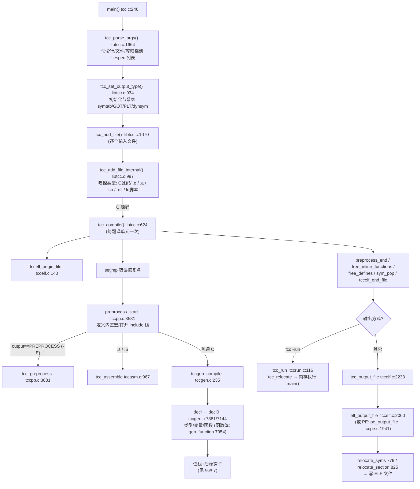

# TCC（Tiny C Compiler 0.9.27）编译器实现详解

> 本文基于两方面的分析写成：
> 1. **graphify 0.9.61** 对本目录源码构建的知识图谱（`graphify-out/`，共 **2321 个节点、6419 条边、173 个社区**，纯本地 tree-sitter AST 提取，无 LLM 参与）；
> 2. 对核心源文件的逐段精读。
>
> 文中所有 `文件:行号` 引用均可在本目录中直接定位验证。文末第 13 章汇总了 graphify 图谱分析的结论（枢纽节点、社区聚类、跨模块关系），并说明如何继续用 graphify 查询这份图谱。

---

## 目录

1. [项目概览与设计哲学](#1-项目概览与设计哲学)
2. [目录结构与构建系统](#2-目录结构与构建系统)
3. [端到端编译流水线](#3-端到端编译流水线)
4. [核心数据结构（tcc.h）](#4-核心数据结构tcch)
5. [词法分析器与预处理器（tccpp.c）](#5-词法分析器与预处理器tccppc)
6. [C 解析器与目标无关代码生成（tccgen.c）](#6-c-解析器与目标无关代码生成tccgenc)
7. [机器后端（xxx-gen.c / xxx-link.c）](#7-机器后端xxx-gen--xxx-linkc)
8. [内置汇编器与内联汇编（tccasm.c）](#8-内置汇编器与内联汇编tccasmc)
9. [ELF 链接器（tccelf.c）](#9-elf-链接器tccelfc)
10. [PE/COFF 输出（tccpe.c / tcccoff.c）](#10-pecoff-输出tccpec--tcccoffc)
11. [内存运行与运行时库（tccrun.c + lib/）](#11-内存运行与运行时库tccrunc--lib)
12. [libtcc 嵌入式 API](#12-libtcc-嵌入式-apilibtcch)
13. [graphify 图谱分析结果](#13-graphify-图谱分析结果)
14. [总结：TCC 为什么能这么小](#14-总结tcc-为什么能这么小)

---

## 1. 项目概览与设计哲学

### 1.1 这是什么

本目录是 Fabrice Bellard 的 **Tiny C Compiler（TCC）0.9.27**（见 `VERSION`、`README`），一个用 C 写的完整 C 编译器：

- 体积极小（整个编译器 + 链接器 + 汇编器约 10 万行 C，单文件构建时能塞进一张软盘）；
- 编译速度极快（README 声称约为 `gcc -O0` 的 7 倍）；
- 支持五种目标架构：**i386、x86_64、ARM、ARM64、C67**（TMS320C67xx DSP），外加 Windows PE / ELF 两种可执行格式；
- 具备 C99 + 大量 GNU 扩展支持、内置预处理器、内置汇编器、内置 ELF/PE 链接器，**不依赖任何外部 binutils**；
- 可以 **在内存中编译并立即运行 C 程序**（`tcc -run`，支持 shebang 脚本）；
- 可作为库嵌入（libtcc，见 `libtcc.h`），典型用法见 `tests/libtcc_test.c`；
- **可以编译它自己**（自举），也能被 `make cross` 交叉编译出任意目标组合。

### 1.2 设计哲学：单遍、无 AST、无 IR，值栈直出机器码

TCC 与"教科书式编译器"（词法→语法树→IR→优化→目标码）最根本的区别是：

1. **没有 AST，没有中间表示**。解析器每识别出一个表达式子结构，就立刻把它变成"值栈上的一项"，并在二元运算/赋值等归约点上直接调用代码生成钩子产出机器码字节，写进 ELF `Section` 缓冲区。整个编译是**单遍（single-pass）**的。
2. **"优化"几乎只有两类**：编译期常量折叠（`gen_opic`/`gen_opif`，tccgen.c:1864/2014）和死代码抑制（`nocode_wanted` 机制）。没有 SSA、没有寄存器分配图着色——寄存器分配是**按需的栈式分配**（见 §6.3）。
3. **速度来自"少做事"**：token 直接以整数流表示；符号表用哈希驻留；节（section）就是一块可增长的内存缓冲区；链接器不做全局优化，只做符号解析 + 重定位。
4. **正确性靠对照测试**：`tests/tcctest.c` 用同一份输入分别跑 tcc 和 gcc 的产物并 diff 输出（包括用 tcc 内存运行、tcc 编译出的可执行、静态链接、边界检查四种方式），`tests2/` 有约 90 组 `编号.c`/`.expect` 对照，`pp/` 有 21 组预处理器用例。

这个设计换来了 10 万行的极限体积，代价是代码质量约等于 `gcc -O0` 级别。graphify 的"枢纽节点"统计（第 13 章）非常直观地印证了这一点：`unary()`（解析器）、`gen_op()`（运算 lowering）、`vpushi/vswap`（值栈原语）是全仓库连接度最高的函数。

### 1.3 模块总览图

```mermaid
flowchart LR
    subgraph 前端
        A[tcc.c 命令行驱动] --> B[libtcc.c\n编译上下文/错误恢复/文件管理]
        B --> C[tccpp.c\n词法+预处理]
        B --> D[tccgen.c\nC 解析+目标无关代码生成]
        B --> E[tccasm.c\nGNU 风格汇编器]
    end
    subgraph 后端"按目标三选一编译"
        D --> F1[i386-gen / x86_64-gen\n+ i386-link / x86_64-link]
        D --> F2[arm-gen / arm64-gen\n+ arm-link / arm64-link]
        D --> F3[c67-gen + tcccoff.c]
    end
    subgraph 目标文件/链接
        D --> G[tccelf.c\nELF 节/符号/重定位/链接器]
        E --> G
        F1 --> G
        F2 --> G
        G --> H[tccpe.c\nWindows PE 输出]
        G --> I[tccrun.c\n内存运行/回溯]
        G --> J[lib/ → libtcc1.a\n运行时算术/alloca/边界检查]
    end
```

> 注意：五个后端中**每次构建只编入一个**（Makefile 按目标挑文件列表），而 `tccelf.c/tccpp.c/tccgen.c` 是所有目标共享的"核心"（`CORE_FILES`）。

---

## 2. 目录结构与构建系统

### 2.1 源文件清单与角色

| 文件 | 行数(约) | 角色 |
|---|---|---|
| `tcc.c` | 371 | 命令行驱动：`main()`（tcc.c:246）、帮助文本、`-ar` 等工具分发。`#if ONE_SOURCE #include "libtcc.c"`（tcc.c:22）、`#include "tcctools.c"`（tcc.c:25）实现单文件构建 |
| `libtcc.c` | 1981 | **库核心**：`TCCState` 生命周期、公共 API 实现、错误处理（longjmp）、文件缓冲、选项解析、每翻译单元的编译驱动 `tcc_compile`（libtcc.c:624） |
| `libtcc.h` | 100 | 嵌入式 API 头（tcc_new … tcc_run，见 §12） |
| `tcc.h` | 1660 | **全局数据中心**：所有核心结构体、VT_* 编码、后端接口声明、目标宏选择（tcc.h:126-146） |
| `tccpp.c` | 3903 | 词法分析 + 预处理器（token 驻留、宏、#include、#if） |
| `tcctok.h` | 350 | token 编号 X-macro 表 `DEF(TOK_xxx, "str")`，预处理器与解析器共享 |
| `tccgen.c` | 7386 | C 解析器 + 目标无关代码生成（全仓库最大的文件，`unary()`/`block()`/`gen_op()` 都在这里） |
| `tccelf.c` | 3058 | ELF 节管理、符号表、GOT/PLT、重定位、ELF 输出、`.o/.a/.so/ld 脚本` 加载 |
| `tccrun.c` | 844 | `tcc -run`：内存布局、重定位、执行、运行时崩溃回溯 |
| `tccasm.c` | 1277 | GNU 风格汇编器与内联 `asm()` |
| `tccpe.c` | 1996 | Windows PE/COFF 输出（导入表/导出表/基址重定位） |
| `tcccoff.c` + `coff.h` | 948 | C67 目标的 COFF 输出（仅 `TCC_TARGET_COFF` 时编译） |
| `tcctools.c` | 546 | 编译器内置工具：`tcc -ar`（打 .a 归档）、`-impdef`、`-m32/-m64` 重执行、`-MD` 依赖生成 |
| `i386-gen.c`/`x86_64-gen.c`/`arm-gen.c`/`arm64-gen.c`/`c67-gen.c` | 1164/2258/2151/1837/2540 | 五个机器码后端 |
| `i386-link.c`/`x86_64-link.c`/`arm-link.c`/`arm64-link.c`/`c67-link.c` | ~250 each | 各目标的重定位策略（见 §7.4） |
| `i386-asm.c/.h`、`i386-tok.h` | 1723/480/4141 | x86 汇编指令表与编码引擎（i386/x86_64 共用） |
| `include/` | — | 编译器自带的 5 个自由站立头文件：`stddef.h/stdarg.h/float.h/stdbool.h/varargs.h`（不含 libc，libc 用系统的） |
| `lib/` | — | **libtcc1.a** 运行库源码（用 tcc 自己编译，见 §11.3） |
| `tests/`、`examples/`、`win32/` | — | 对照测试、示例脚本、Windows 构建批处理 |

### 2.2 configure / conftest 探测

`configure`（shell 脚本）把宿主编译器对 `conftest.c`（87 行）编译运行一遍，探测出**宿主三元组**（CPU/OS）、可用特性，生成 `config.h` 与 `config.texinfo`。`config.h` 里的宏决定：

- 目标架构兜底：如果 Makefile 没有传 `-DTCC_TARGET_XXX`，tcc.h:126-146 会根据宿主编译器的预定义宏（`__x86_64__`、`__arm__`、`__aarch64__`…）选择本机目标，并定义 `TCC_IS_NATIVE`；
- 可选特性：`CONFIG_TCC_BCHECK`（边界检查）、`CONFIG_TCC_ASM`、`CONFIG_TCC_STATIC`（不用 dlopen 的静态模式）等；
- `CONFIG_TCCDIR`：`libtcc1.a`、include 的默认安装路径（可用 `-B` 覆盖）。

### 2.3 Makefile：目标选择与 ONE_SOURCE

- **核心文件组**：`CORE_FILES = tcc.c libtcc.c tccpp.c tccgen.c tccelf.c tccasm.c tccrun.c …`（Makefile:158 起），目标特定组如 `i386_FILES = $(CORE_FILES) i386-gen.c i386-link.c i386-asm.c i386-asm.h i386-tok.h`。`make` 默认构建本机目标，`make cross`（Makefile:94-116）对 `i386/x86_64/arm/arm64/c67/…-win32/…-osx` 每个目标重跑一次 make，传 `CROSS_TARGET` 和 `DEF-x86_64 = -DTCC_TARGET_X86_64` 这类宏（Makefile:104-116）。
- **ONE_SOURCE**（Makefile:173-182）：开启后只编译 `tcc.c` 一个翻译单元——`libtcc.c` 被它 `#include`，而 `libtcc.c` 内部又依次 `#include` 各个后端 `-gen.c`/`-link.c`（源码里 `#include "*.c"`）。这样交叉编译器可以做成**一个单文件 C 程序**，方便 `gcc one.c -o tcc` 式的引导。
- **自举细节**：`lib/Makefile` 里 `XCC = tcc`——`libtcc1.a` 是**用刚构建好的 tcc 编译**出来的，这是仓库内嵌的自举验证（tcc 必须能正确编译运行时库，整个工具链才可用）。

### 2.4 一条重要全局规则：单例 TCCState 与静态数据

TCC 0.9.27 中大量"当前状态"（当前文件 `file`、当前 token `tok`、值栈 `vtop` 等）是**全局/静态变量**（tcc.h 中以 `ST_DATA` 声明，定义散布在 tccpp.c/tccgen.c 顶部）。`tcc_cleanup()`（libtcc.c:710）负责在删除状态时复位它们。这意味着**一个进程内同时存在多个 TCCState 是受限的**——这是"单遍"设计换来的另一个取舍（后来的 TCC mob 分支改成了把状态装进 `TCCState`）。

---

## 3. 端到端编译流水线

### 3.1 完整调用链



### 3.2 中枢函数 tcc_compile（libtcc.c:624）

这是"每个翻译单元"的编译入口，浓缩了 TCC 的几个工程习惯：

```c
static int tcc_compile(TCCState *s1)
{
    define_start = define_stack;          /* 记录 -D 与内置宏的栈底 */
    tccelf_begin_file(s1);                /* 准备本次编译输出的节 */
    if (setjmp(s1->error_jmp_buf) == 0) { /* 错误处理：longjmp 跳回这里 */
        preprocess_start(s1, is_asm);
        if (s1->output_type == TCC_OUTPUT_PREPROCESS)
            tcc_preprocess(s1);           /* -E 路径 */
        else if (is_asm)
            tcc_assemble(s1, ...);        /* .s/.S 路径 */
        else
            tccgen_compile(s1);           /* C 路径 */
    }
    preprocess_end(s1);
    free_inline_functions(s1);            /* 丢弃没被引用的内联函数 */
    free_defines(define_start);           /* 宏栈回滚到编译单元开始前 */
    sym_pop(&global_stack, NULL, 0);      /* 作用域栈回滚 */
    sym_pop(&local_stack, NULL, 0);
    tccelf_end_file(s1);
    return s1->nb_errors != 0 ? -1 : 0;
}
```

要点：

- **错误恢复不用返回值逐层检查**，而是 `tcc_error()`（libtcc.c:538）在 `error_set_jmp_enabled` 时直接 `longjmp` 到这里，简单粗暴且零开销；
- **宏与符号作用域按翻译单元回滚**，保证多文件编译互不污染；
- `tcc_define_symbol()`（libtcc.c:676，即 `-D` 的实现）非常取巧：伪造一个内容为 `NAME VALUE` 的小"文件"，喂给 `parse_define()`——连命令行宏都复用了预处理器的代码路径。

### 3.3 输入嗅探（tcc_add_file_internal，libtcc.c:997）

TCC 把"编译器 + 链接器 + 库管理"统一在 `tcc_add_file` 之下：读文件头几个字节，用 `tcc_object_type()` 判别是 ELF 目标文件、ELF 动态库、`ar` 归档、COFF，还是纯文本（C 源码 / 汇编 / 链接脚本）。因此 `tcc hello.c -lfoo` 里的 `.a/.so` 与源码走同一条入口，只是加载函数不同（§9.5）。

### 3.4 输出与运行分流

- `tcc -run prog.c`：`tcc_run()`（tccrun.c:116）在**进程内存**里布局、重定位所有节，找到 `main` 后直接调用（§11.1）；
- 其它目标（`-o` 可执行 / `-shared` 动态库 / `-r` 重定位目标 / `-E` 预处理输出）：`tcc_output_file()`（tccelf.c:2233）按 `output_type` 与平台分发到 ELF 或 PE 生成器。

---

## 4. 核心数据结构（tcc.h）

TCC 的"编译器数据模型"全部集中在 tcc.h，理解它们就读懂了一半。

### 4.1 TokenSym：标识符驻留 + 四大命名空间（tcc.h:381）

```c
typedef struct TokenSym {
    struct TokenSym *hash_next;   /* 哈希桶链 (TOK_HASH_SIZE=16384, tcc.h:376) */
    struct Sym *sym_define;       /* 该名字当前可见的 #define */
    struct Sym *sym_label;        /* 该名字当前可见的标号 */
    struct Sym *sym_struct;       /* 该名字当前可见的 struct/union/enum tag */
    struct Sym *sym_identifier;   /* 该名字当前可见的标识符 */
    int tok;                      /* token 编号 (关键字编号固定, 见 tcctok.h) */
    int len;
    char str[1];                  /* 柔性数组: 名字文本 */
} TokenSym;
```

每个**名字只驻留（intern）一次**：词法器扫到标识符就 `tok_alloc()`（tccpp.c:448）进哈希表，得到唯一 token 编号；此后所有作用域操作只动 `TokenSym` 上的四个 `Sym*` 指针（进出作用域时由 `sym_pop` 恢复，tccgen.c:600-626）——**作用域切换是 O(1) 的指针保存/恢复，不需要任何查找**。这是 TCC 符号管理最漂亮的一处。

### 4.2 CType：一个 int 位域 + 一个指针（tcc.h:405）

```c
typedef struct CType {
    int t;          /* VT_* 位域编码 */
    struct Sym *ref;/* struct/union/enum/函数参数链 的描述符 */
} CType;
```

`t` 的编码（tcc.h:853-879）：

- 低 4 位 `VT_BTYPE`：基本类型 `VT_VOID=0 … VT_STRUCT=7, VT_FLOAT/DOUBLE/LDOUBLE=8..10, VT_BOOL=11`，以及 x86-64 ABI 专用的 128 位 `VT_QLONG/VT_QFLOAT`（tcc.h:866-867，用于 `__int128` 与 `long double` 结构传参）；
- 修饰位：`VT_UNSIGNED 0x10`、`VT_ARRAY 0x40`、`VT_BITFIELD 0x80`（位域时高 16 位编码位置/宽度，`BIT_POS/BIT_SIZE`）、`VT_CONSTANT/VOLATILE/VLA/LONG`；
- 存储类别等在更高位（`VT_EXTERN 0x1000` 等，tcc.h:879 起）。

所有类型都由这 8 字节表示——没有类型树，复合类型靠 `ref` 指向 `Sym` 链（结构成员链、函数形参链）。

### 4.3 SValue：值栈上的一个元素（tcc.h:424）

```c
typedef struct SValue {
    CType type;    /* 值的类型 */
    unsigned short r;   /* 位置: 寄存器编号或 VT_CONST/VT_LOCAL/VT_CMP/VT_JMP + 标志位 */
    unsigned short r2;  /* 64 位值的高半寄存器 (32 位目标) / 对寄存器 */
    CValue c;           /* VT_CONST 时的常量值 */
    struct Sym *sym;    /* VT_SYM 时的符号 (重定位用) */
} SValue;
```

`CValue`（tcc.h:411）是一个 union：`uint64_t i` / `double d` / `long double ld` / `{size,data}` 字符串。**"位置编码"**（tcc.h:831-850）是理解 tccgen 的钥匙：

| 编码 | 含义 |
|---|---|
| `0..0x2f` | 寄存器编号（每目标 `NB_REGS` 不同，类别由 `reg_classes[]` 描述） |
| `VT_CONST 0x30` | 常量（在 `c` 里，可与 `VT_SYM` 组合成 "符号+偏移"） |
| `VT_LOCAL 0x32` | 栈上局部变量（`c` = 帧内偏移） |
| `VT_CMP 0x33` | 值在**CPU 标志位**里（比较结果的布尔） |
| `VT_JMP 0x34 / VT_JMPI 0x35` | 值由**一段跳转补丁链**表示（&&/||/! 的惰性求值，见 §6.6） |
| `VT_LVAL 0x100` | 当前值是**左值**（即它的地址可直接寻址，需要 `indir()` 解引用一次才是右值） |
| `VT_SYM 0x200` | 附加一个符号（`sym`），用于重定位 |
| `VT_MUSTCAST / VT_MUSTBOUND / VT_LVAL_BYTE/SHORT/UNSIGNED` | 延迟的窄化转换标记 / 边界检查标记 / 访问宽度 |

### 4.4 Sym：一个结构打天下（tcc.h:465）

```c
typedef struct Sym {
    int v;                 /* 名字的 token 编号 */
    unsigned short r;      /* 变量的存储位置 (同 SValue.r) 或标号状态 */
    struct SymAttr a;      /* aligned/packed/weak/visibility/dllimport... (tcc.h:435) */
    union {
        int c;             /* 局部变量: 帧偏移; 全局: ELF 符号索引; 标号: 跳转链 */
        int sym_scope;     /* 作用域层级 */
        int jnext;         /* break/continue 跳转链下一跳 */
        struct FuncAttr f; /* 函数属性: 调用约定/形参风格/形参数 */
        int *d;            /* 宏: 展开的 token 流 */
        long long enum_val;/* 枚举常量值 */
    };
    CType type;            /* 变量/成员/函数的类型 */
    struct Sym *next;      /* 结构成员链 / 函数形参链 */
    struct Sym *prev;      /* 作用域栈: 指向栈中下一个更老的符号 */
    struct Sym *prev_tok;  /* 同名链: 指向上一个同名符号 (用于恢复 TokenSym 指针) */
} Sym;
```

同一个结构体同时充当：**变量/函数/typedef/标号/结构成员/宏/枚举常量** 的描述符。`sym_push2`（tccgen.c:501）把新符号头插进"栈"（`prev` 链）与"同名链"（`prev_tok` 链）；`sym_pop`（tccgen.c:600）沿 `prev` 链逐个把 `TokenSym` 的命名空间指针恢复成 `prev_tok`（tccgen.c:615-619）。宏定义也走这条路：`sym_define` 指向的 `Sym`，其 `d` 字段是宏体的 **token 流**。

### 4.5 Section：一切皆节（tcc.h:492）

```c
typedef struct Section {
    unsigned char *data;       /* 可增长缓冲区 (section_ptr_add 追加) */
    unsigned long data_offset; /* 当前写入位置 */
    int sh_type, sh_flags, sh_addralign, sh_entsize...;  /* ELF 语义 */
    addr_t sh_addr;            /* 输出/运行时的虚拟地址 */
    struct Section *link;      /* 如 .symtab ↔ .strtab */
    struct Section *reloc;     /* 对应的重定位节 (.rel.text 等) */
    struct Section *hash;      /* 符号哈希表 */
    char name[1];
} Section;
```

**编译器的输出就是往若干 `Section` 里写字节**：`.text` 写机器码（后端 `g()`/`o()`）、`.data/.rodata/.bss` 写初始化数据、`.symtab` 写 `put_elf_sym`、`.rel.text` 写 `greloca`。PE/内存运行只是同一批节的另一种"打包/布局"方式。所有节挂在 `TCCState.sections[]`（tcc.h:770）。

### 4.6 TCCState（tcc.h:640）

一次编译会话的全部上下文：选项、include 搜索路径、`include_stack/ifdef_stack/cached_includes/pack_stack`（预处理器状态，§5.5）、`inline_fns`（延迟编译的内联函数）、节指针（`symtab/got/plt/dynsym/dynsymtab`）、`sym_attrs[]`（每个 ELF 符号额外的 GOT/PLT 偏移，tcc.h:630）、命令行文件列表等。

---

## 5. 词法分析器与预处理器（tccpp.c）

TCC 的预处理器与词法器是一体的（预处理器需要词法器，解析器也用它），这是 C 语言的现实决定的。

### 5.1 令牌表示：int + CValue

当前 token 是全局变量 `tok`（int 编号）+ `tokc`（CValue）。编号规则：

- 关键字/内置符：由 `tcctok.h` 的 X-macro `DEF(TOK_INT, "int")` 分配**固定编号**（约 240 个），词法器启动时把关键字表灌进 TokenSym 哈希（`tccpp_new` → `tok_ident` 之上再分配编号）。固定的 token 编号让解析器可以用 `switch(tok)` 直接分发，也让**宏体的 token 流可以序列化成 int 数组**。
- 标识符：从 `TOK_IDENT` 起动态分配。
- 带值的 token（数字/字符串/字符/浮点常量）：`tokc` 里放值；`TOK_PPNUM/TOK_PPSTR` 是预处理阶段的"生"token，解析阶段再用 `parse_number/parse_string` 转换成"熟"token（tccpp.c:3560-3566，`next()` 末尾）。
- token 流（宏体、内联函数体、`unget_tok` 回退缓冲）用 `TokenString`（tcc.h:575）存 int 数组：`tok_str_add2`（tccpp.c:1129）追加时，带值的 token 后面跟着值的数据字；`TOK_GET`（tccpp.c:1218）反序列化。

### 5.2 手写词法器 next_nomacro1（tccpp.c:2561）

字节级扫描，逐字符分类（`set_idnum` 配置哪些字符属于标识符，允许 `$`、汇编模式下允许 `.`，tccpp.c:3597-3598）。要点：

- 输入是 `BufferedFile`（tcc.h:554）的缓冲区，`inp/minp/handle_eob`（tccpp.c:629-700 附近）处理换行、`\` 行续接与缓冲区切换；`CH_EOB` 用 `'\\'` 作哨兵字符（tcc.h:571）；
- 注释在词法层剥掉（`parse_comment`）；
- 数字常量 `parse_number`（tccpp.c:2260）只做"切词"，产生 `TOK_PPNUM`，数值转换留给后面（这样 `#if` 里可以用更宽的算术）；
- 字符串/字符的转义处理 `parse_escape_string`（tccpp.c:2015）。

### 5.3 next()：宏展开调度器（tccpp.c:3529）

```c
ST_FUNC void next(void) {
 redo:
    if (parse_flags & PARSE_FLAG_SPACES) next_nomacro_spc();
    else next_nomacro();                       /* 先拿一个原始 token */
    if (macro_ptr) {                           /* 正在读宏展开流? */
        if (tok == TOK_NOSUBST || tok == TOK_PLCHLDR) goto redo; /* 丢弃占位符 */
        else if (tok == 0) { end_macro(); goto redo; }  /* 展开流耗尽, 弹栈 */
    } else if (tok >= TOK_IDENT && (parse_flags & PARSE_FLAG_PREPROCESS)) {
        Sym *s = define_find(tok);             /* 从文件读到的标识符是宏? */
        if (s) {
            Sym *nested_list = NULL;
            tokstr_buf.len = 0;
            macro_subst_tok(&tokstr_buf, &nested_list, s);  /* 展开到缓冲区 */
            tok_str_add(&tokstr_buf, 0);
            begin_macro(&tokstr_buf, 2);       /* 压入展开流, 之后 token 从这读 */
            goto redo;
        }
    }
    /* TOK_PPNUM/PPSTR → 熟 token */
}
```

**宏展开的总体模型**：`macro_ptr` 指向当前 `TokenString`；展开一个宏 = 把展开结果追加进缓冲区再从那里读；`begin_macro/end_macro` 维护一个 TokenString 栈，实现递归展开。`TOK_NOSUBST/TOK_PLCHLDR` 两个内部占位符用于阻止蓝色墨水（blue paint）问题——已被展开过的参数名不再二次展开（C11 6.10.3.4 的"递归隐藏"语义）。`unget_tok`（tccpp.c:3571）也复用这套机制实现单 token 回退（解析 `label:` 歧义时用）。

### 5.4 宏替换 macro_subst_tok（tccpp.c:3282）

- **特殊宏**：`__LINE__/__COUNTER__/__FILE__/__DATE__/__TIME__` 现场生成（tccpp.c:3297-3328）；
- **对象式宏**：`s->d` token 流直接追加；
- **函数式宏**（tccpp.c:3334 起）：先带空白读下一个 token，若不是 `(` 则原样退回（宏名不一定是调用，tccpp.c:3345-3358）；然后按括号深度收集每个实参为独立 `TokenString`（tccpp.c:3384-3398），`sa->type.t` 非 0 表示 `...`/`__VA_ARGS__` 可变参数；
- **参数替换** `macro_arg_subst`（tccpp.c:3006）：把形参换成实参 token 流；`#` 运算符在此把实参字符串化；**`##` 粘贴**在 `macro_twosharps`/`paste_tokens`（tccpp.c:3159/3124）里对相邻 token 做文本级拼接再重新驻留；
- **递归抑制**：`nested_list` 链记录"正在展开的宏"，自引用不再展开（C 标准的 blue paint）。

这一段（连同 `next_argstream`）是 tccpp 里最复杂的状态机，graphify 社区 1（"预处理器+词法"）的枢纽正是 `get_tok_str()`（45 条边，第 13 章）——渲染 token 回文本供错误信息、`#`、`-E` 输出用。

### 5.5 指令解释器 preprocess()（tccpp.c:1714）

逐行读 `#` 指令并分发（`TOK_DEFINE → parse_define` tccpp.c:1472；`TOK_INCLUDE →` 搜路径 → 压 `BufferedFile` 栈；`TOK_IF*` → `expr_preprocess` tccpp.c:1426；`TOK_PRAGMA → pragma_parse` tccpp.c:1604…）。几个特色：

- **include 守护缓存**（`CachedInclude`，tcc.h:597；`search_cached_include` tccpp.c:1560）：记录"某文件被 `#ifndef X` 保护且已包含过一次"，第二次 `#include` 直接跳过——这让 TCC 对反复包含大头的系统头文件非常快；
- **#if 求值**复用 C 解析器的常量表达式机器：置 `pp_expr` 标志后调 `expr_const`，未定义标识符按 0 处理，`defined(X)` 由专门的 token 钩子处理；
- `#pragma pack` 用 `pack_stack`（TCCState，tcc.h:759）做栈式作用域；`#pragma comment(lib)` 在 PE 模式收集进 `pragma_libs`；
- `-E` 输出 `tcc_preprocess()`（tccpp.c:3831）：带 `PARSE_FLAG_SPACES` 逐 token 打印并维护 `#line`（`line_ref` 字段，tcc.h:560）。

---

## 6. C 解析器与目标无关代码生成（tccgen.c）

7386 行的 tccgen.c 是编译器的心脏。它在**不做任何语法树**的前提下完成：递归下降解析 + 类型检查/推导 + 机器码生成 + 符号/重定位产出。

### 6.1 入口与声明解析

- `tccgen_compile()`（tccgen.c:235）：初始化一组"规范类型"（`int_type`、`char_pointer_type`、`func_old_type`…），`next()` 取第一个 token，然后 `decl(VT_CONST)`；
- `decl()`（tccgen.c:7381）→ `decl0()`（tccgen.c:7144）：顶层声明循环。类型部分 `parse_btype()`（tccgen.c:4001，含 struct/enum 定义 `struct_decl` tccgen.c:3763 与布局 `struct_layout` tccgen.c:3489），声明符部分 `type_decl()`（tccgen.c:4401，经典的"螺旋法则"式解析，数组/函数后缀在 `post_type` tccgen.c:4255），属性在 `parse_attribute`（tccgen.c:3291）；
- 全局变量 → `decl_initializer_alloc()`（tccgen.c:6818）直接把初始化值写进 `.data/.bss/.rodata` 节；函数定义 → `gen_function()`（tccgen.c:7054）：`sym_push` 函数名（`VT_CONST|VT_SYM|VT_FUNC`）、调后端 `gfunc_prolog()`、`block()` 解析函数体、`gfunc_epilog()`、回填标签、`put_extern_sym` 登记全局符号。

### 6.2 值栈：编译器的"寄存器堆"（tcc.h:1283, tccgen.c:630-797）

所有表达式计算发生在固定大小 256 项的静态数组 `__vstack`（`#define vstack (__vstack+1)`，tcc.h:1283；`vtop` 指向栈顶）。每个 `SValue` 要么是常量/符号/栈槽（"懒"的），要么已被 `gv()` 物化到真实 CPU 寄存器。基础原语（均已核实）：

| 函数 | 位置 | 作用 |
|---|---|---|
| `vsetc(type, r, vc)` | tccgen.c:630 | 压入一个值。**关键细节**：若当前栈顶持有 `VT_CMP/VT_JMP`（CPU 标志或跳转链），必须先 `gv(RC_INT)` 把它物化成寄存器，否则后续发射指令会破坏标志（tccgen.c:649-653） |
| `vswap()` | tccgen.c:663 | 交换栈顶两项（同样先物化标志） |
| `vpop()` | tccgen.c:678 | 弹栈；x86 上若值在 x87 栈（TREG_ST0）则发射 `fstp %st(0)`；若值是 VT_JMP 则 `gsym()` 回填跳转 |
| `vpushi/vpushs/vpush64/vpushll` | tccgen.c:702-732 | 压各类整型常量 |
| `vdup/vpushv` | tccgen.c:758/750 | 复制栈顶 |
| `vrotb/vrote/vrott` | tccgen.c:766-797 | 旋转栈中元素（函数调用、二元运算调整操作数顺序时用） |

**二元运算的标准节拍**是：左操作数先算（压栈）→ 右操作数算（压栈）→ `gen_op(op)` 归约成一个结果。三元/赋值/逗号同理。**这就是 TCC 的"IR"**：一个立即求值的栈机。

### 6.3 gv(rc)：把值物化进寄存器（tccgen.c:1253）

`gv(int rc)` 是全编译器被调最频繁的"寄存器分配器"（graphify 里 `vpushi` 38 条边、`vswap` 33 条边都是它的外围）。流程：

1. **位域**：若值是位域，先用移位提取——`SHL (bits - pos - size)` 再 `SAR/SHR (bits - size)`（tccgen.c:1285-1290；打包位域走 `load_packed_bf`，tccgen.c:1169）；
2. **浮点常量**：CPU 一般不能立即寻址浮点常量，把常量写进 `data_section`（`section_add` + `init_putv`，tccgen.c:1293-1306），值变成"指向 .rodata 的左值"；
3. **判定是否需要装载**（tccgen.c:1326-1335）：常量 / 左值（要先解引用）/ 寄存器类别不符 / 64 位值的高半不在配对类别 → 需要装载；
4. `get_reg(rc)`（tccgen.c:1062）选一个类别匹配的空闲寄存器；不够用就 `save_reg()`/`save_reg_upstack()`（tccgen.c:962/969）把别的栈上值**溢出回内存**（这就是"栈式寄存器分配"——值栈里低优先级的项本来就有内存镜像，溢出只是把寄存器里的版本 store 回去）；
5. 调后端 `load(r, sv)`（tcc.h:1472 声明）真正发射取数指令；对 64 位值（32 位目标）`lexpand()`（tccgen.c:1488）拆成两个 SValue，用 `r/r2` 两个寄存器（`gv2` tccgen.c:1431 管寄存器对）；x86-64 的 `__int128`/`long double` 结构传参用 `VT_QLONG/VT_QFLOAT` 双 64 位表示；
6. 左值解引用：`indir()`（tccgen.c:4471 附近，`lvalue_type` 同区）按 `VT_LVAL_BYTE/SHORT/…` 宽度生成一次内存读。

### 6.4 gen_op(op)：运算归约（tccgen.c:2154）

对栈顶两个 `SValue` 做"常用算术转换"并发码：

- **函数/数组退化**：`VT_FUNC` 操作数先 `mk_pointer + gaddrof()` 转成指针（tccgen.c:2167-2178）；
- **指针运算**：`ptr ± int` → 把整型乘上元素大小 `pointed_size()`（`gen_op('*')`，tccgen.c:2227-2237）；`ptr - ptr` → 差值除以元素大小（`gen_op(TOK_PDIV)`，tccgen.c:2201-2207）；指针比较按无符号整型处理（tccgen.c:2182-2191）；VLA 用运行时元素大小 `vla_runtime_pointed_size`；
- **浮点提升**：取 float/double/long double 的较宽者（tccgen.c:2273-2283）；
- **整型提升**：两侧都转 `int`（或 `unsigned`）；
- **常量折叠**：两侧都是常量时走 `gen_opic()`（tccgen.c:1864，含除零保护、移位截断等）/`gen_opif()`（tccgen.c:2014）纯算术，不产码；
- 否则 `gen_cast` 对齐两侧类型后调后端 `gen_opi(op)` / `gen_opf(op)`（tcc.h:1486-1487 声明）。

**比较运算**不生成布尔值，而是置 `VT_CMP`（值在标志寄存器里）；消费它时 `gvtst()`（tccgen.c:1605）转成跳转，或 `gv()` 时用 `setcc` 物化成 0/1。`&&/||/!` 生成 `VT_JMP/VT_JMPI` **跳转补丁链**（真/假两条链，`c.i` 指向链头），这正是 `vpop` 里 `gsym(vtop->c.i)` 的用途（tccgen.c:688-691）。**三元与短路的求值跳转**都在 `expr_cond`（tccgen.c:5480）/`expr_eq`（tccgen.c:5655）里用这套原语手工回填——TCC 用"奇偶编码"的技巧（`VT_JMP` 为真跳转、`VT_JMPI` 为假跳转，`~1` 运算对两者取反）让 `!`、`&&`、`||` 的组合变成链合并而不是代码复制。

### 6.5 unary() 与函数调用（tccgen.c:4594）

`unary()` 是一个巨型 switch（一元/初等表达式），graphify 显示它有 64 条出边、是全仓库第一大脑函数：

- **字面量**：`TOK_CINT/CCHAR/.../TOK_CLDOUBLE` 直接 `vsetc(&type, VT_CONST, &tokc)`（tccgen.c:4616-4647）；字符串字面量当场在 `data_section` 里 `decl_initializer_alloc` 分配（tccgen.c:4678-4691）；`__func__` 同理（tccgen.c:4652-4669）；
- `(...)`：区分强转（`parse_btype` 成功 → `gen_cast`，tccgen.c:4695-4717）、复合字面量（`'{'` → `decl_initializer_alloc`，栈上或全局）、GCC 语句表达式（`block(NULL,NULL,1)`，tccgen.c:4729）；
- `*`→`indir()`，`&`→`gaddrof()`，`sizeof/alignof` 用 `in_sizeof` 抑制代码生成只取类型大小；
- **标识符**（tccgen.c:5079-5107）：依次查 `local_stack/global_stack`（变量）、`sym_label/sym_struct/sym_typedef` 命名空间，命中后 `vset(&s->type, r, s->c)`——**`Sym.r` 里存的就是这个变量在值栈上的位置编码**（全局变量 = `VT_CONST|VT_SYM`，局部 = `VT_LOCAL|VT_LVAL`），并回填 `vtop->sym = s`；
- **后缀循环**（tccgen.c:5111-5254）：`++/--`（`inc()` tccgen.c:3241，读-改-写 + `VT_MUSTCAST`）、`.`/`->`（`gaddrof` + 字段偏移 `vpushi(s->c)` + `gen_op('+')`，tccgen.c:5131-5140）、`[]`（`gen_op('+') + indir`，tccgen.c:5151-5156）、**函数调用**（tccgen.c:5157-5254）：

函数调用生成的完整协议（与后端密切配合）：

1. 结构体返回值：`gfunc_sret()`（tcc.h:1474）问后端"能不能寄存器返回"；不能则调用者在栈上开隐式缓冲区，把它作为第一个隐藏参数压栈（tccgen.c:5183-5207）；
2. 各实参 `expr_eq()` 求值后 `gfunc_param_typed()`（做 ABI 特别的分类，如 x86-64 SysV 的八觉分类由 `classify_x86_64_arg` 完成）依次压栈——**调用参数从左到右求值，压在值栈上**；
3. `gfunc_call(nb_args)`（tccgen.c:5249 → tcc.h:1475）：**后端从栈顶开始逐个弹参**（即从最后一个参数向前），把寄存器类参数装进 ABI 寄存器、栈类参数写到调用栈，然后 `call`；
4. 返回值：按 `ret.r`（`REG_IRET/REG_FRET/REG_LRET/REG_QRET`，及多寄存器 `ret_nregs`）`vsetc` 成新值（tccgen.c:5252-5254）。

### 6.6 语句与控制流 block()（tccgen.c:5876）

控制流生成完全靠**后向地址回填**：`ind` 是当前代码输出位置（`.text` 的 data_offset），`gjmp(t)` 发射跳转并返回"待回填链"，`gsym(a)`/`gsym_addr(t,a)` 把链上所有跳转的目标补成 `a`。`if/while/for/do/switch/break/continue/goto` 全是这一招的排列组合：

- `if`（tccgen.c:5891-5920）：条件 `gexpr()` → `condition_3way()` 若是编译期常量直接剪枝（`cond==1` 不产测试码）→ `gvtst(1,0)` 得假跳转 `a` → then 分支 → `gjmp` 得 `d` → `gsym(a)` → else 分支 → `gsym(d)`；
- `while`（tccgen.c:5921-5939）：`d = ind` 记循环头，尾部 `gjmp_addr(d)` 回跳，`gsym_addr(b, d)` 回填 continue 链；
- **break/continue 的作用域传递**用两个 `int*` 链（`bsym/csym`）沿 `Sym.c` 的 `jnext` 串起来，块结束时上交给外层（`block(&a, &b, 0)`）；
- `switch` 用 `gcase()`（tccgen.c:5816）生成比较-跳转序列（无跳转表优化）；局部声明用 `sym_pop` 弹栈（tccgen.c:5988）；VLA 块退出时恢复栈指针（tccgen.c:5991-5995）；
- **死代码抑制**：`nocode_wanted`（含常量条件分支时置 `0x20000000` 位，tccgen.c:5904）让解析器继续做类型检查但**不发射机器码**——这也是 `sizeof`、常量表达式求值复用同一条解析路径的机制（`NODATA_WANTED` 宏同时抑制数据发射）。

### 6.7 初始化器、VLA、内联函数、调试信息

- **初始化器**：`decl_initializer()`（tccgen.c:6635）递归处理花括号嵌套与指定初始化器（`decl_designator` tccgen.c:6329），`init_putv()`（tccgen.c:6441）把常量逐项写进节；非常量部分生成运行时赋值代码；指针初始化产生重定位（`greloca`）；
- **VLA**：进入作用域 `gen_vla_sp_save` 保存栈指针，`gen_vla_alloc`（后端钩子，tcc.h:1499）运行时扣减栈，块退出恢复（tccgen.c:5991-5995）；
- **内联函数**：函数体若为 `inline`，解析时不生成代码，而是把它的 token 流存进 `TCCState.inline_fns`（tcc.h:766）；编译单元结束时 `gen_inline_functions()`（tccgen.c:7096）只把**被引用过**的内联函数重新喂给解析器生成——典型的"单遍编译 + 按需回补"；
- **调试信息**：STABS 格式（`stab.def/stab.h`），`tcc -g` 时 `tcc_debug_*` 往 `.stab/.stabstr` 节写条目（`block()` 开头的 `tcc_debug_line`，tccgen.c:5882）。

### 6.8 符号与重定位的产出

- 全局符号登记：`put_extern_sym2()`（tccgen.c:338）在 `.symtab`（`symtab_section`）里创建 `ElfW(Sym)`；
- 重定位发射：`greloca()/greloc()`（tccgen.c:429/448）向当前节（通常是 `.text`）的 `reloc` 节追加一条 `ElfW_Rel`（符号索引 + 重定位类型 + 偏移）。**编译阶段只记"这里引用了符号 X"，不做任何地址决定**——地址统一留给链接器（§9）。

---

## 7. 机器后端（xxx-gen.c / xxx-link.c）

### 7.1 后端接口契约（tcc.h:1466-1499，已核实）

tccgen.c 是完全目标无关的：它只通过下面这组函数操纵机器（每次构建只有被选中的那对 `xxx-gen.c`/`xxx-link.c` 被编入，见 §2.3）：

| 钩子 | 职责 | tccgen 里的调用场景 |
|---|---|---|
| `reg_classes[NB_REGS]` | 每个寄存器所属类别位掩码（`RC_INT/RC_FLOAT/RC_ST0/RC_XMM0...`） | `gv()` 选寄存器（tccgen.c:1328） |
| `load(r, sv)` / `store(r, v)` | 从 SValue 描述的位置**装载**到寄存器 r / 反向存储 | `gv()` 物化、赋值、实参传递 |
| `gfunc_call(nb_args)` | 弹值栈上 nb_args 个实参并 call | 函数调用（tccgen.c:5249） |
| `gfunc_prolog(type)` / `gfunc_epilog()` | 发射函数序言/尾声 | `gen_function`（tccgen.c:7054） |
| `gfunc_sret(vt,...)` | 结构体返回方式查询（0=隐式指针，>0=寄存器数） | tccgen.c:5185 |
| `gen_opi(op)` / `gen_opf(op)` | 对栈顶两值做整型/浮点运算（结果留在栈顶） | `gen_op`（tccgen.c:2154） |
| `gtst(inv, t)` / `gjmp(t)` / `gjmp_addr(a)` / `gsym_addr(t,a)` | 条件跳转（返回待回填链）/ 无条件跳转 / 回填 | `gvtst`、`block()` 控制流 |
| `gen_cvt_itof / gen_cvt_ftoi / gen_cvt_ftof` | 数值转换 | `gen_cast` |
| `gen_vla_sp_save/restore/alloc` | VLA 栈指针管理 | VLA（tcc.h:1497-1499） |
| `o(c)`、`g(c)`（仅 x86 系） | 直接发射字节/指令 | 后端内部 |

**关键约定**：值栈语义在后端之上——`gen_opi` 时两个操作数已在栈顶（`vtop[-1]`、`vtop[0]`），结果必须归约回栈顶一项；`gfunc_call` 从栈顶往前弹实参（即**最后一个参数先弹**）。

### 7.2 i386 / x86_64 详解（默认本机目标）

**发射原语**（i386-gen.c）：`g(c)` 写一个字节（:98）、`o(c)` 写一个 LE 编码的指令字（:110）、`gen_le32`（:124）、`gen_modrm`（:180，modrm 编码器）。

**x86_64 的 REX 前缀**：`orex()`（x86_64-gen.c:192）在需要访问 r8-r15 时合成 `0x40|W|R|X|B` 前缀——这是 i386 后端"加宽"成 x86_64 后端的主要增量。

**寄存器布局**：i386 的 `NB_REGS` 含 `eax/ecx/edx/ebx/esp/ebp/esi/edi` + x87 `st0`；x86_64 加上 `r8-r15` 与 xmm0-7。返回值寄存器常量 `REG_IRET`(=rax)、`REG_LRET`(=rdx，64 位高半/第二个返回寄存器)、`REG_FRET`(=xmm0)、`TREG_ST0`（x87）。

**函数调用序 SysV（x86_64-gen.c:810-924，已核实）**：

1. 值栈上实参顺序是左→右，`arg` 下标从 `nb_args-1` 递减（即从栈顶=最后一个参数开始处理）；
2. 第一遍先处理**栈传递的大结构/long double**（因为生成 memcpy 调用会破坏寄存器实参，tccgen.c 注释原话），用 `gen_offs_sp` 把它们拷到调用栈暂存区（`func_scratch` 记录最大用量，序言统一 `sub`）；
3. 第二遍处理寄存器类实参：浮点 `gv(RC_XMM0)` 后 `movaps/movq` 送到目标 xmm 或 GPR（tccgen.c:884-893）；整型 `gv(RC_INT)` 后 `mov` 进 `rdi/rsi/rdx/rcx/r8/r9`（`arg_prepare_reg`），第 7 个起写栈槽；
4. `save_regs(0)` 保存被调用者可能破坏的寄存器；把分类用的 R10/R11 复制回 RCX/RDX（:915-921）；`gcall_or_jmp(0)` 发射 `call`（符号引用经 PLT/GOT 重定位）；
5. **两套 gfunc_call**：SysV 版在 :810，Win64 版在 :1236（32 字节 shadow space、单 xmm 返回寄存器等差异），用 `#ifdef TCC_TARGET_PE` 切换。

**函数序言/尾声**（i386-gen.c:513/603，x86_64 类似）：`push %ebp; mov %esp,%ebp; sub $N,%esp`（N 含局部变量+溢出槽+`func_scratch`）、callee-saved 寄存器保存；尾声对称恢复 + `ret`。VLA 存在时以 `%rbp` 为基。

**gen_opi**（i386-gen.c:750）：把 tccgen 的运算码映射到 x86 ALU（`01/29/31/...` + modrm），除法/取模走 `cdq/idiv`（先 `gv2(RC_EDX_ECX, RC_EAX)` 固定操作数寄存器——x86 除法要求 edx:eax），移位要求 cl。**gen_opf**（i386-gen.c:892）用 **x87 FPU 栈**：`fld/fmul/faddp` 等，这也是为什么 `vpop` 要特判 `TREG_ST0`（tccgen.c:682-686）；x86_64 上浮点改走 SSE（`is_sse_float` 分流）。

**i386 的 64 位**：`VT_LLONG` 被 `lexpand` 拆成两个 `VT_INT`（低在 `r`、高在 `r2`），加法用 `add/adc`，乘除调用 libtcc1 的 `__divdi3` 等运行时助手（§11.3）。

### 7.3 ARM / ARM64 要点

- **arm-gen.c**：`arm_init()`（:162）按 EABI/soft-float/VFP 配置浮点 ABI；立即数编码 `stuff_const()`（:236）实现 ARM 经典"8 位立即数循环移位"分解，分解不了就加载字面量池；条件码 `mapcc()`（:444）把 tcc 的比较码映射到 ARM 条件后缀；EABI 参数分配 `assign_regs()`（:950）+ `copy_params()`（:1046）处理 r0-r3 与浮点 s0-s15/d0-d7 混合传参、结构体 HFA；64 位用 `__aeabi_llsl` 等运行时助手（lib/armeabi.c）。
- **arm64-gen.c**：A64 定长指令编码；位段立即数编码器 `arm64_encode_bimm64`、常数生成 `arm64_iconst`（movz/movk 序列）；`gfunc_call()`（:824）按 AAPCS64 把参数分到 x0-x7/d0-d7，栈类参数倒序写栈；`gfunc_prolog/epilog`（:998/:1242）带帧指针与栈检查；结构体 HFA 分类 `arm64_hfa/hfa_aux`；`__int128` 传递用 x0-x3 四寄存器（`VT_QLONG` 的主要用户）。

### 7.4 各目标重定位策略（xxx-link.c）与 c67

**接口**（tcc.h:1448-1464，已核实）：链接器对每条重定位问后端三个问题、再委托它打补丁：

```c
enum gotplt_entry {          /* 这条重定位需要 GOT/PLT 吗? */
    NO_GOTPLT_ENTRY,         /* 永不 (GLOB_DAT/JMP_SLOT 本身) */
    BUILD_GOT_ONLY,          /* 只建 GOT (如 TLS TPOFF) */
    AUTO_GOTPLT_ENTRY,       /* 符号 UNDEF 时才建 */
    ALWAYS_GOTPLT_ENTRY };   /* 总是建 (PLTOFF) */
ST_FUNC int  code_reloc(int reloc_type);          /* 是代码重定位吗(决定走PLT还是GOT) */
ST_FUNC int  gotplt_entry_type(int reloc_type);
ST_FUNC unsigned create_plt_entry(...);           /* 建 PLT 项 */
ST_FUNC void relocate(TCCState*, ElfW_Rel*, int type, unsigned char *ptr,
                      addr_t addr, addr_t val);    /* 实际改写目标字节 */
```

- **i386-link.c**：`relocate()`（:178 起）处理 `R_386_32`（绝对，`add32le`）、`R_386_PC32/PLT32`（相对，`val - addr - 4`）、`R_386_GOT32/GOTOFF/PLT32` 等；
- **x86_64-link.c**：`R_X86_64_64/32/32S/PC32/PLT32/GOTPCREL` 等，`-4` 变 `-8`，并支持 `R_X86_64_GOTPCREL` 经 GOT 间接；
- **arm-link.c**：处理 24 位分支偏移的编码裁剪（`BL` 指令低 24 位 = 偏移/4）、`R_ARM_ABS32`、Thumb 交互位（`plt_thumb_stub`，tcc.h:636）、移动立即数重定位（`R_ARM_MOVW_ABS_NC/MOVT_ABS` 等）；
- **arm64-link.c**：`R_AARCH64_ADR_PREL_PG_HI21/ADD_ABS_LO12/ Jump26/CondBranch19/Call26` 等 A64 位段重定位（每类要往指令的不同位段塞数字）；
- **c67-gen.c/c67-link.c/tcccoff.c**：TMS320C67xx DSP 后端，指令由巨型表 `C67_asm()` 驱动（graphify 里 70 条边的第二大枢纽节点），输出 COFF 而非 ELF。注意 `il-gen.c`（CIL 字节码后端）已声明死代码：`#error this code has bit-rotted since 2003`（il-gen.c:22）。

---

## 8. 内置汇编器与内联汇编（tccasm.c）

TCC 内置了一个 **GNU as 风格的汇编器**，让 `.s/.S` 文件和 GNU 内联 `asm()` 都不需要外部工具：

- **文件汇编** `tcc_assemble()`（tccasm.c:967）→ `tcc_assemble_internal()`（:905）：逐行解析。标签 `asm_new_label()`（:401）；指令 `.byte/.word/.ascii/.globl/.section/.align/.string...` 在 `asm_parse_directive()`（:455）；**汇编表达式**用独立的 ExprValue 求值器（`asm_expr` :352，优先级函数族 `asm_expr_sum/prod/...` :352-400，值 = 常数 + 可选符号 + pcrel 标记，tcc.h:607），符号引用会在装配时变成重定位——**前向引用由两遍处理解决**（先记符号地址再回填，`asm_output_symbol` 处理未定义则补 undefined 符号）；
- **指令编码**：x86/x86_64 共用 `i386-asm.c` 的**指令表**（`ASMInstr` 数组 + `i386-asm.h` 的操作数格式宏），`asm_opcode()` 做操作数匹配与 modrm/SIB 编码；寄存器名由 `i386-tok.h` 的 token 表驻留（`asm_parse_reg`）；
- **GNU 内联 asm**：`asm_global_instr()`（:1245，文件级 `__asm__`）与 `asm_instr()`（:1145，函数内）：解析模板字符串与 `:输出 :输入 :clobber` 三个列表（`parse_asm_operands` :1089），约束匹配 `asm_compute_constraints()`（先按约束类别给操作数分配寄存器/内存位，处理 `"0"` 匹配、`+` 读写、`m/r/i` 等），`subst_asm_operands()`（:1043）把 `%0/%1/...` 替换成 `asm_str`，最后生成的汇编文本再喂回上面那套汇编器。graphify 社区 35（"内联 asm"）精确捕捉了这组函数。

---

## 9. ELF 链接器（tccelf.c）

TCC 的链接器与编译器共享同一套 `Section` 对象，因此能做出 **"没有中间 .o 文件"** 的直通编译：编译阶段写入的节直接参与最终布局。

### 9.1 节与符号基础设施

- `new_section()`（tccelf.c:192）按 ELF 语义建节；`section_ptr_add()`（:291）是所有数据发射的入口（对齐 + 追加 + 返回旧偏移）；字符串表 `put_elf_str()`（:323）；
- 符号：`put_elf_sym()`（:388）追加 `ElfW(Sym)`；`find_elf_sym()`（:435）按名查找；**`set_elf_sym()`（:490）是符号解析合并的核心**：处理定义/未定义/公共块（common）/弱符号的合并规则——例如 UNDEF 遇到 DEF 则更新值、COM 符号遇到真定义则让位、同是 COM 取最大尺寸等，并同步 `sym_attrs`；
- 重定位记录：`put_elf_reloca()`（:577）；每个符号的额外属性（GOT/PLT 偏移、动态符号索引）存 `get_sym_attr()`（:688）的旁表 `sym_attrs[]`（tcc.h:787）——**不污染标准 ELF 符号表**。

### 9.2 GOT / PLT（build_got_entries，tccelf.c:1018）

对每条重定位：按后端 `gotplt_entry_type()` 决定是否需要 GOT/PLT 项；`put_got_entry()`（:926）在 `s1->got/plt` 节里分配槽位（首次访问某符号时建项），PLT 项的跳转桩由后端 `create_plt_entry()` 生成（x86_64: 先 `jmp *GOT[n]`，GOT 初值指向 PLT 推迟解析路径）。动态链接时 GOT 槽初始指向"懒绑定桩"，或 `-Wl,-z,now` 语义下由 ld.so 一次性填好。**`-run` 模式下**这些机制同样工作，只是 GOT 槽会被 `dlsym` 解析出的宿主进程地址直接填上（§11.1）。

### 9.3 输出 ELF（elf_output_file，tccelf.c:2060）

`tcc_output_file()`（:2233）分发后的主线（可执行/共享库）：

1. `tcc_add_runtime()`（:1188）：挂上 `libtcc1.a`、crt 对象（`crt1.o/crtbegin.o/...`）、libc；边界检查模式加 `bcheck.o`；
2. `bind_exe_dynsyms()`（:1384）/`bind_libs_dynsyms()`（:1470）：决定哪些符号要导出到 `.dynsym`（可执行默认只导出被引用的，`-rdynamic` 全导出）；从加载进来的 `.so` 符号表解析未定义符号；
3. `layout_sections()`（:1563）：**唯一的"地址分配"时刻**——按对齐给每个 ALLOC 节排 `sh_addr`（代码/只读数据/可写数据分段集中，便于设置页权限）；
4. `fill_dynamic()`（:1786）：生成 `.dynamic`、`.dynstr`、hash 表、interpreter（PT_INTERP 指向 ld.so）；
5. `relocate_syms()`（:779，已核实）+ `relocate_section()`（:825，已核实）：先把每个符号解析成最终地址（节地址 + 节内偏移；未定义符号查 `.dynsym`），然后逐条重定位调后端 `relocate()` **直接改写节缓冲区里的字节**——TCC 没有单独的"重定位应用"阶段，改完即所得；
6. `tcc_output_elf()`（:1860）写 ELF header/program headers/节内容，`tcc_write_elf_file()`（:1977）落盘；目标文件（`-r/-c`）模式则跳过符号解析，保留重定位节直接输出。

### 9.4 输入：目标文件 / 归档 / 动态库 / 链接脚本

- `tcc_load_object_file()`（:2283）：把 `.o` 的节并入同名节、符号搬进全局 symtab（重定位条目整体平移）；
- `tcc_load_archive()`（:2636）：**alacarte 加载**——扫描归档索引，只把"能解析当前未定义符号"的成员拉进来（`alacarte_link` 选项，tcc.h:649），循环直到无新增；
- `tcc_load_dll()`（:2691）：读 `.so` 的 `.dynsym/.dynstr`，把导出符号登记到 `dynsymtab_section`（tcc.h:781）供编译期/链接期查名字；`-lfoo` 由 `tcc_add_library()` 按搜索路径找 `libfoo.so` 优先、`.a` 兜底；
- `tcc_load_ldscript()`（:3019）：能吃简化版 GNU ld 脚本（`GROUP(...)`/`INPUT(...)`），这样 `/usr/lib/libc.so` 这类"链接脚本伪装的 so"（某些发行版）也能处理。

---

## 10. PE/COFF 输出（tccpe.c / tcccoff.c）

Windows 下（`TCC_TARGET_PE`）`tcc_output_file()` 走 `pe_output_file()`（tccpe.c:1941），对同一批编译产物做 PE 打包：

- `pe_build_imports()`（:783）：从加载的 DLL/`.def`（`pe_load_def` :1742 附近，含 `tcc -impdef` 生成的导入库）构建导入表（IAT + 绑定序号/名字 + thunk），未解析符号指向 `__imp_xxx` 转发；
- `pe_build_exports()`（:891）：`-shared` 时生成导出表（`__declspec(dllexport)` / `-rdynamic` / `#pragma comment(lib)` 收集的 `pragma_libs`）；
- `pe_build_reloc()`（:991）：扫描所有节的重定位，生成 PE 基址重定位目录（.reloc）；
- `pe_assign_addresses()`（:1081）+ `pe_write()`（:491）：按 PE 节对齐（`pe_file_align`，默认 0x200）布局并写文件；x64 下生成 `.pdata` 展开信息（`uw_pdata`，tcc.h:798）供异常处理/栈回溯；
- 入口约定：控制台 `main` → 生成 `__run_on_exit/main` 包装，DLL 用 `_dllstart`/`DllMain`（lib/wincrt 相关，graphify 社区 50/79 捕捉了这组符号）；
- C67 目标走 `tcccoff.c` 的 COFF 输出（`tcc_output_coff`/`tcc_load_coff`）。

---

## 11. 内存运行与运行时库（tccrun.c + lib/）

### 11.1 tcc -run：把编译产物当函数调用（tccrun.c）

`tcc_run()`（:116）→ `tcc_relocate(TCC_RELOCATE_AUTO)`（:59）→ `tcc_relocate_ex()`（:179，已核实）的**两遍协议**：

1. **第一遍**（`ptr == NULL`）：只做布局——`tcc_add_runtime` + `build_got_entries` 后，遍历 ALLOC 节累加大小（代码节与数据节之间隔开 `RUN_SECTION_ALIGNMENT`，避免同缓存行污染，:225-230），返回所需总字节数；
2. 分配一块 RWX 内存，**第二遍**：把各节 `sh_addr = mem + offset`；`relocate_syms(s1, symtab, do_resolve=1)`——`do_resolve=1` 时**未定义符号直接 `dlsym(RTLD_DEFAULT, name)`** 向宿主进程借地址（tccelf.c:790-799），这就是"tcc 脚本能直接调 libc"的秘密；`relocate_section()` 逐节打补丁、`relocate_plt()`；
3. `memcpy` 各节数据到目标地址；代码节 `set_pages_executable()`（:280，已核实）：Unix 上 `mprotect(PROT_READ|WRITE|EXEC)` + ARM 的 `__clear_cache`；Win64 注册展开信息（:270-272）；
4. `tcc_get_symbol(s,"main")` 拿到函数指针，argc/argv 透传后**直接调用**。崩溃时信号处理器（`sig_error` :505、`rt_get_caller_pc` :571 按平台取 PC、`rt_printline` :338 反查"地址属于哪个函数哪一行"）打印**带源码行号的调用栈**——编译期 STABS 行号表在这里变现。

`libtcc` 嵌入者可用 `tcc_relocate(s, buf)` 把同一份产物拿到自己的内存里执行。

### 11.2 libtcc1.a：编译器伸出的"手"（lib/）

用 tcc 自己编译（lib/Makefile `XCC = tcc`），链接时 `tcc_add_runtime` 自动挂上：

- `libtcc1.c`：32 位目标的 64 位算术（`__divdi3/__udivdi3/__moddi3/__umoddi3`）、整型↔浮点转换助手（`__fixdfdi/__floatundidf...`）、x86 `__tcc_fpinit`（FPU 控制字按 C99 设置）；
- `alloca86.S/alloca86_64.S/alloca-arm.S`（及其 `-bt` 边界检查变体）：`alloca` 的栈指针回拨实现；
- `bcheck.c`：**边界检查器**（`tcc -b`）。编译期后端把每次指针算术/解引用替换成 `__bound_ptr_add/__bound_ptr_indir*` 调用（tccgen.c 的 `VT_MUSTBOUND/VT_BOUNDED` 标记 + `gen_bounded_ptr_add/deref` tcc.h:1536-1537）；运行时用区域哈希表（`BoundEntry`，graphify 社区 12）跟踪 malloc 块与栈/全局对象的合法区间，越界即报错并给出分配点回溯；
- `va_list.c`（x86 stdarg）、`armeabi.c`（EABI 64 位助手）、`lib-arm64.c`/`armflush.c`。

### 11.3 其它运行面

`tcctools.c` 让 tcc 自带 `ar`（`tcc -ar` 直接写 `.a` 归档，:69）、`-impdef`（从 DLL 生成 `.def`，:304）、`-MD` 依赖文件（`gen_makedeps` :518）；`-m32/-m64` 通过 `tcc_tool_cross`（:433/:482）重新执行对应架构的交叉编译器二进制。

---

## 12. libtcc 嵌入式 API（libtcc.h）

libtcc 把整条"编译+链接+（可选）加载"管线暴露成 25 个左右的 C 函数（`tests/libtcc_test.c` 是官方示例）：

```c
TCCState *tcc_new(void);
void      tcc_delete(TCCState *s);
/* 错误回调 / 选项 */
void tcc_set_error_func(s, opaque, func);
void tcc_set_options(s, "选项字符串");          /* 复用命令行解析器 tcc_parse_args */
/* 预处理环境 */
void tcc_add_include_path / tcc_add_sysinclude_path / tcc_define_symbol / tcc_undefine_symbol;
/* 输入 */
int  tcc_add_file(s, "file.c | .o | .a | .so");  /* 同 §3.3 的嗅探 */
int  tcc_compile_string(s, "内存中的 C 代码");    /* libtcc.c:663, 伪造 <string> BufferedFile */
/* 输出 */
void tcc_set_output_type(s, TCC_OUTPUT_MEMORY|EXE|DLL|OBJ|PREPROCESS);
int  tcc_output_file(s, "out");
/* 内存执行 */
int  tcc_relocate(s, void *buf /*NULL=查询大小*/);
void *tcc_get_symbol(s, "name");
int  tcc_run(s, argc, argv);
/* 与宿主互操作 */
int  tcc_add_symbol(s, "name", void *addr);      /* 让脚本代码调用宿主函数 */
void tcc_add_library_path / tcc_add_library / tcc_set_lib_path;
```

典型嵌入流程：`tcc_new` → 设输出类型 `TCC_OUTPUT_MEMORY` → `tcc_compile_string` → `tcc_relocate` → `tcc_get_symbol` 调用。这正是 `tcc -run`、libtcc1 自举以及大量脚本化集成（如通过 shebang `#!/usr/local/bin/tcc -run`）的底层。

---

## 13. graphify 图谱分析结果

用 `graphify extract . --code-only` + `cluster-only`（Leiden 社区检测，tree-sitter C/C++/ObjC 语法，85% EXTRACTED + 15% INFERRED 边）得到 **2321 节点 / 6419 边 / 173 社区**。产物在 `graphify-out/`：`graph.html`（可交互缩放的力导向图）、`graph.json`（图数据）、`GRAPH_REPORT.md`。

### 13.1 枢纽节点（god nodes，连接度最高的"核心抽象"）

| 排名 | 节点 | 出入边 | 所在文件 | 解读 |
|---|---|---|---|---|
| 1 | `tcc_error()` | 133 | libtcc.c:538 | 全编译器的错误出口（longjmp 恢复），跨模块桥 |
| 2 | `C67_asm()` | 70 | c67-gen.c | C67 后端的巨型指令编码表 |
| 3 | `unary()` | 64 | tccgen.c:4594 | 解析器主体，几乎所有表达式语法汇入 |
| 4 | `main()` | 52 | tcc.c:246 | 命令行驱动 |
| 5 | `get_tok_str()` | 45 | tccpp.c:473 | token→文本（错误信息/#/-E） |
| 6 | `opi()` | 39 | tccgen.c（gen_opic 内部） | 编译期整型常量折叠 |
| 7 | `gen_op()` | 38 | tccgen.c:2154 | 运算归约与 lowering 总线 |
| 8 | `vpushi()` | 38 | tccgen.c:702 | 值栈压常量——值栈核心地位的直接证据 |
| 9 | `type_size()` | 36 | tccgen.c:2659 | 类型大小（布局/ABI/指针算术都用） |
| 10 | `tcc_free()` | 36 | libtcc.c:199 | 内存管理 |

这张表用数据印证了 §1.2 的判断：**解析器（unary）、值栈（vpushi/vswap）、运算归约（gen_op/opi）是 TCC 的三个最高流量中心**，而不是任何"优化器/IR"组件（它们不存在）。

### 13.2 社区聚类 vs. 实际文件架构

Leiden 聚类把函数聚成的社区与源文件划分高度吻合，等价于一份"自动架构分区"：

- **Community 0**（174 节点，最大）：tccgen+libtcc 核心（`unary/decl0/block/gen_op/section_ptr_add/greloca/...`）——**目标无关的编译核心**；
- **Community 1**（122 节点）：预处理器 + 汇编器接口（`BufferedFile/asm_*/parse_number/get_tok_str`）；
- **Community 2**（95 节点）：C67 指令编码器（全部 `C67_*`）；
- **Community 4**（78 节点）：ELF 链接器（`relocate/bind_exe_dynsyms/alloc_sec_names/...`）；
- **Community 6**（59 节点）：核心结构 + x86 装载（`CType/SValue/Sym/save_reg/load/gen_addr32`）——图上把"数据结构"与"x86 load/store"聚在一起，恰好反映 `SValue.r` 与寄存器模型的强耦合；
- **Community 9/10/13**：arm64 / arm / i386 三个后端各自成簇；
- **Community 17/18**：libtcc1 软浮点/64 位算术（`__addtf3/f3_*` 四精度、`u128_t`）；
- **Community 19**：汇编器表达式（`asm_expr_*` 优先级族）；
- **Community 35**：GNU 内联 asm（`asm_compute_constraints/subst_asm_operands`）；
- **Community 37**：编译驱动（`tcc_compile/tcc_add_file_internal/tcc_error_noabort`）；
- **Community 46/47/54/58/59/77**：五个 `-link.c` 重定位模块（每个目标的 `code_reloc/gotplt_entry_type/relocate` 成对出现）；
- 其余 100+ 小社区基本是 `tests/`、`include/`（Windows 头）、`win32/` 里的独立测试程序。

**结论**：图谱上没有任何跨社区的"意外环"，与 §1.3 的模块图一致；`Import Cycles: None detected` 也说明文件依赖是严格的单向 DAG（前端→后端→链接器）。

### 13.3 图谱揭示的"意外连接"与知识缺口

- `code_reloc()/gotplt_entry_type() --calls--> tcc_error()`（arm64-link.c → libtcc.c 等 5 条 INFERRED 边）：链接策略函数在遇到未知重定位类型时报错——看似意外，实际正确（各 -link.c 的 switch default 分支）；
- `tcc_error()` 的 122 条 INFERRED 边需要甄别：其中多数真实（每个模块都调错误出口），少数是模型对宏包装（`ST_FUNC` 等）的过度推断；
- **58 个孤立节点**：主要是 `.expect` 测试期望文件符号、COFF/归档头部字段结构（`scnhdr/ar_hdr/filehdr` 等纯数据节点）——它们不是缺陷，而是"数据-only"组件自然没有调用边。

### 13.4 如何继续用这份图谱

```bash
graphify query "表达式如何从解析器流到 x86 代码生成?"       # BFS 语义检索
graphify path "unary" "gfunc_call"                          # 两个符号间的调用链
graphify explain "SValue"                                   # 某节点+邻居的解说
graphify affected "section_ptr_add" --relation calls        # 反向: 谁会受它影响
graphify god-nodes --top 30 --json                          # 枢纽导出
graphify tree --root /Users/lavender/Documents/x            # 生成按文件分层的 D3 树
```

（大图可用 `--no-viz`；增量更新用 `graphify update .`；浏览器直接打开 `graphify-out/graph.html` 即可交互探索，`GRAPH_TREE.html` 是文件层次视图。）

---

## 14. 总结：TCC 为什么能这么小

把全文收拢成七条工程决策：

1. **单遍直出**：无 AST/IR/优化管线，解析即产码（tccgen.c 一步到位），省掉整个中端；
2. **栈机即 IR**：256 项 `SValue` 值栈 + 十来个操作原语（vsetc/vswap/vpop/gv...）替代了寄存器分配框架，寄存器按需物化、溢出回内存镜像（tccgen.c:1253）；
3. **一切皆节**：编译、汇编、链接、内存运行共享同一批 `Section` 缓冲区（tcc.h:492），没有中间文件、没有重复表示；
4. **哈希驻留 + 指针栈作用域**：TokenSym 四命名空间 + Sym 双链使符号操作 O(1)（tcc.h:381/465，tccgen.c:600）；
5. **后端薄到只剩编码**：后端只实现 ~20 个钩子（tcc.h:1466-1499），重定位策略独立成百行级 `-link.c`，五架构 + ELF/PE 共享全部前端；
6. **错误恢复用 longjmp**，选项解析、宏定义、依赖生成全部复用主代码路径（libtcc.c:624/676）；
7. **用测试换优化**：tcctest.c 与 GCC 输出对照 + tests2/pp 用例组 + 自举 libtcc1（lib/Makefile `XCC=tcc`）兜住正确性。

代价同样是明确的：生成代码质量为 `-O0` 级（无指令选择优化、无全局寄存器分配、switch 无跳转表）、全局状态导致多 TCCState 并存受限（§2.4）、部分 C11+ 特性缺失。但作为**教学样本、脚本引擎、引导编译器**，这套 ~10 万行代码展示了"一个 C 编译器最少需要多少东西"——而 graphify 的图谱（第 13 章）恰好从数据侧验证了这份答案：**流量最高的节点全部落在"解析—值栈—运算归约—错误出口"这条主轴上**，其它一切（五个后端、两套目标格式、汇编器、运行时）都是挂在这条主轴上的薄层。

---

## 附录 A：目录重组说明（2026-09-14）

本仓库源码已于 2026-09-14 按功能分类重组目录，**本文正文中所有 `文件:行号` 引用仍然有效**，只需按下表补上目录前缀：

| 本文写法 | 现实际路径 |
|---|---|
| `tcc.c` `libtcc.c` `tcc.h` `libtcc.h` `tccpp.c` `tccgen.c` `tccelf.c` `tccrun.c` `tccasm.c` `tcctools.c` `tcctok.h` | `src/core/…` |
| `i386-gen.c` `i386-link.c` `i386-asm.c/.h` `i386-tok.h` `x86_64-gen.c` `x86_64-link.c` `x86_64-asm.h` `arm-gen.c` `arm-link.c` `arm-asm.c` `arm64-gen.c` `arm64-link.c` `c67-gen.c` `c67-link.c` `il-gen.c` `il-opcodes.h` | `src/targets/…` |
| `tccpe.c` `tcccoff.c` `coff.h` `elf.h` `stab.h` `stab.def` | `src/formats/…` |
| `tcc-doc.texi` `tcc-doc.html`（随库版本）`Changelog` `CodingStyle` `TODO` `RELICENSING` `texi2pod.pl` | `docs/…` |
| `tcclib.h` | `include/tcclib.h` |
| `Makefile` `configure` `conftest.c` `VERSION` `README` `COPYING` | 仍在仓库根 |
| `include/` `lib/` `tests/` `examples/` `win32/` | 位置不变（`lib/`、`include/`、`win32/` 的路径被运行时搜索逻辑与构建宏固定引用） |

重组未修改任何 `.c/.h` 源文件（含所有 `#include` 指令）：跨目录引用通过根 Makefile 的 `VPATH` 扩展与 `-I$(TOPSRC)/src/{core,targets,formats}` 编译/预处理标志解决；同步修改点仅 `Makefile`、`tests/Makefile`、`win32/build-tcc.bat`。构建命令不变：`./configure && make`。验证结论：全部对象编译、`tcc`/`libtcc.a`/`libtcc1.a` 链接、`tcc -run` 示例执行、tests2 用例抽查 20/20、libtcc 嵌入式 API（`libtest`）与 `tcc` 自身完整预处理自举均通过。

---

*文档生成：2026-09-13；分析工具：graphify 0.9.61（`uv tool install graphifyy`）；图谱产物：`graphify-out/graph.html`、`graphify-out/graph.json`、`graphify-out/GRAPH_REPORT.md`。2026-09-14 目录重组后图谱已按新路径重建。*
